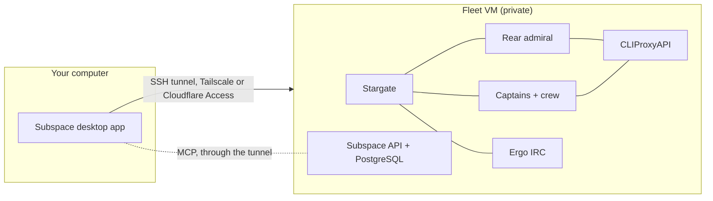

# Install Subspace

This page gets a Subspace fleet running and connects the desktop app to it.
Clone the repository, open your coding agent (Claude Code, Codex or another)
in it, and ask it to set Subspace up. The agent reads this page, asks you a few
questions and runs the installer for you. You can also follow it yourself.

> [!IMPORTANT]
> **Coding agents: read this whole page before running anything.**
>
> 1. **Ask first, all at once.** Ask the user every question in
>    [Decide with the user](#decide-with-the-user) before you run, install or
>    create anything, and explain the trade-offs in your own words. Do not pick
>    names for them.
> 2. **Confirm the plan once.** Summarise the answers, the exact commands you
>    will run and everything they will install or change: software on this
>    computer (Lima, QEMU, Multipass), the VM, any cloud account, the user's
>    agent profiles. Wait for one clear yes. That yes covers only what the
>    plan lists; pass `--install-deps` only if it says so.
> 3. **Then work unattended to the end.** Run the installer non-interactively:
>    pass the answers as flags and add `--yes`. Its prompts cannot reach the
>    user through you. Do not stop to ask again. If something the plan did
>    not cover comes up, take the safe default named in
>    [Decide with the user](#decide-with-the-user), or stop with a clear
>    message that says what is needed and which command to run next.
> 4. **The fleet VM must stay private.** Never open its services to the
>    internet, never bind them to `0.0.0.0`, and never pass `--no-lockdown`
>    unless the user asks for it after you have explained the risk. Agents'
>    keys and model logins live on that VM.
> 5. Never print, paste or log passwords, tokens or private keys. The
>    installer saves them as owner-only files and tells you where.
> 6. Finish by running the [privacy audit](#check-that-the-fleet-is-private)
>    and reporting its result. Then tell the user that **the agents stay
>    offline until CLIProxyAPI is signed in to at least one of their provider
>    accounts**. That sign-in needs the user's browser, so it is the one step
>    you cannot do unattended: walk them through
>    [bringing the agents online](#bring-the-agents-online) if they are there,
>    or leave them the exact commands.
> 7. If the plan included the [local agent skills](#use-your-local-agents-with-the-fleet),
>    install them last, for the agents and the name the user gave.

## What you are installing



- **A fleet is one Linux VM.** It runs a **rear admiral** and one or more
  **captains**. Each is its own Linux user with its own tmux session, files,
  IRC account and GitHub App. Each captain has a **crew** (two Claude-family
  and two Codex-family workers by default) that runs under the captain's
  Linux user, inside the captain's OpenCode server. Each crew member has one
  Git worktree per repository, commits as its captain and is reached only
  through its captain.
- **Stargate is the glue.** It connects the rear admiral and captains to
  their IRC channels (and the rear admiral to Slack or Teams, if you add them
  later), routes messages and wakes the right agent. Its crew plugin lets each
  captain delegate to its crew and collect their results.
- **CLIProxyAPI** holds your agentic provider accounts (for example a Claude
  or ChatGPT subscription) and serves the models to the agents. You sign it in
  after the install; until then the agents are offline.
- **OpenCode** is the agent harness: the program each agent runs in. The
  installer installs it and uses it by default. Stargate can also drive agents
  through the **Claude Agent SDK** or the **OpenAI Codex SDK**, but OpenCode is
  the most tested and the recommended choice. The Stargate dashboard and
  **AgentsView** show what the agents are doing.
- **Ergo IRC** carries conversations between you and the agents: a
  **Starbase** channel for talking to the rear admiral, and a channel per
  captain (ship).
- **The Subspace API** (with PostgreSQL) holds issues, initiatives and fleets.
  The desktop app uses it, and so can your local coding agents through its MCP
  server ([Use your local agents](#use-your-local-agents)). The fleet's own
  agents cannot reach it: its development sign-in is for you only.
- **The desktop app** runs on your computer and reaches all of this through a
  private connection.

Everything on the VM listens on `127.0.0.1` only. The installer adds a
firewall that drops all inbound traffic except SSH, hardens SSH to key-only
logins for your user, and keeps the agents' Linux users away from operator
services and from the cloud's metadata service, so they cannot use the VM's
cloud identity.

## Decide with the user

Ask all of these before running anything, then confirm the plan once.
Defaults are in bold. Each question says what to do if the user cannot
answer it now.

1. **Where should the fleet run?**
   - **A new local VM on this computer.** On macOS it uses Apple's
     Virtualization framework through [Lima](https://lima-vm.io); on Linux,
     Lima with QEMU and KVM; on Windows, [Multipass](https://canonical.com/multipass)
     with Hyper-V (Windows Pro, Enterprise or Education; Windows Home has no
     Hyper-V, so use an existing VM instead). All are free. The VM needs
     about 4 CPUs, 8 GiB of memory and 40 to 60 GiB of disk; use 16 GiB of
     memory for two or more captains. Ask whether you may install the VM
     tool if it is missing (`--install-deps`); without that, the installer
     stops and says what to install.
   - **An existing VM, for example in the cloud.** Ubuntu 24.04 or Debian 12,
     amd64 or arm64, reachable over SSH with a key and passwordless sudo. It
     must not accept inbound traffic from the internet (see
     [Prepare a cloud VM](#prepare-a-cloud-vm)). Collect the SSH target
     (`user@host`), the key to use, the SSH port, any proxy command and the
     host key fingerprint from a trusted channel. Ask whether you may use
     their cloud account to read that fingerprint (for example
     `az vm run-command`); if not, they give it to you. Never run without it.
2. **Do you intend to run more than one fleet?** Ask this directly, and explain
   [the difference](#one-fleet-or-several-shared-irc).
   - **No, one fleet:** everything runs on the fleet VM: IRC, the API and
     one PostgreSQL holding two databases (the API's and IRC's history).
     There is nothing to choose.
   - **Yes, or maybe later:** we recommend running IRC on a separate host
     that all fleets share: another VM (`./install.sh irc-server`), Azure
     Container Apps or another container host. Switching fleet in the desktop
     then loads that fleet's IRC channels, so they can work across fleets
     while seeing only the channels and captains of the fleet they are in.
     IRC's history goes in PostgreSQL by default there too; on its own VM they
     may choose SQLite instead (`--history sqlite`). Collect that host's
     details as in question 1. For an IRC server the installer does not
     manage, they must add the fleet's accounts there themselves and give you
     its host name and CA certificate.
3. **Names.** A name for the fleet (for example "Example Fleet"), a name for
   the rear admiral (for example "Atlas") and one or more captain or ship
   names (for example "Orion, Vega"). Names become IRC channels, IRC accounts
   and Linux users, so keep them short: the fleet ID (the fleet name in lower
   case, or `--slug`) plus a hyphen and an agent's name must fit 32
   characters, as in `example-fleet-orion`.
4. **Which GitHub repositories should the captains have checked out?** List
   them in order, as HTTPS URLs; the first is where each captain starts. Every
   captain gets every repository in the list (`--repositories`, at most
   nine). The answer drives:
   - each captain's own checkout of every repository, and the rear admiral's
     read-only reference copies;
   - **one Git worktree per repository for each crew member**, under its
     captain's Linux user. Crew need at least one repository: with none, the
     captains have no crew;
   - the GitHub access the captains' GitHub Apps need. Captains push, and
     their crew push as them, so each captain's App needs Contents write on
     these repositories, plus Pull requests and Issues write to open pull
     requests and update issues. The rear admiral's App needs Contents read.

   Public repositories work straight away; without Apps, the agents can read
   and commit but not push. **Private** repositories need a GitHub App for
   the rear admiral and every captain before the installer can clone them
   (see [GitHub Apps per fleet member](subspace-installer/README.md#github-apps-per-fleet-member)).
   Ask whether those Apps exist and where their keys are. If not, install
   with the public repositories only, and tell the user how to add the private
   ones once the Apps exist. **Default: no repositories, so no crew yet.**
5. **Crew per captain** (**2 Claude, 2 Codex**; 0 to 10 each,
   `--crew-claude`, `--crew-codex`). Explain that crew run inside their
   captain's OpenCode server as the captain's Linux user: they share the
   captain's files, credentials and GitHub App, commit as the captain, and
   have no IRC accounts. The user talks to the captain, who delegates to its
   crew. A captain's crew roster is fixed once the fleet first starts, so
   settle the counts now.
6. **Their IRC account name** (**admiral**), used as their nickname. The
   agents only take orders from this account.
7. **Demo data?** (**yes**) Fictional fleets, initiatives and issues so they can
   look around the desktop app straight away.
8. **Agent harness** (**OpenCode, recommended**). Stargate also supports the
   Claude Agent SDK and the OpenAI Codex SDK. OpenCode is the most tested,
   and crew need an OpenCode captain. To use the Claude Agent SDK for the
   rear admiral or a captain without crew, set its `harness` to `claude-sdk`
   in `/root/fleet/fleet.json` after the install (see the
   [fleet installer's guide](subspace-installer/README.md#crew-and-repositories)).
   The Codex SDK is configured in Stargate directly; the installer does not
   set it up yet.
9. **Which provider accounts** will power the agents, for example a ChatGPT
   (Codex) or Claude subscription. They sign them in to CLIProxyAPI after the
   install, in their browser; see [Bring the agents online](#bring-the-agents-online).
   Ask whether they will be there at the end to do it. If not, finish the
   install and leave them the sign-in commands.
10. **How they reach the VM.** (**SSH tunnel**). Or Tailscale, or Cloudflare
    Zero Trust (free for up to 50 users), with `--access`; ask for any
    addresses that alone may use SSH (`--ssh-from`). See
    [Private access](docs/private-access.md). Also offer nginx with internal
    host names if they want browser-friendly addresses.
11. **Secrets.** (**On the VM**, as root-only and per-agent files.) On Azure,
    they can also keep the generated secrets in Key Vault (`--key-vault`), so
    a rebuilt VM gets the same ones. That needs the VM's managed identity to
    have access to the vault, which they set up or allow you to set up in
    their cloud account; if neither, keep the secrets on the VM.
12. **Local agent skills.** Should their own coding agents (Claude Code,
    Codex, OpenCode) get Subspace skills in their user profile, so they can
    use the tracker and talk to the fleet? Which agents, and what name should
    those agents use for them? You install them at the end. See
    [Use your local agents with the fleet](#use-your-local-agents-with-the-fleet).
    **Default: no.**
13. **Slack or Teams** (optional). Should stakeholders reach the rear admiral
    in Slack or Microsoft Teams? Slack works with a private VM as is
    ([Slack](docs/slack.md)). Teams needs an Azure VM and one public callback
    path ([Teams](docs/teams.md)). Teams bots cannot talk to each other, so
    captains coordinate in IRC, and the installer connects only the rear
    admiral to Teams. Both need an app the user creates and its tokens, so
    they follow those guides with the user after the fleet runs. **Default:
    neither.**

Then confirm the plan once, as the box at the top of this page describes,
and run without stopping to ask again.

## Install on a local VM

macOS or Linux, from the repository root:

```sh
./install.sh --local --yes --install-deps \
  --name "Example Fleet" --rear-admiral Atlas --captains Orion,Vega \
  --admin admiral --demo
```

Windows, in PowerShell from the repository root:

```powershell
powershell -ExecutionPolicy Bypass -File .\install.ps1 --local --yes --install-deps `
  --name "Example Fleet" --rear-admiral Atlas --captains Orion,Vega `
  --admin admiral --demo
```

Add the user's repositories as `--repositories URL,URL` (HTTPS Git URLs,
optionally `ID=URL`) and their crew counts as `--crew-claude N --crew-codex N`,
on this command and on the existing-VM one below. Leave out `--install-deps`
to stop and ask instead of installing Lima, QEMU or Multipass. Size the VM with `--cpus`, `--memory` and `--disk` (GiB). The first
run downloads an Ubuntu image, the agents' tools and the container images, so
it takes a while. Running it again is safe: it keeps the answers, secrets and
work already on the VM.

## Install on an existing VM

### Prepare a cloud VM

- Use Ubuntu 24.04 LTS or Debian 12 with an SSH key login for a user with
  passwordless sudo.
- **Give it no public inbound access.** Best: no public IP at all, and reach it
  over Tailscale, Cloudflare Zero Trust or your cloud's private network. If it
  must have a public IP for now, allow SSH from your own address only in the
  cloud firewall, then move to Tailscale or Cloudflare and remove that rule.
- On Azure, for example, create the VM without a public IP and with a
  network security group that has no inbound allow rules, and join it to your
  tailnet through a run-command (see [Private access](docs/private-access.md)).
- Get the VM's SSH host key fingerprint from a trusted channel, so the
  installer can check it is talking to the right machine. On Azure:

  ```sh
  az vm run-command invoke -g <resource-group> -n <vm> --command-id RunShellScript \
    --scripts "ssh-keygen -lf /etc/ssh/ssh_host_ed25519_key.pub"
  ```

### Run the installer

```sh
./install.sh --remote azureuser@fleet.example.ts.net --host-key SHA256:... --yes \
  --name "Example Fleet" --rear-admiral Atlas --captains Orion,Vega --admin admiral --demo
```

Add `--identity ~/.ssh/key` for a specific key (load passphrase-protected keys
into `ssh-agent` first), `--ssh-port` for another port (the lockdown keeps
whichever ports sshd listens on), and
`--ssh-from 203.0.113.7/32` to accept SSH from listed addresses only. With
Tailscale up on the VM, add `--access tailscale` to accept SSH on the tailnet
only.

To keep the generated secrets in Azure Key Vault, give the VM a managed
identity that can read and write the vault's secrets (for example the Key
Vault Secrets Officer role on that vault), then add `--key-vault <vault-name>`.
Secrets are named `subspace-<fleet>-…`. The VM still writes root-only copies,
because the fleet's services read them from disk. The lockdown keeps the
agents' Linux users away from Azure's metadata service, so they cannot ask for
that identity's tokens; the audit fails if they could.

## One fleet or several: shared IRC

The user's answer to whether they intend to run more than one fleet decides
where IRC runs and where its history is stored.

| | One fleet | Several fleets |
| --- | --- | --- |
| IRC (Ergo) | On the fleet VM | On a separate host shared by all fleets: another VM, Azure Container Apps or another container host |
| IRC history | PostgreSQL, always (unless you pass `--no-api`, which leaves SQLite): the same instance as the API, in its own `ergo_history` database with its own role | PostgreSQL by default; SQLite is fine on a dedicated IRC VM if the user prefers |
| Subspace API | On the fleet VM, in the same PostgreSQL (`subspace` database) | See below |

- **One fleet.** Simplest. One PostgreSQL holds two databases, `subspace`
  for the API and `ergo_history` for Ergo, with separate roles and generated
  passwords, so there is a single database service to back up. The desktop
  reaches everything through the same tunnel.
- **Several fleets.** One Ergo server for all your fleets. Each fleet keeps
  its own Starbase and ship channels, named after the fleet, and its agents
  have their own accounts. The desktop stays connected to that one network.
  When you change fleet, by picking an initiative of another fleet in
  **Channels**, it loads that fleet's channels, so you work across fleets while
  seeing only the channels and captains of the fleet you are in. Stargate on
  each VM ties the channels to that fleet's agents. Choose this when the user
  plans more than one fleet VM, or already runs IRC elsewhere, for example as
  a container app.

The desktop app talks to one Subspace API, so with several fleets the API
belongs on a shared host too, ideally the same one as IRC. Today the installer
runs the API on the first fleet's VM. Install further fleets with
`--api-target <first fleet's target>`: they skip their own API, and the
installer registers each one, with an initiative listing its channels, on the
first fleet's API. That uses the first fleet's development sign-in, which the
installer checks before changing anything; once that API uses WorkOS or Entra,
register further fleets through its `/api/v1/fleets` and initiative endpoints
as an administrator instead. Further fleets need the shared IRC server
(`--irc-server`), because IRC on their own VM is unreachable from the first
fleet's API. The desktop needs the first fleet's tunnel, which carries the API.
Every fleet's tunnel uses the same local ports for its dashboard, AgentsView
and Fleet API, so to look at another fleet's dashboard, stop the first fleet's
tunnel and start that fleet's for a while.

The shared server and every fleet must reach each other over a private
network such as a tailnet or a cloud virtual network, and the desktop must be
on it too. The server needs a DNS name that matches its TLS certificate: a
Tailscale MagicDNS name works well. Set the server up once, then point each
fleet at it:

```sh
./install.sh irc-server --remote ops@irc.example.ts.net --host-key SHA256:... --yes \
  --server-name irc.example.ts.net --admin admiral
./install.sh --remote ops@fleet-one.example.ts.net --host-key SHA256:... --yes \
  --irc-server subspace-irc --name "Fleet One" --rear-admiral Atlas --captains Orion
./install.sh --remote ops@fleet-two.example.ts.net --host-key SHA256:... --yes --target fleet-two \
  --irc-server subspace-irc --api-target subspace-fleet --name "Fleet Two" --rear-admiral Nova --captains Lyra
```

`--bind` picks the private address for the TLS listener (default: the
Tailscale address, else the first private address). `--history` picks where
Ergo keeps history: `postgresql` (the default) runs a PostgreSQL container
beside Ergo on that host; `sqlite` keeps it in Ergo's data volume. Without `--tls-cert` and
`--tls-key`, Ergo makes a self-signed certificate, and the installer copies it
to each fleet and to the desktop's IRC settings. With Tailscale, `tailscale
cert` gives a trusted certificate for the MagicDNS name instead. Adding a
fleet restarts Ergo for a moment; agents reconnect on their own.

An existing Subspace IRC server works too, including one you run as a
container app: pass `--irc remote --irc-host <name>` (and `--irc-ca <path on
the VM>` for a private CA) instead of `--irc-server`. Then run
`sudo subspace-setup irc-bundle` on the fleet VM and add the SASL accounts and
channels it lists to that server, for example through its `IRC_ACCOUNTS_FILE`
and `IRC_CHANNELS_FILE` ([Subspace IRC](subspace-irc/README.md#accounts-and-channel-access)).
The bundle holds the agents' IRC passwords: move it privately and delete
copies afterwards. The installer cannot fetch your own IRC password from a
server it does not manage, so add that network to the desktop yourself
(Settings > Channels > Add network) with the account and password from that
server's operator.

## What the installer does

1. Creates the VM, or checks the remote VM's host key and sudo access.
2. Copies `subspace-installer/`, `subspace-api/` and `subspace-irc/` to
   `/opt/subspace/bootstrap` on the VM.
3. Runs `subspace-setup` there, which:
   - writes the fleet's settings to `/root/fleet/` and generates every
     password and key on the VM;
   - before any service starts, keeps the agents' Linux users away from the
     API, PostgreSQL and the cloud metadata service (agent isolation, which
     never blocks your own login and is never rolled back);
   - runs the [fleet installer](subspace-installer/README.md): the latest
     Stargate (its newest `vX.Y.Z` release, looked up on every run and pinned
     in `fleet.json`; pass `--stargate-ref <SHA>` to stay on one commit),
     CLIProxyAPI, OpenCode, AgentsView, the dashboard, a Linux user and tmux
     session for the rear admiral and each captain, the crew's worktrees and
     each captain's pinned session, and Ergo IRC;
   - starts PostgreSQL and the Subspace API on loopback, creates IRC's
     history database (`ergo_history`) beside the API's, signs you in first
     (the first user in an organisation becomes its administrator), seeds the
     demo data if asked, creates an initiative for the fleet with its channels
     and registers the fleet;
   - turns on Stargate's Fleet API when the installed Stargate has it;
   - applies the lockdown and runs the privacy audit.
4. Confirms the lockdown over a fresh SSH connection, then runs the audit
   again. If that connection fails, the change rolls itself back after three
   minutes to the last confirmed lockdown, and the installer stops with an
   error. It also stops if the audit fails. It only reports success when the
   lockdown is confirmed and the audit passes. A re-run that changes nothing
   leaves the confirmed lockdown as it is.
5. Saves your IRC password and the Stargate Fleet API token as owner-only
   files under `~/.subspace/targets/<target>/`, and adds the fleet's IRC
   connection to the desktop app's settings.

## Bring the agents online

The agents get their models from [CLIProxyAPI](https://github.com/router-for-me/CLIProxyAPI)
on the VM. **Until it is signed in to at least one of your agentic provider
accounts, the agents are offline**: they join IRC but cannot think. Sign in
each account the fleet should use, from the repository on your computer:

```sh
./install.sh providers                        # which accounts are signed in
./install.sh providers login codex-device     # ChatGPT / Codex, with a device code
./install.sh providers login claude           # Claude
```

On Windows, use `.\install.ps1 providers ...` the same way. Each login prints
a link: open it in your browser and sign in with the account the agents should
use. `codex-device` shows a code to enter and needs nothing else. `claude` and
`codex` call back to your computer on port 54545 or 1455; the installer
forwards that port to the VM for the login. The proxy restarts afterwards and
the agents come online. CLIProxyAPI also supports `antigravity`, `kimi`,
`kimi-ai`, `xai`, `devin` and `meta` accounts.

The default models are `gpt-5.4` for Codex-family agents and
`claude-sonnet-5-5` for Claude-family crew. Use model IDs your accounts can
reach: change them under `harness` and `crew` (`crew.claude.model`,
`crew.codex.model`) in `/root/fleet/fleet.json` and run `sudo subspace-setup`.
The [fleet installer's guide](subspace-installer/README.md#model-provider-sign-in)
covers models and harnesses. On the VM, `sudo subspace-setup providers`
does the same as `./install.sh providers`.

## Connect the desktop app

1. **Start the tunnel.** It forwards the fleet's ports to `127.0.0.1` on your
   computer: the API (3000), IRC (6667 and 6697), the dashboard (8070),
   AgentsView (8080) and the Stargate Fleet API (8484) when it is on.

   ```sh
   ./install.sh tunnel --background
   ```

   Stop the local stack first if it is running (`make stack-down`), because it
   uses the same ports.
2. **Run the desktop app.** From the repository root, `make run` (see the
   [README](README.md#run-the-whole-system-locally) for the toolchain). Its
   default build signs in to `http://127.0.0.1:3000` as `developer@example.com`
   in organisation `local`, which is the administrator the installer created.
   If you chose another `--admin-email` or `--organisation`, set
   `SUBSPACE_DEV_EMAIL` and `SUBSPACE_DEV_ORGANISATION` for the app (on macOS,
   in a build configuration; see the [desktop README](subspace-desktop/README.md)).
   Release downloads may be built for another sign-in provider, so build from
   source for this setup.
3. **Channels.** The installer already added the fleet's IRC network, signed in
   as your account with the password file it saved. Pick the fleet's
   initiative in **Channels** to join its Starbase and ship channels. Say hello
   to the rear admiral in Starbase. If the desktop's settings file could not
   be updated automatically, the installer printed the network to add under
   **Settings > Channels > Add network**; `./install.sh desktop` writes it
   again.
4. **Fleet Console: connect Subspace to Stargate's API.** The installer
   installs the latest Stargate release (v0.40.1 or later), turns on its
   private Fleet API on the VM's loopback port 8484, and saves its token in
   `~/.subspace/targets/<target>/stargate-api.token`. The tunnel forwards the
   port, so the **Stargate API address** is `http://127.0.0.1:8484`.
   - Fleet Console is built into Subspace on macOS and Windows, with its
     permissions allowed, so there is nothing to install. On macOS the
     installer fills in its Stargate API address and token, even before the
     app first starts. If Subspace was running, quit it and run
     `./install.sh desktop` again. On Windows, start Subspace once, quit it
     and run `.\install.ps1 desktop`. Or enter both yourself in
     **Settings > Spaces > Fleet Console**, pasting the token from the file
     above. For a copy you installed under another Board ID, add
     `--fleet-console <id>`.
   - Through Tailscale or Cloudflare instead of the tunnel, use that HTTPS
     address. The token is still required, and stays on your computer.

Open the dashboard at <http://127.0.0.1:8070> and AgentsView at
<http://127.0.0.1:8080> while the tunnel runs. They show prompts and code, so
keep them private.

## Use your local agents with the fleet

Your own coding agents can work with the fleet too: read and update issues,
log decisions, write documents, and talk to the rear admiral and captains on
IRC. The [Subspace skills](agent-skills/README.md) add this to Claude Code,
Codex and OpenCode, each in its own form, and register the Subspace API's MCP
server with them:

```sh
./install.sh skills --agents claude,codex,opencode --name "Your Name"
```

On Windows, use `.\install.ps1 skills ...`. This changes your agents' user
profiles, so agents run it only when the user agreed to it in the plan. Local agents sign in with
**your** login. They must always say they are an agent acting for you, with
their model and version, for example
`[on behalf of George (Claude Opus 5.5)]` on IRC, or
`**On behalf of George (Claude Opus 5.5):**` at the start of a tracker
comment. The skills require this, and the IRC helper adds it to every line.
The fleet's agents take orders from your account, so local agents send only
what you asked for.

## Check that the fleet is private

```sh
./install.sh audit
```

The audit fails if any service listens beyond loopback (apart from SSH and a
VPN agent), if the lockdown firewall is not loaded, if SSH accepts passwords or
root logins, if a container publishes a port publicly, or if secrets are
readable by anyone but root. It warns when the VM has a public address: then
check from outside that nothing answers, for example `nc -vz <public-ip> 22`
should time out unless you chose public SSH.

Development sign-in, which the desktop uses by default, trusts anyone who can
reach the API. The lockdown keeps the agents' users away from it, and the
tunnel keeps everyone else away. For a team, switch the API and desktop to
WorkOS or Entra (see the [API guide](subspace-api/README.md#external-sign-in))
before sharing access.

## Day to day

| Task | Command |
| --- | --- |
| See or add provider accounts (agents need one) | `./install.sh providers`, `./install.sh providers login codex-device` |
| Open a shell on the VM | `./install.sh ssh` |
| Watch a captain work | `./install.sh ssh`, then `sudo subspace-fleetctl attach orion` |
| Follow Stargate's logs | `sudo journalctl --namespace=subspace-fleet -u subspace-fleet-gateway.service -f` |
| Show the fleet and services | `./install.sh status` |
| Change a setting | Run the install command again with the new flags |
| Connect the rear admiral to Slack or Teams | [Slack](docs/slack.md), [Teams](docs/teams.md) |
| Change the repositories | Run the install command again with `--repositories`; it replaces the list. Once a captain's session is pinned, the installer refuses an empty list or a different first repository, whether reordered or replaced |
| Add private repositories or GitHub Apps | Edit `/root/fleet/fleet.json` on the VM, put credential files under `/root/fleet/fleet.secrets/`, then `sudo subspace-setup` |
| Print your IRC password | `sudo subspace-setup secret irc-admin` on the VM |
| Seed the demo data again | `sudo subspace-setup demo` on the VM |
| Stop or start a local VM | `./install.sh stop`, `./install.sh start` |
| Delete a local VM | `./install.sh destroy` |

`--target NAME` picks which VM a command acts on when you have several
(default `subspace-fleet`). See the [fleet installer's guide](subspace-installer/README.md)
for repositories, GitHub Apps for the rear admiral and captains, crew,
permissions, Slack and Teams.

## Secrets

| Secret | Where it lives |
| --- | --- |
| IRC passwords, model proxy key, PostgreSQL password | Generated on the VM in `/root/fleet/` (root-only), optionally also in Key Vault |
| Installed copies the services read | `/etc/subspace-fleet/` (root-only), and each agent's files in its own home with mode 0600 |
| Model provider logins | `/var/lib/subspace-fleet/proxy/auth` on the VM, owned by the proxy user |
| Your IRC password and Stargate API token | `~/.subspace/targets/<target>/` on your computer, owner-only |
| Local VM SSH keys | Lima: `~/.lima/_config/`; Multipass on Windows: `~\.subspace\targets\<target>\` |

## If you get locked out

A lockdown change only becomes permanent after a new SSH connection
succeeds. If that fails, the change undoes itself after three minutes and the
last confirmed lockdown (or none, on a first install) applies again; wait and
try again. A restart also undoes an unconfirmed change. From a console:

```sh
sudo subspace-setup lockdown rollback
```

This undoes a pending change. With nothing pending, it removes the inbound
firewall and SSH hardening entirely, for example when a confirmed `--ssh-from`
no longer matches your address; run the installer again afterwards to restore
them. Agent isolation stays, because it never blocks your login.

- Local Lima VM: `limactl shell <target>` uses SSH too; if that fails, wait
  for the rollback, or stop and start the VM (`./install.sh stop`, then
  `start`), which undoes an unconfirmed change.
- Multipass: `multipass shell <target>`.
- Cloud VM: use the serial console or a run-command, for example on Azure
  `az vm run-command invoke … --scripts "subspace-setup lockdown rollback"`.

## Troubleshooting

- **The tunnel says a port is in use.** Something local already listens there,
  often the local stack: `make stack-down`.
- **The desktop shows no initiatives.** Check that the tunnel runs and that
  `curl http://127.0.0.1:3000/health` answers. Re-run the installer if the API
  was not up.
- **Channels names a server to add.** The desktop's IRC network must match the
  fleet's host, port and TLS setting exactly: `127.0.0.1`, `6667`, TLS off for
  IRC on the fleet VM. Run `./install.sh desktop`.
- **Agents do not answer.** Check `./install.sh providers`: with no signed-in
  account the agents are offline. Then watch the gateway's logs and check the
  model IDs in `/root/fleet/fleet.json`. Agents only take orders from your IRC account.
- **Lima or Multipass cannot start the VM.** On Linux, check that `/dev/kvm`
  exists and that you are in the `kvm` group. On Windows, enable Hyper-V;
  the installer cannot reach Multipass VMs on VirtualBox.
- **Read the full setup output again:** run the install command again; it is
  safe to repeat.

## Uninstall

On the VM, `sudo /opt/subspace/bootstrap/subspace-installer/install.sh uninstall`
stops the fleet and keeps its data. `sudo docker compose --project-name subspace-api down`
stops the API. For a local VM, `./install.sh destroy`
deletes everything. Revoke any GitHub App keys and model logins you gave the
fleet.
