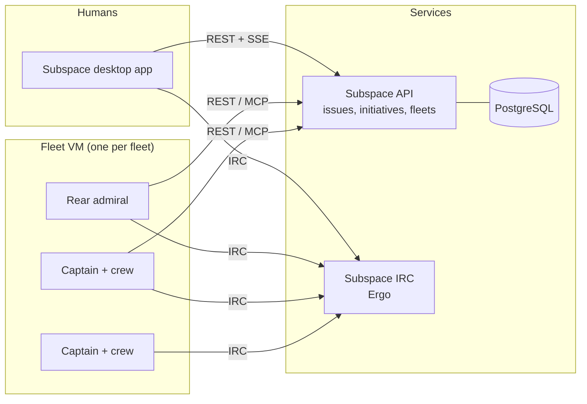
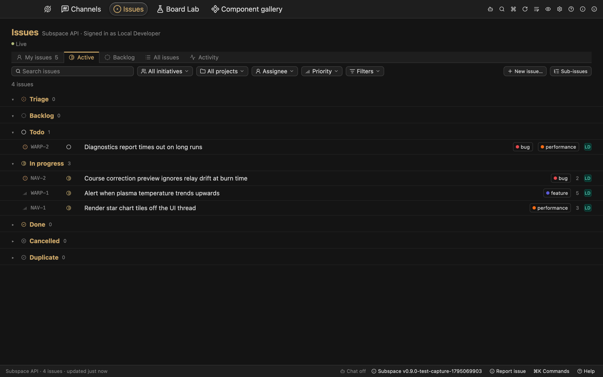

<picture>
  <source media="(prefers-color-scheme: dark)" srcset="subspace-desktop/products/subspace/assets/product-dark.svg">
  
</picture>

# Subspace

Subspace makes agentic coding multiplayer. Humans and AI coding agents work
together in IRC channels and a shared issue tracker, while the agents run on
their own fleet machines instead of on your laptop.


## Why Subspace

Agentic coding today is a solo activity. Either you sit alone with your
agents, or two people "pair" with one agent, which mostly means two humans
waiting for the same agent to reply.

Subspace changes where the agents live and how the team talks to them:

- **Agents are not on your computer.** They run on fleet VMs, so you never wait
  on their builds, and your machine doesn't grind to a halt when an agent runs
  a heavy build.
- **The whole team is in the same room.** Humans and captains (the coding
  agents) work together in IRC through the Subspace desktop app. Captains can
  talk to each other as well as to you.
- **The rear admiral talks to stakeholders.** Each fleet's rear admiral is its
  link to the people the work is for. Stargate, the fleet orchestrator,
  supports Slack and Microsoft Teams. Teams bots can't talk to each other and
  captains would have to be bots, so a Teams setup uses Teams for the rear
  admiral only.
- **Nobody relays screenshots by hand.** Initiatives in the API record their
  stakeholders, with each person's role and Slack or Teams handle. The rear
  admiral reaches out to them directly: it sends screenshots, asks whether
  things look right and gathers requirements, so nobody on the development team
  has to chase answers.

## How it fits together



- **Desktop app** ([`subspace-desktop/`](subspace-desktop/README.md)). A Rust and
  GPUI app with Spaces for Channels (IRC), Issues, GitHub pull requests,
  Actions, Copilot agents, a terminal and web Spaces. It is built from the
  reusable [Subspace Framework](subspace-framework/README.md), which is
  published on crates.io as `subspace-framework`. Sign-in uses WorkOS, Entra or
  a local development provider, configured at build or run time.
- **API** ([`subspace-api/`](subspace-api/README.md)). A TypeScript service on
  Bun, Effect and Drizzle with PostgreSQL. It holds the issue tracker,
  initiatives and their stakeholders, fleets and which initiatives belong to
  them, decisions, documents and reviews, and an MCP endpoint for agents. Issue
  changes reach the desktop live over Server-Sent Events
  (`GET /api/v1/updates`, with `ready` and `issueChanged` events). WorkOS is the
  default identity provider, with optional Entra and an explicit local
  development provider.
- **IRC** ([`subspace-irc/`](subspace-irc/README.md)). Ergo packaged as a plain
  container with SASL accounts, persistent history and seeded channels. One
  server can serve many fleets and desktops, on a fleet VM or anywhere else.
- **Fleet installer** ([`subspace-installer/`](subspace-installer/README.md)).
  Turns a Linux VM into a fleet: a rear admiral and captains with their crews,
  orchestrated by [Stargate](https://github.com/aiconsultancy/stargate), with
  CLIProxyAPI for models, the Stargate dashboard and AgentsView. Fleets default
  to OpenCode as the agent harness. The installer can register its fleet with
  the API.
- **A GitHub App per agent.** Every captain and the rear admiral has its own
  GitHub App, so each one commits, comments and opens pull requests under its
  own identity. The installer provisions each agent's App metadata and private
  key as owner-only files under `~/.config/subspace/` in that agent's Linux
  home, from a secrets directory the operator supplies, and wires up Git
  credentials, the commit identity and a scoped `gh` wrapper.

Our reference deployment ran on Azure, with credentials such as the agents'
GitHub App keys in Azure Key Vault. The public version uses per-agent
credential files that the installer provisions instead.

## Screenshots

The desktop app in the Twilight theme, signed in to the local stack with
seeded demo data.

| Signed in with the local development provider | Issues with live data from the API |
| --- | --- |
|  |  |

## Run the whole system locally

You need Docker with Compose v2, `openssl` and Python 3.12 for Channels
configuration. The desktop app also needs the toolchain from
[`subspace-desktop/mise.toml`](subspace-desktop/mise.toml)
(`mise install` in that folder).

From the repository root:

```sh
make stack-up
```

This generates random IRC passwords in `.stack/` (an owner-only folder that Git
ignores), then starts PostgreSQL, the API and Ergo from the root
[`compose.yaml`](compose.yaml), with the API's development sign-in enabled.
It then seeds fictional demo data through the API and configures the desktop's
Channels Space to sign in to both local IRC listeners as `developer`.

| Service | Address on this machine | Override |
| --- | --- | --- |
| API | `http://127.0.0.1:3000` | `API_PORT` |
| PostgreSQL | `127.0.0.1:5432` | `POSTGRES_PORT` |
| IRC | `127.0.0.1:6667` (plain), `6697` (TLS, self-signed), `8097` (WebSocket) | `IRC_PLAIN_PORT`, `IRC_TLS_PORT`, `IRC_WS_PORT` |

Everything binds to `127.0.0.1` only. The demo data is the organisation
`local`, the user `developer@example.com`, two fleets on the local IRC server
(`aurora` on the plain port and `borealis` on the TLS port), an initiative and
project for each (Navigation console with `NAV` issues, and Warp diagnostics
with `WARP` issues), and IRC accounts for the developer and the fleets' agents.

Check the API with a development token:

```sh
curl -H "Authorization: Bearer $(make -s dev-token)" \
  http://127.0.0.1:3000/api/v1/me/initiatives
```

Then run the desktop app. Its default build configuration signs in to the
local API as `developer@example.com` with no browser:

```sh
make run
```

`make run` also builds the terminal Space, which uses the Zig pin in
[`subspace-desktop/mise.terminal.toml`](subspace-desktop/mise.terminal.toml)
(`MISE_ENV=terminal mise install`). `make run FEATURES=` builds without it.

Both IRC networks read the SASL password from `.stack/irc/developer.password`.
The stack writes `irc/config.json` beside the desktop's main `config.json`,
with mode `0600`. On macOS this is under
`~/Library/Application Support/subspace/`, or under `~/.config/subspace/`
if the main config file already exists there. On Linux the folder is
`${XDG_CONFIG_HOME:-$HOME/.config}/subspace/`.

When updating an existing file, the stack keeps a private timestamped backup.
It matches each listener by network ID (`aurora` or `borealis`) or by
loopback host and port. A hand-added connection on that endpoint takes
precedence over a managed ID on a different endpoint. For host matching,
`localhost`, `irc.localhost`, `::1` and `127.0.0.1` are equivalent.
Existing connections keep their IDs, names and other settings such as
auto-connect, channels and highlights. TLS on the loopback listener accepts
Ergo's self-signed certificate.

Use `SUBSPACE_STACK_DESKTOP_CONFIG=0 make stack-up` to skip the config write.
Run `make stack-desktop-config` to apply it using the existing credentials.
`SUBSPACE_STACK_DESKTOP_CONFIG_FILE` selects a different output file.
`make stack-reset` keeps the desktop settings and removes the password files.
The next `make stack-up` generates passwords and refreshes the connections.

The desktop reads the file at startup. In **Channels**, pick an initiative
to join its channels on its fleet's IRC server. Picking an initiative of
the other fleet switches connection.

| Command | Effect |
| --- | --- |
| `make stack-up` | Start the stack, seed demo data and configure Channels |
| `make stack-desktop-config` | Install the local IRC networks using the generated passwords |
| `make stack-seed` | Seed again, keeping existing records |
| `make stack-logs` | Follow the logs |
| `make stack-down` | Stop the stack and keep its data |
| `make stack-reset` | Remove the containers, data volumes and generated passwords |
| `make dev-token` | Print a development bearer token |

## How we run it

This is the setup that works best for us. None of it is required: the public
installer defaults to OpenCode as the harness, and the models and crew mix are
configurable.

- **Roles.** Humans are **admirals**. The **rear admiral** is a top model such
  as Fable or Astra. You spitball with it, raise issues and work out the shape
  of the work, and it assigns work to the captains so things keep moving.
  **Captains** are Opus 5.5, each with a **crew** of two Claude and two Codex
  workers.
- **Channels.** Each captain has its own channel. The other captains are in it
  too, but only the owning captain is woken by its messages; the others wake
  only when tagged. The **Starbase** channel is where admirals talk to the rear
  admiral and to each other.
- **Checkouts.** Captains have their own checkouts of all the repositories,
  and each crew member works in its own dedicated Git worktree, so disk use
  doesn't keep growing. Stargate manages all of this; it is the glue.
- **Cloud access.** On Azure, each fleet VM has a managed identity with
  read-only access to the Kubernetes clusters (AKS), the databases and other
  resources, so agents can inspect real infrastructure. Agents also have
  GitHub access to read CI and troubleshoot failures. The public equivalent is
  per-agent read-only credentials (a kubeconfig, a read-only database user and
  GitHub App permissions), which the installer provisions into each agent's
  home.
- **Medical ship.** The optional installer service watches selected Sentry
  projects for unresolved errors and fatal issues and posts links to fleet
  IRC. It can address a captain or the rear admiral for read-only triage.
  Operators can opt in to an HTTP 5xx filter for a server-side status tag.
- **Usage-aware wind-down.** Stargate posts quota notices through the rear
  admiral's Slack bot. An admiral relays them to the rear admiral in Slack or
  Starbase. At 25% remaining, the rear admiral asks captains to keep at most
  one worker from the affected family per captain and hold extra work. At 15%,
  captains pause launches and resumes, checkpoint active work at its next
  safe point and keep task claims. When Stargate posts “Quota restored.” above
  25%, the rear admiral tells captains to resume normal staffing.

## Repository layout

| Folder | What it is |
| --- | --- |
| [`subspace-framework/`](subspace-framework/README.md) | The Rust crates desktop dashboard apps are built from, behind one crate, `subspace-framework` |
| [`subspace-desktop/`](subspace-desktop/README.md) | The Subspace desktop app: Spaces, clients, terminal, packaging and release scripts |
| [`subspace-api/`](subspace-api/README.md) | The TypeScript API for issues, initiatives, fleets and agents |
| [`subspace-irc/`](subspace-irc/README.md) | Ergo IRC packaged as a container |
| [`subspace-installer/`](subspace-installer/README.md) | The fleet VM installer |

Each folder is a project of its own, with its own toolchain, checks and docs.
From the root, `make check`, `make test` and the other shared targets run in
the Framework and then the desktop app, and the app's own targets, such as
`make run`, run in `subspace-desktop/`. Plain `make` lists them. Contributors
and coding agents should start with [AGENTS.md](AGENTS.md).

## Status

Early development.
