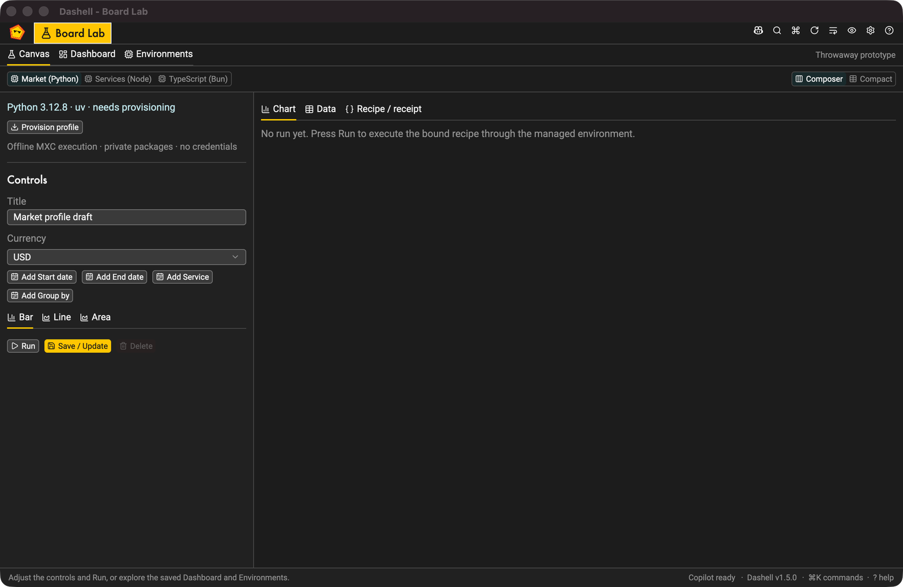

# Subspace Board Lab

## Experimental integration

Board Lab is now a default-off experimental board in full Subspace on macOS
ARM64. See the [enablement and safety guide](../../board-lab.md).
Its canonical implementation is `spaces/board-lab/` and the
adapter is `spaces/board-lab/crates/mxc-worker/`. The standalone
developer harnesses are retired. Git history retains their source and locks.
The broader managed-runtime Framework intent remains draft.

The integrated full-product checks passed: `make check`, `make interfaces`,
the unchanged quality baseline and a zero-warning DocFX build. In an isolated
native full-Subspace instance, opening Board Lab, adding Currency and attempting
an unprovisioned Run created no board storage or downloads. The Run reported
that the environment must be provisioned first.

This is a macOS ARM64 workbench. Worker execution uses MXC Seatbelt. There is no unsandboxed fallback. Linux and Windows containment are not implemented.

## Run the integrated board

Use the [enablement and safety guide](../../board-lab.md) for current setup.
The retired bundle build and seed commands no longer apply. The screenshots
below show the original seeded experiment, not a cold checkout.

## Original experiment views

- **Canvas** is a two-column composer. Choose a profile, add typed controls, change values, then Run. Chart, Data, and Recipe / receipt show the same result. Compare Bar, Line, and Area without rerunning the worker.
- **Dashboard** has saved chart cards. Compare Grid, Wide, and Rows. Earlier and Later change the persisted card order. Open returns a card to the composer.
- **Environments** shows runtime pins, package managers, readiness, and tools. It can provision projects, change versions, add packages, and add pinned CLIs.
- **Compact** compares a single-column composer with the default two-column view.
- The original **Runtime Lab** provided the containment examples in the retired harness.

The saved examples are Python market analysis, Node service releases, Bun TypeScript, an imported static canvas, custom capacity analysis, and a configuration-created HTTPX/Polars board. Chart examples use labelled synthetic data and fixed fixture exchange rates. They are not real service data.

## Decisions explored

| Question | Prototype choice | Tradeoff |
| --- | --- | --- |
| Can an ordinary project own a board's dependencies? | Real `pyproject.toml`/`uv.lock` and `package.json`/manager locks | Familiar package tooling, but installation remains a trusted host step |
| Can boards choose different runtime versions? | Private mise installs and per-project exact pins | Reuses downloads while keeping dependencies separate |
| Can updates preserve a working board? | Stage a new revision, then atomically replace the active symlink | Old jobs keep their physical paths, but revisions accumulate |
| Can a visualization survive its chat? | Save recipe reference, parameters, controls, view and last snapshot | Refreshable recipes and frozen imports have different behavior |
| Can generated code be saved without silently changing old presets? | Immutable SHA-256 custom recipe references | A new source version creates a new reference |
| Can Copilot use the same operations as the UI? | Four actual AgentTools, also exposed through stdio MCP | Handler/protocol checks do not prove live model behavior |
| Can networked clients work without unrestricted egress? | Default deny, optional host destination proxy, MXC proxy-only execution | CONNECT controls destinations, not API paths or operations |

The prototype prefers the two-column composer plus a separate dashboard. Keep environment setup on its own page. Grid is useful for comparing several small results. Wide gives charts and long titles more room. Preserve recipes separately from exported canvases. A chart snapshot cannot reconstruct a query.

Compact is a rejected direction at the default window size. Its vertical controls push the chart below the visible area. Rows works, but it uses much more vertical space than Grid or Wide for these small grouped datasets.

## Native screenshots

These captures are from the original `0.0.2` experiment against Framework commit `4a76721`. They are not a fresh run on current `main`.

- [Composer after a real Python run](workbench-v002-canvas.png)
- [Grid dashboard](workbench-v002-dashboard-grid.png)
- [Wide dashboard](workbench-v002-dashboard-wide.png)
- [Rows dashboard](workbench-v002-dashboard-rows.png)
- [Environment catalog](workbench-v002-environments.png)
- [Compact layout, with the chart pushed below the controls](workbench-v002-compact.png)

## Evidence from the original experiment

Eleven CLI probes completed with exit 0 on that `0.0.2` build against Framework commit `4a76721`: `--runtime-matrix`, `--workbench-smoke`, `--config-smoke`, `--custom-smoke`, `--bun-package-smoke`, `--lifecycle-smoke`, `--tool-smoke`, `--mcp-smoke`, `--network-smoke`, `--network-public`, and `--probe`.

## Publication verification

The published copy builds with `cargo build --locked` against Framework commit `3448800` on macOS ARM64. All eleven CLI probes listed above also passed for this copy using the existing disposable runtime state. The publication changes adapt the tool schema/approval API and explicitly enable the two prototype boards by default.

The lifecycle probe exposed configuration discovery outside the private project when its state path contained `../..`.
The mise invocation now canonicalizes its directories before setting the discovery ceiling.
That exact lifecycle case and cold private jq provisioning then passed.
Production `make check` was not run; the standalone prototype is outside that workspace.
Repository hooks, including secret detection, check the staged publication files.

The runtime combinations below were observed in both verification runs. The screenshots remain the earlier UI evidence, not captures of the updated Framework shell.

### Observed runtime combinations

| Environment | Executed combination |
| --- | --- |
| `python-data` | Python 3.12.8, Polars 1.17.1, pandas 2.2.3 |
| `python-alt` | Python 3.11.11, packaging 24.2 |
| `node-services` | Node 22.23.4, pnpm 11.13.0, semver 7.7.4, is-number 7.0.0 |
| `bun-notebook` | Bun 1.4.2, native TypeScript, semver, `bun.lock` |
| `cli-lab` | jq 1.8.2 |
| `api-explorer` | Python 3.12.8, HTTPX 0.28.1, Polars, without pandas |
| Extra CLI | ripgrep 14.1.1 invoked by Python and a Bash pipeline |

Other observed checks on that experiment:

- Currency, date range, service, and grouping change worker results. Invalid calendar dates fail before execution.
- Saved parameters, controls, and dashboard order survive reopening the store. Save increments revisions. A stale snapshot does not become a fresh result.
- Exported charts pass the existing native canvas preparation path. Static imports retain a snapshot but cannot refresh without a recipe.
- A configuration-created environment and custom recipe need no new Rust board adapter. It uses HTTPX MockTransport explicitly, not an invented live API.
- A Python version change retains the old executable. An incompatible change fails while the previous working environment remains usable.
- Real package installation and an extra mise CLI work in private projects.
- The registered AgentTool handlers run without a model request. A separate child process answers MCP initialize, tools/list, and tools/call.
- The local proxy allows its fixture destination, denies another destination, supports CONNECT, and does not allow direct worker connections to the origin.
- Python urllib and HTTPX 0.28.1 made credential-free public GitHub HTTPS requests through the proxy with normal TLS verification. This does not prove compatibility with a custom retry transport or service authentication.
- A cold developer bundle provisioned jq with an empty environment and system PATH only. It used bundled mise, not a host mise discovered on PATH.

Those probes are not a security certification or a release gate.

## Source

Canonical source is under `spaces/board-lab/`. The MXC adapter is
under `spaces/board-lab/crates/mxc-worker/`. The standalone
developer harnesses and compatibility entry points are retired.

- `src/environments.rs` owns configuration, provisioning, revision activation, and worker execution. `src/environments/extensions.rs` adds pinned CLIs.
- `src/studio.rs` owns recipes, controls, presets, canvas conversion, and layout.
- `src/custom_recipes.rs` stores and verifies immutable recipe source records.
- `src/workbench.rs` composes the native board from existing Framework widgets.
- `src/lab_tools.rs` exposes the same services to Copilot and MCP.
- `src/net_probe.rs` owns the prototype destination proxy and network fixtures.

Generated projects, retained revisions, and preset files stay local. Do not commit them.

## Limits and unverified work

- No real service SDK, private feed, private API, credential store, or credential broker was configured. No service credentials were supplied to workers.
- Installation is not MXC-contained. Private directories and cleared environment variables do not make dependency installation safe for hostile packages.
- Historical Python pins required disabling mise Python attestation verification. That is a prototype workaround, not production policy.
- MXC execution has no unsandboxed fallback. This experiment does not establish complete hostile-code isolation, resource accounting, or cross-platform safety.
- General Copilot built-in tools retain their existing SDK policy. Only the new board tools use this execution service. No live Copilot inference request was used as proof.
- Controls bind five fixed parameters: `start`, `end`, `currency`, `service`, `group_by`. Dates are ISO text fields, not calendar pickers.
- Native checks on the original experiment proved Currency dropdown, Run, Save, Grid/Wide, and card order. Background keyboard replacement of GPUI text fields could not be established. CLI parameter checks are not proof of that text-input route.
- A generic foreign MCP-worker lifecycle, credential injection, and production installer policy remain open design work.
- The upstream dependency `block v0.1.6` emits a Rust future-incompatibility warning. No production `make check`, release, or merge-readiness claim is made.
