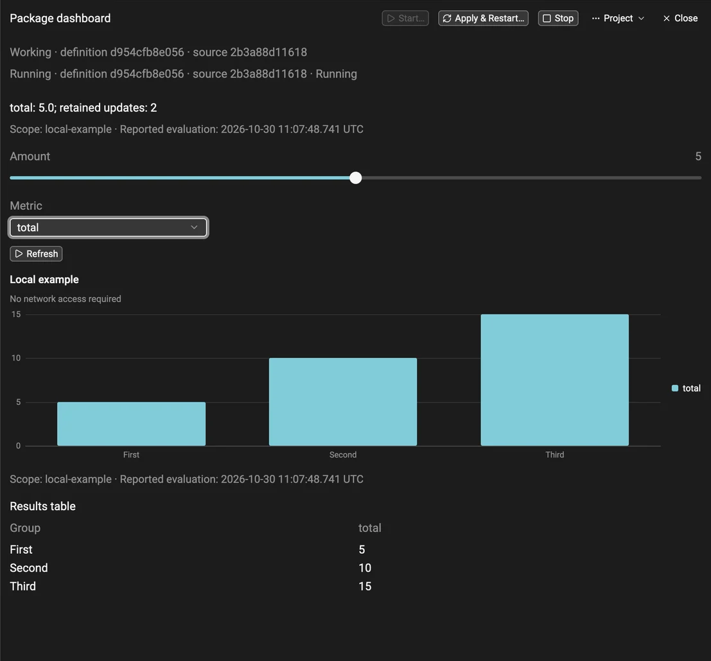
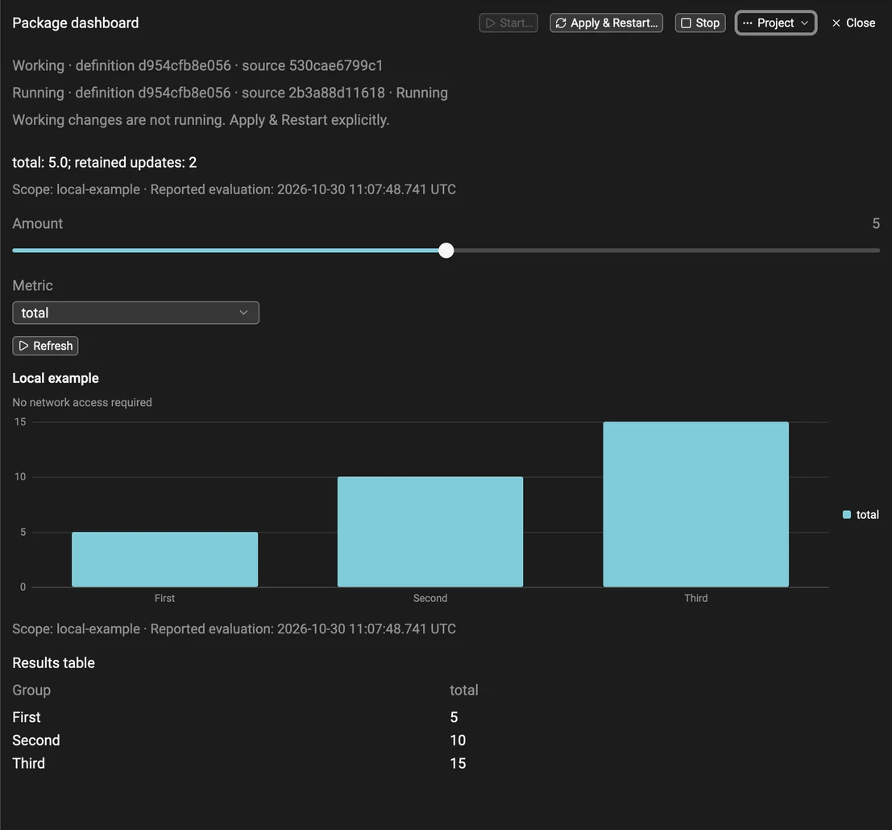
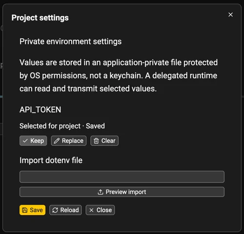

# Board Lab (alpha)

Board Lab is an opt-in alpha managed-runtime workbench in the Subspace app on
macOS ARM64. It is not ready to ship: release builds of every channel
(stable, nightly, alpha and beta) do not include it. The app includes it only
when built with its `board-lab` Cargo feature, or `unreleased-spaces`, which
`make run-unreleased` uses. In such a build it is off by default in debug and
release profiles alike, and a saved `boards."board-lab"` choice in
`config.json` always wins. Linux and Windows do not include it, even with the
feature.

## Bundled guide

The illustrated [Board Lab guide](../spaces/board-lab/help.md) is bundled in the
app's **Board help** view, available through **Commands > Board help**. It includes
a first-project walkthrough, Python/Node/Bun
callback examples, private settings, source reload and sharing. Copilot reads
the same guide with `board_help` and can request a bundled screenshot by ID.



## Enable it

In a build that includes Board Lab, open **Settings > General > Boards**,
enable **Board Lab** and save, or choose it from **Add a Space**. The tab
appears without a restart. Disabling Board Lab hides its tab; open project
workers keep running until you quit Subspace. The same setting can be written in Subspace's configuration file:

```json
{
  "boards": {
    "board-lab": true
  }
}
```

Enabling or opening the board does not download tools, install packages or
provision an environment. The first view is **Projects**. Open **Environments**
to inspect configured profiles and their readiness. On an unsupported platform, this configuration cannot add the
board to the product.

## Layout

Every view uses the Framework's workspace shell
(`subspace_framework::dashboard::workspace`):

- **Navigator.** Titled **Board Lab** with the badge **Alpha** and a **New
  project** action in its header. Its body holds the view switch
  (**Projects** and **Environments**, plus **Canvas** and **Dashboard** with
  prototype views on), then the project list with **Refresh projects** at its
  foot, or the environments list.
- **Tab strip.** One tab for what is open in the pane: the open project's
  title, **Welcome** when no project is open, **New project** while the form
  shows, or the view's name in the other views.
- **Toolbar.** The open project's title and its actions (**Start**, **Apply &
  Restart**, **Stop**, the **Project** menu and **Close**), or **Projects**
  and **New project** when nothing is open. The switch at its leading end
  hides the navigator, and a view menu then offers what the navigator holds.
  The choice is stored under `board-lab.navigator`. Board Lab has no
  inspector.
- **Content.** The empty state, the New project form, or the open project
  under its two revision lines. The other views draw their existing content.
- **Status bar.** `Dashboard::status` returns the guidance, the worker's
  state, the latest result, or `Working…` while a project operation is
  pending. The shell shows it; the content has no status line of its own.

`src/shell.rs` holds what the views share: the view list, the stored
navigator choice, and the navigator header, view switch and view menu. The
project browser draws the shell around Projects
(`src/project_browser/view.rs`) and asks the Workbench for changes with a
`ShellRequest`. The Workbench draws it around the other views
(`src/workbench/view/frame.rs`).

## Provision and run

### Native dashboard projects

1. Open **Projects** and choose **New project**.
2. Enter a project ID and select a configured Python, Node or Bun environment.
   Creation writes a readable example; it does not install packages or run code.
3. If the environment is not ready, provision it explicitly in **Environments**.
4. Open the project in a detected VS Code or Zed installation. Edit
   `dashboard.json` and the declared entrypoint files.
5. Use **Project settings** for private values. Only names declared in the
   definition's `environment_keys` are delegated when starting code.
6. Choose **Start** and review the exact revision, variable names and destination
   grants. Native controls and results use the same live state as Copilot tools.
7. After saving source changes, choose **Project > Refresh working files**, then
   **Apply & Restart**. Close the project
   when you want to stop it; switching boards only pauses UI observation.

Dashboard projects describe native controls, layouts and results with a
versioned JSON definition. Python, Node and Bun project code supplies data and
handles control events. These are native GPUI Kit interfaces, not embedded web
applications or a complete notebook engine.

Use Project Settings for local environment values and credential delegation.
Provisioning installs the selected private runtime and dependencies; opening a
project does not install anything. Start executes the accepted source snapshot.
Workers keep their data and connections while you switch boards. Stop, explicit
project close and app exit end the worker. Crashes do not restart automatically.

Saving source in VS Code or Zed leaves the running snapshot unchanged. Use
**Project > Refresh working files**, then **Apply & Restart** to validate and
run the changed source. Invalid edits retain the
last valid view; a failed replacement launch remains stopped with an error.



### Legacy fixture recipes

1. Open **Environments** and select a profile.
2. Select **Provision** to install that profile's private runtime and packages.
3. Return to **Canvas**, choose the matching profile and select **Run**.
4. Add controls for dates, currency, service or grouping. Apply changes with
   **Run**, then use **Save / Update** to retain the recipe and its last result.
5. Open **Dashboard** to arrange saved visualizations in Grid, Wide or Rows.

The built-in examples use synthetic data and fixed fixture exchange rates.
They do not call live services or obtain live financial data. Imported chart canvases
without a recipe remain labelled snapshots and cannot refresh automatically.

Released macOS Subspace bundles mise `2026.10.17` under
`Contents/Resources/bin/mise`. Explicit provisioning copies that verified CLI
into the board's private tool root. Developer builds may use an installed mise
when the app has no bundled copy. Python projects use uv; Node projects use
pnpm; TypeScript projects use Bun and its package manager.

Board data is stored beside Subspace's state file, under
`spaces/board-lab/`. On macOS this is normally
`~/Library/Application Support/subspace/boards/board-lab/`. Runtime revisions,
projects, dependencies, presets and dashboard layout stay there, not in the
installed application or source checkout. The trusted development override
`SUBSPACE_WORKBENCH_ROOT` selects a separate absolute data directory.

## Safety and current limits

- Provisioning is trusted, network-enabled host execution. It is not
  MXC-contained and is not safe for arbitrary hostile dependencies.
- Worker execution uses the MXC Seatbelt adapter, with no unsandboxed fallback.
  It receives the selected project/runtime roots and only explicitly delegated
  local environment values. It does not inherit the whole host environment.
- Worker networking is denied by default. Explicit network execution uses a
  host-managed destination proxy. HTTPS CONNECT controls destinations, not
  individual API paths or service operations.
- Historical Python pins currently disable mise's Python attestation check.
  This is an experimental compatibility workaround, not production policy.
- Other Copilot built-in tools retain their existing SDK policy. Board Lab is
  not a sandbox around the whole conversation.
- Service-specific credential brokering, service SDK/private-feed integration,
  arbitrary host UI callbacks and Linux/Windows containment are not provided.
- The legacy fixture controls bind `start`, `end`, `currency`, `service` and
  `group_by`. Their dates are ISO text fields, not calendar pickers. Native
  project definitions are a separate contract, not a change to saved presets.

## Private settings and sharing

Local Project Settings are file-backed and kept outside the shareable project.



Saved values are not loaded back into inputs or ordinary Copilot tool replies.
Keep, replace and clear are explicit. Dotenv import reads literal assignments;
it never sources a shell or executes substitutions.

Selected environment values are injected only when starting a worker or using
Apply & Restart. Project code and its children can read and transmit those
values. Destination restrictions do not stop code sending a token to an allowed
destination. Ordinary readback and diagnostic redaction are not a guarantee
against code deliberately transforming or printing secrets.

Export only the approved project artifacts, not the whole workbench. Local
settings, dotenv files, runtime caches, logs and result snapshots are not
shareable project content. Required variable names can be shared without their
values. Review source for manually hardcoded credentials before sharing it;
automatic exclusion of app-managed settings cannot classify every source literal.

The initial backend is a private file, not encrypted Keychain or Credential
Manager storage. Platform credential-store integration can follow. This storage
choice does not add runtime support to Windows or Linux.

## Project tools and schemas

`board_lab_project_inspect` publishes the definition schema, protocol schema and
an example through its `schemas` action. It can inspect a project, read a
declared source file, read live state and list saved setting names. It does not
return private setting values.

`board_lab_project_edit` creates and saves projects, edits declared files, starts
or applies revisions, changes inputs, invokes actions and exports projects.
Source writes, Start, Apply and export require both expected revision hashes.
Input and action writes require the visible session ID and input revision.
Action outcomes retain the request and session IDs in a bounded shared history.
UI and tools cannot silently consume each other's completion messages.

The Python entrypoint defines `on_init(context, event)`,
`on_input(context, event)` and `on_action(context, event)` callbacks. JavaScript
entrypoints export `on_init`, `on_input` and `on_action`. Callbacks return typed
patches; the persistent helper handles the JSON-line transport. Background tasks
can publish patches through the helper context. Source remains ordinary code
with access to the provisioned environment's installed packages.

## Tools and source

When enabled, the board exposes the same operations to chat and MCP through
`board_lab_inspect`, `board_lab_edit`, `board_lab_run` and
`board_lab_environment`. Calls use a flat object with an `action` field.
Mutating and executing tools require the calling client's approval policy;
enabling the board does not approve later provisioning or execution.

The canonical implementation is `spaces/board-lab/` and the MXC adapter is
`spaces/board-lab/crates/mxc-worker/`. The standalone developer harnesses are
retired; the integrated board remains. The original
[design evidence and screenshots](agents/board-lab/README.md)
record the exploratory work and its verification limits.
