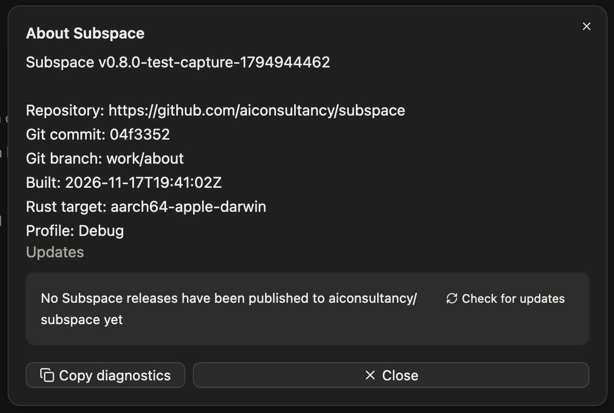
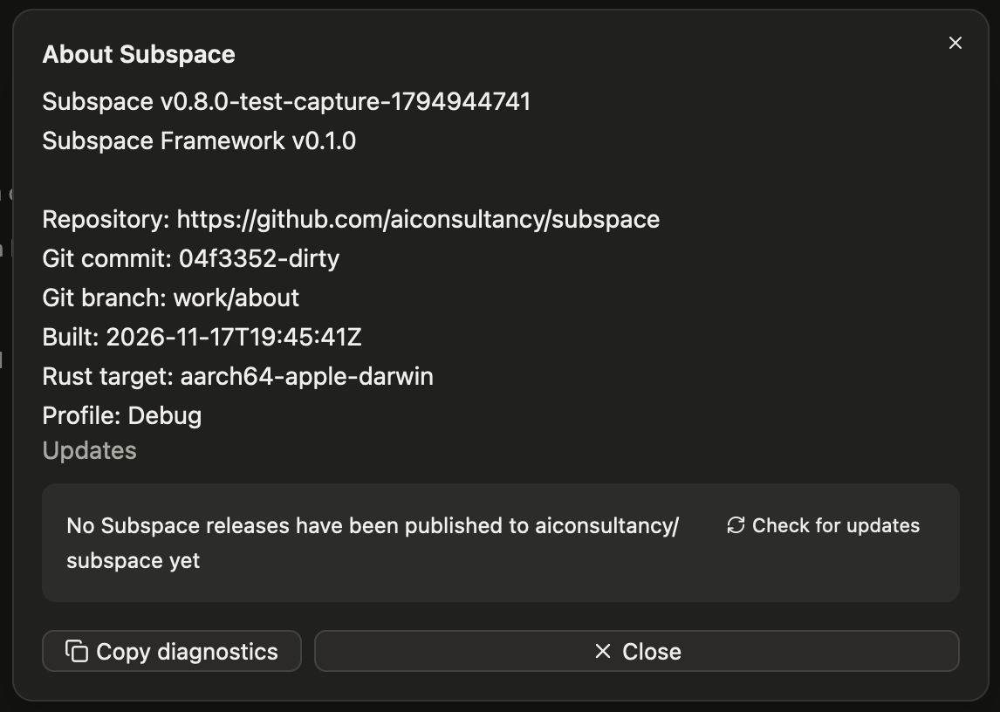

# About shows the Framework version

Back to the [change records](../README.md).

## Intent

The Subspace App (0.8.0) and the Subspace Framework (0.1.0) now have their
own versions, which will keep diverging. The owner asked that About, and
other places people read version identity, show both.

## Spec

- About (the dialog and `subspace about` / `--about`) shows a second line
  under the app's version line: `Subspace Framework v<framework version>`.
  "Subspace Framework" is the Framework's own name, so a white-label app
  shows `Harbor v1.2.0` then `Subspace Framework v0.1.0`. The Framework
  version carries no dev or test marker: the marker describes the app build.
- `--version` stays one line with the app's version only. The interface
  check parses it as `Subspace v<version>…`, and it is the conventional
  shape for scripts; About is where support people read both.
- `subspace mcp` reports the app's version in its MCP server identity. It
  reported the `subspace-mcp` crate's version (the Framework's); the
  desktop's MCP server already reported the app's.
- `__product_metadata` already has `version` and `subspace_version`; Copy
  diagnostics and Report issue already name the Framework version. The
  status bar is unchanged.
- The Framework fills its own version in. `ProductBuild::subspace_version`,
  the `subspace_version` argument of `prepare_context` and of
  `product::product_metadata` are gone; the app no longer passes
  `SUBSPACE_VERSION` back to the Framework.

## Delivery

- Unit tests: About text from the product context (the dialog) and from the
  descriptor (`--about`), each with and without a repository, including a
  white-label name; `product_metadata` reports the Framework's own version;
  the command-line MCP server's identity is the app's name and version.
- `make interfaces` checks that the second line of `--about` is
  `Subspace Framework v<subspace_version from __product_metadata>`.
- Documented in the Framework's
  [Developer tools](../../../../subspace-framework/docs/developer-tools.md#build-version)
  and the [README](../../../README.md).

Before, a capture build's About dialog (Cupertino Dark, fixture data):

After:

## Tasks

- [x] Add the Framework version line to About in both paths.
- [x] Report the app's version from `subspace mcp`.
- [x] Remove `ProductBuild::subspace_version` and the redundant arguments.
- [x] Keep `--version` to the app's version line.
- [x] Tests, interface check, docs and screenshots.
