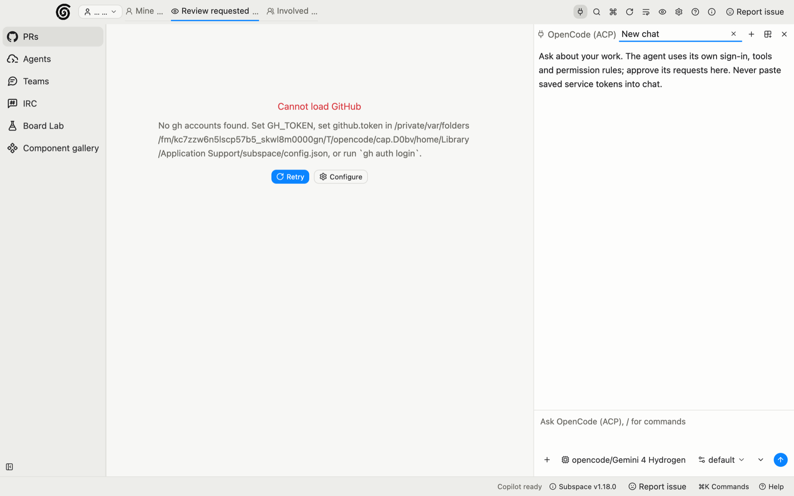
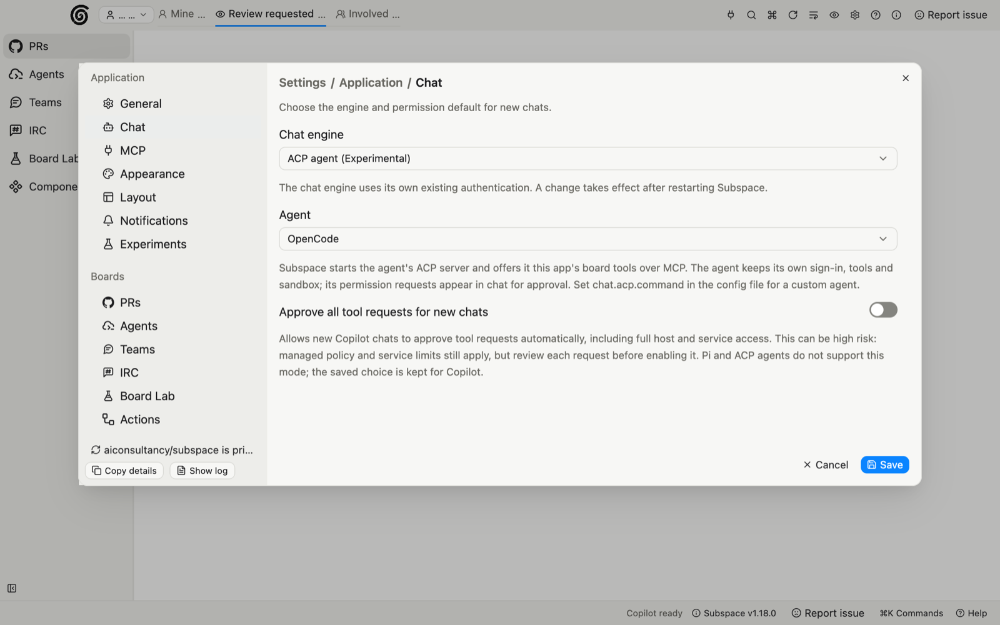
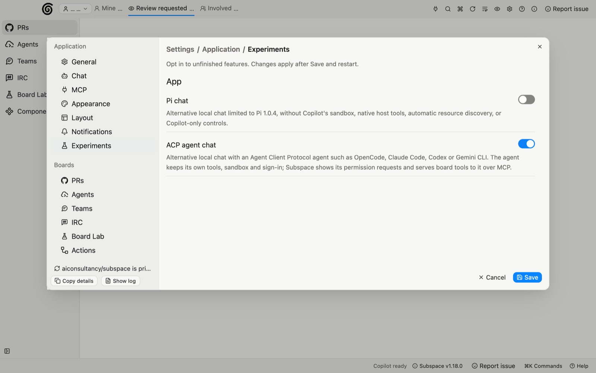

# Delivery: ACP agent chat

## What shipped

See the [spec](spec.md) and [ACP agent chat](../../acp-chat.md).

## Verification

- Unit and fixture tests in `subspace-agent` (`runtime::acp::*`), settings and
  config tests; `make check` and `mise run quality` pass.
- `cargo run -p subspace-agent --example acp_chat -- <agent> "<prompt>"` with
  a throwaway Subspace `HOME` and `ACP_AGENT_HOME` set to the real one:
  - **OpenCode 2.3.0**: setup, model list, slash commands, streamed reply,
    shell tool rows with status updates, usage, and session reload of a saved
    tab after restart.
  - **Codex** (`npx @agentclientprotocol/codex-acp`): setup, models and a
    streamed reply.
  - **Claude Code** (`npx @agentclientprotocol/claude-agent-acp` 0.107): setup
    and models; the prompt reported "Authentication required" because this
    machine's Claude Code is not signed in, which the chat shows as a sign-in
    error.
  - **Gemini CLI 0.46**: initialize and `authenticate` work; Google refuses
    the account ("no longer supported for Gemini Code Assist for
    individuals"), shown as the sign-in error.
- In the example the agent's `subspace` MCP server fails to start, because the
  example is not the app. In the app it is `<app> mcp`.

## Evidence

Captured from the isolated capture build (empty `HOME`, fixture config, no
OpenCode credentials, so OpenCode offers its free model). Typing into the
composer is not possible from the capture tool, so a sent prompt is shown by
the example runs above.

## Divergence from the request

- One agent process per chat tab (like Pi), not one per runtime: tab
  isolation and exit reporting stay as Pi's.
- An agent that exits is not restarted in place; open a new chat.
- Session modes are not wired; Subspace's mode control stays Copilot-only.
