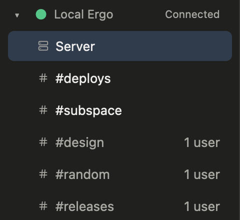
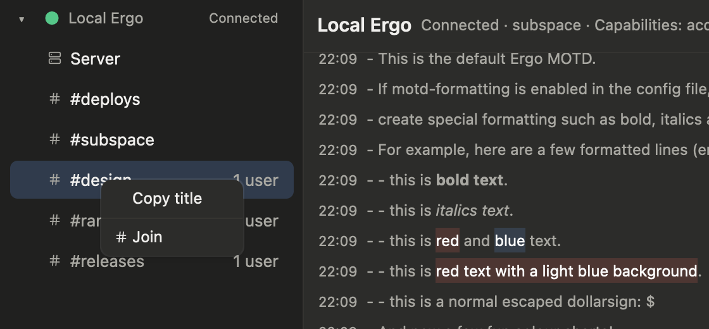
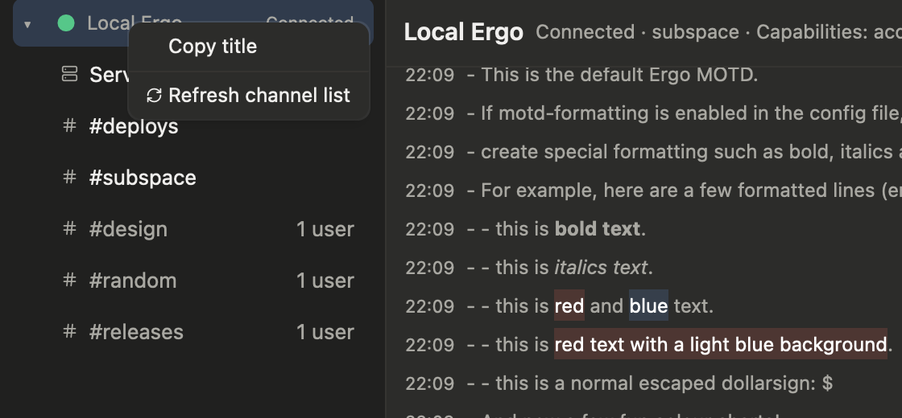
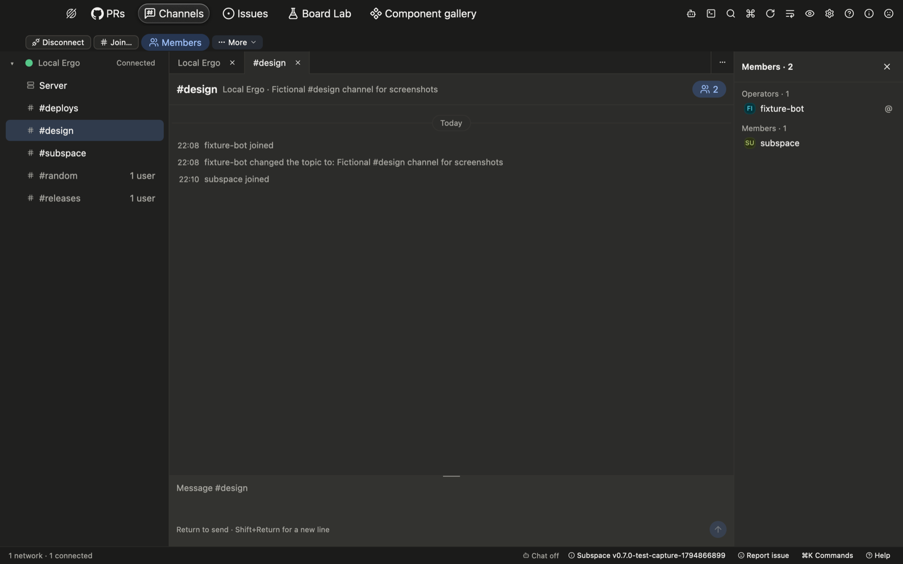

# Channels: every channel on the server

Back to the [change records](../README.md).

## Intent

The owner asked for the Channels Space (board id `irc`) to list every
channel on each server, not only the ones already joined or saved in its
settings. Unjoined channels appear greyed out, and right-clicking one offers
**Join**. The list is cached so it shows at once on the next start. Today
each channel has to be added by hand, and the owner sees fewer channels than
expected.

## Spec

- **Fetch**: after a network registers (at the end of the MOTD, 376 or
  422), the client sends `LIST` once per connection and collects `RPL_LIST` (322) until
  `RPL_LISTEND` (323): name, visible user count and topic. Servers that
  advertise `ELIST` or `SAFELIST` need nothing special; a server that
  refuses or errors leaves the previous list. A **Refresh channel list**
  command (network row right-click menu and palette) sends `LIST` again.
  At most one `LIST` per network is in flight.
- **Cache**: per network, in the Space's cache file next to `state.json`
  (`prefs::write_cache`, not `state.json`), with the time it was fetched.
  On start the cached list shows straight away and is replaced when the new
  `LIST` ends. Each network keeps its 500 busiest channels: the shared list
  draws every row, so an unbounded list (tens of thousands on a large
  public network) would make the sidebar slow.
- **Sidebar**: under each network, the server row, channels and private
  conversations show as today. Channels from the list that are not joined
  follow them in name order, greyed out (muted text, no unread badge), with
  their user count (`7 users`). They come after the private conversations
  rather than straight after the joined channels, so a long list never
  pushes private conversations out of sight. A network with no list yet
  shows nothing extra. Parted or kicked channels keep their own greyed
  buffer row, as before; after **Remove from list** they return as listed
  rows.
- **Join**: right-click an unjoined channel for **Join** (and the shared
  **Copy title**); double-click or Enter joins too, and a single click only
  selects it (the shared list's new `ListDashboard::activates_on_click`).
  **Join** is unavailable while the network is not connected. Joining sends `JOIN`, the row
  becomes a normal channel and the channel opens. A joined channel's
  right-click menu is unchanged. Joining does not add it to the saved
  autojoin list; the existing **Join automatically** (or equivalent) choice
  stays separate.
- **Search**: the Space's `/` and palette search matches unjoined channels
  too; choosing one selects its row.
- **Hidden channels**: channels with mode `+s` (secret) or `+p` (private)
  are not in `LIST` replies unless you are in them; the Space's help says so.
- Shared components only; any new or changed shared component gets its
  Component gallery card. Capture evidence uses the local Ergo test server
  (`scripts/irc-test-server.sh`, `CAPTURE_IRC_CONFIG`) with fixture channels.

## Delivery

`make check` and `mise run quality` (Findings 0 → 0) pass. Tests cover the
`LIST` replies and one-at-a-time rule, the cache, sidebar order and greying,
search, and Join from the menu, double-click and Enter.

Captured with `make capture` against the local Ergo server
(`IRC_TEST_CHANNELS="#design #random #releases" scripts/irc-test-server.sh`),
with `#subspace` and `#deploys` in Channels to join. Before this change the
sidebar showed only Server, `#deploys` and `#subspace`.

## Tasks

- [x] Client: LIST request and 322/323 collection, refresh, one in flight.
- [x] Cache per network.
- [x] Sidebar: greyed unjoined rows with counts; Join from menu, double-click
      and Enter.
- [x] Help and docs.
- [x] Tests.
- [x] Captures (`make capture` with the local Ergo server and
      `IRC_TEST_CHANNELS`).

## Why fewer channels showed

The Space hid nothing it received. It showed only buffers: channels in a
network's `channels` setting or joined by hand, channels with kept history,
and private conversations. With no `LIST`, a channel nobody had told it
about never appeared. Two other things can hide a channel: a channel left
with **Leave channel** is recorded in `irc.removed` and skipped in the
autojoin even when it is in `channels`, until joined again; and the server
leaves secret (`+s`) and private (`+p`) channels out of `LIST` unless you
are in them. The runtime routes by the server's `CHANTYPES` and filters
nothing else; only Settings' **Channels to join** limits names to `#` and
`&`, which covers ordinary networks.
