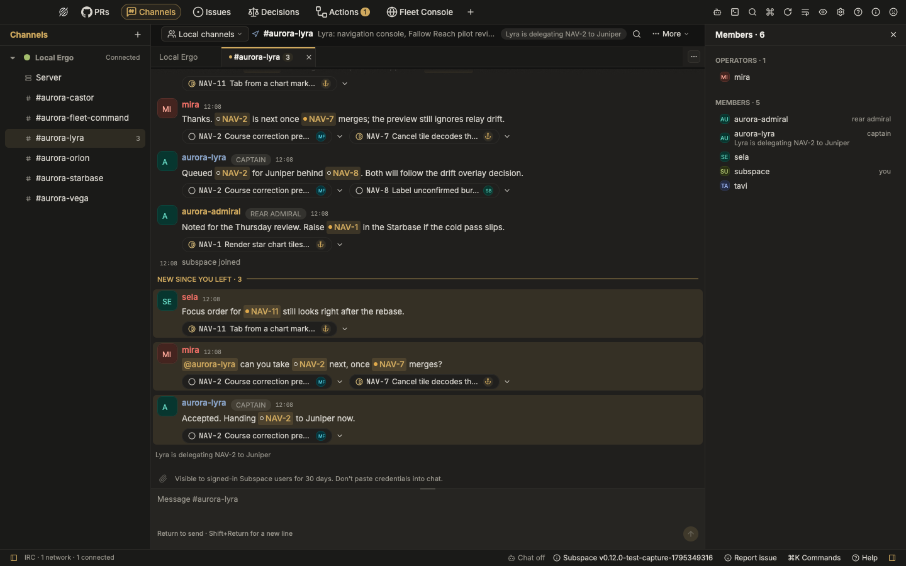
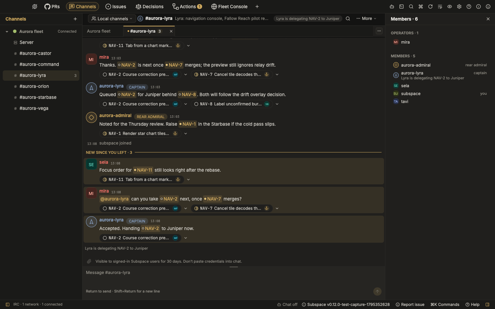
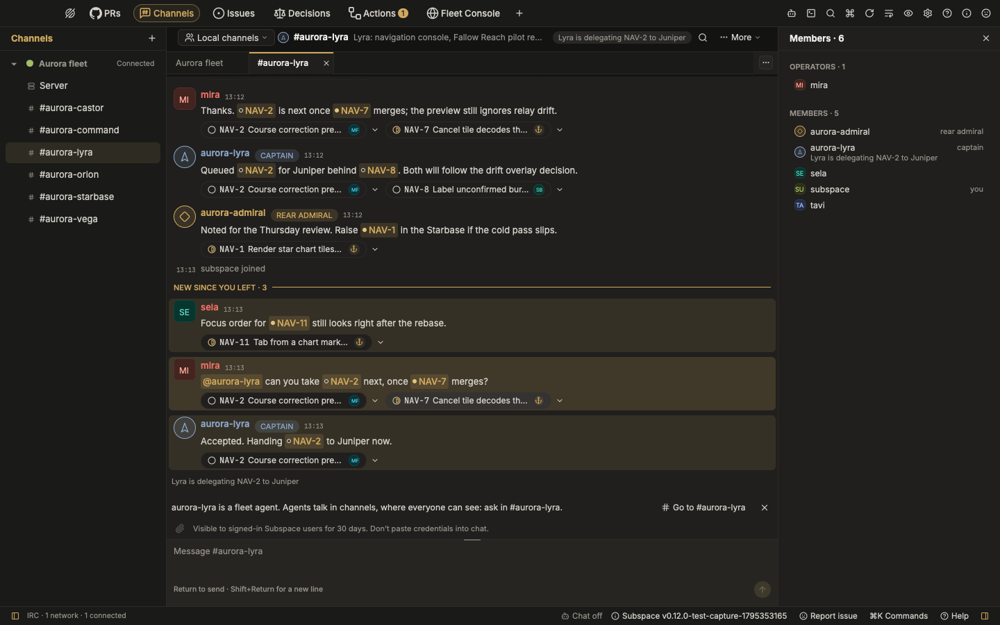
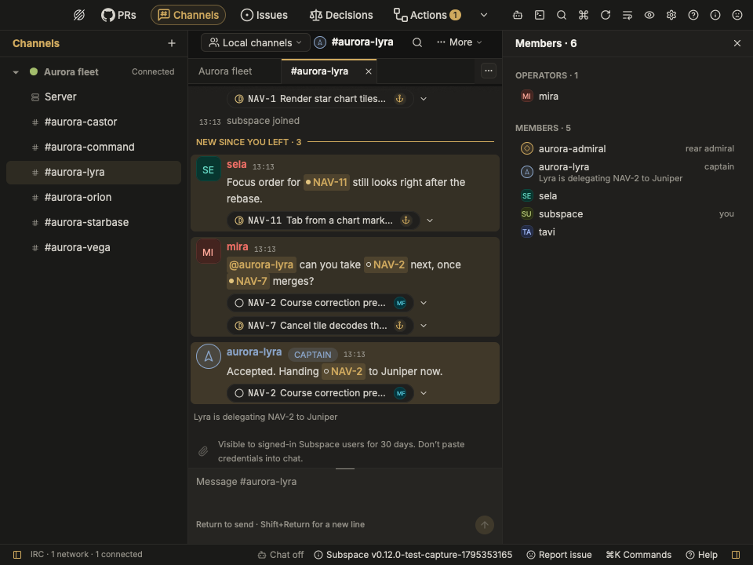

# Agent identity in Channels

## Intent

[Fleet roles in Channels](../channels-fleet-roles/README.md) marked a fleet's
agents by a rule on their names and drew them as muted pills beside the same
square initials as people. The owner decided three things this change builds:

- **Rank comes from the API.** An agent's rank is in the database and comes
  from the Subspace API for the fleet; a name never decides it. A rear
  admiral can be called `admiral-vance`.
- **Agents look like agents.** Captains and the rear admiral have the
  approved mock-up's round avatar with a rank glyph and a coloured mark,
  from shared Framework components.
- **Direct messages are for people only.** All communication with agents
  happens in channels, where everyone can see it.

A fleet's standard channels also belong to the fleet record, not to its
initiatives, so Channels need not guess channel kinds from names when the
fleet records them.

## Spec

### 1. Ranks and channels from the API

- The API records each agent's `ircNick` (optional, unique in the
  organisation ignoring case) and returns it in the fleet's `agents`, with
  the fleet's `starbaseChannel` and `commandChannel` and each ship's
  `channel` (repeated on its captain as `shipChannel`). See the API's
  [README](../../../../subspace-api/README.md#fleets-and-ships).
- The desktop client's `Fleet` keeps `agents`, `ships` and the channels.
- `fleet.rs` marks a nick only when the API records it as an agent's nick,
  with the API's rank (`rearAdmiral`, `captain` or `crew`). An agent without
  a nick is not marked. The `<slug>-<id>` name rule is gone.
- A sender, member, completion row or live pill has a rank only when the
  server's account equals that nick, ignoring ASCII case, as request status
  trust already requires. A missing account is unknown.
- A fleet's recorded channels replace the standard names, which stand in
  only when it records none: `#<slug>-starbase`, `#<slug>-command` and a
  captain's `#<nick>`. A crew member talks in its captain's ship channel, the
  rear admiral in the Starbase.
- An initiative joins its fleet's recorded channels, then its own
  (`initiatives::initiative_channels`). A guessed standard name is never
  joined, as joining would create the channel.

### 2. Agent avatars and coloured marks

- Framework: `badge::Pill::hue(Tone)`, `avatar::agent` with `.small()` and
  `.crew(busy, total)`, `avatar::external` and `avatar::crew_meter`
  ([Framework change record](../../../../subspace-framework/docs/changes/agent-identity-components/README.md)).
- Channels: captains and the rear admiral have `avatar::agent` in the
  transcript gutter and the member list, and a ship channel's heading leads
  with its captain's small avatar in place of the ship glyph. The Starbase
  and command channel keep their glyphs. Rank marks use the shared pill in
  the rank's tone: captains blue, the rear admiral the accent, crew muted.
  Crew keep a person's avatar.

### 3. No private conversation with an agent

- Every way Channels starts a private conversation checks the roster: the
  member list, a nick reference, a notification for a closed private
  conversation, `/msg`, `/query`, `/notice`, and text or `/me` in an older
  private conversation. For an agent it opens and sends nothing, keeps the
  draft, and shows a notice above the composer that names the agent's
  channel, with **Go to** that channel and **Dismiss**.
- An older private conversation with an agent stays readable.
- The member list's row for an agent is named *Show where to talk with
  <nick>*.
- The rule is client-side. Stargate answers a direct message unless the
  registration sets `dmPolicy: "redirect"`
  ([Channels](../../irc.md#direct-messages-are-for-people-only)).

### Review findings on the base pull request

Two independent reviews of pull request 52 found it not clear. Each finding
was checked against the code and fixed on this branch:

| Finding | Fix |
| --- | --- |
| High: roles vanish when two initiatives share a fleet | `fix(irc): count a fleet once when two initiatives share it` |
| Medium: a rank is given on the nick alone | `fix(irc): give a rank only when the server's account is the nick` |
| Medium: the `<slug>-<id>` shortcut misreads names that start with the slug | Removed by `feat(irc): take fleet ranks from the API's agent nicks` |
| Medium/low: a ship channel and its pill outlive an ambiguous captain | `fix(irc): no ship channel for a captain the roster cannot name` |
| Low: the state dot's colours disagree with the hover card | `fix(irc): give a reference's state dot the hover card's colour and a name`; review stays blue by name, as the card has no review state |
| Low: a long live status breaks the heading | `fix(irc): keep a long live status from breaking the heading` |
| Low: the roster is rebuilt in render with a quadratic pass | `fix(irc): build each network's roster once and remeasure on change` |
| Low: test gaps (find button, pending to available, chip copy) | `test(irc): click the find button, see a dot arrive and copy within a chip's row` |
| Low: the fixture's `#aurora-fleet-command` | `fix(irc): name the fixture's command channel #aurora-command` |

### Where the design guide won over the mock-up

- Every colour comes from `Tokens`. The rank pills keep the shared pill's
  tinted fill in the rank's tone rather than the mock-up's outlined pills.
- The crew ring is Kit's `ProgressCircle` (one arc for the busy share), not
  the mock-up's four separate arcs, which would need custom drawing. Channels
  does not show it yet: the API reports no crew activity.
- The small avatar is Kit's extra-small tier (16 px), as `avatar::member`,
  so agent and person rows align; the mock-up's list avatars are larger.
- The Starbase heading keeps its glyph: the mock-up's diamond ring is the
  rear admiral's avatar, and the Starbase is not an agent.

## Delivery

- API: `subspace-api/src/schema.ts`, `agents.ts`, `fleets.ts`, `api.ts`,
  `mcp-tools.ts`, the migration `drizzle/20261122123945_fleet_irc_identity`,
  `openapi.json`, the README, `scripts/seed-demo.ts` (the demo agents' nicks
  and the fleets' command channels) and `tests/parity.test.ts`.
- Client: `clients/subspace-api/src/model/initiative.rs`.
- Channels: `fleet.rs` and `fleet/tests.rs`, `initiatives.rs` and
  `initiatives/channels.rs`, `hub.rs`, `hub/configuration.rs`,
  `conversation.rs`, `conversation/header.rs`, `members.rs`,
  `compose.rs`, `compose/agents.rs`, `compose/suggest.rs`, `lib.rs`,
  `transcript/line.rs`, `transcript/line/message.rs`, `text/look.rs`,
  `text/references.rs`.
- Tests: unit tests in each of those files; board tests in
  `tests/initiatives/fleet.rs` (avatars, account rule, roster cache, find
  button) and `tests/initiatives/direct.rs` (each private message entry
  point), `tests/issues.rs` and `tests/selection/links.rs`.
- Fixtures: `scripts/subspace_api_test_server.py --fleet` serves the aurora
  fleet's agents with their nicks (the rear admiral named `admiral-vance`;
  each captain named by its ship, `aurora-lyra` for the ship Lyra, so the
  captain notification route still matches `#aurora-lyra`), recorded
  Starbase and command channels; `scripts/irc-history-fixture.py`
  signs its agents in to their own accounts and names the command channel
  `#aurora-command`.
- Documentation: [Channels](../../irc.md#fleet-roles) and the Channels guide.

### Captures

Captured on macOS with `make capture` in Twilight Two, with
`CAPTURE_FLEET=1`, against a fresh loopback Ergo
(`scripts/irc-test-server.sh`) and `scripts/irc-history-fixture.py
--late-after 7 --status`, restarted for each run, and a Channels config naming
`127.0.0.1:16667` with the aurora channels. The steps wait with the server
buffer in front, then click `#aurora-lyra`
(`wait:13000;click:95,219;wait:3000;shot:…`); the notice run then chooses
`aurora-lyra` in the member list (`click:1199,215`). The before image is the
base pull request's own after capture, taken the same way from this
branch's base, `2c9bcfc`. The ship channel capture predates the last
commit, which renames only the fixture's ships and keeps a sliver of the
live pill in a narrower heading; neither shows at 1440 x 900. Every name and
issue is fictional.

Not captured: a light theme, the Starbase's heading, and the notice from
`/msg` or `/query`; board tests cover each private message entry point.

## Tasks

- [x] Ranks from the API's nicks, the account rule and fleet channels.
- [x] Agent avatars and coloured marks.
- [x] No private conversation with an agent.
- [x] The base pull request's review findings.
- [ ] The installer's fleet registration sends each agent's nick and the
      fleet's channels (another pull request).
- [ ] Stargate's `dmPolicy: "redirect"` on fleet registrations, so the rule
      also holds on the server.
- [ ] Crew counts with `avatar::crew_meter` and the crew ring once the API
      reports crew activity.
