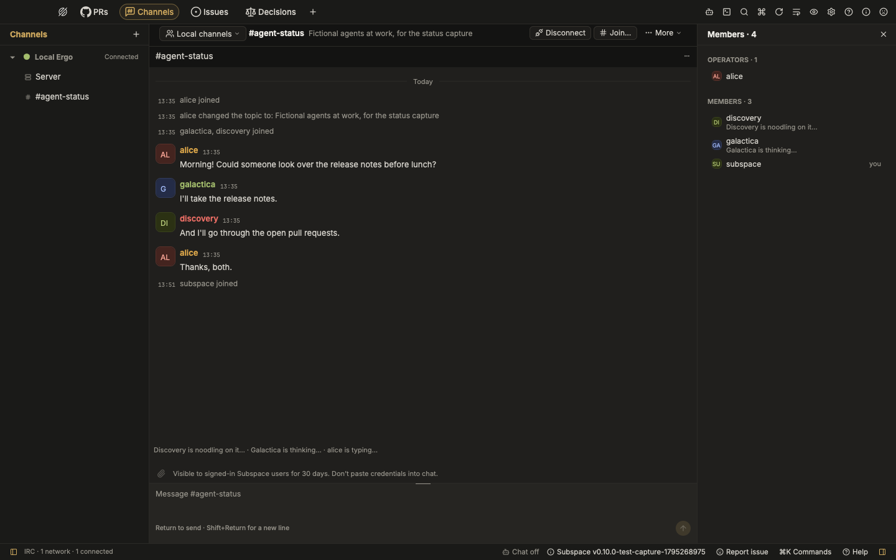
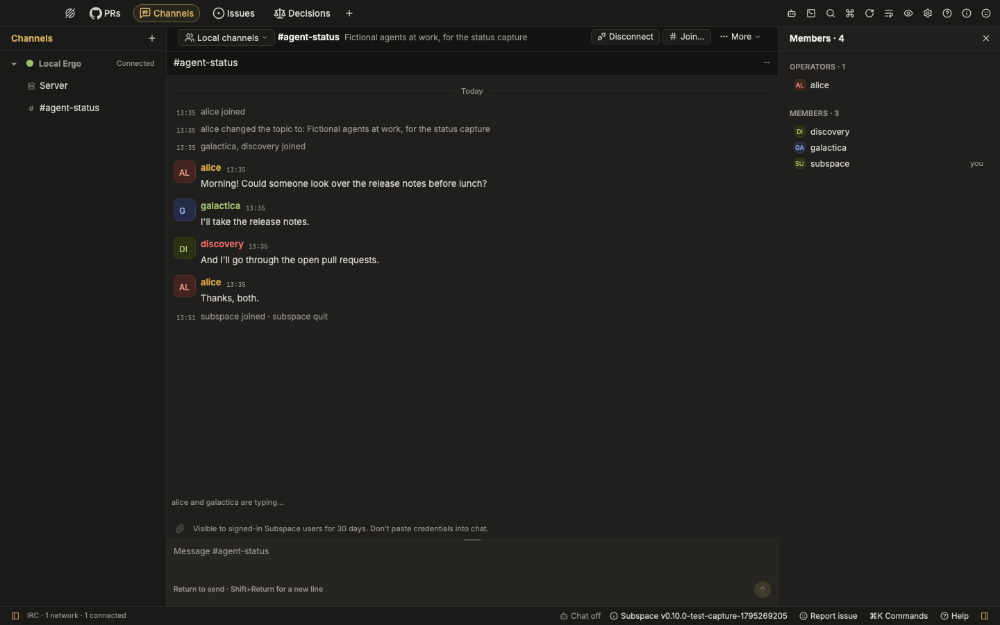
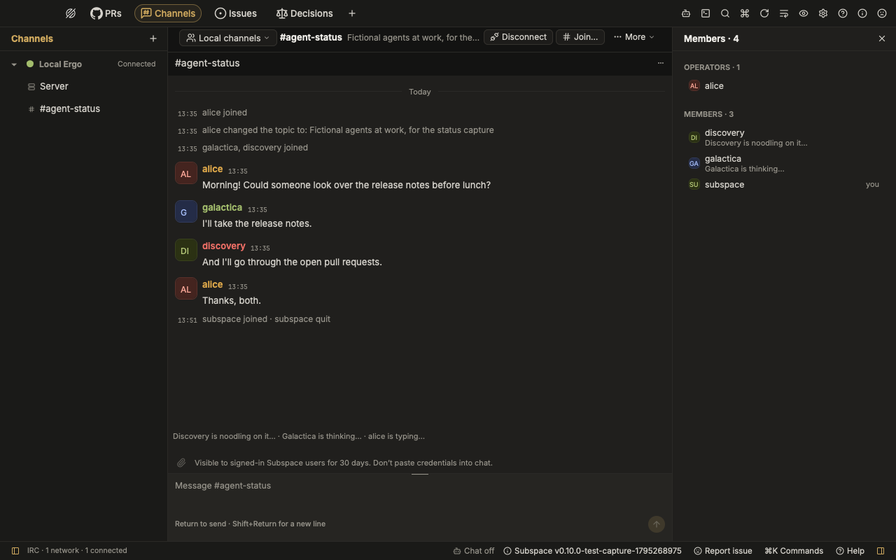

# Channels agent status lines: delivery

Back to the [change record](intent.md).

## What changed

- `clients/irc`: the existing status cleaner is public as
  `subspace_client_irc::status_text` (re-exported through `session` and the
  crate root). Its behaviour and tests are unchanged. No protocol code
  changed.
- `spaces/irc/src/state/statuses.rs`: `Statuses`, one network's nick-wide
  statuses, with set (cleaning again), remove, clear and lookups that ignore
  ASCII case. `Network` holds one; a reconfiguration keeps it while the
  network stays connected, as it keeps the nick.
- `spaces/irc/src/state/apply.rs`: the reducer applies `Event::NickStatus`
  instead of ignoring it, and drops a departed nick's status when no held
  channel of the network lists it. `state/apply/status.rs` drops every
  status of a network when its connection is anything but connected.
- `spaces/irc/src/transcript/activity.rs`: the line above the composer,
  which replaces `transcript::typing_line`. Pure functions choose the
  statuses a conversation shows (`shown`) and compose the line and its
  accessible name (`compose`); `typing_text` moved here unchanged.
- `spaces/irc/src/members.rs`: the status as a second, quiet line in the
  member row, and in the row's accessible name (`spoken`).
- `scripts/irc-agent-status-fixture.py`: the capture fixture below.
- Docs: the Channels guide (`spaces/irc/help.md`), `docs/irc.md` (Agent
  status lines, IRCv3 table, Design, Test with a local server) and a pointer
  from the [protocol record](../irc-agent-status/README.md).

## Design choices

- **Line composition.** Statuses first, then typing for nicks without a
  status, separated by ` · `, so the agent's own words lead and a person
  typing is still seen. A status replaces only its own nick's typing notice.
- **Member row.** A second, muted caption line under the nick, inside the
  shared `row_button`, rather than after the nick on one line: the inspector
  is about 320 px wide and a status can be 80 characters, so on one line it
  would leave almost nothing for the status or the nick. The row grows only
  when the member has a status, with `h_auto()`, which the shared row button
  already allows (the Issues Space's end-state picker uses it). Tokens only:
  caption size, `muted`, `fg`.
- **Untrusted text.** The value is cleaned again in the reducer and shown
  through `truncated::styled` as a plain string, wrapped in `test_text` so
  render tests can read it (the Framework's `truncated::text` does not record
  its text for tests): no Markdown, link, mention or issue reference is ever
  rendered from it. The member's nick is wrapped in `test_text` for the same
  reason; what it draws is unchanged.
- **Accessible names** use the mechanisms already in the Space: the line is
  a `Role::Label` with `aria_label`, as the day separator and reply counts
  are; the member row extends the label it passes to `row_button`.

## Tests

All pass (see [Checks](#checks)).

- `state/tests/statuses.rs` (reducer): set, replace under another spelling
  and clear; an empty value after cleaning clears; statuses add no line,
  typing notice or unread count to any buffer; an over-long value (200
  characters, fed straight in as an event) is clamped to 80 with an
  ellipsis; a multi-line value is held as one line; the nick's own message
  ends its typing but not its status; the runtime's clear for a quit;
  `MemberLeft` from one channel keeps the status while another held channel
  lists the nick (in another spelling) and drops it after the last; a
  dropped connection clears every status at once, and nothing stale shows
  after reconnecting until a new status is set.
- `transcript/activity.rs` (pure): typing alone reads as before; a status
  first with a person typing beside it, and the accessible name; an agent
  with a status that is also typing shows its status only; only the
  conversation's nicks show (a channel member in another spelling, a
  private conversation's peer), never our own, and none for the server
  buffer; Markdown, links and mentions stay literal.
- `members.rs` (pure): the spoken name with and without a status and away.
- `tests/statuses.rs` (render, the real board): the line above the composer
  shows galactica's multi-line status as one line beside "alice is
  typing…", hides galactica's own typing and discovery's status (not a
  member), with the expected accessible name; the member row shows the
  status, says it in its accessible name, stays inside the member list, and
  a member without a status reads as before; a dropped connection and
  reconnect leave the line and the member row without the status.

## Evidence

Captured on 21 November 2026 with `make capture` against the local Ergo
2.19.1 server and the fixture below, in Twilight Two, fixture data only.
Each was examined before it was added: fictional nicks, a loopback server,
no hostnames, tokens or real names.

- 
  After, 1440 x 900: above the input, "Discovery is noodling on it… ·
  Galactica is thinking… · alice is typing…" (galactica's own typing notice
  does not show); in the inspector, each agent's status as a quiet line
  under its nick; nothing in the transcript.
- 
  Before, an `origin/main` build (`40b9ebd`) with the same fixture: "alice
  and galactica are typing…" and no statuses in the inspector.
- 
  The narrowest window capture allows, 1280 x 800 (the app's minimum; a
  requested 1000 x 720 was raised to it), with both docks shown: the line
  above the composer and both member rows still fit. A status too long for
  its row is cut by the shared truncated text with an ellipsis and a
  tooltip; that is not shown in an image here.

Compared with the design guide's shell anatomy and its review checklist:
the zones are unchanged (navigator, tab strip, toolbar, content, inspector,
status bar); the status adds no control, heading or line of context; the
line above the composer keeps the typing line's height, caption size and
muted colour; the member row's second line uses the inspector's caption
size and `muted` token; selection and hover are the shared row button's.
The line above the composer keeps the typing line's existing `px_2` inset
rather than `workspace::text_edge`; that inset predates this change.

### Capture commands

From `subspace-desktop`, with nothing else on port 16667 (otherwise set the
same `IRC_TEST_LISTEN=127.0.0.1:<port>` for the server and the fixture):

1. Start a fresh local Ergo server:

   ```sh
   scripts/irc-test-server.sh &
   server=$!
   ```

2. Start the fixture and wait for `agent-status fixture: ready`. It writes
   the Channels configuration (network `local`, nick `subspace`, channel
   `#agent-status`) and keeps `alice`, `galactica` and `discovery` in the
   channel until it is stopped:

   ```sh
   python3 scripts/irc-agent-status-fixture.py --config "${TMPDIR:-/tmp}/irc-agent-status.json" &
   fixture=$!
   ```

3. Capture. `CAPTURE_STATE` opens Channels on `#agent-status` with the
   navigator and the inspector shown, in a 1440 x 900 window:

   ```sh
   CAPTURE_THEME="Twilight Two" \
   CAPTURE_IRC_CONFIG="${TMPDIR:-/tmp}/irc-agent-status.json" \
   CAPTURE_STATE='{"app.dashboard":"irc","app.window":"[0,0,1440,900]","irc.dock-layout":"{\"center\":{\"kind\":\"tabs\",\"buffers\":[{\"network\":\"local\",\"target\":{\"Channel\":\"#agent-status\"}}],\"active\":0},\"buffers\":{\"open\":true},\"members\":{\"open\":true}}"}' \
   make capture OUT=docs/changes/channels-agent-status/evidence \
     STEPS='wait:12000;shot:agent-status;wait:4000;shot:agent-status-again'
   ```

   The two shots are a few seconds apart; alice's typing notice is renewed
   every 3 seconds, so both should show it. Keep the better one as
   `agent-status.png`.

4. Stop the fixture, which disconnects the agents and so clears their
   statuses, and the server:

   ```sh
   kill "$fixture" "$server"
   ```

For the before image, run steps 1 to 3 again on an `origin/main` build with
`shot:agent-status-before`. Check that each image is at most 1600 px wide,
and examine it for anything that is not fixture data, before committing it.

## Checks

Run on 21 November 2026 on macOS (arm64), Rust 1.99.0 through mise.

- [x] The first build found a name clash (a second `listed` in
      `state/apply.rs`), renamed `in_a_channel`, and three render tests that
      could not read text drawn through `truncated::text`; the text is now
      wrapped in `test_text` (see [Design choices](#design-choices)). No
      behaviour changed.
- [x] `cargo test -p subspace-client-irc -p subspace-irc-board`: all pass
      (Channels 460 passed, 4 ignored as on `main`; the IRC client's suites
      all pass).
- [x] `make check` in `subspace-desktop/`: exit 0. Architecture, board
      docs, documentation index, format, licences, clippy with warnings
      denied, the tests in both configurations (2,378 passed, none failed)
      and the script fixtures. `subspace-framework/` did not change.
- [x] `mise run quality`: exit 0, 100.0%, unchanged. `rustqual . --findings`
      shows one finding, a stale suppression in `products/subspace/build.rs`,
      which an untouched export of `main` shows too.
- [x] The fixture script against a live local Ergo 2.19.1 server (from
      `scripts/irc-test-server.sh`, on `127.0.0.1:16677`): it set both
      statuses and the app showed them, as the evidence shows.
- [x] Captures: before, after and narrow, above.
- [ ] Not checked: a real Stargate gateway on a fleet (only the fixture);
      screen readers (the accessible names are checked in headless tests
      only); the Linux capture path.
- [ ] Both model reviews (GPT-6.2 Sol and Claude Opus 5.5, high effort):
      not yet run; required before merging.

## Review findings

Both required reviews, Claude Opus 5.5 and GPT-6.2 Sol at high effort, read
`70cff6a` through the repository's review helper and cleared it, with no P0
or P1 findings. Their P2 and P3 findings, and what was done:

- **Fixed:** every `MemberLeft` and `MemberChanged` scanned every member list
  of the network, even for a nick without a status (Opus, low).
  `status_if_gone` now returns at once unless the nick holds a status.
- **Fixed:** the fixture opened its config path following symbolic links,
  before it knew the server was there (Sol, medium). It now refuses a
  symbolic link (`O_NOFOLLOW`) and writes the config only after the server
  has answered.
- **Fixed:** the fixture accepted `--typing-every 0`, which sends typing
  notices as fast as it can (Sol, low). It now requires a positive, finite
  number of seconds.
- **Left open, for the owner to decide:** the line above the composer shows
  the status text without the publisher's nick, so a member could publish
  text that reads as if another nick said it (Sol, medium). The owner's
  decision was to show what the gateway sends; the gateway's lines name the
  agent already ("Galactica is thinking…"). The nick is in the line's
  accessible name and beside the status in the members inspector. Adding a
  visible label would change the agreed design.
- **Left open, for the owner to decide:** the line truncates from the end,
  where the typing text sits, so in a narrow pane several statuses can push
  "alice is typing…" out of sight, though not out of the tooltip (Sol,
  medium). Statuses lead by design; a separate, never-cut typing segment is
  a follow-up if it matters in practice.
- **Left open:** nicks compare ignoring ASCII case, not by the server's
  `CASEMAPPING`, so on an `rfc1459` network `[bot]` and `{bot}` do not match
  (Sol, medium). The Space has no case mapping (the member list's own
  `you` note compares the same way), and the runtime reports one spelling
  per nick; Opus judged it an edge case.
- **Left open:** status lookups are linear in the held statuses (Sol,
  medium). The map holds only nicks with a live status, normally a few
  agents mid-turn, so the cost is small; with none held, the scan is
  empty.
