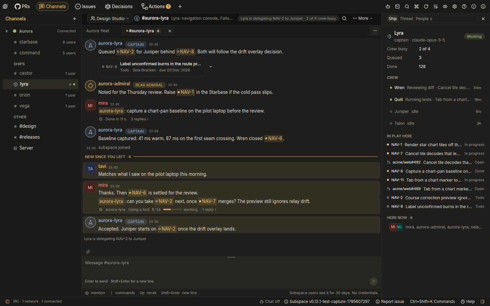

# Channels crew details

## Intent

SUB-68 adds a crew view to the Ship tab so that people can see what a
crew member is doing across projects without leaving the conversation.

## Delivery

Select a crew member in the Ship tab. The inspector shows their state,
model and current task, and each project's Git state and pull request.
**Back to Ship** returns to the crew list. **Open PR** uses the existing
pull request navigation. Branch diffs and activity are separate work.
The roster initially shows up to 24 members; **Show all N members** makes
the rest reachable in the same scrolling inspector. Without the Fleet API
service or a route to the member, the roster rows are plain text.

The view reads the crew detail endpoint in the background and refreshes it
when the member changes on the live roster. Routine changes such as Git's
last check time or a queue count neither start a read nor discard one in
flight. A current task's identity, status or `updatedAt` queues a roster-driven read,
with at most one follow-up. Newer roster task text is shown while its
refreshed full detail is being read.
A change of fleet directory, selected member identity or task assignment
invalidates an older response; removal or an unavailable roster takes
effect immediately. Directory changes drop the old request and allow a
new one without waiting for it. A transient failure offers **Try again**
and up to five automatic retries, with delays of one to 16 seconds or
the gateway's longer requested wait (up to 30 seconds). Reloading Channels
or reconnecting to the fleet also rearms the read. Hidden crew views do
not start reads; showing a retained view rearms the read and ignores any
older response. A 404 falls back to the roster without polling. Showing the
detail again, Reload, a reconnect or a returning member each probes the route.
Task summaries and progress each carry up to 64,000 characters, the dispatch
limit. The crew detail response allows up to 16 MiB of JSON; the fleet and
ship reads still allow 8 MiB. Control and bidirectional formatting codes are
written out as code points, except line breaks and tabs.

## Verification

- The Fleet client tests cover the read, missing route and response identity.
- The Channels tests cover roster changes, missing Git state, no checkout,
  and pull request display. Ship tab tests check accessible names, keyboard
  focus into and out of the detail view, and clearing the view on a buffer change.

### Captures

Captured on Linux with `make capture` in Twilight Two at 1440 × 900, using
the fictional Fleet API and loopback IRC fixtures described in
[Desktop capture](../../capture.md). The Ship tab stays beside the open
conversation as the inspector moves from the roster to a crew member.

Not captured: the before state and the older-gateway fallback. The Fleet
API fixture serves the crew detail route and has no switch to omit it.

## Space checklist

This extends the existing Channels inspector, without adding a board,
changing its zones or adding a command, setting or board-to-board role.
The inspector uses shared sections and action components; the crew row
uses a GPUI Kit button. The existing [Channels guide](../../irc.md) describes
how to open and leave the view.
