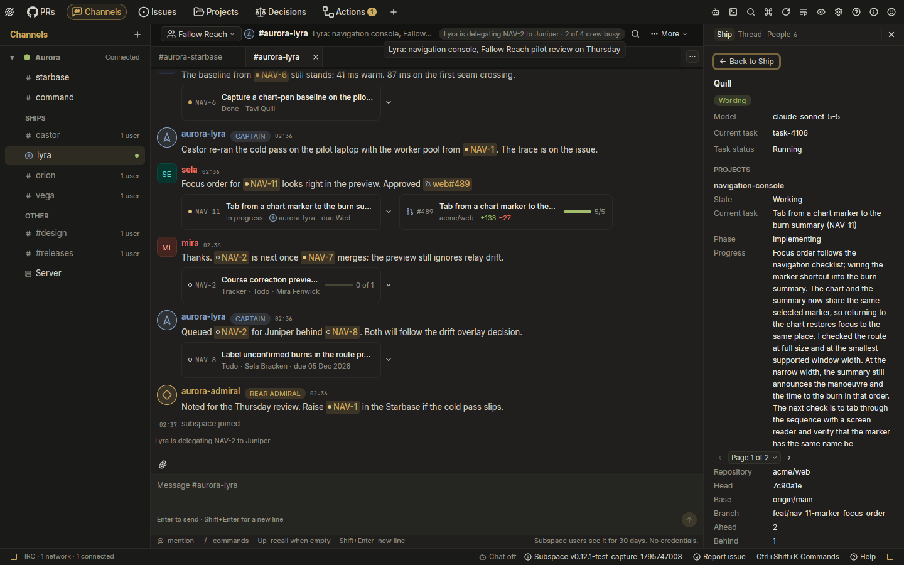
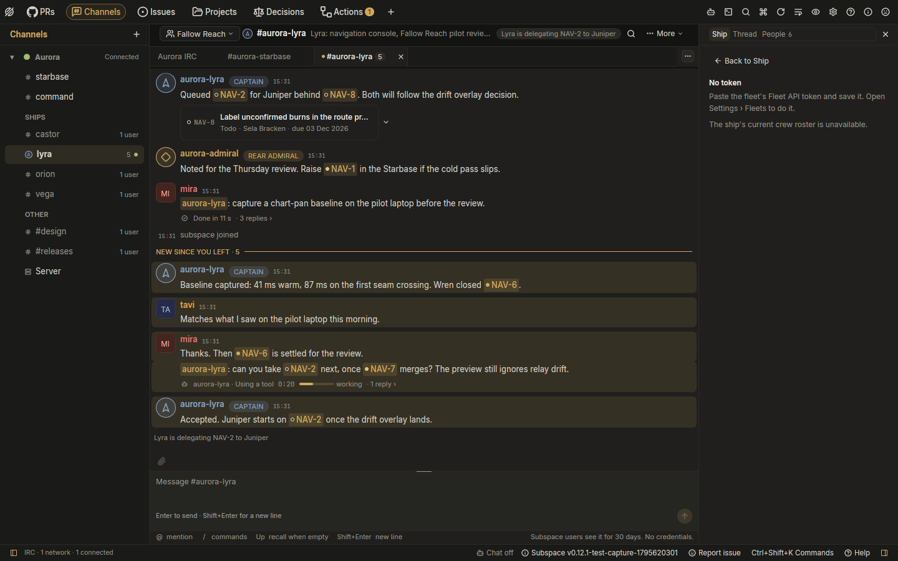

# Channels crew details

## Intent

SUB-68 adds a crew view to the Ship tab so that people can see what a
crew member is doing across projects without leaving the conversation.

## Delivery

Select a crew member in the Ship tab. The inspector shows their state,
model and current task, and each project's Git state and pull request.
**Back to Ship** returns to the crew list. **Open PR** uses the existing
pull request navigation. Branch diffs and activity are separate work.
The roster initially shows up to 24 members; **Show all N members** makes
the rest reachable in the same scrolling inspector. Without the Fleet API
service or a route to the member, the roster rows are plain text.

The view reads the crew detail endpoint in the background and refreshes it
when the member changes on the live roster. Routine changes such as Git's
last check time or a queue count neither start a read nor discard one in
flight. A current task's identity, status or `updatedAt` queues a roster-driven
read, with at most one follow-up. The roster carries the first 180 code points
of the summary, the first 80 of the phase, and the last 400 of progress, with
no ellipsis. A preview matching fetched text or its capped head or tail never
replaces it. A changed field on a newer revision replaces the old text until
the reread; at the cap it is marked as partial, with an ellipsis at the cut
edge and a note. If the reread fails, the marked preview stays visible. A
divergent preview for the same revision keeps the fetched text and queues one
reread; replaying that preview does not poll.
A change of fleet directory, selected member identity or task assignment
invalidates an older response; removal or an unavailable roster takes
effect immediately. Directory changes drop the old request and allow a
new one without waiting for it. A transient failure offers **Try again**
and up to five automatic retries, with delays of one to 16 seconds or
the gateway's longer requested wait (up to 30 seconds). Reloading Channels
or reconnecting to the fleet also rearms the read. Hidden crew views do
not start reads; showing a retained view rearms the read and ignores any
older response. A 404 falls back to the roster without polling. Showing the
detail again, Reload, a reconnect or a returning member each probes the route.
Each project's current task text displays in 512-code-point pages with no
truncation. Each field's Previous, Next and page-count jump menu sit below its
value and fit the minimum 260 px inspector. The member header shows the primary task's ID and status
without repeating its text. Control and bidirectional formatting codes are
shown as code-point markers, including tabs and line breaks in task fields.

The crew detail read budgets 15 tasks per project context, each with two
64,000-code-point fields at up to six JSON bytes per code point. It multiplies
that budget by the member's context count in the latest roster (at least one),
then rounds it up to a power of two to allow for JSON metadata: 16 MiB for one
context, 32 MiB for two, and 64 MiB for three. If a read's cap grows while it
is in flight, one follow-up uses the larger cap. An invalid response alone
does not trigger another read at the same cap. A 404 or Retry-After retains
its usual handling. Fleet and ship reads still allow 8 MiB.

## Verification

- The Fleet client tests cover the read, missing route, response identity and
  JSON budgets for different context counts.
- The Channels tests cover roster changes, whole Git observations, checkout
  changes and pull request identity, including same-revision previews and
  a context added during a read. Ship tab tests check accessible names,
  keyboard focus, clearing detail on a buffer change, and paging to the end
  of a 64,000-code-point progress field at the minimum inspector width
  without losing control markers.

### Captures

Captured on Linux with `make capture` in Twilight Two at 1440 × 900, using
the fictional Fleet API and loopback IRC fixtures described in
[Desktop capture](../../capture.md). The Ship tab stays beside the open
conversation as the inspector moves from the roster to a crew member.

Quill's capture shows the updated pager using a progress field that exceeds
one page. The Fleet API fixture ran with `--tick 0` so the task did not advance
during the capture. The roster and missing-token captures show unchanged
states. The target branch has no crew detail view to capture. Tests cover the
older-gateway fallback; the Fleet API fixture always serves the crew detail
route.

## Space checklist

This extends the existing Channels inspector, without adding a board,
changing its zones or adding a command, setting or board-to-board role.
The inspector uses shared sections and action components, including the
crew row and page menu trigger. The existing [Channels guide](../../irc.md)
describes how to open and leave the view.
