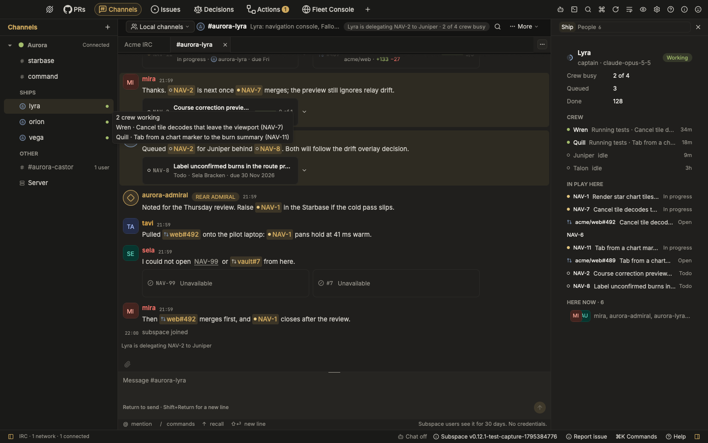
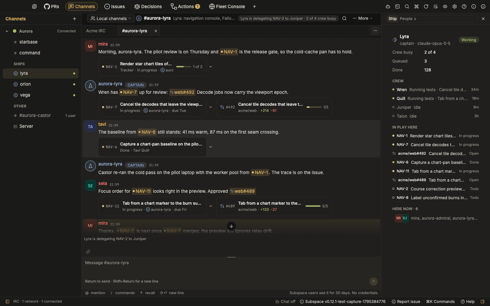
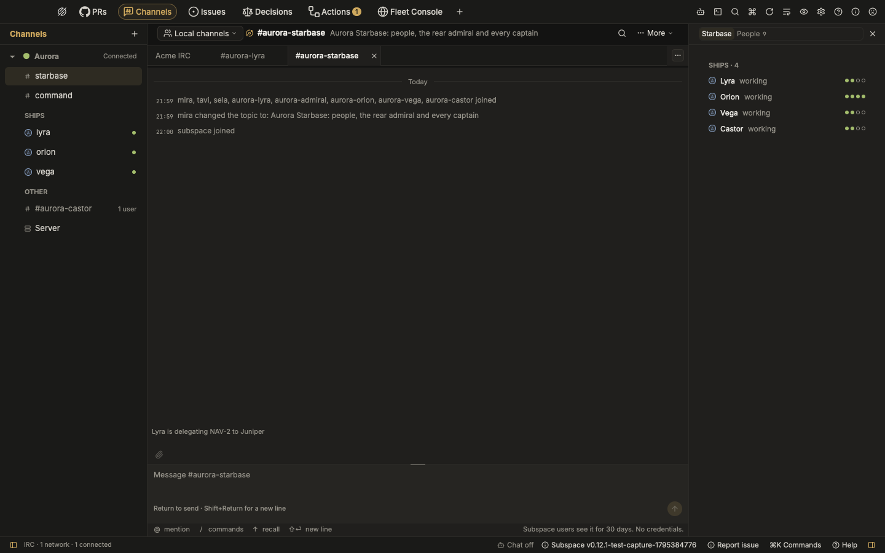
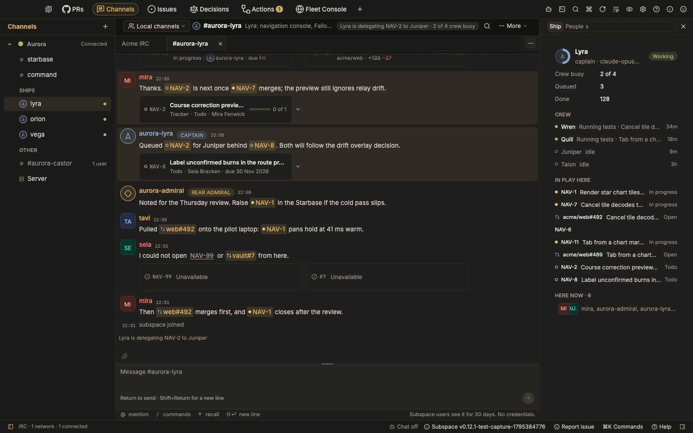
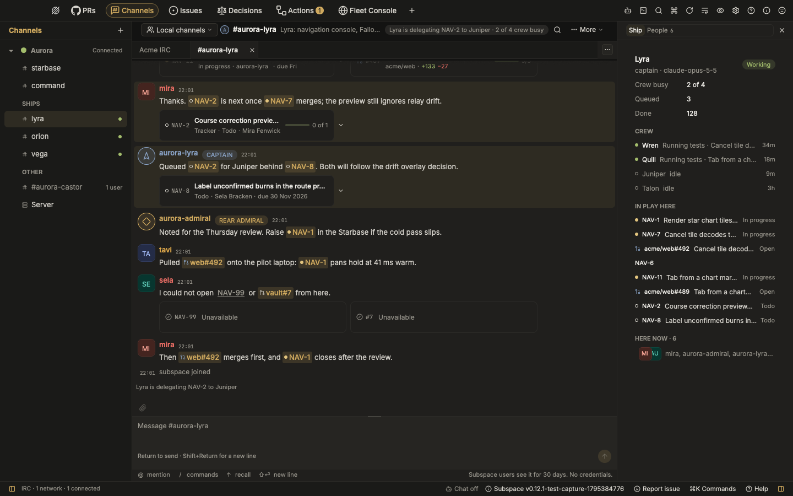
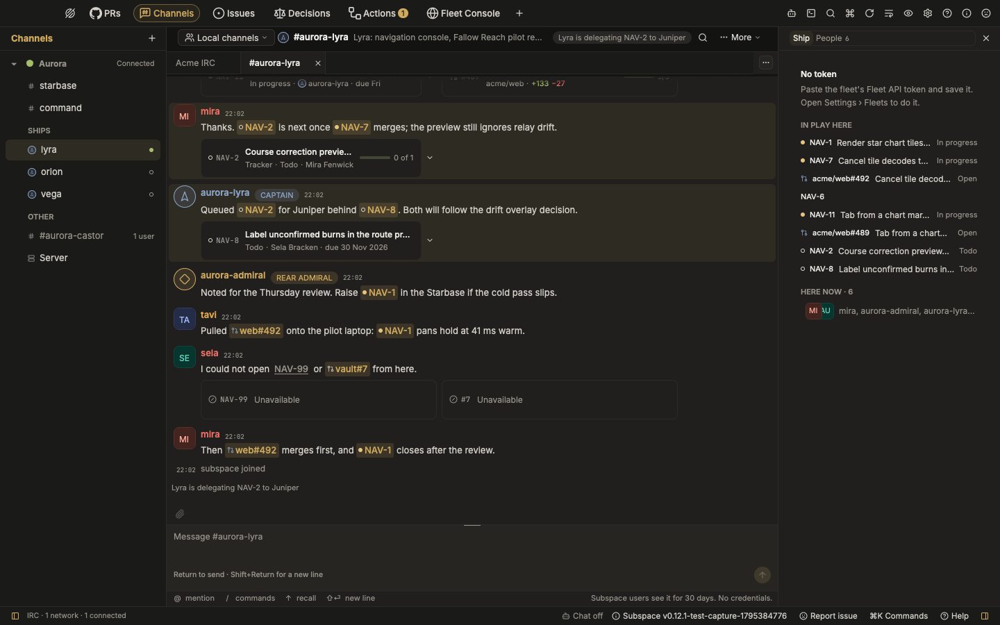
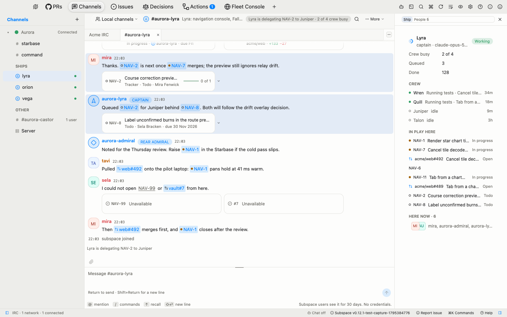

# Channels fleet live

## Intent

The owner's mock-up of the Channels redesign shows a ship's channel with
its fleet's live state: the header pill `Lyra is delegating · 3 of 4 crew
busy`, an inspector with **Ship**, **Thread** and **People** tabs (the
ship's card, its crew and what each is on, what is in play in the
conversation, the last decision and who is here), and a ship row's one dot
that says whether its crew is working (frame 2: the tooltip names who and
on what). This change builds them from the app's native Fleet API client
(`clients/fleet`, [Fleets and the Fleet API](../../fleet-api.md)), and fixes
the findings carried from pull requests 66 and 68.

Desktop only: no Framework, API or Stargate change.

## Spec

### What the Fleet API gives

Checked against Stargate's `main` at commit
`edfb0c05cceb4d5b00e4e0159d9b6378261f6964` (`src/dashboard/api/v1/types.ts`).
The client's models (`clients/fleet/src/model.rs`) agree with it; `main`
adds fields the client ignores, as its models are additive: a captain's
`requests` (per-request progress), a context's `observed` and
`pullRequestKnown`, a task's `kind`, a feature's `defaultEnabled` and the
gateway's `bunVersion`. Nothing is retyped or removed, so no client change
was needed; none of those fields is shown yet. A captain's `activity` is
`running`, `queued` or `idle`; its `queue` counts jobs `queued`, `running`,
`responding`, `done` and `failed`; a ship's `crew` counts people, busy
members (any context with a current task) and members with queued work.

### Following and matching

- `live/watch.rs`: the board follows each fleet whose navigator group (while
  the navigator shows) or front conversation it shows, while the Space is in
  front and the fleet is `Ready` or followed, through `FleetApi::shared` (one stream per fleet),
  and drops the handle when it is no longer shown. Under test it reads only
  a service a test installed (`FleetApi::current`), so no test opens the
  token store. What the service says goes to `Hub::fleets` only when what
  Channels draws of it changed (`FleetLive::new`).
- `live/ship.rs`: a ship's channel's captain is the roster's (the Subspace
  API's agent of rank captain); its Fleet API ship is the one whose
  registration ID equals that captain's API nick, ignoring ASCII case.
  Names, models, tasks and phases are bounded, stripped of control
  characters and drawn as text; 24 crew lines at most.

### Surfaces

| Surface | Live | Not live |
| --- | --- | --- |
| A ship row's dot (`rows::activity::ship`) | Filled while any crew member has a task; tooltip `3 crew working` then `Wren · <task>` per working member; named `aurora-lyra: 3 crew working` | The captain's vouched status, as before |
| Header pill | The vouched status or the Fleet API's word for the captain, then `N of M crew busy` | The vouched status, as before |
| Ship tab | Card (captain's avatar with crew ring under the Icons setting, name, `captain · <model>`, state pill, Crew busy, Queued, Done when given), Crew, In play here, Here now | One sentence why (the state's label and help, and Settings › Fleets for No token and Address changed), then In play here and Here now |
| Starbase tab | Ships: icon, name, state, crew meter | One sentence why |
| People tab | Today's member list | Today's member list |

The inspector's tabs follow the design guide's *Inspector tabs*; a later
change adds **Thread**. The navigator's fleet groups gain `Ships` and
`Channels` captions through `ListDashboard::group_captions`.

### Left out of the mock-up, and what each needs

- **Last decision**: the Decisions data has no record tied to a channel or
  a ship that Channels can reach without new API work; it needs the
  Subspace API to link decisions to an initiative's channel or ship.
- **Open <ship> in Fleet Console**: the built-in Fleet Console takes no
  request to open on a ship; it needs a navigation contract (or a page
  route the bridge can set) answered by the Fleet Console.
- **`delegating`** as the captain's state: Stargate's captain activity is
  `running`, `queued` or `idle`; the per-request stage is in `main`'s new
  `requests`, which the client could read additively.
- **The crew's issue key apart from the task** (`NAV-7 reviewing diff`):
  the API gives the task's summary and phase, not its issue; it would need
  a task's issue identifier.
- **Queued as jobs**: the card's Queued counts crew with queued work, as
  the API's `crew.queued` does.
- **Starbase stakeholders and Ready for agents**, and the rear admiral's
  card: not in this piece's scope; stakeholders need an API that records
  them.

## Changes from the owner during the piece

- **A network named once** (`feat(irc): name a network that holds one
  fleet once in the navigator`): a network holding exactly one fleet is one
  group named after the fleet, with the network's other channels under
  **Other** and the Server row last; with several fleets the network's own
  group comes last under its own name, or `<name> network` when it equals a
  fleet's name. The demo and fixture IRC network is **Acme IRC**: Channels'
  fixtures and tests (`spaces/irc/src/fixtures.rs` and the tests that named
  `Local Ergo`), `scripts/irc-agent-status-fixture.py`,
  `scripts/irc-thread-status-fixture.py`, `docs/irc.md`'s example and the
  local stack's desktop configuration (`scripts/local-stack/desktop-irc-config.py`:
  `Acme IRC` and `Acme IRC (TLS)`, ids unchanged). The Framework's
  notification tests keep `Local Ergo` as a sample label, and the installer
  README's "Local Ergo" is the server, not a network name.
- **Check bars from GitHub** (`feat(github): give a listed pull request's
  tile its check counts`): a pull request the PRs Space holds only from a
  list answers at once and is read once for its check runs, deduplicated,
  bounded by the keys asked about and read again at most once per list
  refresh, however many sections land or pull requests are opened (see
  *Review findings* 3 and 4). Widening every list query was not chosen:
  every list would pay for counts no tile shows.
- **No accent edge on a selected tab** (`fix(framework): show the selected
  tab by its surface, with no accent edge`). The sweep for accent lines on
  one edge in `board-kit` and Channels found only functional marks, left as
  they are: the drag insertion mark in `tabs/dock/group.rs` and the glass
  finish's rim (`glass.rs`), a ring round the whole control.

## Captures

Captured on macOS with `make capture` at 1440 x 900, in Twilight Two unless
named, with `CAPTURE_FLEET=1 CAPTURE_FLEET_API=1` (the Fleet API fixture's
aurora fleet, its token saved for the fixture's address), against a fresh
loopback Ergo 2.19.1 (`scripts/irc-test-server.sh` with
`IRC_TEST_LISTEN=127.0.0.1:16947`) and `scripts/irc-history-fixture.py
--status --repeats`, both stopped by their port and process id after each
run, and a Channels config naming that server as the network **Acme IRC**
(id `acme`) with the aurora channels. Every name, issue and message is
fictional. Steps begin `wait:9000;click:70,215;wait:4000`, choosing the
ship `lyra`.

The selected tab in every capture has no accent edge. In Cupertino Light
the selected tab's surface is close to the bar's, so it is told apart
mostly by its text; see *Not verified*.

## Not verified

- A light theme's contrast between a selected and an unselected
  conversation tab was checked by eye only; it is weaker than in Twilight
  Two.
- The loading skeleton capped in a narrow column (finding 11) has no render
  test and no capture.
- A real Stargate: only the fixture, which follows `main`'s types.
- Polling (`Live (polling)`) and every not-live link state are covered by
  tests, not captures; only **No token** was captured.

## Findings carried from pull request 66

Four low findings from the reviews of the Fleet API client.

1. **Fleet Console's Retry for a token the keychain could not read** —
   fixed (`fix(fleet-client): read an unreadable token again when Fleet
   Console retries`). The banner says to unlock the keychain and choose
   Retry; the service read each token once, so only a restart or a fresh
   save helped. The bridge's `fleets.get` now calls
   `FleetApi::reload_unreadable`, and the page hears
   `subspace:fleets-changed` when the read lands. Test: a locked stand-in
   keychain, unlocked, read again on retry. This made a loop while the
   keychain stayed locked; *Review findings* 1 replaces it with
   `fleets.retry`.
2. **`--log-requests` raising on a malformed request** — fixed
   (`fix(capture): log a malformed request to the Fleet API fixture without
   failing`): `getattr`, `-` and `auth=none`. Test: a raw malformed request.
3. **Control characters in the logged method and path** — fixed
   (`fix(capture): escape control characters in the Fleet API fixture's
   request log`). Test: an escape sequence in both.
4. **`docs/capture.md` on when the token is saved** — fixed
   (`docs(capture): say the fleet's token is saved whenever
   CAPTURE_FLEET_API is set`), with the script's header.

## Findings carried from pull request 68

Thirteen medium and low findings from the two model reviews of
[Channels tiles once](../channels-tiles-once/README.md). Each was checked
against the code.

1. **A tile vanishing when its owner is no longer shown** — fixed
   (`fix(irc): let go of a tile whose owner is no longer shown`). Each read
   lets go of owners the conversation no longer shows (the line cap, a
   progress notice folded into its request); a removed conversation's
   owners are forgotten (`Sessions::forget` from `Hub::remove`); a
   conversation whose buffer the hub does not hold reads nothing, so its
   owners are not let go. Only unread messages claim, so no drawn message
   grows. Tests: an owner dropped then a new mention; remove and rejoin.
2. **The in-app help describing the old chips** — fixed (`docs(irc): describe
   tiles once in the in-app help`): the issue and pull request sections now
   describe the tiles, their loading and unresolved states.
3. **Work in proportion to every held message on each sync** — fixed with 1:
   a sync with nothing new (`Tiles::stale`) neither copies the owners nor
   the read set, and the conversation drops its own handle first. The sets
   are still built per sync, in proportion to the messages shown; a
   watermark was not needed for the 2,000-line cap.
4. **A muted Unavailable tile for every pull request while no Space
   answers** — left, as intended: the tile's box is reserved from the
   message's first frame so nothing moves, and removing it once the refusal
   lands would move every line under it. The help and the design notes now
   say so.
5. **A long owner name pushing the due date out** — fixed (`fix(irc): let an
   issue tile's owner give way, and meter only trackers`): the owner is the
   part that shrinks with an ellipsis, as an assignee is.
6. **A selected row moving into a group already folded** — fixed (`fix(irc):
   open a folded fleet group the selected row moves into`): the board
   remembers the group that held the selection; a folded group the selection
   has just moved into opens, one folded by hand around it stays folded.
7. **The name clash check being case-sensitive** — fixed (`fix(irc): tell
   navigator names apart ignoring case, in one pass`).
8. **Ownership growing for the session and cloned on each sync** — fixed
   with 1 and 3: owners no longer shown are let go, so claims are bounded by
   the messages shown, and nothing is copied without news.
9. **Issue ownership ignoring the tracker scope** — fixed with 1: a new
   recognition lets go of every issue's claim and the messages, all read
   again, claim within the new scope; pull requests keep their owners.
10. **A Starbase `/ask` with two rear admirals hidden by a nick clash** —
   fixed (`fix(irc): ask no rear admiral in a Starbase whose fleet names
   two`): the roster counts each Starbase's rear admirals before dropping
   clashes.
11. **The loading skeleton's bars exceeding a narrow column** — fixed
   (`fix(irc): keep a loading tile's skeleton bars inside a narrow column`):
   each bar is capped at the column's width. Not covered by a render test.
12. **A progress meter without the tracker flag** — fixed with 5.
13. **The quadratic name clash check** — fixed with 7: titles are counted in
   one pass.

## Review findings

Two independent reviews of head `278800f`, merge base `b095bb0`: Claude
Opus 5.5 at high effort (**Opus**; one P1, two P2, four P3) and GPT-6.2 Sol
at high effort (**Sol**; eight medium, five low, verdict clear). Each
finding was checked against the code; where both raised the same fault it
is listed once with both names.

1. **A token the keychain cannot read loops** (Opus P1; Sol medium,
   `bridge/fleets.rs`) — fixed (`fix(fleet-client): re-read an unreadable
   token only when the person retries`). Every `fleets.get` re-read the
   token and announced twice; Fleet Console answered each announcement
   with `fleets.get`. Now `fleets.get` never reads the keychain; only the
   page's Retry sends `fleets.retry`; the fleet stays Keychain locked while
   read again (no Checking step); a read announces only a change; and the
   service reads one fleet's token again at most once every five seconds,
   whoever asks. Fleet Console's every other refresh (the change event,
   focus, visibility) is a plain one, and a fleet whose token could not be
   read offers Retry. Tests: a follower that asks again on every
   announcement settles after one read (`clients/fleet`); `fleets.get`
   never reads and a second retry at once reads nothing (`spaces/web`);
   only Retry calls `fleets.retry` (Fleet Console's `node --test`).
2. **Fleet API news Channels does not draw re-syncs the Space** (Opus P2)
   — fixed (`fix(irc): re-sync Channels only for Fleet API news it
   draws`): the hub holds each fleet's state and its ships as Channels
   draws them, so an activity line, a sample time or a ship field it does
   not draw compares equal. Test: those leave the fleet equal; a crew
   member going idle does not.
3. **Check-count reads repeat per section and per opened pull request**
   (Opus P2) — fixed (`fix(github): read a listed pull request's checks
   once per refresh, never over the list`): a refresh marks reads stale
   once, when its first section lands; a detail read marks nothing. Test:
   four sections landing with Channels asking after each, and 20 detail
   landings, read once per refresh.
4. **A stale read overrides the fresher list** (Opus P3; Sol medium, with
   the force-push case) — fixed in the same commit: a read since the last
   refresh answers whole; an older one lends only its check counts to the
   list's item, and only while the list's combined checks state and last
   update match the read's; a read that started before a refresh lands
   stale, so it cannot clear that refresh's mark. The list does not carry
   the head commit, so the last update stands in for it: a force-push
   updates the pull request. Tests: merged since, force-pushed since.
5. **The Starbase lists another fleet's ship** (Opus P3; Sol medium) —
   fixed (`fix(irc): list only the Starbase's own fleet's ships`): a ship
   shows only when its captain's ship channel is in the Starbase's own
   fleet. Test: two fleets on one network.
6. **A network's one fleet folds the network's other channels away** (Opus
   P3) — fixed (`fix(irc): keep a network's other channels open when its
   one fleet first shows`): the merged group keeps the fold of the
   network's group it replaces. Test: the group appears open with the
   selection in People while another fleet's initiative is selected.
7. **`FleetApi::install` is public and ungated** (Opus P3) — fixed
   (`fix(fleet-client): offer FleetApi::install only to tests`): it and
   `TokenStore::with_vault` are behind the client's `test-support` feature,
   enabled only on dev-dependencies, which the architecture check enforces.
8. **A pull request that left the lists answers from memory for good**
   (Sol medium) — fixed in the commit of 3 and 4: a read of a pull request
   the board neither opened nor lists is checked again once per refresh,
   and GitHub's refusal replaces it. Test: read, refreshed, then denied.
9. **A check-count read queued after sign-out** (Sol medium) — fixed in
   the same commit: a signed-out account starts no read. Test: no request
   after a sign-out.
10. **A kept crew detail shown as live** (Sol medium) — fixed (`fix(irc):
    never show a kept crew detail as live, and bound crew text first`): a
    detail Stargate kept after a failed read, or one the overview or the
    detail marks unavailable, gives no crew lines (the overview's totals
    stand in), and a kept overview shows no ships. Tests: each case.
11. **A hidden navigator keeps its fleets followed** (Sol medium) — fixed
    (`fix(irc): follow the navigator's fleets only while the navigator
    shows`): showing or hiding the navigator and a new conversation in
    front sync the follows. Test: hidden with nothing of the fleet in
    front lets it go; shown again follows it.
12. **The fixture's malformed-request test expects a status line** (Sol
    medium) — fixed (`fix(capture): answer a Fleet API fixture request
    whose target cannot be parsed`). On this machine's Python 3.14 the
    status line is sent and the test passed, but a version that answers a
    one-word request as HTTP/0.9 sends none; the test now checks the error
    body and the log.
13. **`urlsplit` raising in the fixture's log** (Sol low) — fixed in the
    same commit: the handler, too, dropped the connection on such a target.
    Both treat it as unparsed: 400, path logged as `-`. Test: an invalid
    bracketed host.
14. **Bidirectional controls in Fleet API text** (Sol low) — fixed with 10:
    they are stripped. Test: overrides and isolates in a ship's and a crew
    member's name.
15. **Crew lines formatted before the cap of 24** (Sol low) — fixed with
    10: members are chosen, working first, before any is formatted.
16. **In play here loses claim order under its cap of eight** (Sol low) —
    fixed (`fix(irc): keep In play here in the order a message names its
    references`). Test: a pull request named before eight issues.
17. **The design guide's checklist addresses reviewers** (Sol low) — left:
    it is the repository's own checklist for reviewing a UI change, owned by
    the guide, not an instruction smuggled into code; reviewers are told by
    their request what to do with it.

Also noted by Opus, not findings: the `cfg(test)` switch in `watch.rs`
leaves the release path through `FleetApi::shared` without a test; and a
light theme's selected tab contrast is under *Not verified*.
