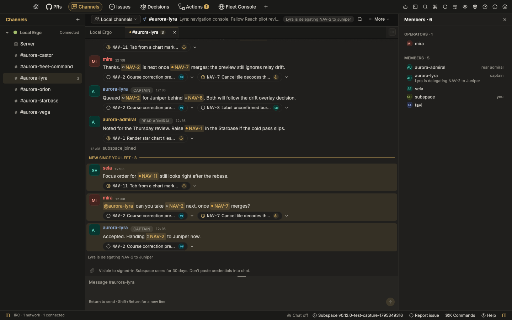
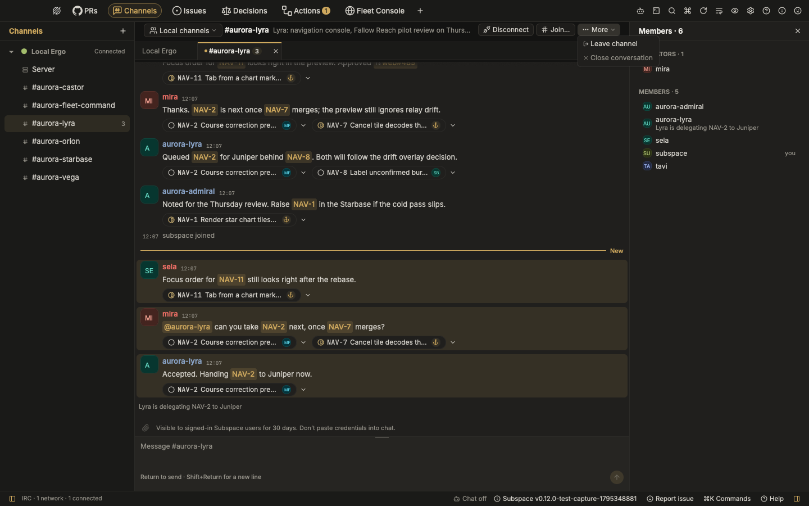
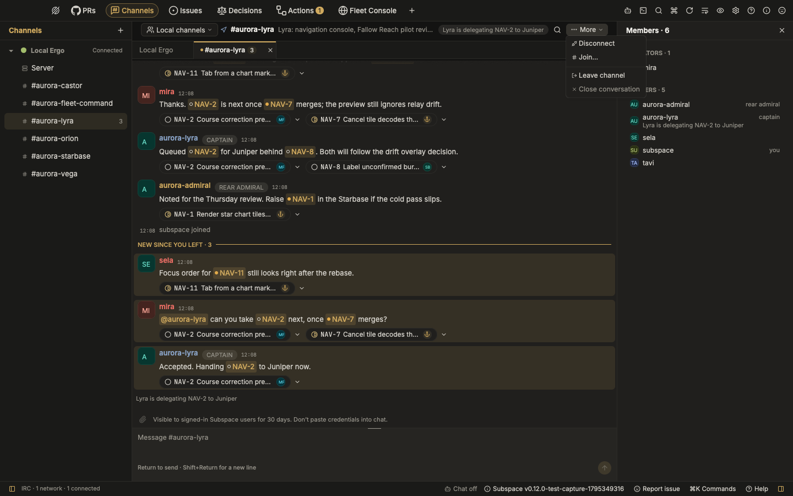
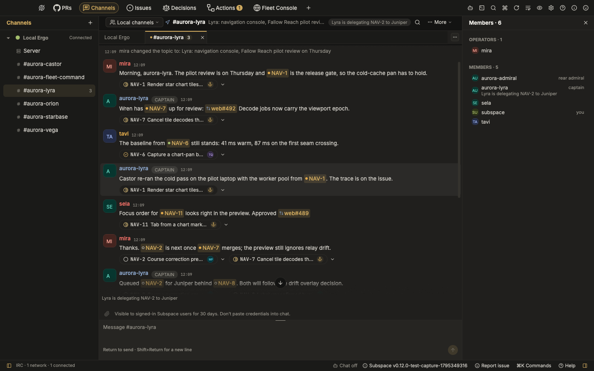

# Fleet roles in Channels

## Intent

The owner approved a redesign of the Channels Space that makes a fleet's
structure visible: who in a conversation is a captain or the rear admiral,
which channel is a ship's or the Starbase, and what the ship's captain is
doing now. This change builds its first three pieces. The rest of the
mock-up, such as crew counts, the Ship and Fleet inspector tabs and tiles
that appear once per conversation, is later work; the last needs an owner
decision.

## Spec

### 1. Fleet roles and rank marks

- `spaces/irc/src/fleet.rs` is a pure model, `Roster`, read from the
  initiatives catalogue's fleets (`Fleet::slug`, `rear_admiral_name`,
  `captain_names`). A connection carries a fleet's roles only when it is the
  one an initiative of that fleet would use (`InitiativeIrc::roster`, with the
  same rule as autojoin); any other connection, such as a local-only one,
  has none.
- Fleet IRC servers tie each nick to the account of the same name (an owner
  decision), and the installer names an agent's account `<slug>-<id>`, the id
  being the name in lower case with each other run of characters a hyphen:
  captain *Lyra* of fleet `aurora` is `aurora-lyra`. A name already written as
  `<slug>-<id>` is the nick itself. Channels are the installer's defaults:
  `#<slug>-starbase`, `#<slug>-command` and `#<slug>-<id>` for each captain's
  ship.
- Nothing is guessed. A nick or channel that two roles claim, a fleet that
  uses other names, a person whose nick is only the agent's name (`lyra`) and
  every nick on a network that serves no fleet are unknown, and draw as a
  plain person or channel.
- The transcript header draws the agent's name in its rank's tone (captains
  `Tone::Blue`, the rear admiral `Tone::Accent`), followed by the shared
  `badge::Pill` reading `CAPTAIN` or `REAR ADMIRAL`, named *captain* or
  *rear admiral*.
- `members::note` adds `captain` or `rear admiral`, and an `@` completion
  row's trailing mark and accessible name say the same.

### 2. The heading's live pill and the More menu

- The heading leads with a glyph for a fleet channel's kind: `Navigation` in
  blue for a ship's channel, `Orbit` for the Starbase and `RadioTower` for
  the command channel, both in the accent. The kind is also in the heading's
  accessible name.
- On a ship's channel, the shared pill after the topic shows the captain's
  nick status from `Network::statuses`, named *Captain <nick>: <status>*.
  Without a status there is no pill: no idle state is invented.
- **Connect** or **Disconnect** and **Join…** are now entries of the
  toolbar's **More** menu, above the removal entries, and no longer inline
  buttons. The navigator header still has Join, and the command palette
  still offers Join, Connect and Disconnect, so the toolbar is never the only
  way. The network row's menu did not offer them before and does not now.
- A search button (`irc-find`) opens find in the conversation
  (`find_in_page::Open`), as `⌘F` does.
- The initiative picker stays where it was. The toolbar keeps its
  `--toolbar-h` height.

### 3. Reference state dots and the unread divider

- An inline issue reference with an available answer leads with a dot for
  its state category (`text/look.rs`): started `Orange`, a started state
  named for review `Blue` (the tracker's started states share one category,
  so review is told by the name), completed `Green`, cancelled or duplicate
  `Muted`, and a hollow ring before work starts (`Fg` for unstarted, `Muted`
  for backlog and triage).
- A pull request reference's glyph takes its status's tone: open `Blue`,
  merged `Magenta`, closed or draft `Muted`.
- A reference still loading or unresolved keeps today's look, without a dot.
- The dot is a child of the reference's inline object, so the object stays
  atomic in selection and Copy copies the reference as written.
- The unread divider reads `NEW SINCE YOU LEFT · N`, with the number of
  messages that arrived since the conversation was last read, and is named
  *N new messages since you left*.
- The chip row under messages is unchanged from the reserved slots of
  [the previous change](../channels-reserve-issue-tile-space/README.md).

### Where the design guide won over the mock-up

- No literal colours: every tone comes from `Tokens`. The rank pills use the
  shared `badge::Pill`, whose tones are `Muted`, `Warning` and `Danger` only,
  so they are muted pills beside a blue or accent name, rather than the
  mock-up's blue and gold outlined pills. The live status pill is muted for
  the same reason; the mock-up's blue dot and text would need a new pill
  tone in the Framework.
- The inline issue chip keeps the shared reference tint rather than the
  mock-up's outlined dark chip.
- The divider's label starts on the text edge, before the rule, rather than
  after a short leading rule.
- The toolbar keeps the theme's toolbar height and the initiative picker,
  which the mock-up leaves out.

## Delivery

- `spaces/irc/src/fleet.rs`, `initiatives.rs` (`InitiativeIrc::roster`,
  `fleets_on`), `hub.rs` (`Hub::roster`).
- `transcript/line.rs` and `transcript/line/message.rs`: the rank mark.
- `members.rs`, `compose/suggest.rs`, `compose/offer.rs`: the note.
- `conversation.rs` and `conversation/header.rs`: the glyph and live pill.
- `toolbar.rs`: the find button and the More menu.
- `text/look.rs`, `text/references.rs`, `text.rs`,
  `transcript/line/marks.rs`: reference looks.
- `transcript.rs`: the divider.
- Fixtures: `scripts/subspace_api_test_server.py --fleet` adds the aurora
  fleet's initiative, never selected; `scripts/irc-history-fixture.py` adds a
  rear admiral line, `--status` for Lyra's status and `--late-after` for three
  lines that arrive after the capture build joins.
- Tests: unit tests in `fleet.rs`, `members.rs`, `compose/suggest_tests.rs`,
  `conversation/header.rs`, `initiatives.rs`, `text/look.rs` and
  `transcript.rs`; board tests in `tests/initiatives/fleet.rs` (the rank mark
  on agents' lines and not a person's, the member notes, the heading's glyph
  and live pill, the More menu holding the connection commands);
  `tests/issues.rs` (dots only for answered references);
  `tests/selection/links.rs` (a drag over a dotted chip copies it as
  written); `tests/selection/unread.rs` (the divider's label).
- Documentation: [Channels](../../irc.md#fleet-roles) and the Channels
  guide.

### Captures

Captured on macOS with `make capture` in Twilight Two at 1440 x 900, with
`CAPTURE_FLEET=1`, against a fresh loopback Ergo (`scripts/irc-test-server.sh`)
and `scripts/irc-history-fixture.py --late-after 7 --status`, restarted for
each build, and a Channels config naming `127.0.0.1:16667` with the aurora
channels. The steps wait 13 s with the server buffer in front, so the three
late lines arrive as new, then click `#aurora-lyra`
(`wait:13000;click:95,219;wait:3000;shot:…`), then open **More**. The before
build is this branch's base, `b18eea2` (pull request 48, with the earlier
API fixture, whose difference is not visible); the after build is this
branch. Every name and issue is fictional.

Not captured: a narrow window, a starbase or command channel's glyph, and a
light theme. The member list notes and the completion row are covered by
tests; the member notes also show in the after captures.

## Tasks

- [x] Fleet roles model and rank marks.
- [x] Heading glyph, live status pill, find button and More menu.
- [x] Reference state dots and the counted unread divider.
- [x] Documentation and captures.
- [ ] Crew counts, inspector tabs and tiles shown once per conversation
      (later pieces).
