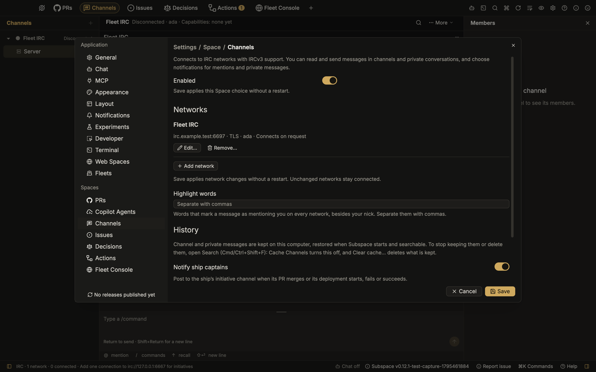
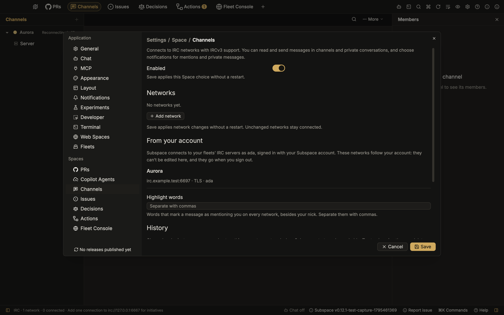
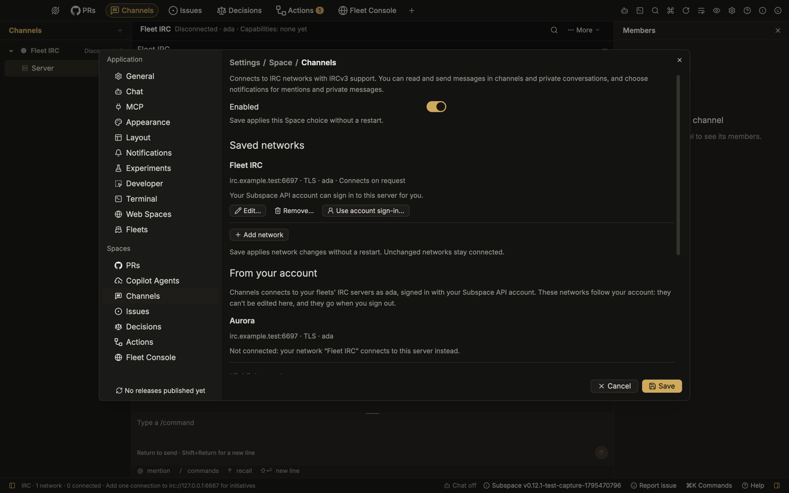

# Delivery: networks from the signed-in account

Back to the [record](README.md).

## Checks

Run from `subspace-desktop` on the branch, with Cargo through mise, on
23 November 2026:

- `make check` passed: architecture, board-guide and documentation-index
  checks, format, cargo-shear, clippy with warnings denied, the tests (55
  test binaries, none failed, over the workspace with the unreleased Spaces
  and the app in its release configuration: 2,988 tests at first, 3,017
  after the first review round, 3,025 after the second) and the script
  fixtures, `scripts/test-capture.sh` among them.
- `mise run quality` passed: 100.0% against `rustqual-baseline.json`, no
  new violations, and `rustqual . --findings` reports none.
- `python3 -I scripts/test-subspace-api-test-server.py` passed (31 tests),
  with the credential route asked for one server.
- `mise run audit` reports advisories (`cookie`, `heapless`, `url` and
  others) for crates already in the lockfile on `main`; this change adds
  no crate, only `uuid`, already locked, to the Channels Space.

For the second review round the branch merged `origin/main` without
conflicts, and `cargo metadata --locked` passed in the desktop, the
Framework and both terminal projects. The Framework, which gained the
search rule for hidden records, passed its own `make check` and
`mise run quality` (100.0%).

New tests (with both review rounds'):

- API client (`clients/subspace-api/src/tests/irc_credential.rs`): one POST
  with the bearer naming the server, nothing sent without a host or port,
  the password never formatted, 404, 401, 500 and 503, an unreachable API,
  credentials an IRC line cannot carry, `username` present and absent, NETT
  never asked, and the catalogue naming the account it was read for.
- IRC client sign-in (`session/tests/sign_in.rs`,
  `network/tests/credential.rs`): the issued password sent once then
  dropped, fixed SASL wording, a server registering without accepting the
  sign-in left before any join and retried with the source told, a
  certificate failure never asking for a login, and a plaintext login only
  to a loopback peer.
- Channels per server (`managed/login.rs`, `managed/servers.rs`,
  `managed/tests.rs`, `managed/tests/lifecycle.rs`,
  `managed/tests/history.rs`): logins kept until a minute before expiry,
  spaced and backed off, refused when expired; servers vouched or refused
  on their own; forty connects using two probe logins, each network only its
  own server's; a switch with the old memberships still loaded; check and
  probe answers after a switch dropped; a source refusing after sign-out;
  servers coming and going; memberships read again; history kept across
  another person's sign-in and back, hidden from them in the buffer list
  and search, and restored after signing out and in again without a
  restart; hosts compared in one form, with only a login's host held to
  the strict rule; `@account.` ids refused on load and in Settings while
  `@work` loads and saves; a staged switch kept at Save after sign-out or
  while memberships cannot be confirmed.
- Framework search (`services/search/tests/cases/isolation.rs`): a board's
  rule hides documents from every search without deleting them.
- Logins (`clients/subspace-api/src/tests/irc_credential.rs`,
  `managed/login.rs`, `session/tests/sign_in.rs`): the lifetime taken from
  the API's `Date`, an unexpired login kept through a failed renewal, a
  refused sign-in ended at once, and a login that may no longer be sent
  refused when it would be.
- IRC client (`network/secrets.rs`, `network/tests/credential.rs`,
  `session/tests/registration.rs`, `model/credential.rs`): the source asked
  at each connect and reconnect and setting the nick, a saved password or
  EXTERNAL never asking it, a failing source retried and never failed while
  a bad password file still fails, PLAIN sending `account@device` as both
  identities, and sources comparing by key without showing a password.
- Channels (`managed/*`, `managed/tests.rs`, `editor/tests/account.rs`):
  the account check's outcomes and backoff, server and network derivation
  (distinct servers, plaintext servers elsewhere left out, the login's
  shape, saved networks on the same server, ids), the device ID, the
  source's requests and reasons; over a hub, sign-in bringing a network
  beside the saved ones, the initiative's autojoin on it, sign-out removing
  it, a Settings save leaving it connected, a saved network on the same
  server kept with no second connection, an API without sign-ins bringing
  none, and Settings seeing it only while signed in; headless renders of the
  read-only section, its absence, and the switch offer, its cancellation and
  its confirmation.

## Screenshots

Captured with `make capture` from the branch's capture build (and
`origin/main` at `9d53e2b` for the before image) in Twilight Two,
1440 × 900, with the fixture API's aurora fleet (`CAPTURE_FLEET=1`) on the
fictional `irc.example.test:6697`, which never resolves, so its connection
retries. The signed-in fixture person is `ada`. The fixture vouches for the
aurora fleet's server only. After the first review round the account,
clash, switch and Channels images were captured again from the branch's
head: the saved list is headed **Saved networks**, and the words name the
service and the Space rather than the product.

Settings › Channels before, with a saved network on the fleet's server
(`origin/main`):

After, against an API without IRC sign-ins (`CAPTURE_IRC_CREDENTIAL` off):
unchanged.

After, signed in with IRC sign-ins and no saved network
(`CAPTURE_IRC_CREDENTIAL=1`): the account's network, read-only.

After, with a saved network on the same server: it stays, with the offer to
switch, and the account's row says why it is not connected.

After choosing **Use account sign-in…**: the confirmation.

Channels with no saved network: the account's network for the aurora
fleet, retrying because the fictional server does not resolve.

## Review round one

Two reviews of pull request 83 found the issues below; each was checked
against the code and fixed in its own commit.

- **The credential was not bound to a server** (P1): the desktop asked for
  one login and offered it to every fleet server. The contract now takes
  the server's host and port; each server is probed and signed in with its
  own login, and a 404 removes only that server.
- **An account switch could plan from the previous account's fleets** (P1):
  planning now waits for memberships read for the same generation and
  verified user.
- **A saved network could take an account network's id** (P1): account
  networks have `@account.` ids from digests of the user ID and endpoint,
  refused in saved settings; their history is restored with them and other
  people's was deleted at sign-in (round two keeps and hides it instead).
- **The issued password was in the configuration** (P2): it is an
  `IssuedPassword`, sent once and dropped, with fixed SASL wording.
- **Expiry ignored and a request per reconnect** (P2): logins are kept
  until a minute before expiry, an expired one is refused, and requests are
  spaced with backoff.
- **SASL not required** (P2): registration without an accepted SASL
  exchange disconnects before any join and retries.
- **Endpoints not validated; `localhost` trusted by name** (P2): hosts and
  ports are validated before use, and a plaintext login needs a loopback
  peer; a certificate failure prevents any request.
- **Refusals settled for the session; unread memberships stayed empty**
  (P2): only 404 or a missing username settles; refusals and failed reads
  are retried with backoff.
- **Settings** (P2, P3): the switch is withdrawn on change, revalidated and
  disabled on a locked page; the words use `service_name()` and the issued
  account; the saved list is labelled apart.
- **Tests for the real path** (P3): sign-in through the timer, late answers
  after a switch, a source refusing after sign-out, servers coming and
  going, and memberships read again.

## Review round two

The second reviews of pull request 83 found the issues below; the owner
asked for data loss, broken use or upgrades, and anything that lets one
identity act as another to be fixed, and the rest recorded.

- **History deleted when the account changed** (data loss): nothing is
  deleted any more. Another person's account networks do not run, so their
  buffers are not listed, and search hides their lines through the
  Framework's `Service::set_hidden`, including results that arrived before
  the change. When an account network runs again in the same session, its
  stored buffers are read again and restored with their anchors.
- **Stricter hosts stopped matching** (upgrade): every host comparison uses
  one form on both sides (lower case, no final dot or IPv6 brackets,
  canonical IP), and the strict DNS-or-IP rule applies only where a login
  is about to be sent, so the endpoint variable and initiatives on saved
  networks match as before.
- **Every id starting with `@` was refused** (upgrade): only `@account.` is
  kept back, with a message that does not ask anyone to delete their
  settings, and only an id of exactly the account form counts as an
  account's.
- **A staged switch could remove a saved network after sign-out**: Save
  checks again against memberships verified for the person signed in now,
  and stops with the reason when they signed out, another account signed
  in, or the memberships cannot be confirmed.
- **The credential path**: a failed renewal keeps offering an unexpired
  login; a login's lifetime runs from the API's `Date`, not the local
  clock; a SASL refusal drops the login at once; the login's lock is not
  held while the API answers; and the login is checked for expiry and the
  account at the moment it is sent.

## Known limits

Recorded by owner decision:

- At start, the stored buffers are restored before the first account
  check, so another person's account network buffers may be read then; none
  is shown, since only running networks are, and nothing is deleted.
- Beyond refusing `@account.` ids, there is no migration for hand-edited
  ids in `irc/config.json`.
- Fixed SASL wording applies to sessions with an issued login; a saved
  network keeps the server's words, as the IRC client's clean-room
  acceptance tests require.
- Save stops while a switched network cannot be confirmed; **Cancel**
  discards the page's other edits too.

## Not verified

- **End-to-end sign-in.** The API's credential route and Ergo's auth-script
  hook reached `main` while this branch was in review and came in with the
  merge. The desktop's request and answers match the API's documented
  contract (host and port in, account, password and `expiresAt` out, 404
  for an unlisted server, 409 retried), but no sign-in was run against a
  real API and Ergo, so Ergo's account creation and per-device history
  replay were not exercised. The client was tested with offline fixtures,
  and PLAIN's payload against Ergo 2.19.1's rule that both identities match
  before the device is removed.
- **The retrying reason on screen.** The capture's fleet server does not
  resolve, so its network retries for that reason, not for a missing
  credential; the credential reasons are covered by the IRC client's
  network tests and the source's tests.
- **Identity providers.** Only the API calls differ between `dev`, `workos`
  and `entra`, and the capture's debug fixture stands in for all three; no
  real provider was signed in to.
