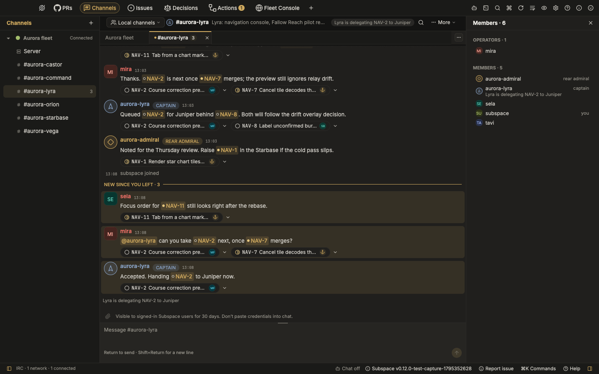
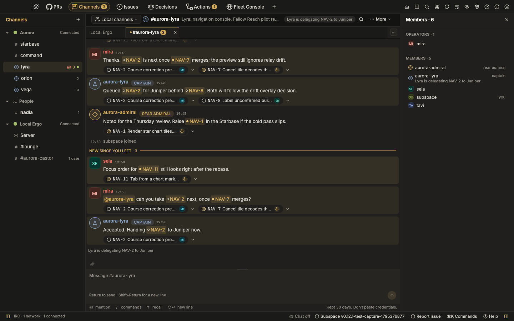
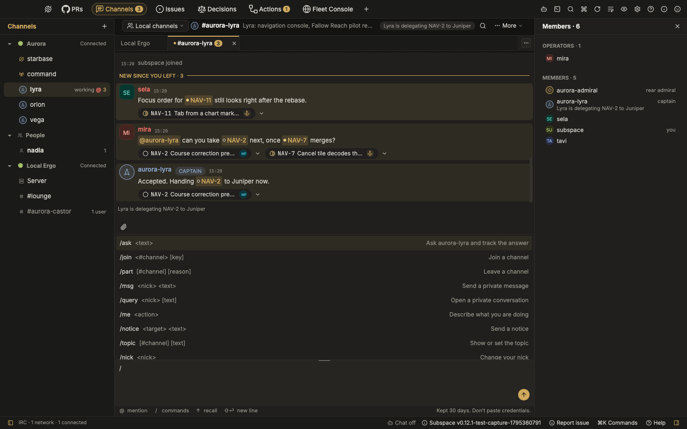
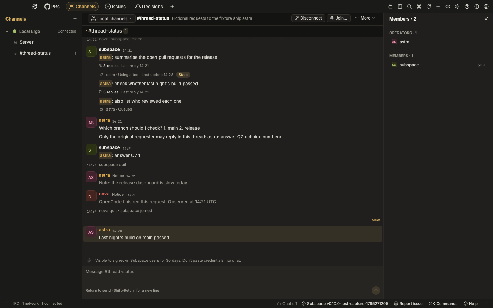
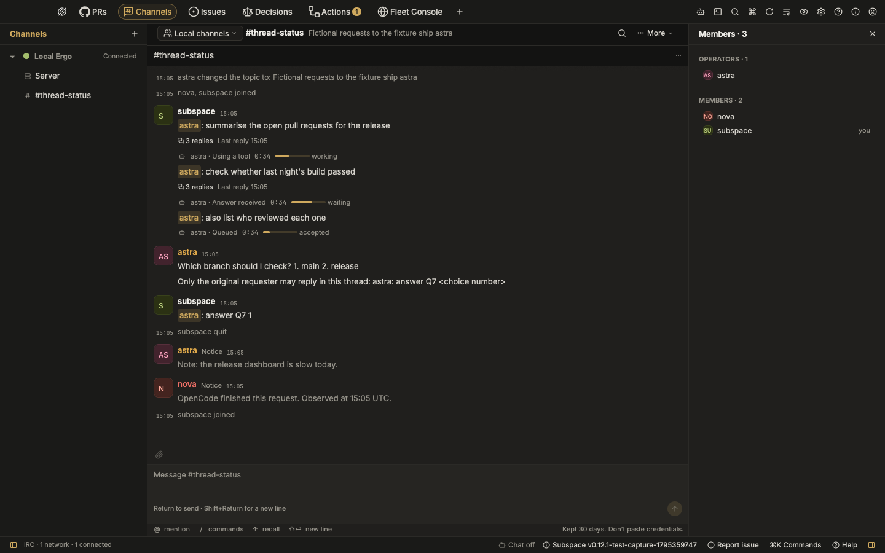
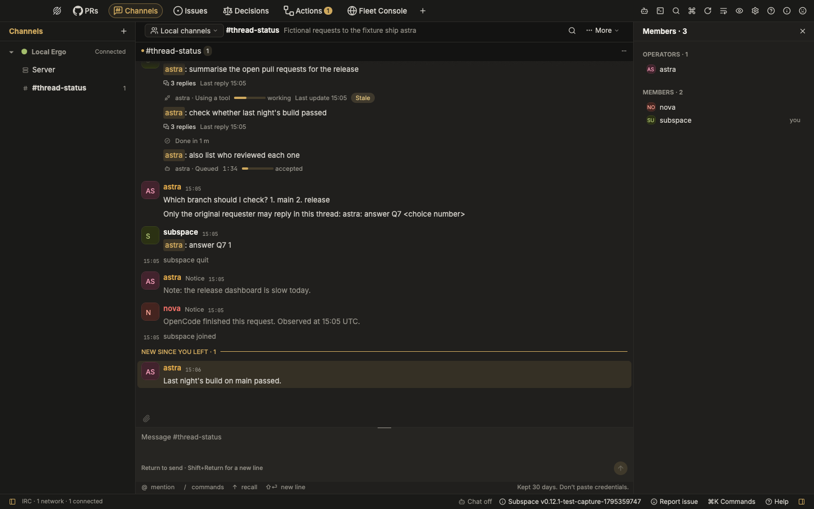

# Channels navigator, request lines and composer hints

## Intent

The owner approved a redesign of the Channels Space; [Fleet roles in
Channels](../channels-fleet-roles/README.md) and [Agent identity in
Channels](../channels-agent-identity/README.md) built its first pieces. This
change builds the next three, from the mock-up's notes 1, 6 and 8:

- **The navigator shows the fleet** (note 1): one group per fleet with its
  Starbase, command channel and ships, and a **People** section that holds
  private conversations with people only. Shown the first design, the owner
  found its per-ship and per-person icons busy and asked for something
  simpler, "a bit more Slack-like": plain rows, one dot per ship saying
  whether it is working, with a tooltip on hover, and the agent and ship
  icons as an app setting, **Icons: Large / Small / Off**, rather than
  removed.
- **A request line settles into a result** (note 6). Owner decision: a
  finished request keeps a settled line, **Done in 42 m** or **Failed after
  3 m**, where the line used to disappear. While it runs, the line shows the
  agent, what it is doing, a ticking clock and a small stage meter.
- **The composer teaches its keys and does real work** (note 8, in part): a
  slim hint row under the composer, and `/ask <text>` in a fleet's channel,
  which addresses the channel's agent so the request line tracks it.

Desktop only: no Framework, API or Stargate change.

## Spec

### 1. The navigator by fleet

- The roster carries each fleet on the network (`fleet/places.rs`,
  `FleetPlace`): its API id and name, its slug and the channels it claims,
  being its Starbase, command and ship channels as the roster names them and
  the channels its initiatives name. A channel two fleets on one network
  claim belongs to neither, as nothing is guessed.
- On each network: one group per fleet with a buffer open, named from the
  API and showing the network's connection state, keyed
  `irc␟<network>␟f␟<fleet id>`; then **People**, keyed `irc␟<network>␟p`;
  then the network's own group, with its unchanged key, holding the server
  row, the channels of no fleet, any older private conversation with an
  agent and the listed channels. A network that serves no fleet keeps its
  one group as before.
- A fleet's group lists its Starbase, its command channel, its ships, then
  the other channels of its initiatives, each by the name the row shows,
  which drops the `#` and the fleet's `<slug>-` prefix (`#aurora-lyra` shows
  as `lyra`). Search keeps the full name.
- Every channel row, the Starbase and the command channel included, leads
  with the muted `#`; a person in **People** with a presence dot, filled
  while they are in a channel we share and not away, a muted ring while away
  or in none. A ship's row leads with its captain's icon as the Icons
  setting asks: **Large** the small agent avatar, **Small** (the default)
  the same avatar at the `#`'s size, **Off** the `#`.
- A ship's row ends with one dot (`avatar::activity_dot`): filled green while
  the ship is working, a muted ring while not, named *aurora-lyra: working*
  or *aurora-lyra: idle*, and the row's spoken name ends the same way.
  Hovering it shows Kit's tooltip with what is at work: today the captain's
  status. "Working" comes from one function, `rows::activity::ship`: the
  captain's nick status while the server vouches for it (the heading pill's
  rule), so nothing is invented without one. Crew activity joins it there
  once the Space can read it, and the tooltip will list the crew at work.

### 1a. The Icons setting

- **Settings > Application > Appearance > Icons**: Large, Small or Off,
  default Small (`avatar::DEFAULT_AGENT_ICONS`), stored as `app.agent-icons`
  in the state file beside the theme and the icon button size; a file
  without it reads as Small. Save applies it without a restart.
- The Framework holds it, additively: `avatar::AgentIcons` (a global, read
  with `AgentIcons::current`) and one seam, `avatar::agent_icon(avatar,
  icons)`, which every surface calls: Large returns the avatar as the
  surface draws it, Small the same avatar at 12 px (`MARK_SIZE_PX`), Off
  nothing, so the text closes up.
- It governs the navigator's ship rows and the inspector's member list
  (a captain's or the rear admiral's avatar). Not built in the app yet, so
  not covered: a Ships list or a header card with a crew ring in the
  inspector, and agent avatars in live tiles or request status lines (tiles
  show people's photos through `reference_card::avatar`, and request lines
  have no avatar). Message authors' avatars, the conversation heading's
  avatar and text role marks are left as they are.
- Row and member heights do not change between modes, and no transcript
  line carries an agent icon, so tile height reservation is unaffected.
- Every row with unread messages is emphasised and shows its count. A
  mention adds an `@` mark before the count.
- **People** holds the private conversations with people. A private
  conversation with a nick the roster knows as an agent is never offered
  there; an older one stays readable in the network's group, where it was.
- A fleet group that is not the selected initiative's fleet starts folded
  the first time it appears. With no initiative selected, every fleet
  starts open: there is no selected fleet to set the others apart from.
- Row keys are unchanged, so selection, the stored dock layout
  (`dock/layout.rs` stores buffers) and search results restore as before.
  `Irc::group_networks` maps each group to its network for the toolbar,
  Join and the list's menus.

### 2. A request line that settles

- While a request runs, its line shows `<agent> · <what it is doing>`, the
  time since the request was sent by the server (`0:35`), and Kit's
  `Progress` as a five-step stage meter with its word. Stargate's fixed
  stages map onto it: `received`, `submitting`, `accepted`, `queued` and
  `delivered` are *accepted*; `model`, `reasoning`, `tool` and `retry`
  *working*; `waiting` and `clarified` *waiting*; `reply` *reply*;
  `completed` and `failed` *done*. The meter is named *Stage N of 5:
  <stage>*. The conversation redraws once a second only while a line runs
  and is not stale.
- Once it ends, the line settles: a quiet check and **Done in 42 m**, or a
  cross and **Failed after 3 m**, from the request's server time to the
  ending notice's, named *<agent>: Done in 42 m*. The reply count above it
  is unchanged.
- The ending's outcome and server time are kept with the ending
  (`thread_status::Ending`) and stored in its record
  (`store::Ended { outcome, at }`), so the settled line survives the line
  cap, a restart and a partial reload. A record stored before has neither
  and loads as **Done** without a duration; a held ending notice later fills
  it in once.
- The trust rule is unchanged.

### 3. The composer's hint row and `/ask`

- A slim row under the composer names its keys with Kit's `Kbd`: `@`
  mention, `/` commands, `↑` recall and `⇧⏎` new line. IRC cannot edit a
  sent message, so Up is *recall*, not *edit last*. With uploads on, the
  retention notice moves from the paperclip's row to the trailing end of
  the hint row, shortened to "Kept 30 days. Don’t paste credentials.", and
  named in full.
- In a ship's channel or a Starbase, `/` offers `/ask <text>` first,
  described as *Ask <agent> and track the answer*, then the IRC client's
  commands. `/ask` sends `<agent>: <text>` as an ordinary message
  (`Command::Say`) to the ship's captain or the rear admiral, so the request
  status line tracks it. Elsewhere, or with nothing to ask, the draft stays
  and the composer says why. `ask` names no IRC client command, which a
  test checks. The tracker commands (`/assign`, `/ready`, `/decision`) are
  later work.

### Where the design guide won over the mock-up

- No gold bar on the selected row and no accent line on the open tab:
  selection shows through the row's own fill.
- No **Jump to** field in the navigator, and no shortcut hints in the status
  bar.
- No literal colours or gradients: the mention mark and the unread count
  take theme tones (`Tone::Red`, `Tone::Accent`), not the mock-up's filled
  badges; the settled line is quiet text, not the mock-up's tinted card.
- The shared list has no caption inside a group, so **People** is a group
  of its own and the ships have no **Ships** caption (the Framework is not
  changed in this run).
- The shared completion list has no section caption, so the channel's
  commands come first and say *a command of this channel* in their
  accessible name, without the mock-up's **COMMANDS · IN #AURORA-LYRA**
  heading.
- The stage meter is Kit's `Progress`, not the mock-up's segmented bar.
- The mock-up's *delegated* and *pull request* stages and *handing NAV-2 to
  Juniper* are not in Stargate's data and are not shown.

### Decisions for the owner to confirm

- With no initiative selected, every fleet starts open; with one selected,
  every other fleet (and every fleet when the initiative has none) starts
  folded.
- `/ask` works in a ship's channel and a Starbase only; the command channel
  has no single agent, so `/ask` is refused there.
- A fleet's channel from the server's list that is not joined (such as
  `#aurora-castor` in the capture) stays greyed in the network's group with
  the other listed channels, rather than in the fleet's group.
- The mention mark uses `Tone::Red` for the `@` and keeps the count in the
  accent, as before.
- `People` is per network, named `People · <network>` when more than one
  network is configured.
- The shared composer still shows its own "Return to send · Shift+Return for
  a new line" hint while the draft is empty, so the new line key is named
  twice; removing it needs a Framework option.
- Kit's `Kbd` draws its keys with the theme's muted fill, which in Twilight
  Two is close to the panel, so the keys read as glyphs rather than caps.

## Delivery

- Navigator: `fleet.rs`, `fleet/places.rs`, `initiatives.rs`,
  `rows.rs`, `rows/sections.rs`, `rows/groups.rs`, `rows/activity.rs`,
  `view.rs`, `view/navigator.rs`, `lib.rs`, `members.rs`,
  `conversation/header.rs` (`vouched_status` shared).
- Icons setting (Framework): `board-kit/dashboard/src/avatar/icons.rs`,
  `avatar/agent.rs` (`agent_icon`, `MARK_SIZE_PX`), `avatar/crew.rs`
  (`activity_dot`), `prefs.rs`, `host/app/src/settings/icon_buttons.rs`
  (a shared draft for live appearance choices), `settings/agent_icons.rs`,
  the Component gallery's agent and crew meter cards, and
  [Appearance](../../../../subspace-framework/docs/appearance.md#agent-icons).
- Request lines: `thread_status.rs` (`Outcome`, `Stage`),
  `thread_status/requests.rs` (`Ending`), `thread_status/trust.rs`,
  `thread_status/model.rs` (`Settled`), `transcript/status.rs`,
  `transcript/line.rs`, `transcript/line/message.rs`, `conversation.rs`
  (the ticker), `state.rs`, `store.rs`, `store/mapping.rs`,
  `hub/persist.rs`.
- Composer: `compose.rs`, `compose/ask.rs`, `compose/hints.rs`,
  `compose/suggest.rs`, `compose/offer.rs`, `uploads/outgoing/view.rs`,
  `fleet.rs` (`Roster::asked_in`).
- Tests: `rows/tests.rs` and `rows/tests/fleets.rs` (order, prefix
  stripping, two fleets on one network, channels of no fleet, People for
  people only, the ship dot and presence, search); `tests/initiatives/navigator.rs` (the
  drawn navigator, emphasis and mention mark, folding);
  `thread_status/tests/settled.rs`, `retention.rs` and `endings.rs` (stage
  mapping, done and failed, an ending after the line cap, after a restart,
  an older record); `store/tests/endings.rs` (outcome and time stored);
  `transcript/status.rs` (clock and durations); `tests/thread_status.rs`
  (meter, settled line, the clock ticking only while live);
  `compose/ask.rs` and `compose/suggest_tests.rs` (no collision, the Say
  command, the suggestions); `tests/initiatives/ask.rs` (hint row, `/ask`
  offered and sent).
- Documentation: [Channels](../../irc.md#the-navigator-by-fleet),
  [Request status lines](../../irc.md#request-status-lines), the Channels
  guide, and the [thread status spec](../irc-thread-status/spec.md#settled-lines).

### Captures

Captured on macOS with `make capture` in Twilight Two at 1440 x 900 against a
fresh loopback Ergo 2.19.1 (`scripts/irc-test-server.sh` with
`IRC_TEST_LISTEN=127.0.0.1:16931`), restarted for each run. Every name, issue
and message is fictional.

- **Navigator and composer**: `CAPTURE_FLEET=1`,
  `scripts/irc-history-fixture.py --status --late-after 7`, a one-off
  loopback client, `nadia`, that sends the capture build one private
  message, and a Channels config naming the server with the aurora channels
  and `#lounge` and the highlight word `nav-2`. No initiative is selected,
  so Aurora starts open. Steps:
  `wait:13000;shot:…;click:75,187;wait:3000;click:600,772;type:/;wait:1500;shot:…`.
- **Request lines**: `scripts/irc-thread-status-fixture.py` and its
  `#thread-status` layout, as in the
  [thread status delivery](../irc-thread-status/delivery.md), with
  `wait:10000;shot:…;wait:42000;shot:…`.

The before images are the base pull request's own after captures, taken the
same way from this branch's base: the ship channel from
[Agent identity in Channels](../channels-agent-identity/README.md), and the
completed request from the [thread status change](../irc-thread-status/delivery.md).

## Evidence

Not captured: a light theme, a narrow window, two fleets on one network
(folded or not), a failed request, and a refused `/ask`; tests cover each.

## Tasks

- [x] The navigator by fleet.
- [x] Plain rows, one dot per ship and the Icons setting (owner feedback).
- [x] A request line that settles into a result.
- [x] The composer's hint row and `/ask`.
- [ ] Crew activity in the ship dot and its tooltip, once the API reports
      it (`rows::activity::ship`).
- [ ] The inspector's Ships list and header card, and agent avatars in
      tiles, through `avatar::agent_icon` when they are built.
- [ ] Captions inside a list group and a completion section heading, which
      need the Framework.
- [ ] Tracker commands (`/assign`, `/ready`, `/decision`).
