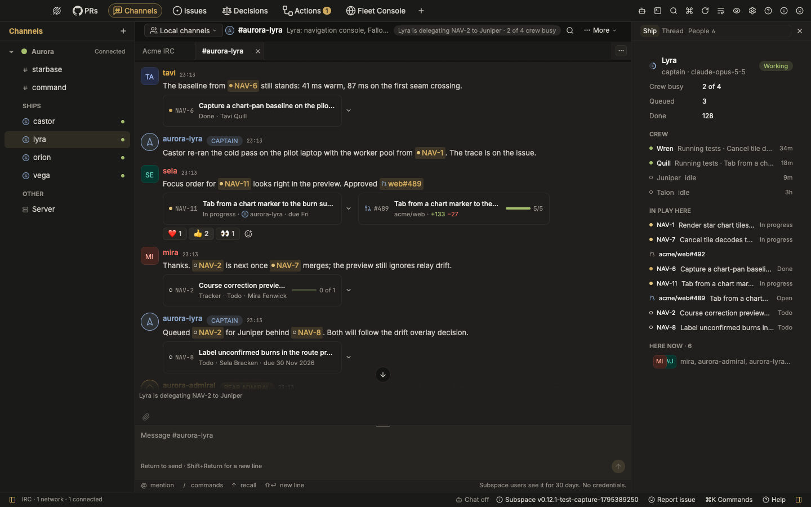
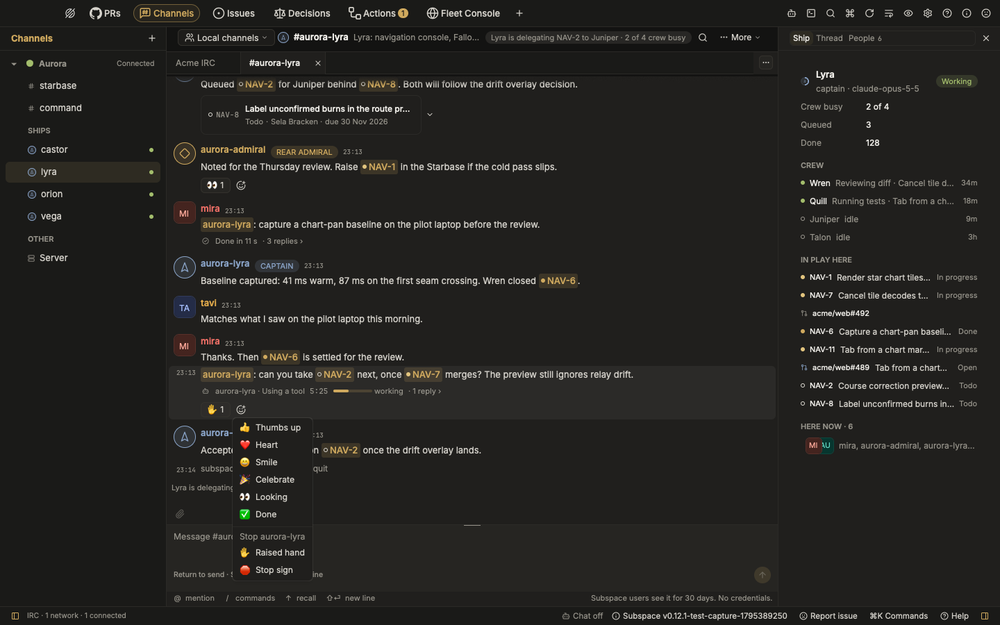
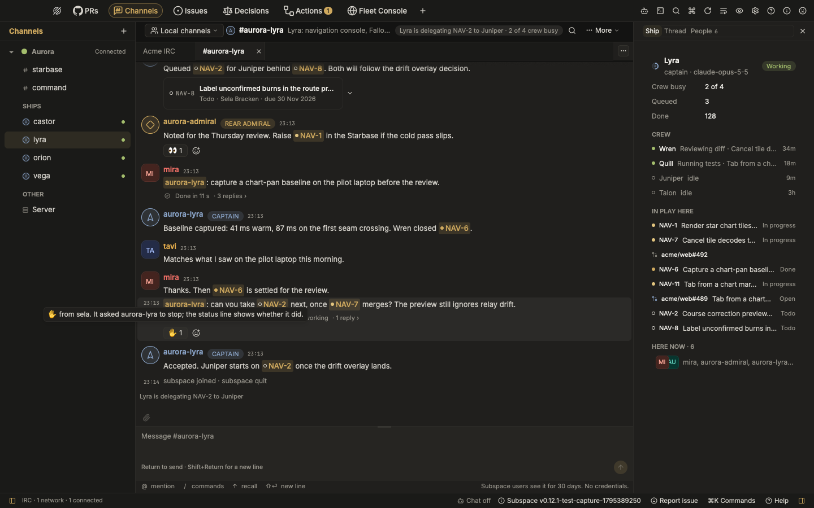

# Channels reactions

## Intent

Show message reactions in Channels, let a person add and take back their
own, and show which reactions stop an agent (the owner's requirement), on
top of the IRC client's reaction layer
([IRC client reactions](../irc-client-reactions/README.md)). Close that
layer's open review findings at the same time, since this is the first
change that reads it.

Not in this change: the message hover toolbar, tracker commands and the
stakeholder relay.

## Specification

- **Reading.** Channels drains the runtime with `drain_updates` instead of
  `drain`. The hub keeps one `ReactionBook`, observes every event before it
  applies (nick changes, loaded lines) and applies every reaction; a
  reaction to a line already held marks that message loaded. Removing a
  conversation drops its reactions. Everything else the hub did is
  unchanged.
- **Pills.** Under a message, one small pill per reaction with its count, in
  the book's order, wrapping, with the rest after ten behind **+N**. Ours is
  told apart by the pill's latched surface and semibold text, never by an
  edge line. A tooltip and the accessible name list who reacted (`👍 from
  alice, bob and you`, at most eight names, then how many others).
- **Toggling.** Selecting a pill adds ours or takes it back. **Add
  reaction** ends a row with pills, and `r` on a keyboard-focused message
  opens the same menu at the message (the Space's existing keyboard path;
  the message text's context menu is the Framework's shared text menu and
  is unchanged). The menu offers six common reactions (👍 ❤️ 😄 🎉 👀 ✅),
  ticked when ours; there is no emoji picker. Ours shows only once the
  client reports it. A `ReactionRefused` shows as a brief, plain notice
  above the composer, with Dismiss.
- **Stop reactions.** The stop group, ✋ **Raised hand** and 🛑 **Stop
  sign** under the plain label `Stop <ship>`, is in a message's menu only
  when the conditions the client can know hold: the conversation is a
  channel; the message is a held request whose status line is trusted (its
  progress comes from the account named after the nick it asks, so the
  agent is verified) and still running and current (not settled, not
  stale), or it is that agent's own reply to such a request (its nick and
  server account both name the nick asked). An unverified nick is never
  taken for the agent. The stop reactions are never among the common
  choices. After a stop is chosen and the client reports it, the notice
  says only: `Sent ✋ to ask <ship> to stop. The status line shows the
  result when Stargate reports it.` A ✋ or 🛑 pill on a request to a
  verified agent, or the agent's reply, has the tooltip `✋ from sela. It
  asked aurora-lyra to stop; the status line shows whether it did.`, and
  selecting it sends nothing (a notice says where the deliberate stop is),
  so a stray click never stops an agent. Elsewhere ✋ and 🛑 are ordinary
  reactions. Nothing claims an agent stopped; that is the status line's.
- **Support and states.** While `Update::ReactionSupport` is not true for the
  network, the controls go and known reactions stay as read-only pills. A
  message without a `msgid` cannot take a reaction.
- **Layout.** Each sync rebuilds the reactions shown per message and
  re-measures only the rows whose reactions, agent role or support changed,
  one by one, as reply counts and status lines do; nothing else moves, and
  the tiles keep their fixed box. The Thread tab shows the root's and the
  replies' pills read-only.
- **Rules.** Reactions go to the conversation the message is in; nothing
  sends a private message. Reaction values and names from the network are
  bounded (the client's limits; names cleaned and cut to 32 characters) and
  rendered as text.

### How the stop choices are decided

Read from Stargate `main` at `d4842b8` (22 November 2026; the stop
behaviour is unchanged since `da242f8`, which the client layer cites:
only `src/irc/status.ts` changed among the IRC files): `docs/irc.md`
"Stop by reaction", `routeIrcStop` and `reactionKey` in
`src/irc/routing.ts`, the `stopReactions` setting in `src/irc/config.ts`
and `stop` in `src/irc/ship.ts`. A person (an `account` tag, not the
ship's own accounts or a peer captain, admitted by the access rules)
reacting with one of `irc[].stopReactions` (default ✋ and 🛑, skin tones
and the variation selector ignored) to the request, or to a bot message
answering it, stops an active turn; `+draft/unreact` is ignored and
replayed history never stops anything. The app cannot see the gateway's
`stopReactions` or access rules, or whether our account counts as a
person; the help says a fleet can configure other stop reactions.

## Client findings

The twelve findings left open on pull request 67
([IRC client reactions](../irc-client-reactions/README.md)), each verified
against the code with a test that failed before the fix:

1. **History marked another person's reaction as ours by our nick**:
   fixed in `729bf02`. History is ours only by a matching account; live
   traffic keeps the nick fallback. (A "known local message ID" was not
   needed: an echo seen live already marks the record ours, and the book
   keeps that.)
2. **Unseen messages shared the loaded messages' budget**: fixed in
   `ada5ab9`. 256 unseen messages in all, 64 per conversation, apart from
   the 2,048 loaded; `observe` and `mark_seen` promote a message once
   loaded.
3. **Reactivating a remembered removal bypassed the display limits**: fixed
   in `ada5ab9`. Any change that makes a group or person visible checks
   both limits first.
4. **A history operation overrode a live one at the same time**: fixed in
   `ada5ab9`. The live state wins a tie. No stable server order is used:
   Ergo's message IDs are not ordered.
5. **An accountless rename left two records with one nick**: fixed in
   `ada5ab9`. Each record keeps when it last took its nick; the newest
   holds it, and the older record stays until resolved.
6. **Support reported before registration and kept after a disconnect**:
   fixed in `729bf02`. Support needs a welcomed connection, is reported at
   the welcome, and is reported off when the link ends.
7. **Nick folds from an earlier case mapping**: fixed in `ada5ab9`. Nicks
   fold under the current mapping when compared; nothing pre-folded is kept.
8. **A destination too long for one line**: fixed in `729bf02`. Refused as
   `InvalidTarget` instead of being cut short by the codec.
9. **An old addition backdated a re-addition across a known removal**:
   fixed in `ada5ab9`, although cosmetic: each record remembers its newest
   removal and never moves a place back across it.
10. **Removal eviction ranked by the addition time**: fixed in `ada5ab9`;
    it ranks by when the removal happened.
11. **A refused addition evicted a remembered removal**: fixed in
    `ada5ab9`; an addition that cannot show is refused before anything is
    dropped.
12. **The removal-only group test passed whichever group went**: fixed in
    `ada5ab9`; it now proves the oldest group went and the next was kept.

## Delivery

- Client: `clients/irc/src/session/reactions.rs`, `session/caps.rs`,
  `session/registration.rs`, `network.rs`; `reactions/book.rs`,
  `reactions/book/groups.rs`, `reactions/book/groups/record.rs`; tests in
  `session/tests/reactions/lifecycle.rs`, `reactions/book/tests/review.rs`
  and `reactions/book/tests/limits.rs`. `ReactionBook::reacted_messages`
  is new, and the book is `Clone`.
- Channels: `reactions.rs` (the hub's book, support and refusals),
  `reactions/choices.rs`, `reactions/stop.rs`, `conversation/reacting.rs`
  (per-sync rows, toggling, the keyboard menu, notices),
  `transcript/reactions.rs` (pills, **+N**, **Add reaction**), the row
  context, `transcript/line/message.rs`, `conversation/keys.rs` (`r`),
  `hub.rs` (`receive`).
- Tests: `reactions/tests.rs` (shown per message, support, refusals, nick
  changes, removal, the stop group's conditions: a trusted running request,
  the agent's verified reply, an impostor without the account, a settled
  request, a stale one, a private conversation; the choices) and
  `tests/reactions.rs` (render tests: pills and their names, ours only once
  reported, taking ours back, a stop pill that sends nothing and says what
  it asked, ordinary ✋ elsewhere, a refusal notice, support off keeping
  read-only pills, removal).
- Fixture: `scripts/irc-history-fixture.py --reactions`.
- Documentation: [Channels](../../irc.md#reactions-in-channels), the
  in-app Channels help and [Desktop capture](../../capture.md).

Checks: `cargo fmt`, Clippy with warnings denied and the tests of
`subspace-client-irc` and `subspace-irc-board`, `mise run architecture`,
and `mise run quality` (no findings, no regression).

## Captures

Captured on macOS with `make capture` at 1440 x 900 (`resize:1440,900`) in
Twilight Two, with `CAPTURE_FLEET=1 CAPTURE_FLEET_API=1` so the roster knows
the aurora fleet's ships and the navigator shows them under **Ships**,
against a fresh loopback Ergo 2.19.1 (`scripts/irc-test-server.sh` with
`IRC_TEST_LISTEN=127.0.0.1:16953`) and
`scripts/irc-history-fixture.py --status --thread --reactions`, both stopped
by their port and process id afterwards, and a Channels config naming that
server as the network **Acme IRC** (id `acme`) with the aurora channels.
Every name, issue and message is fictional. Steps:
`resize:1440,900;wait:9000;click:70,247;wait:4000;scroll:700,400,600;wait:1000;click:355,414;wait:2500;move:1000,800;wait:800;shot:channel-yours;click:441,414;wait:1200;shot:choices-ordinary;click:441,414;wait:800;scroll:700,400,-2000;wait:1500;move:310,589;wait:2000;shot:stop-tooltip;click:347,589;wait:1200;shot:choices-stop`.
The first click on 👍 is the capture build reacting; its pill shows as ours
once the server echoed it.

Each image was compared with the design guide's shell anatomy: the zones
are where they belong, the pills sit inside the message's own row at its
text edge, the menu opens from its control, and no image has an accent
line on one edge. Ours is shown by the native latched surface and bold
count.

## Not verified

- A real Stargate stopping a turn: the stop group's conditions are tested
  against the fixture's progress tags and read from Stargate's source, not
  run against a gateway.
- The keyboard menu (`r`) is not captured; its anchoring uses the focused
  row's measured bounds and is exercised only by hand.
- A light theme, a narrow window and the Thread tab's read-only pills are
  covered by tests, not captured.
- Reactions from history to a message restored from the store are marked
  loaded when they arrive; history ownership needs our account, so on a
  server without accounts our own history reactions show as another nick's
  until a live echo arrives.

## Tasks

- [x] Read reaction updates; drop a removed conversation's reactions.
- [x] Pills, tooltips and names; **+N**.
- [x] Toggle ours; Add reaction and `r`; refusal notices.
- [x] The stop group and stop pills.
- [x] Support changes; messages without a `msgid`.
- [x] Single-row re-measure; the Thread tab read-only.
- [x] The twelve client findings.
- [ ] The message hover toolbar (separate work).
