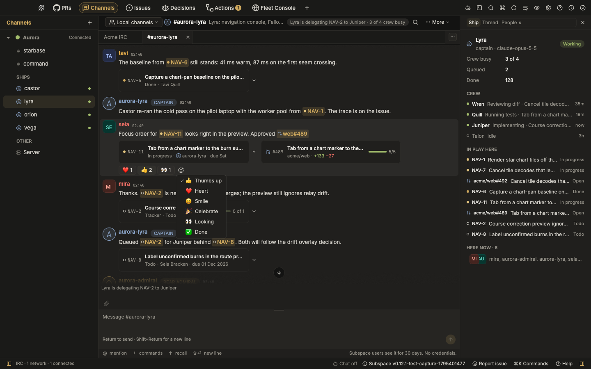

# Channels reactions

## Intent

Show message reactions in Channels, let a person add and take back their
own, and show which reactions stop an agent (the owner's requirement), on
top of the IRC client's reaction layer
([IRC client reactions](../irc-client-reactions/README.md)). Close that
layer's open review findings at the same time, since this is the first
change that reads it.

Not in this change: the message hover toolbar, tracker commands and the
stakeholder relay.

## Specification

- **Reading.** Channels drains the runtime with `drain_updates` instead of
  `drain`. The hub keeps one `ReactionBook`, observes every event before it
  applies (nick changes, loaded lines) and applies every reaction; a
  reaction to a line already held marks that message loaded. Removing a
  conversation drops its reactions. Everything else the hub did is
  unchanged.
- **Pills.** Under a message, one small pill per reaction with its count, in
  the book's order, wrapping, with the rest after ten behind **+N**. Ours is
  told apart by the pill's latched surface and semibold text, never by an
  edge line. A tooltip and the accessible name list who reacted (`👍 from
  alice, bob and you`, at most eight names, then how many others).
- **Toggling.** Selecting a pill adds ours or takes it back. **Add
  reaction** ends a row with pills, and `r` on a keyboard-focused message
  opens the same menu at the message (the Space's existing keyboard path;
  the message text's context menu is the Framework's shared text menu and
  is unchanged). The menu offers six common reactions (👍 ❤️ 😄 🎉 👀 ✅),
  ticked when ours; taking ours back removes each exact value we hold
  (`❤` for the menu's `❤️`); there is no emoji picker. Ours shows only once the
  client reports it. A `ReactionRefused` shows as a brief, plain notice
  above the composer, with Dismiss.
- **Stop reactions.** The stop group, ✋ **Raised hand** and 🛑 **Stop
  sign** under the plain label `Stop <ship>`, is in a message's menu only
  when the conditions the client can know hold: the conversation is a
  channel; the nick asked is a fleet agent on the roster; the message is a
  held request whose status line is trusted (its
  progress comes from the account named after the nick it asks, so the
  agent is verified) and still running and current (not settled, not
  stale), or it is that agent's own reply to such a request (its nick and
  server account both name the nick asked). An unverified nick is never
  taken for the agent. The stop reactions are never among the common
  choices. After a stop is chosen and the client reports it, the notice
  says only: `Sent ✋ to ask <ship> to stop. The status line shows the
  result when Stargate reports it.` A ✋ or 🛑 pill on a request to a
  verified agent, or the agent's reply, has the tooltip `✋ from sela. It
  asked aurora-lyra to stop; the status line shows whether it did.`
  Each pending stop is kept by its message and exact reaction, so another
  reaction sent before its echo loses no notice. Nothing claims an agent
  stopped; that is the status line's.
- **The sending rule** (`reactions/gate.rs`). Every reaction sent goes
  through `reacting::toggle` and one rule: nothing to the server buffer or
  to a fleet agent in a private conversation (the composer's
  `AgentNotice::refusing`; the controls are hidden there), and a new ✋ or
  🛑 of ours (Stargate's stop keys, skin tones and the variation selector
  folded) only from the labelled `Stop <ship>` item in a channel. A pill,
  a `+N` item, a common choice or anything else that asks for one is
  explained, not sent, on any message, whether or not the app recognises it
  as an agent's: Stargate stops a queued turn before any status line
  exists. So no selection but that labelled item sends Stargate's default
  stop reactions; a fleet's other configured stop reactions are invisible
  to the app and are sent like any other. Taking back our own stop still
  goes. Reactions between people in private are ordinary.
- **Support and states.** While `Update::ReactionSupport` is not true for the
  network, the controls go and known reactions stay as read-only pills. A
  message without a `msgid` cannot take a reaction.
- **Layout.** Each sync rebuilds the reactions shown per message and
  re-measures only the rows whose reactions, agent role or support changed,
  one by one, as reply counts and status lines do; nothing else moves, and
  the tiles keep their fixed box. The Thread tab shows the root's and the
  replies' pills read-only.
- **Rules.** Reactions go to the conversation the message is in; nothing
  opens a private conversation, and none goes to an agent in private.
  Reaction values and names from the network are bounded (the client's
  limits; names cleaned and cut to 32 characters; values shown without
  spaces, control or invisible format characters, keeping the zero-width
  joiner) and rendered as text; the exact value held is what is sent back.

### How the stop choices are decided

Read from Stargate `main` at `d4842b8` (22 November 2026; the stop
behaviour is unchanged since `da242f8`, which the client layer cites:
only `src/irc/status.ts` changed among the IRC files): `docs/irc.md`
"Stop by reaction", `routeIrcStop` and `reactionKey` in
`src/irc/routing.ts`, the `stopReactions` setting in `src/irc/config.ts`
and `stop` in `src/irc/ship.ts`. A person (an `account` tag, not the
ship's own accounts or a peer captain, admitted by the access rules)
reacting with one of `irc[].stopReactions` (default ✋ and 🛑, skin tones
and the variation selector ignored) to the request, or to a bot message
answering it, stops an active turn; `+draft/unreact` is ignored and
replayed history never stops anything. The app cannot see the gateway's
`stopReactions` or access rules, or whether our account counts as a
person; the help says a fleet can configure other stop reactions.

## Client findings

The twelve findings left open on pull request 67
([IRC client reactions](../irc-client-reactions/README.md)), each verified
against the code with a test that failed before the fix:

1. **History marked another person's reaction as ours by our nick**:
   fixed in `729bf02`. History is ours only by a matching account; live
   traffic keeps the nick fallback. (A "known local message ID" was not
   needed: an echo seen live already marks the record ours, and the book
   keeps that.)
2. **Unseen messages shared the loaded messages' budget**: fixed in
   `ada5ab9`. 256 unseen messages in all, 64 per conversation, apart from
   the 2,048 loaded; `observe` and `mark_seen` promote a message once
   loaded.
3. **Reactivating a remembered removal bypassed the display limits**: fixed
   in `ada5ab9`. Any change that makes a group or person visible checks
   both limits first.
4. **A history operation overrode a live one at the same time**: fixed in
   `ada5ab9`. The live state wins a tie. No stable server order is used:
   Ergo's message IDs are not ordered.
5. **An accountless rename left two records with one nick**: fixed in
   `ada5ab9`. Each record keeps when it last took its nick; the newest
   holds it, and the older record stays until resolved.
6. **Support reported before registration and kept after a disconnect**:
   fixed in `729bf02`. Support needs a welcomed connection, is reported at
   the welcome, and is reported off when the link ends.
7. **Nick folds from an earlier case mapping**: fixed in `ada5ab9`. Nicks
   fold under the current mapping when compared; nothing pre-folded is kept.
8. **A destination too long for one line**: fixed in `729bf02`. Refused as
   `InvalidTarget` instead of being cut short by the codec.
9. **An old addition backdated a re-addition across a known removal**:
   fixed in `ada5ab9`, although cosmetic: each record remembers its newest
   removal and never moves a place back across it.
10. **Removal eviction ranked by the addition time**: fixed in `ada5ab9`;
    it ranks by when the removal happened.
11. **A refused addition evicted a remembered removal**: fixed in
    `ada5ab9`; an addition that cannot show is refused before anything is
    dropped.
12. **The removal-only group test passed whichever group went**: fixed in
    `ada5ab9`; it now proves the oldest group went and the next was kept.

## Merged with main and the Thread tab

`main` at `c502895` (the Thread tab pull request, 70, as merged after four
review rounds) was merged into this branch in `a3a8bc6`. The one textual
conflict was the hub's fields: it keeps both the reaction book and each
view's share of the fleet state. The Thread tab as `main` builds it takes
its rows' facts from the conversation's row context, so its root and
latest replies keep their read-only pills. Tests added in `d5a53b6`, in
`tests/initiatives/thread_reactions.rs`, prove on the merged code that a
reaction row under a request leaves its linked status line a button with
its status element beside it; that the tab's pills are read-only and
selecting one sends nothing; that `r` opens the reaction menu at the
focused message from reply mode without leaving it; and that reacting
while a gone reply's draft is held sends only the reaction and keeps the
guard. Reactions send only `React` and `Unreact` to the message's own
conversation and never touch the composer's draft or reply mode.

## Findings carried from pull request 70

The seven findings left open at the Thread tab's final head, each checked
against the merged code. Each fix has a test that was run against the
code before the fix and failed there.

1. **A save queued before a clear could release the hold that clear set**
   (`clients/fleet`): fixed in `fe9d9bd`. The hold remembers the token
   generation its clear began, and only a write or read queued in that
   generation or later ends it; a read queued before the clear that found
   no token no longer ends it either. A cleared token stays cleared.
   Tests: `service/tests/hold.rs` (save, clear, refused delete, refused
   save, then the fleet removed and added again; and a read queued before
   the clear).
2. **Reply in thread on another thread replaced a gone reply's target**
   (`compose/reply.rs`): fixed in `d7ce673`. While a gone reply's draft
   holds text, **Reply in thread** only offers the new thread; the row
   adds **Move to \<author\>'s thread** (named after review; see Review
   findings) beside **Write to the channel**, and the
   draft stays unsendable until the person chooses one or empties it. An
   offered thread that goes too is withdrawn. Tests in
   `tests/initiatives/thread_gone.rs`.
3. **A deferred Retry recorded its scheduled deadline as the read time**
   (`clients/fleet/src/service.rs`): fixed in `a68c80c`. Each re-read
   records when it starts on the fleet's ordered path, from the app's
   clock, and a Retry asked while a read is in flight waits for its
   interval instead of being lost. Tests in `service/tests/keychain.rs`
   (a late timer; a Retry during an in-flight read).
4. **In play here asked for references for ordinary conversations and
   inactive views** (`view/inspector/play.rs`): fixed in `b3f51cd`. It
   asks only while the Space is active, the inspector shows, and the
   conversation in front is a ship's channel on its Ship tab. Tests in
   `tests/initiatives/review.rs`.
5. **The Thread tab built a row for every status transition**
   (`thread/model.rs`, `view/inspector/thread/steps.rs`): fixed in
   `68fdf30`. The timeline keeps its latest 24 steps and counts the rest,
   and the tab says how many earlier steps it leaves out. Test in
   `thread/tests/timeline.rs` (121 steps).
6. **A follow-up request's status line shows no reply count while its tab
   shows the thread's replies**: left as documented behaviour. The tab's
   heading reads **Replies in this thread** for a follow-up made as a
   reply, and [Channels](../../irc.md) says so.
7. **The zero-size status element beside a linked status line may be
   skipped by assistive technology**: left, unverified. It needs a check
   with VoiceOver, which was not run; the render test proves only that the
   element is there, beside the button, with the status role.

## Review findings

Pull request 72 at `b609038` was reviewed by Claude Opus 5.5 (not clear:
two P1, two P2, four P3), GPT-6.2 Sol (not clear: one high, six medium,
one low) and a second Opus pass from the review helper (clear: two
medium, two low). Each finding was checked against the code. Each fix
has a test that was run against the code before the fix and failed
there, except where noted.

Stop reactions and where reactions go:

1. **The +N overflow menu sent a stop with no guard** (Opus P1 1; Sol
   high; helper medium 1): fixed in `f33b39a`. Every path sends through
   `reacting::toggle` and the one rule in `reactions/gate.rs`; a new ✋ or
   🛑 goes only from the labelled `Stop <ship>` item. The +N tooltips
   carry the stop wording. Test: a ✋ behind +1 on a running request,
   chosen from the menu by keyboard (`tests/reactions/gate.rs`).
2. **A ✋ or 🛑 pill sent a stop where the app could not see the agent**
   (Opus P2 3; Sol medium; helper medium 2): fixed in `f33b39a` by the same
   rule, which does not depend on recognising the message. Tests: a ✋ on
   a fresh request with no status, and a 🛑 on an agent reply without an
   account tag; taking back our own ✋ still sends.
3. **Reactions could be sent privately to a fleet agent** (Opus P1 2):
   fixed in `f33b39a`. The rule refuses them where they are sent, with the
   composer's notice, and the controls are hidden. Reactions between
   people in private are ordinary. Tests in
   `tests/initiatives/private_reactions.rs`.
4. **Another reaction overwrote the pending stop acknowledgement** (Sol
   medium): fixed in `f33b39a` (pending stops kept per message and exact
   reaction); the test, added in `d567669`, failed against the earlier
   `reacting.rs`.
5. **Take-back sent the menu's value, not ours** (Sol medium): fixed in
   `9197bc1`. Tests: the Heart choice with `❤` held, through the menu, and
   two variants held at once.
6. **The stop group did not consult the roster** (Opus P3 8): fixed in
   `61feede`; the nick asked must be a fleet agent on the roster. The
   test failed with the roster check taken out.

Performance:

7. **Quadratic stop rebuild** (Opus P2 4; Sol medium): fixed in `61feede`,
   one msgid index per rebuild.
8. **reacted_messages scanned the whole book and built summaries; holds
   scanned the buffer per update** (Opus P2 4; Sol low): fixed in
   `caf830c` (a range of the book, a check for one shown person, no buffer
   scan for a message already known loaded). No behaviour changes, so its
   test pins the result rather than failing before.
9. **Every rename re-folded every nick with allocations** (helper low 1):
   fixed in `2615a58` with `Casemapping::same`; a test checks it against
   `fold` under each mapping. The earlier change record's sentence about
   pre-folded nicks is corrected.

The rest:

10. **A stale Move to the thread offer** (Opus P3 5): fixed in `d8d09c7`.
    Choosing another thread withdraws the offer, and the button names the
    thread's author, with the root's start in its accessible name.
11. **A Retry lost behind a read that outlasts the interval** (Opus P3 6):
    fixed in `e24bd86`. The test failed with the landing extracted into
    `read_landed` and the fix not yet in.
12. **Network reaction values shown uncleaned** (Opus P3 7): fixed in
    `f3bec96`. Values are shown without spaces, control or invisible format
    characters, keeping the zero-width joiner; the exact value is what is
    sent back. `validate_reaction` is unchanged, so such values still
    arrive and are only cleaned for display.
13. **A second accountless rename renamed a nick's earlier holder** (Sol
    medium): fixed in `2615a58`.
14. **A late removal left a backdated place before it** (Sol medium):
    fixed in `2615a58`.
15. **apply evicts before record can refuse** (helper low 2): refuted as
    stated. For a message the book does not hold, `record` always keeps
    the operation (a new group and person always fit), and invalid
    reactions return before anything is evicted. A removal for an unknown
    message is kept on purpose, as a remembered removal stops a later
    history replay showing the reaction again, so it may evict the least
    recently changed unseen message within the unseen budget. Left as
    designed.

## Delivery

- Client: `clients/irc/src/session/reactions.rs`, `session/caps.rs`,
  `session/registration.rs`, `network.rs`; `reactions/book.rs`,
  `reactions/book/groups.rs`, `reactions/book/groups/record.rs`; tests in
  `session/tests/reactions/lifecycle.rs`, `reactions/book/tests/review.rs`
  and `reactions/book/tests/limits.rs`. `ReactionBook::reacted_messages`
  is new, and the book is `Clone`.
- Channels: `reactions.rs` (the hub's book, support and refusals),
  `reactions/choices.rs`, `reactions/stop.rs`, `conversation/reacting.rs`
  (per-sync rows, toggling, the keyboard menu, notices),
  `transcript/reactions.rs` (pills, **+N**, **Add reaction**), the row
  context, `transcript/line/message.rs`, `conversation/keys.rs` (`r`),
  `hub.rs` (`receive`).
- Tests: `reactions/tests.rs` (shown per message, support, refusals, nick
  changes, removal, the stop group's conditions: a trusted running request,
  the agent's verified reply, an impostor without the account, a settled
  request, a stale one, a private conversation; the choices) and
  `tests/reactions.rs` (render tests: pills and their names, ours only once
  reported, taking ours back, a stop pill that sends nothing and says what
  it asked, ordinary ✋ elsewhere, a refusal notice, support off keeping
  read-only pills, removal).
- Fixture: `scripts/irc-history-fixture.py --reactions`.
- Documentation: [Channels](../../irc.md#reactions-in-channels), the
  in-app Channels help and [Desktop capture](../../capture.md).

- Findings carried from pull request 70: `clients/fleet/src/service.rs`,
  `service/queue.rs`, `service/tokens.rs` with
  `service/tests/hold.rs` and `service/tests/keychain.rs`;
  `compose/reply.rs`, `view/inspector/play.rs`, `thread/model.rs`,
  `view/inspector/thread/steps.rs` with `tests/initiatives/thread_gone.rs`,
  `tests/initiatives/review.rs` and `thread/tests/timeline.rs`;
  [Fleet API](../../fleet-api.md) and [Channels](../../irc.md) updated.
- Review findings: `reactions/gate.rs` (the one sending rule) with
  `conversation/reacting.rs`, `transcript/reactions.rs`,
  `reactions/choices.rs`, `reactions/stop.rs`, `compose/reply.rs`,
  `thread.rs`; the client's `reactions/book.rs`,
  `book/groups/record.rs` and `session/isupport.rs`; the fleet client's
  `service.rs`. Tests in `tests/reactions/gate.rs`,
  `tests/reactions/take_back.rs`, `tests/initiatives/private_reactions.rs`,
  `reactions/tests.rs`, `book/tests/review.rs` and
  `service/tests/keychain.rs`.

Checks: `cargo fmt`, Clippy with warnings denied and the tests of
`subspace-client-irc`, `subspace-irc-board`, `subspace-client-fleet` and
`subspace-web-board`, `mise run architecture`, and `mise run quality` (no
findings, no regression).

## Captures

Retaken after the merge with `main` (the inspector's tabs now share one
surface, as `main` draws them). Captured on macOS with `make capture` at
1440 x 900 (`resize:1440,900`) in Twilight Two, with
`CAPTURE_STATE='{"app.dashboard":"irc"}'` so it opens on Channels, and
`CAPTURE_FLEET=1 CAPTURE_FLEET_API=1` so the roster knows
the aurora fleet's ships and the navigator shows them under **Ships**,
against a fresh loopback Ergo 2.19.1 (`scripts/irc-test-server.sh` with
`IRC_TEST_LISTEN=127.0.0.1:16953`) and
`scripts/irc-history-fixture.py --status --thread --reactions`, both stopped
by their port and process id afterwards, and a Channels config naming that
server as the network **Acme IRC** (id `acme`) with the aurora channels.
Every name, issue and message is fictional. Steps:
`resize:1440,900;wait:9000;click:70,247;wait:4000;scroll:700,400,600;wait:1000;click:355,414;wait:2500;move:1000,800;wait:800;shot:channel-yours;click:441,414;wait:1200;shot:choices-ordinary;click:441,414;wait:800;scroll:700,400,-2000;wait:1500;move:310,589;wait:2000;shot:stop-tooltip;click:347,589;wait:1200;shot:choices-stop`.
The first click on 👍 is the capture build reacting; its pill shows as ours
once the server echoed it.

Each image was compared with the design guide's shell anatomy: the zones
are where they belong, the pills sit inside the message's own row at its
text edge, the menu opens from its control, and no image has an accent
line on one edge. Ours is shown by the native latched surface and bold
count.

## Not verified

- A real Stargate stopping a turn: the stop group's conditions are tested
  against the fixture's progress tags and read from Stargate's source, not
  run against a gateway.
- The keyboard menu (`r`) is not captured; a render test proves it opens
  from the focused message, also in reply mode, but where it lands uses the
  focused row's measured bounds and is checked only by hand.
- The status element beside a linked status line with VoiceOver (finding
  7 above), and the Thread tab's new **Move to the thread** and earlier
  steps line, which are covered by tests, not captured.
- A light theme, a narrow window and the Thread tab's read-only pills are
  covered by tests, not captured.
- Reactions from history to a message restored from the store are marked
  loaded when they arrive; history ownership needs our account, so on a
  server without accounts our own history reactions show as another nick's
  until a live echo arrives.

## Tasks

- [x] Read reaction updates; drop a removed conversation's reactions.
- [x] Pills, tooltips and names; **+N**.
- [x] Toggle ours; Add reaction and `r`; refusal notices.
- [x] The stop group and stop pills.
- [x] Support changes; messages without a `msgid`.
- [x] Single-row re-measure; the Thread tab read-only.
- [x] The twelve client findings.
- [x] Merge `main` with the Thread tab; reactions proved on it.
- [x] The seven findings carried from pull request 70 (five fixed, one
      documented, one unverified).
- [x] The review findings on pull request 72 (fourteen fixed, one
      refuted).
- [ ] The message hover toolbar (separate work).
