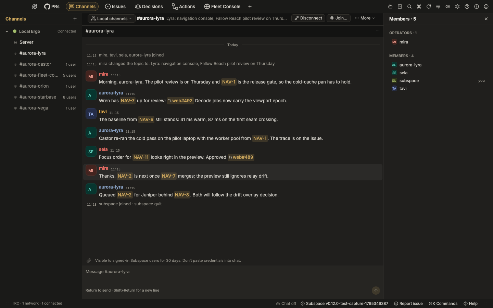
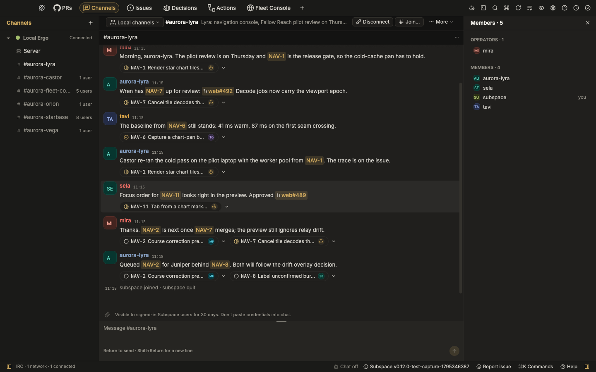
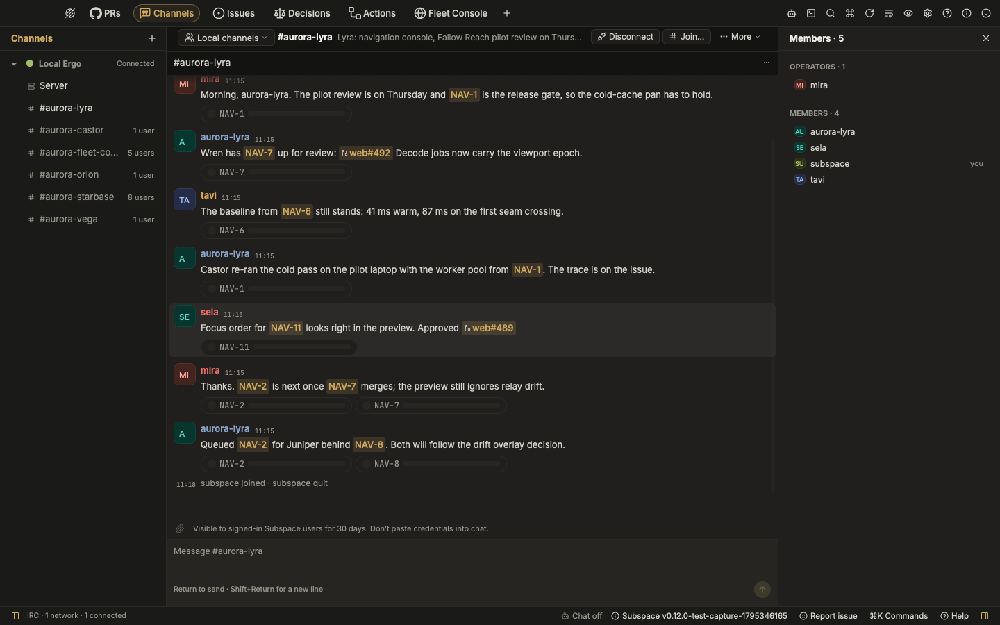

# Reserve issue chip space in Channels

## Intent

A Channels message that names issues, such as `NAV-7`, drew its text first
and its issue chips only once the Issues contract answered. The row then grew
and everything below it jumped. The owner wants the row the right size from
its first frame.

## Spec

- The references are parsed from the message text, so the number of chips is
  known before any answer. `issues::tiles` gives every recognised issue
  reference outside code a slot in the chip row from the first frame.
- An available answer draws the chip, as before. With no answer yet or
  `Pending`, the slot is a placeholder: the same chip surface
  (`card_button` in `reference_card::surface`, inert), the known key in muted
  text and static skeleton marks where the state glyph and title go, in the
  shared list skeleton's colour. Nothing animates, so reduced motion needs
  no case of its own. Its accessible name is the tooltip note,
  *Loading NAV-7…*.
- `Unavailable`, `SignedOut` and `Failed` keep the slot rather than shrink
  the row: a muted `CircleSlash` chip with the key and **Unavailable**,
  **Signed out** or **Couldn't load**, named by the tooltip note. The inline
  reference stays the way to open it, as it was. No cheap synchronous check
  can tell an unknown issue from a real one, because Channels already
  recognises only the scope's project keys, so reserving only plausible
  references would reserve the same set.
- An answer already held, including one kept from an earlier round, draws
  its chip on the first frame, with no placeholder.
- Slots share the chips' wrapping row, so the layout engine wraps them the
  same way. A loading slot is as wide as a chip with a full-length title; a
  chip with a short title can be narrower than its slot, so a row of three or
  more at a line boundary can still rewrap when titles arrive.
- Out of scope: recognition itself. A scope that arrives after the message,
  changes or is withdrawn still adds or removes the slots.
- Pull request references are inline chips that do not change with their
  answer and add no row under the message, so they need no reservation.
  Upload thumbnails already draw a tile for every reference before its card
  loads.

## Delivery

- `spaces/irc/src/issues/preview.rs`: a slot per identifier; the reserved
  slot and a shared hover wrapper.
- `spaces/irc/src/issues/tile.rs`: `reserved` and `absence` compositions,
  sharing the chip's row and key.
- `spaces/irc/src/transcript/line/message.rs`: only issue identifiers reach
  the chip row; pull request and upload keys are still asked for.
- Tests: `spaces/irc/src/tests/issues/reserved.rs` covers the first frame's
  placeholder and the same height once the chip lands, a pending slot taking
  an assigned chip, every unresolved state keeping the height, a held answer
  drawing without a placeholder, a followed transcript keeping the row's
  bounds, and slots wrapping in a narrow transcript. `issues/tile/tests.rs`
  covers the reasons.
- [Channels documentation](../../irc.md#issue-references) describes the
  slots.

### Captures

Captured on macOS with `make capture` in Twilight Two at 1440 x 900, from
the `#aurora-lyra` history fixture (`scripts/irc-test-server.sh`,
`scripts/irc-history-fixture.py`) with `CAPTURE_FLEET=1`. The before build is
`origin/main` at `4bbba18`; the after build is this branch. Each pair was
taken 100 ms and 250 ms after the window opened, while the Issues Space was
still answering and just after.

## Tasks

- [x] Reserve a slot per recognised reference from the first frame.
- [x] Placeholder and unresolved slots built from the chip's shared surface.
- [x] Headless tests for reservation, resolution, unresolved and held answers.
- [x] Documentation.
