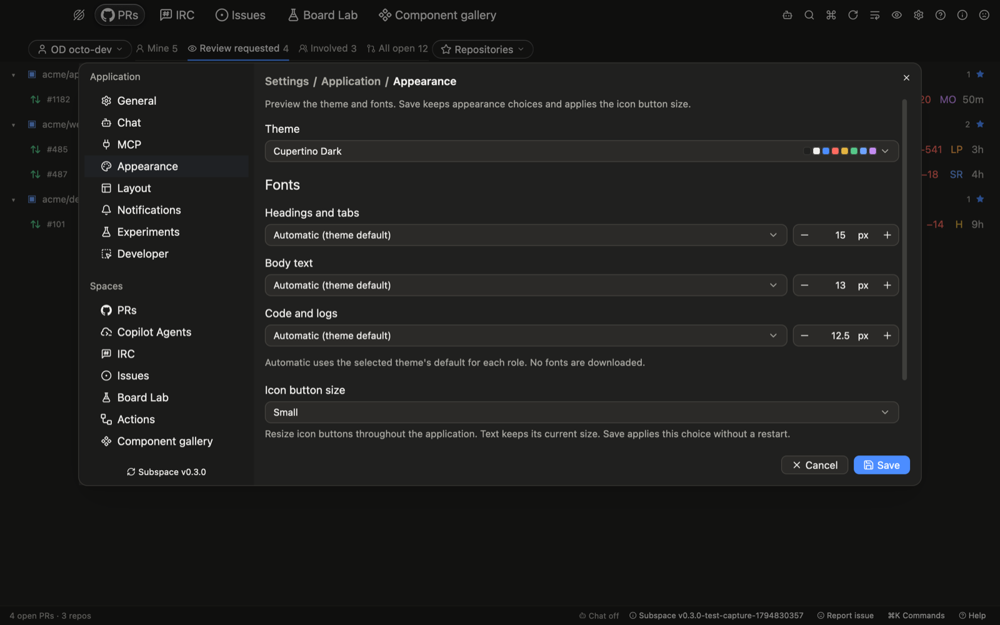
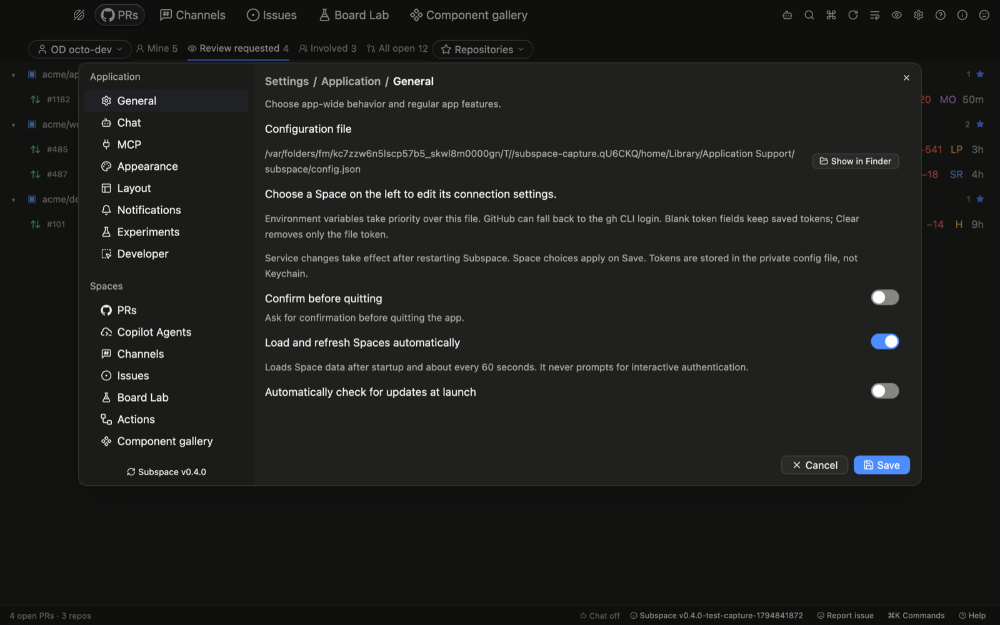

# The IRC Space is Channels

Back to the [change records](../README.md).

## Intent

The owner renamed the IRC Space to Channels, and asked that the docs say that
a Space is a board: the terms are interchangeable, every board rule applies to
Spaces, and Space is preferred from now on, though existing references to
boards can stay.

## Spec

- The board's title is **Channels**, so its tab, rail item, Settings page,
  palette entries, search source and help guide say Channels.
- Text that names the Space now says Channels or "the Channels Space":
  - "Settings > Channels";
  - "Channels is not running";
  - the agent tools' descriptions and errors;
  - the agent setup prompt;
  - the chat context's `Space: Channels` line.
- Text about the protocol keeps IRC: IRC networks, IRCv3, the IRC settings
  file, "Send on IRC", "IRC: #channel" references.
- The board id `irc`, the crates, `irc/config.json` and stored data keep their
  names, so saved settings and history carry over.
- The glossary defines Space, Board and Channels, and distinguishes Channels
  from a release channel. AGENTS.md, the board guide, the board checklist and
  the developer checklist say a Space is a board, with the same rules. Space is
  the preferred term from now on; existing references to boards stay.

## Delivery

The tests of the IRC board and client, the shell, search UI, the Component
gallery and the product all pass. The docs index and board guide checks pass.

Before (Cupertino Dark, fixture data):

After:

## Tasks

- [x] Rename the Space and the text that names it.
- [x] Keep the id and stored data.
- [x] Document Space and board as one concept.
