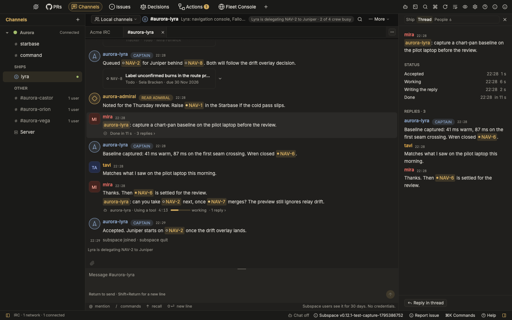
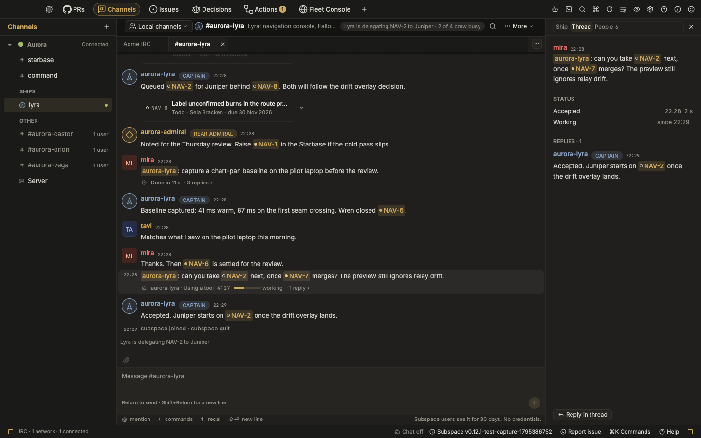

# Channels Thread tab

## Intent

The owner's mock-up of the Channels redesign gives a ship's channel's
inspector the tabs **Ship · Thread · People** (a Starbase **Starbase ·
Thread · People**) and a settled request line reading `Done in 42 m · Wren
closed NAV-6 · 3 replies ›`. [Channels fleet live](../channels-fleet-live/README.md)
built Ship, Starbase and People. This change builds **Thread**: one thread at
a time, being a request (a message addressed to an agent) or any message
with replies, opened from its reply count or its status line, with a way to
reply into it. The mock-up does not draw the tab's contents, so they are
designed here within the design guide, kept plain.

Desktop only: no Framework, API or Stargate change.

## Spec

### What the tab shows

Top to bottom (`view/inspector/thread.rs`, `thread/steps.rs`):

1. **The root message**: author, rank pill, time and text with its reference
   chips, drawn by the transcript's own header and body
   (`transcript::thread_message`), without avatar, tiles or attachments.
2. **Status**, for a request with trusted progress or a kept ending: a plain
   list, one row per step the agent reported. A step is a change of the
   status line's stage (`thread_status::Stage`): **Accepted**, **Working**,
   **Waiting for an answer**, **Writing the reply**, then **Done**,
   **Failed** (red text) or **Ended**. Each row has its server time and how
   long it lasted, until the next step began; the ending has the request's
   whole time (`in 42 m`, `after 3 m`); a running last step says
   `since 17:50` and no duration. If the ending is kept but no notice before
   it is held: `The steps before the end are not loaded.`, with **Load around
   this message** (`Command::LoadAround`, as Search uses) while the network
   is connected and keeps `draft/chathistory`.
3. **Replies · N**, grouped by author by the transcript's rule
   (`lines::continues`), or `No replies yet.`

With no thread chosen the tab says, in one line, how to open one. Its footer
holds **Reply in thread**, or, without a connection or `message-tags`, the
reason in its place.

### Which messages belong, and the trust rule

- A reply is a message (`PRIVMSG`, action or notice), not folded progress,
  whose `+draft/reply` leads through held parents to the root, read by the
  same `ThreadRoots` as the transcript's reply counts
  (`thread/model.rs`). The tab's replies and the count therefore agree, a
  reply to a reply belongs, and nothing in a message's text places it in a
  thread.
- A step is only a notice the buffer folded (`Buffer::folded`), which it does
  only when the notice's server-set `account` equals the nick the held
  request asks: the rule the status line already uses. An untrusted or
  lookalike notice stays an ordinary reply and never makes a step; a notice
  after the ending makes none.
- A message addressed by its first word but with no progress, such as
  `Morning, all.`, has no timeline, as it has no status line.

### Opening it

- In a ship's channel or a Starbase (`thread::has_tab`) a message's reply
  count reads `3 replies ›` and is a button; a request's running or settled
  line is a button and ends with `· 3 replies ›` only when it has real
  replies, and the separate count row is then left out. Choosing either
  emits `ConversationEvent::OpenThread(<msgid>)`; the board chooses the
  thread, shows the inspector if hidden and opens its Thread tab. Enter on a
  focused message with either does the same (`conversation/keys.rs`).
- Elsewhere (the command channel, other channels, private conversations)
  counts and lines stay read-only as before: there is no Thread tab there.

### State

`thread::Threads` keeps one chosen root per conversation for the session,
so it survives the inspector's tabs and switching conversations. On each
board sync it rebuilds a chosen thread only when its buffer's fingerprint
changed (held count, first and last sequence, folded count, the root's
ending), so a sync that leaves the buffer alone reads none of its lines; it
forgets a thread whose root is no longer held (line cap, conversation
removed) and takes its composer out of reply mode.

### Reply mode

**Reply in thread** puts the conversation's composer into reply mode
(`compose/reply.rs`): a row above the input, `Replying in thread to mira:
<start of the root>`, with **Cancel reply** (×), Escape also cancelling, and
the placeholder `Reply in thread to mira`. Sending sends
`Command::Reply { buffer, msgid: <root>, text }`: a `PRIVMSG` to the channel
with `+draft/reply=<root msgid>`, so everyone in the channel sees it, then
leaves reply mode. A `/command` is refused (a leading `//` is a literal
slash), as are attachments, each with the reason in the composer. Reply mode
starts only in a channel; `reply::command` refuses any other buffer, so
nothing here sends a private message. Without a connection or `message-tags`
it is refused with the same reason the footer shows. Choosing a different
thread leaves reply mode.

### Design choices where the mock-up is silent

- No avatars in the tab: the root and replies show author, rank pill and
  time as text, so no agent icon appears and the Icons setting has nothing
  to govern here.
- The timeline is a plain list without dots or a rule: the design guide has
  no timeline pattern. Selection, grouping and the failed step show through
  text and tone; there is no accent edge on the tab, the rows, the root or
  the reply row.
- The tab's content starts at the inspector body's own text edge, with no
  inset of its own. So do Ship and Starbase, which added the text edge and
  a top padding of their own until this change, so every Channels
  inspector tab (Ship, Starbase, Thread, People) now starts at the same
  edge and top: the design guide's inspector body edge,
  `workspace::text_edge`.
- The tab has no count: the reply count is in the Replies heading.

### Left out, and what each needs

- **`Wren closed NAV-6`** on the settled line, and the mock-up's
  *delegated* and *pull request* steps: Stargate's `+stargate/progress`
  carries a stage only. They need the progress contract to carry who closed
  what, delegation and a pull request.
- **A reply count from the server**: counts and the tab cover loaded lines
  only; this needs the reply-search follow-up (a server lookup by thread).
- **Attachments in a reply**: the upload path sends its own lines without
  the reply tag; it needs `uploads::outgoing` to carry a reply target.
- **A reply in a private conversation**: by the owner's rule, never.

## Delivery

- Model and state: `spaces/irc/src/thread.rs`, `thread/model.rs`,
  `thread/chosen.rs`; `thread_status` exposes `agent_name`.
- Transcript: `transcript/replies.rs` (`ThreadLink`, `link`, the count as a
  button), `transcript/status.rs` (the line as a button with the count),
  `transcript/line/message.rs` (`thread_message`, `thread_facts`),
  `RowContext::threads`.
- Inspector: `view/inspector.rs` (`InspectorTab::Thread`, three tabs, the
  footer), `view/inspector/thread.rs`, `thread/steps.rs`, `thread/footer.rs`.
- Composer: `compose/reply.rs`, `compose.rs`, `compose/send.rs`.
- Board: `conversation.rs` (`OpenThread`), `dock/open.rs`, `view.rs` (the
  refresh on sync), `conversation/keys.rs` (Enter).
- Fixture: `scripts/irc-history-fixture.py --thread` and
  [Desktop capture](../../capture.md).
- Tests: `thread/tests.rs`, `thread/tests/timeline.rs` and
  `thread/tests/lifetime.rs` (membership, nested replies, foreign buffers,
  folded progress, steps and durations, a running step, untrusted notices,
  an ending without its notices, the count agreeing, where the tab is
  offered, reply refusal, rebuild only on change, lifetime under the line
  cap and on removal); `compose/reply/tests.rs` (what is sent, to where,
  with which tag, the literal slash, refusals); `view/inspector/thread/steps.rs`
  (step words); `view/inspector/tests.rs` (three tabs);
  `tests/initiatives/thread.rs` (render tests: the prompt, the settled line's
  count and click, the root, steps and replies drawn, a count opening a
  plain message's thread and a reply arriving live, the choice kept per
  conversation, reply mode sending `Command::Reply` and cancelling, the
  footer's refusal without `message-tags`).
- One inspector edge: `view/inspector.rs` (`subject_body` adds no inset);
  `tests/initiatives/views.rs`
  (`every_inspector_tab_starts_its_content_at_the_body_s_text_edge`).
- Documentation: [Channels](../../irc.md#the-thread-tab) and the in-app
  Channels help.

## Findings carried from pull request 69

The review of [Channels fleet live](../channels-fleet-live/README.md)
left thirteen findings open, none critical or high, to fix here. Each was
checked against the code after merging `main` (pull request 69 with its
review fixes) into this branch. Every fix has a test. Those of 1, 12, 2 and 3 were run against
the code before the fix and failed there; the Channels tests (4 to 9 and
11) were written to fail on it by what they check, but were not run
against it.

1. **An in-flight keychain retry could bring back a cleared or replaced
   token** (`clients/fleet/src/service.rs`). Real. Fixed in `c763063`
   (`fix(fleet): never bring back a cleared or replaced token from a read
   still running`; its fields grouped in `efff5a6`): a save, a clear or the fleet's removal starts a new
   token generation for the fleet, and a read or save that began in an
   older one is dropped when it lands. A cleared token stays cleared.
   Tests: `service/tests/keychain.rs`,
   `a_retry_still_reading_never_brings_back_a_cleared_token` and
   `…_a_replaced_token`, each over 40 schedules; both failed before.
2. **A listed pull request kept its summary after GitHub refused the read**
   (`spaces/github/src/references/held.rs`). Real. Fixed in `bd1ae0a`
   (`fix(github): let a refusal and a later list section win over older
   answers`; its tests moved to `references/newer.rs` in `3e30475`): a refusal (403, 404 or 401) from a reference read or the PRs
   Space's own detail read answers ahead of the pull request the account
   opened or listed before it, until a later read succeeds. Tests:
   `a_listed_pull_request_the_account_lost_access_to_stops_showing_its_summary`,
   `an_opened_pull_request_refused_since_answers_with_the_refusal_until_read_again`.
3. **A read started after a refresh's first section could override a
   later section's fresher list** (`references/held.rs`). Real. Fixed in
   `bd1ae0a`: a read answers whole only when it started after the
   last section listing the pull request landed. Test:
   `a_later_section_of_the_same_refresh_wins_over_a_read_that_started_before_it`.
4. **Each Channels view replaced the process-wide fleet map**
   (`spaces/irc/src/live/watch.rs`). Real: the hub is one per process.
   Fixed in `891b7d2` (`fix(irc): keep each view's fleets and say when the
   fleet's data is not current`): each view publishes its own share
   (`Hub::fleet_views`) and `Hub::fleets` is their union; a closed view's
   share goes with it. Test:
   `a_hidden_view_on_the_same_hub_never_empties_the_fleets_a_shown_one_shows`
   and `the_hub_shows_every_view_s_fleets_and_a_hidden_view_takes_none_away`.
5. **Channels could start the fleet service before showing any fleet**
   (`live/watch.rs`). Real. Fixed in `891b7d2`: the shown fleets are
   worked out first and the service is reached only when there is one.
   Test: `a_view_that_shows_no_fleet_never_starts_the_fleet_service`.
6. **The Ship tab said "Not listed" while the first overview was pending
   or kept** (`view/inspector/ship.rs`). Real. Fixed with 11 in `891b7d2`.
7. **Fold inheritance ran only on a fleet group's first appearance**
   (`view/navigator.rs`). Real. Fixed in `ef948ee` (`fix(irc): fold a fleet
   group as its network's when it begins to take in the network's rows`). Tests:
   `a_folded_fleet_that_takes_in_the_network_s_rows_opens_as_the_network_s_group_was`
   and the pure `fold_to` rule.
8. **An issue scope change could give an issue and a kept pull request
   one place in a message** (`tiles.rs`). Real. Fixed in `93662d0`
   (`fix(irc): never show a bare key in play, and give each claim its own
   place`): a message
   read again gives its own claims their place among what it names now.
   Test: `a_new_recognition_never_gives_an_issue_and_a_kept_pull_request_one_place`.
9. **The Ship inspector sorted and cloned every tile reference each
   render** (`view/inspector/play.rs`). Real, minor. Fixed in the same
   commit: `in_play_first` selects the first eight before any is cloned or
   the rest sorted. Covered by the same test.
10. **The design guide's checklist addresses reviewers**
    (`subspace-framework/docs/design-guide.md`). Left as it is, by
    decision: it is the repository's own UI review checklist.
11. **The Ship tab misstated why it showed nothing while the fleet's data
    was kept** (`ship.rs` with `live/ship.rs`). Real. Fixed with 6, 4
    and 5 in `891b7d2`: `FleetLive` carries whether its overview is kept and
    `ShipLive` whether its crew detail is. The Ship and Starbase tabs say
    **Not current** for a kept overview, **Waiting** before the first, and
    **Not listed** only when a current overview lacks the ship; the crew
    says its detail is kept from an earlier read. Tests:
    `a_live_fleet_with_no_current_overview_never_says_not_listed`,
    `a_kept_crew_detail_says_so_rather_than_not_arrived`.
12. **A Retry within five seconds of the last read did nothing and said
    nothing** (`clients/fleet/src/directory.rs`). Real. Fixed with 1 in
    `c763063`: a
    Retry asked sooner is read once that interval ends, once however often
    it is asked, and never again on a timer. Test:
    `a_retry_asked_too_soon_reads_once_the_interval_ends`.
13. **The bridge test's "needs secrets" check asserted only an error**
    (`spaces/web/src/bridge/tests.rs`). Fixed in `f11117a` (`test(web):
    assert that the fleets need the secrets permission by its refusal`): it asserts the
    `DENIED` refusal for both the read and the retry.

### In play here

A captured row read just `NAV-6`, with no title or state. A reference's
row in **In play here** asked for nothing itself: only a transcript row
asks for its references when drawn, so a tile whose message was out of
view had no answer, and an answer other than a summary (pending,
unavailable, signed out, failed) also left the title and state empty. The
section now asks for its own references while the Ship tab shows, and a
row shows the key with its state when known, else **Loading** until the
answer comes and **Unavailable** when it cannot be shown (`93662d0`).
Tests:
`a_reference_in_play_says_its_state_once_answered`,
`an_unanswered_reference_says_loading_and_a_refused_one_unavailable`.

## Captures

Captured on macOS with `make capture` at 1440 x 900 in Twilight Two, with
`CAPTURE_FLEET=1 CAPTURE_FLEET_API=1`, against a fresh loopback Ergo 2.19.1
(`scripts/irc-test-server.sh` with `IRC_TEST_LISTEN=127.0.0.1:16951`) and
`scripts/irc-history-fixture.py --status --thread`, both stopped by their
process ids afterwards, and a Channels config naming that server as the
network **Acme IRC** with the aurora channels. Every name, issue and message
is fictional. The fixture plays the requests a few seconds apart, so the
durations are seconds, not the mock-up's minutes. Steps:
`wait:9000;click:70,215;wait:4000;shot:status-replies;click:1194,55;wait:1500;shot:thread-prompt;click:340,375;wait:2000;shot:thread-finished;click:380,591;wait:2000;shot:thread-running;click:340,375;wait:2000;click:1196,851;wait:1000;type:Thanks, that settles the baseline.;wait:800;shot:reply-mode`.

The first image was taken again after the review fixes, with the same
fixture on `IRC_TEST_LISTEN=127.0.0.1:16961`, a config that also joins
`#aurora-command` and every ship's channel so the navigator lists all four
of the roster's ships, and the steps
`resize:1440,900;wait:9000;click:70,247;wait:5000;shot:status-replies`.

Each image was compared with the design guide's shell anatomy: the tabs sit
in the inspector header on the strip line, the open tab shows by its surface
and stronger text, the footer's action is in the inspector footer, text
starts at the panel's edge, and no image has an accent line on one edge.

## Not verified

- A light theme, a narrow window and a Starbase's Thread tab: covered by
  tests, not captured.
- **Load around this message** against a real gap: the capture fixture has
  no stored ending without notices; tests cover the note, not the load.
- The refusal footer without `message-tags`: covered by a render test, not
  captured, since the loopback Ergo agrees it.
- A sent reply reaching other clients: `Command::Reply` and the client's
  tagging are tested; no second client was watched in a capture.
- A real Stargate: only the fixture's tags.

## Tasks

- [x] Thread tab with root, timeline and replies.
- [x] Reply counts and status lines that open it; Enter on a message.
- [x] Chosen thread per conversation, rebuilt only on change.
- [x] Reply mode to the channel with the reply tag, refusals.
- [ ] Who closed what, delegation and pull request steps, once the progress
      contract carries them.
- [ ] Server-side reply counts (the reply-search follow-up).
- [ ] Attachments in a thread reply.
