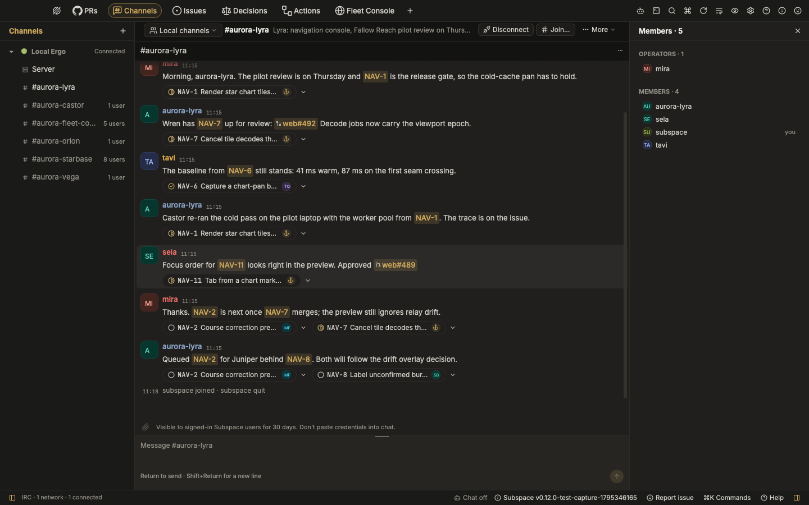
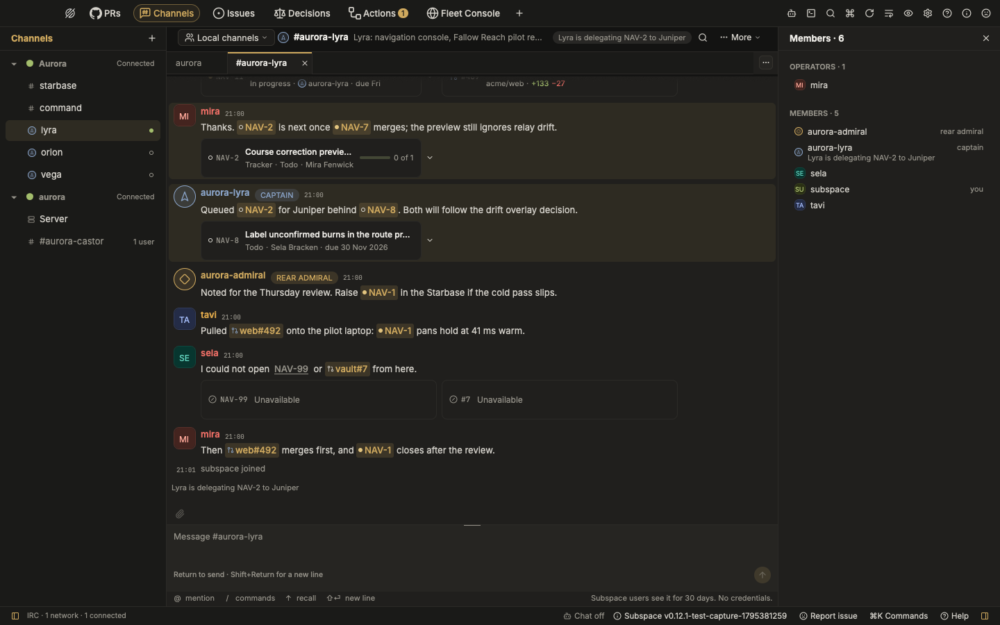
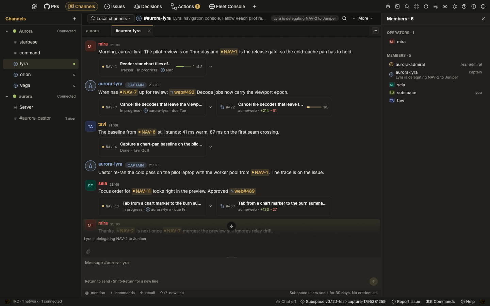

# Channels tiles once

## Intent

The owner approved a redesign of the Channels Space; [Channels navigator,
request lines and composer hints](../channels-navigator-and-requests/README.md)
built its last pieces. This change builds note 4 of the mock-up, and the
fuller tiles it shows:

- **References are quiet chips; tiles appear once** (note 4). Every message
  that named an issue repeated a compact chip under it, so a busy channel
  showed the same `NAV-1` again and again. Owner decision: the first message
  to show a tile for an issue or a pull request keeps it, and later mentions
  are only the inline reference.
- **Fuller tiles.** An issue tile says what the tracker knows (Ready for
  agents, Tracker, the state, who has it, when it is due, progress); a pull
  request, which had no tile under a message before, gets one with its
  repository, lines changed and checks.
- **A tile that is still loading holds its place** (note 5), as
  [Reserve issue chip space](../channels-reserve-issue-tile-space/README.md)
  promised: no message changes height once it is laid out.

Desktop only: no Framework, API or Stargate change.

## Spec

### 1. Tiles once

- `tiles.rs` holds the rule, `TileOwners::claim`: each reference of the
  messages read, in order, that has no owner yet goes to the message that
  names it first; an owner is never replaced. `TileOwners::shows` says
  whether a message draws a reference's tile.
- What a message names is read exactly as its row reads it
  (`transcript::tile_refs`): its issues and pull requests outside code,
  each once, in reading order (`tiles::candidates`); a pull request by its
  canonical `owner/repo#n`, so a marker and a URL are one reference.
- **When "first" is decided.** On every sync with the hub
  (`Conversation::sync`, `show_latest` and `reveal`), before the scroller
  takes the new rows, `conversation/owners.rs` reads the messages it has not
  read yet in transcript order and claims for them. Rows are only laid out
  after that, so every row drawn has been read.
- **History loaded above** and lines merged from the store are read after
  the messages already held, so an older mention found later stays a chip:
  the message that showed the tile first in this session keeps it.
- **New messages** only ever take references nobody owns.
- **Re-rendering** reads nothing again: a message is read once per issue
  recognition.
- **The owner scrolls out of the held window** (the line cap): it keeps its
  claim. No other message takes the tile, which would make an already drawn
  message grow; a later mention stays a chip.
- **A new issue scope** can recognise references the messages did not have
  (those messages change anyway, as their text gains chips), so every held
  message is read again; owners already decided stay.
- **Scope.** Owners are per conversation (`BufferKey`): the same issue has
  its first tile in each channel. They live in the hub for the session, in
  memory only: closing and reopening a conversation keeps them, and a
  restart decides again from the messages then held.

### 2. One fixed tile box

- Every tile, loaded, loading or unresolved, issue or pull request, is the
  same box (`tiles/frame.rs`): 340 px wide at the reference text size,
  capped at the row's width, with two fixed lines. So an answer never
  changes how tiles wrap or how tall the message is. The surface is
  `card_button` in `reference_card::surface` with the outline treatment,
  as the hover cards' shared surfaces are.
- **Loading** (no answer or `Pending`): inert, the known key between a
  skeleton mark and two static skeleton bars in `Tokens::line`, the shared
  list skeleton's colour; nothing animates. Named by the hover note,
  *Loading NAV-7…*.
- **Unresolved** (`Unavailable`, `SignedOut`, `Failed`): one muted line in
  the same box, `CircleSlash`, the key and **Unavailable**, **Signed out**
  or **Couldn't load**. It never says whether the item exists. The inline
  reference still opens it.

### 3. Issue tiles

- Lead: the inline reference's state dot or ring (`look::issue_mark`) and
  the key; then the title.
- Second line (`issues/tile/compact.rs`, `parts`), each only when the
  summary carries it, separated by middle dots: **Ready for agents**
  (`ready_for_agents == Some(true)`, in the accent), **Tracker**,
  **Archived**, the state's name, the assignee or else the owner, and the
  due date (`due Wed` within a week, otherwise the date).
- When the line is full, only the assignee gives way, down to a few
  letters; the line then clips at its end.
- An agent assignee whose rank is captain or rear admiral leads with its
  agent icon through `avatar::agent_icon` and the Icons setting: Large the
  16 px avatar, Small (the default) 12 px, Off none, so the name closes up.
  People's names have no avatar here; crew have no agent avatar yet.
- Trailing: a tracker with sub-items shows Kit's `Progress` as a small bar
  and **1 of 2**, named *1 of 2 done*.
- The accessible name keeps the hover card's facts and adds *ready for
  agents*. The summary disclosure chevron stays beside the tile, inside its
  box.

### 4. Pull request tiles

- Lead: the status glyph tinted as the inline reference's (open blue,
  merged magenta, closed or draft muted) and `#n`; then the title.
- Second line (`pull_requests/compact.rs`): the status in words when it is
  not open, the repository, and the lines added in green and removed in red.
- Trailing: `check_counts` as Kit's `Progress` and **4/5**, named *4 of 5
  checks passed*: red once a check failed, green when all passed, yellow
  while they run.
- A click opens the pull request as its inline reference does (the PRs
  Space, or the browser), and hovering shows the reference's card.

### Where the design guide won over the mock-up

- The tile uses the shared outline surface and Kit's `Progress`, not the
  mock-up's dashed loading border, shimmer or segmented check bar.
- No literal colours: Ready for agents is accent text, not the mock-up's
  tinted label.

### Decisions for the owner to confirm

- An owner dropped by the line cap keeps its claim, so a channel whose
  first mention has scrolled out of the held lines shows only chips for it.
- People assignees show no avatar on a tile, as the mock-up draws none.
- A tile is 340 px wide in every state, so a short title leaves room at its
  end; that is what keeps a loading row from rewrapping.

### Gaps: data the app cannot get today

- *offered to Castor · 4:12 left* (who a Ready for agents issue is offered
  to, and for how long): no field in the API or in `IssueSummary`. It needs
  an offer (agent and expiry) on the issue in the Subspace API and an
  `IssueSummary` field to carry it.
- Crew assignees have no agent icon: `avatar::AgentRank` has only captain
  and rear admiral.
- Check counts come only with a pull request's check runs, which the PRs
  Space reads with its detail. A pull request it holds from a list (most of
  those a channel names) has only the combined check state, so its tile has
  no bar until it is opened. Counting a listed pull request's checks needs
  the PRs Space's list query to fetch the head commit's check contexts.
- Issue tiles cannot show the mock-up's *offered to* or a countdown, as
  above, nor the mock-up's crew-at-work, which the API does not report.

## Delivery

- Rule and frame: `tiles.rs`, `tiles/frame.rs`, `tiles/row.rs`;
  `conversation/owners.rs` and `Conversation` (`tiles`), `hub.rs`
  (`Hub::tiles`), `transcript/line.rs` (`RowContext::tiles`),
  `transcript/line/message.rs` (`tile_refs`), `markup.rs` (`references`).
- Issue tiles: `issues/preview.rs` (`slot`, `panel`),
  `issues/tile/compact.rs`, `issues/tile/label.rs`, `text/look.rs`
  (`issue_mark`).
- Pull request tiles: `pull_requests/slot.rs`, `pull_requests/compact.rs`.
- Tests: `tiles/tests.rs` (the rule: ordering, history above, re-render,
  the line cap, a new recognition, per conversation, candidates);
  `issues/tile/compact.rs` and `pull_requests/compact.rs` (content with
  present and missing fields); `tests/issues/tiles.rs` (drawn: once per
  conversation, history above, an issue tile's facts, progress and agent
  icon, a pull request tile loading in place, shown once, and settling
  unresolved without a height change); the earlier reservation and
  preview tests, now with the two-line tile height.
- Fixtures: `scripts/irc-history-fixture.py --repeats` names NAV-1 and
  pull request 492 again, an issue and a pull request the fixtures do not
  have, and with `--late-after` a late pull request;
  `scripts/github_test_server.py --item-delay` (`CAPTURE_ITEM_DELAY` in
  `scripts/capture.sh`, [Desktop capture](../../capture.md)) holds single
  item reads so a loading tile can be captured.
- Documentation: [Channels](../../irc.md#issue-references) (*Tiles once*,
  *Issue tiles*, *Reserved tiles* and the pull request *Tile*).

### Captures

Captured on macOS with `make capture` in Twilight Two at 1440 x 900, with
`CAPTURE_FLEET=1`, against a fresh loopback Ergo 2.19.1
(`scripts/irc-test-server.sh` with `IRC_TEST_LISTEN=127.0.0.1:16947`) and
`scripts/irc-history-fixture.py --status --repeats`, both restarted for
each run, and a Channels config naming that server with the aurora
channels. Every name, issue, repository and message is fictional. Steps:
`wait:2000;click:75,187;wait:3000;shot:…` opens `#aurora-lyra` at its
newest lines; `scroll:680,400,500;wait:1200;shot:…` shows its first ones.

- **Loading**: the same with `CAPTURE_ITEM_DELAY=20` (well under the GitHub client's read timeout), a new capture
  option that holds the GitHub fixture's single item reads, so
  `acme/vault#7`, which no list holds, stays `Pending`.
- **Checks**: from the first lines, `click:800,315` opens pull request 492
  from its tile in the PRs Space, which reads its detail with its check
  runs; `click:240,19` returns to Channels.

The before image is the [reserved chip
change](../channels-reserve-issue-tile-space/README.md)'s own after
capture, from the same history fixture.

## Evidence

Not captured: a light theme, a narrow window, the Icons setting's Large and
Off modes on a tile (the render test checks the Small icon; Large and Off go
through the same `avatar::agent_icon` seam as the navigator, captured in the
[previous change](../channels-navigator-and-requests/README.md)), Ready for
agents (no fixture issue is marked so; a render test covers it), and history
loaded above (a render test covers it).

## Findings carried from pull request 65

The two model reviews of [Channels navigator, request lines and composer
hints](../channels-navigator-and-requests/README.md) left twelve medium
and low findings for this pull request. Each was checked against the
code; each fix is its own commit with its tests.

1. **A new fleet group folding away the selection** — fixed (`fix(irc):
   keep a new fleet group open when it holds the selection`). A fleet
   group seen for the first time no longer folds when it holds the
   selected row, and a folded group's header carries an `@` mark (a
   mention) or a dot (unread messages) through `group_indicators`.
2. **Two channels with the same short name** — fixed (`fix(irc): keep full
   channel names where a fleet's short names would clash`). Rows whose
   short names clash in a group keep their full channel names. The other
   initiative channels stay short, as the owner approved, rather than
   shortening only the roster's channels as suggested.
3. **`/ask` picking one of two rear admirals** — fixed with 8 (`fix(irc):
   refuse /ask where two fleets or two rear admirals could answer`): a
   Starbase two rear admirals name has no addressee.
4. **An older ending without an outcome reading Done** — fixed (`fix(irc):
   settle a request whose outcome is unknown as Ended, not Done`): it reads
   **Ended** with a plain circle.
5. **Hint row without accessible names** — fixed (`fix(irc): name the
   composer's hints and say who can see an upload`): each hint is named
   `<word>: <key>`, such as *mention: at sign*.
6. **`docs/irc.md` citing `Conversation::follow_clock`** — fixed in the
   same commit as 5: it names `conversation::clock::follow`.
7. **The upload notice not saying who can open a file** — fixed in the same
   commit as 5. The design guide keeps the hint row slim and quiet, so the
   notice stays one truncating line at its end rather than wrapping or
   moving beside the paperclip; its words now say who can see a file and
   for how long, *Subspace users see it for 30 days. No credentials.*, with
   the full sentence as its accessible name and its tooltip.
8. **`/ask` in a channel two fleets claim** — fixed (see 3): `/ask` and its
   completion both ask `Roster::asked_in`, which now refuses a channel that
   not exactly one fleet holds, the same ownership the navigator uses.
9. **A restored request showing Done after it showed Failed** — fixed
   (`fix(irc): load a request's stored ending before its restored notices
   fold`). Reproduced by a test first; the stored endings now load before
   the restored lines fold, and a notice still fills in an ending stored
   without its outcome.
10. **`/ask` not rechecking length** — fixed (`fix(irc): recheck /ask
    against the connection's limits after addressing it`): the addressed
    message is checked against the connection's limits and, when over, the
    draft stays with an error. Whether the IRC client later rejects a
    message is not known when the composer empties, as for any message;
    that is unchanged.
11. **Search losing the network name** — fixed (`fix(irc): search a buffer
    by its network as well as its group`).
12. **People presence scanning every channel per row** — fixed
    (`perf(irc): look up People's presence once per network`).

## Tasks

- [x] The tiles-once rule and its tests.
- [x] One fixed tile box for every state.
- [x] Fuller issue tiles, with Ready for agents and the agent icon.
- [x] Pull request tiles with changes and checks.
- [ ] Who a Ready for agents issue is offered to, and for how long, once
      the API carries it.
