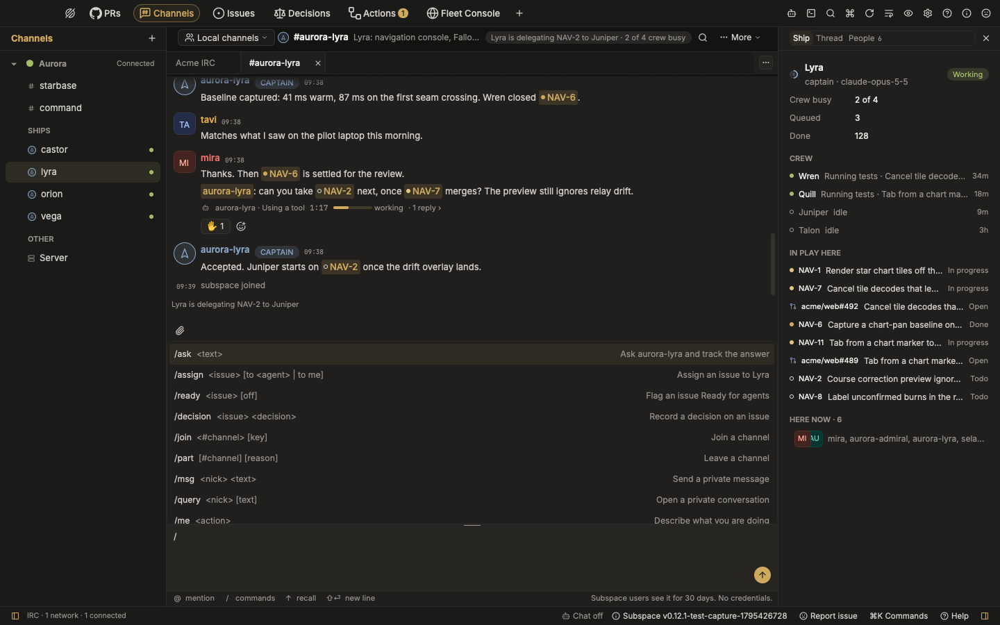
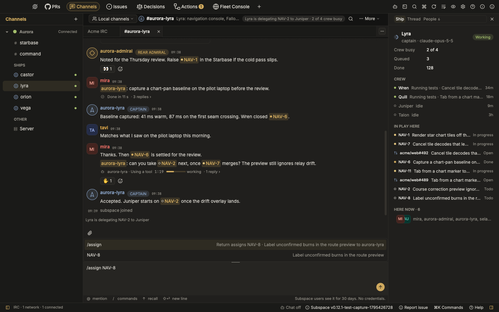
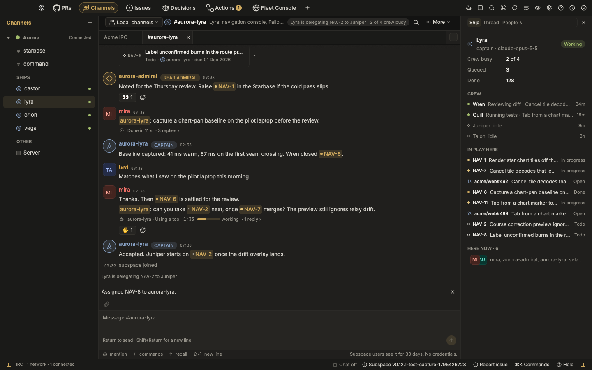
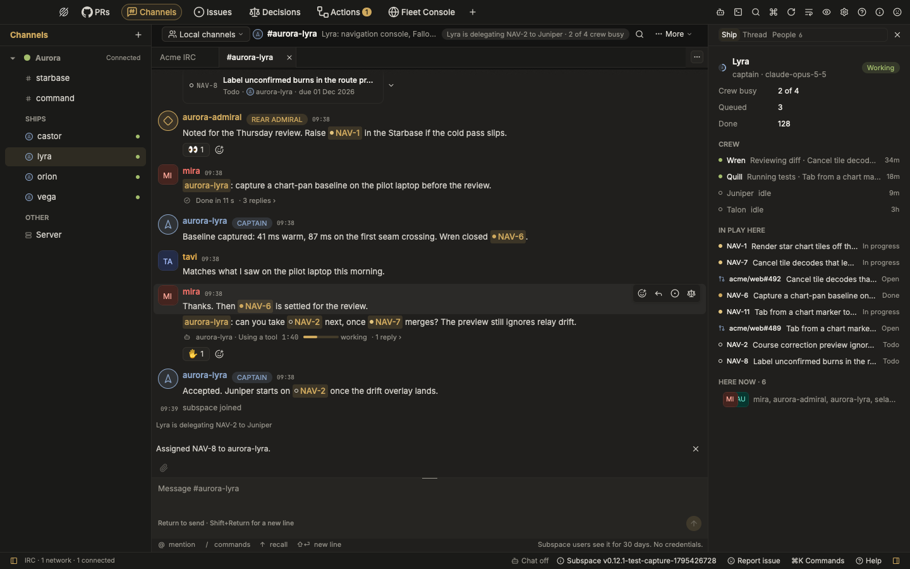
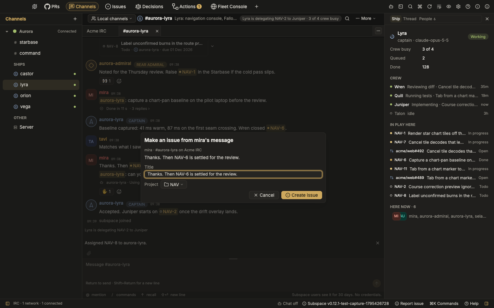

# Channels tracker commands and message toolbar

## Intent

Frame 2 of the owner's Channels mock-up, note 8: the composer does real work
on the tracker from the channel (`/assign`, `/ready`, `/decision`), and
hovering a message offers the same actions on it. This is the last piece of
the Channels redesign after the [Thread tab](../channels-thread-tab/README.md)
and [reactions](../channels-reactions/README.md).

The owner's decisions: tracker writes go directly to the Subspace API as the
signed-in person, through the desktop's API client, never as chat messages
for an agent to act on; private messages are for people only; no accent
line on one edge anywhere.

## Specification

### Where

In a channel, while the Issues Space answers `issues@1/current-scope` with a
scope (it holds the signed-in Subspace API session) and the tracker service
is Subspace API (`tracker::available`). Elsewhere the commands are not
offered; a typed one is kept with the reason and never reaches IRC as an
unknown command.

### Commands

| Command | Writes |
| --- | --- |
| `/assign <issue> [to <agent> \| to me]` | `PATCH /v1/issues/{id}` with `assigneeId` at the issue's version. In a ship's channel the default is the ship's captain. |
| `/ready <issue> [off]` | `PATCH /v1/issues/{id}` with `readyForAgents`. |
| `/decision <issue> <decision>` | `POST /v1/decisions` on the issue's project, linked to the issue, title from the first line, context ``Recorded in Channels from `#channel on Network`.`` (the place in a code span) |

- **Checks before Return** (`tracker/plan.rs`, `check.rs`): an issue is
  named, is in the scope's projects and is not known to be unavailable; an
  assignee is a fleet agent the roster knows by API nick, or `me`; `/ready`
  refuses an assigned, closed or tracker issue and a flag already set, as
  the API does; `/ready … off` refuses a flag already clear; `/assign`
  refuses the same assignee again. A refusal keeps the draft and shows in
  the composer.
- **Completion** (`tracker/suggest.rs`): the three commands follow `/ask`
  among the channel's own, each with its arguments and a one-line
  description (`Assign an issue to Lyra` in Lyra's channel). Arguments
  offer the issues the conversation has shown (its tile owners, newest
  first), then the tracker's project keys (`NAV-`), then whom to assign
  (the captain first, the fleet's agents, `me`) and `off`. Once the draft
  is a whole command that would run, the first row says what Return will do
  (`Return assigns NAV-8 · Label unconfirmed burns in the route preview to
  aurora-lyra`); Return or a click on it runs the command. Tab only
  completes: on that row it takes the first row that inserts, and never
  writes.
- **The write** (`tracker/write.rs`, `flow.rs`): on a background task, read
  `/v1/me` (the person is signed in) and the issue, repeat the checks on the
  issue as the tracker returns it, then write once. One write at a time; the
  composer waits while it runs.
- **The result**: a brief notice in the conversation's notice area, the one
  the reactions piece uses for a refusal: `Assigned NAV-8 to aurora-lyra.`,
  `Flagged NAV-3 Ready for agents.`, `Recorded a decision on NAV-2: “…”.`, or
  the refusal in plain words (`NAV-9 isn't in the tracker, or you can't see
  it.`, `Couldn't change NAV-2: You don't have permission to save this
  issue.`). A landed write empties the composer; a failed one keeps it. No
  notice carries a token or a server body.
- **Fresh state**: after a landed write Channels sends `issues@1/refresh`
  (a new, additive request in the Framework's issues contract). The Issues
  Space reads the issue again (`Hub::refresh_reference`), keeping the old
  card until the new one lands, and its `changed` brings the new state to
  the tiles and the inspector's **In play here** without a restart.

### The message toolbar

`transcript/actions.rs`. The design guide has no row-action pattern, so it is
a compact group of icon buttons at the message's top right, on the content
surface, with a full hairline border, a tooltip and an accessible name each,
inside the row's own box: drawn over the row, it changes no message's height
and moves nothing. It shows while the pointer is over the message or the
message has the keyboard's focus; `r`, `t`, `i` and `d` on a focused message
do the same as its buttons.

| Action | Shown when | Does |
| --- | --- | --- |
| **Add reaction** | the network supports reactions and the message has a `msgid` | Opens the reactions piece's menu at the message, stop group included when its conditions hold (`reacting::open_choices_for`, in `conversation/reacting/menu.rs`). |
| **Reply in thread** | the inspector has a Thread tab and the server carries reply tags; the message has a `msgid` | Opens the thread and starts reply mode, which sends to the channel. |
| **Make issue…** | tracker writes work here | Opens the dialog. |
| **Record decision…** | tracker writes work here, and the message names an issue or the conversation has shown one | Opens the dialog. |

**Make issue** and **Record decision** (`tracker/message.rs`, `quote.rs`,
`message/view.rs`) open a small dialog: the whole message, scrolling, an editable
title (its first line), and a choice: the project (that of the message's
only issue, else of the newest issue in play, else the first) or the issue
(the message's only issue; otherwise the person picks from the message's
issues and those in play). Only the dialog's button, or Return in its title,
writes. A new issue's summary is the message's first 300 characters on one
line; its description quotes the message in a fenced block longer than any
backtick run in it, so nothing becomes Markdown, a link or a mention, then
`From IRC message <msgid> by <nick> in #channel on Network, <time UTC>.`,
that line itself in a code span longer than any backtick run in it. A
decision from a message records its words with that reference and the
message as IRC evidence (`evidenceKind: ircMessage`). The notice reports the
new issue's key (`Created NAV-14: …`); the dialog stays open with the
refusal if the write fails.

**Add reaction and `r`** keep their places: the row-end control after the
pills and the `r` key open the same menu as the toolbar's React.

### Safety

- Every write is a typed command with Return (or its completion row) or a
  dialog's button; hovering, focus and the toolbar's buttons never write.
- Message text, titles and names are untrusted: bounded (`clip`) and drawn
  as text; nothing in a message adds an action or makes a command run (a
  test checks a message reading `/assign NAV-2 to me` offers nothing more).
- Nothing posts to the channel or sends a private message; the render tests
  check that no line, reply or command went to IRC.

### Design choices where the mock-up is silent

- The mock-up's toolbar has text labels (**Reply**, **Make issue**,
  **Record decision**); the app's toolbar uses Lucide glyphs with tooltips,
  as the guide's icon-button rule asks, to keep it compact over a
  single-line message.
- `/ask` keeps its place before the tracker commands; the mock-up shows
  `/assign` first.
- The completion row's ↵ mark in the mock-up is said in words (`Return
  assigns …`): the shared completion row has no trailing mark for commands.

## Left out, and what each needs

- **Assigning a person by IRC nick**: the API has no IRC nick for a person
  (only `FleetAgent::irc_nick`), so `/assign … to mira` cannot name a user
  without guessing from display names. Channels assigns fleet agents and
  `me`; it needs the API to record people's IRC nicks.
- **A NETT tracker**: decisions and `readyForAgents` are Subspace API's; the
  commands are offered only with Subspace API.
- **The API's own refusal text**: the desktop client maps statuses to its
  own plain sentences (`IssueSaveError`, `DecisionWriteError`); the
  problem's `detail` is not shown. The commands check the API's documented
  rules first, so its 400s are rare.
- **The new issue's chip**: notices are plain text, so the created key is
  named, not drawn as a chip.

## Delivery

- Framework (additive): `issues@1/refresh` (`subspace_contracts::issues::Refresh`).
- API client: `decision_writes` (`Client::log_decision`, `NewDecision`,
  `DecisionWriteError`), `IssueProperty::ReadyForAgents`,
  `Hub::refresh_reference` and `ResolutionCache::refresh`; the Issues Space
  answers `issues@1/refresh`.
- Channels: `tracker.rs` and `tracker/` (`parse`, `plan`, `check`,
  `suggest`, `write`, `flow`, `quote`, `message`, `message/view`),
  `transcript/actions.rs`, the composer's completion (`compose/suggest.rs`,
  `compose/suggest/choice.rs`, `compose/offer.rs`, `compose/send.rs`),
  `conversation/keys.rs` (`t`, `i`, `d`, hover),
  `conversation/reacting/menu.rs` (`open_choices_for`), `fleet.rs`
  (agents' user IDs and ships),
  `issues/follow.rs` (`refresh`).
- Fixture: the Subspace API fixture takes `readyForAgents` by the API's
  rule, assigns the aurora fleet's captains by their record's user IDs and
  records decisions (`scripts/subspace_api_test_server.py`).
- Documentation: [Channels](../../irc.md#tracker-commands-and-the-message-toolbar),
  the in-app Channels help, the [Spaces audit](../../spaces-audit.md) and
  the API client's README.

## Tests

- `tracker/tests.rs`: the commands name no IRC client command and parse in
  any case; `/assign` defaults to the captain, takes an agent or `me`;
  every refusal before a write; `/ready` and `/decision` plans; completion
  of the commands, issues, project keys, whom and `off`; the run row and no
  run row for a command that would be refused.
- `tracker/tests/write.rs` (against the client's offline mock): `/assign`
  reads `me` and the issue, then sends only `assigneeId` at the version and
  says the flag cleared; `/ready` sends only `readyForAgents`, and a fresh
  refusal writes nothing; `/decision` posts once on the issue's project
  without maker provenance; a 403 and a 404 read in plain words without the
  server's body.
- `tracker/tests/message.rs`: the issue and decision drafts, the fenced
  quote, the reference back, the dialog's default choices.
- `transcript/actions.rs`: each action's availability, and that a message's
  words never add one.
- `tests/issues/tracker.rs` (render tests): commands offered only with a
  tracker; kept and never sent to IRC without one; a refused write through
  the run row keeps the draft and shows the notice; the toolbar shows on the
  hovered message and goes with the pointer, and hovering writes nothing;
  Make issue writes only from its dialog, once, and asks for the new issue
  again.
- Client: `tests/decision_writes.rs`, `tests/issue_writes.rs` (the flag),
  `tests/resolution_cache/refresh.rs`; Framework: `Refresh`'s key and
  limits; fixture: `test-subspace-api-test-server.py`.

Checks: `cargo fmt`, Clippy with warnings denied and the tests of
`subspace-contracts`, `subspace-api-client`, `subspace-issues-board` and
`subspace-irc-board`, the product's contract inventory test,
`mise run architecture`, and `mise run quality` in both projects (no
findings, no regression).

## Review findings

### Carried over from PR 72

Carried over from the reviews of the
[reactions pull request](../channels-reactions/README.md) (PR 72), each
checked against the code after merging `main`, fixed in its own commit
with a regression test:

1. **An open Stop menu sent after the message stopped qualifying**
   (medium). Choosing **Stop \<ship\>** now reads the live roster, the held
   message and its status line again (`conversation/reacting/menu.rs`,
   `labelled_stop`; `reactions/stop.rs`, `concerning`); the stop goes only
   while they still name a running agent, under the name read then, and is
   explained otherwise.
2. **A deferred Retry kept its first deadline after a queued read started
   later** (medium, `clients/fleet`). A waiting Retry remembers when it was
   asked and the service when each read actually started
   (`service/retry.rs`): a read that started after the Retry has answered
   it; otherwise it waits for a read in flight to land and for five seconds
   from that read's start. This also covers the Opus pass's extra
   keychain read inside the interval.
3. **Accountless matching merged a nick's new holder into the previous
   holder's record** (medium, `clients/irc`). An accountless record now
   matches only when it belongs to the nick's current holder
   (`groups/record.rs`, `current`).
4. **A nick change reported once per shared channel advanced the nick's
   stamp twice** (medium). The book remembers each network's last rename;
   the same rename reported again, moving nothing, leaves the stamp alone.
5. **Every reaction update rebuilt every open conversation** (medium).
   `ReactionBook::apply` and `mark_seen` say whether anything shown changed
   and the book keeps a revision per conversation; a discarded update wakes
   nothing, and a conversation reads its reactions again only when its
   revision or held lines changed.
6. **A stop's acknowledgement depended on room in the display book**
   (low). The hub remembers our latest live additions before the book's
   limits (`Reactions::echoed_since`); a pending stop is acknowledged by an
   echo after it was sent and is let go after two minutes without one (the
   Opus pass's unpruned pending list).
7. **An empty roster let reactions through in a private conversation**
   (P3). Until the initiatives first load (`Catalog::checking`), a private
   conversation takes no reaction (`Roster::not_known_yet`), with a plain
   notice. The composer's own rule for messages is unchanged.
8. **`/raw` could send a tagged `TAGMSG` privately** (noted). The
   private-recipient rule (`private_recipients`) now reads TAGMSG lines as
   it reads PRIVMSG and NOTICE, so the composer refuses one to an agent.

The merge also kept `main`'s final reactions code: the toolbar's **Add
reaction** opens the same menu, whose every choice goes through
`reacting::toggle` and its gate, and **Reply in thread** uses the Thread
tab's reply mode (`compose::reply::start`, sending `Command::Reply`). The
Issues Space's contract test now counts its `issues@1/refresh` response.

### PR 75 reviews

Both reviews of this pull request (GPT-6.2 Sol: not clear, three highs;
Claude Opus 5.5: clear, one medium), checked against the code first:

1. **Tab ran a tracker command** (Sol high, Opus medium). The run row was
   highlighted first and Tab emitted the same Complete event as Return.
   The Framework's chat input now says which key completed
   (`ChatInput::completion_key`, additive; Enter in an open list is bound
   to a new `ChatCompleteWithEnter` that emits the same event). Return or a
   click runs the row; Tab only inserts. A render test presses Tab on whole
   `/ready` and `/assign` commands: nothing reaches the tracker or IRC.
2. **A dialog confirmed under whatever account was current** (Sol high).
   Make issue and Record decision hold the API client of the account and
   organisation they opened under and the tracker's profile and origin;
   their button writes with that client only while it is still current and
   the scope names the same tracker, and otherwise says why and sends
   nothing. A typed command plans and dispatches in one step with the
   current client, so it has no such gap.
3. **A tracker command typed in reply mode** (Sol high, Opus: refused
   locally). Not real: `reply::command` refuses every `/command`. Proved by
   a render test on a server with reply tags: `/decision`, `/assign` and
   `/ready`, by Return and by the run row, reach neither IRC nor the
   tracker, and the draft stays with "A thread reply is sent as text.
   Cancel the reply to run a command."
4. **Private reactions after a failed catalogue read** (Sol medium). The
   gate stays closed until a read of the initiatives has succeeded for the
   current account and organisation (`Catalog::memberships_known`), so
   also after a failed or refused read, and without a Subspace API
   sign-in.
5. **IRC provenance as raw Markdown** (Sol medium, Opus low). The
   description's "From IRC message …" line, the decision's evidence
   reference and its context put the nick, channel and message ID in a code
   span longer than any backtick run in them; a test uses hostile link and
   mention syntax.
6. **Rename de-duplication keyed on the last pair** (Sol medium, Opus low).
   Repeats are now skipped only inside the run of reports one NICK makes
   (its nick lines and member changes); any other event ends the run, so
   the same rename made later by a new holder takes a new stamp.
7. **Both hovered and focused rows wrote the one menu anchor** (Opus low).
   The focused row measures into the keyboard's anchor and the hovered row
   into a second; `r` and the toolbar's React each open at their own
   message.
8. **The revision map was unbounded** (Sol medium). A conversation the
   book no longer holds anything for drops its revision; reading 0 still
   tells an open view its last reactions went.
9. **Completion gathered tracker facts on every edit** (Sol low). Only for
   a draft that starts with `/`.

Left open, as decided: **delayed accountless history is matched against
the nick's current holder** (Sol medium, `groups.rs`). If Robert removes a
reaction while the desktop misses it, and Bob later takes the nick, a
replayed removal of Robert's from history matches Bob, so Robert's
reaction stays shown. Fixing it needs the nick's holder at the operation's
server time, which the book does not keep.

### PR 75 reviews, second round

GPT-6.2 Sol: not clear, two new highs; Claude Opus 5.5: clear, two medium
and four low. Each item was checked against the code first:

1. **The write client was never checked against the scope's tracker**
   (Sol high). Before any write is dispatched, from a dialog or a typed
   command, the client must be Subspace API at the origin the Issues scope
   names, for an account that is still current
   (`tracker/destination.rs`); otherwise nothing is sent and the notice
   says why. The scope carries no account: both sides use the desktop's
   one signed-in account, which the client's lease checks. Render tests
   point the scope and the client at different trackers with the same NAV
   key: Make issue, `/assign` and `/decision` send nothing. Record decision
   goes through the same dispatch and is covered by the typed `/decision`.
2. **A run row ran a plan rebuilt at acceptance** (Sol high). The row
   carries what it showed (words, plan with issue, action and assignee,
   and tracker); Return or a click builds the row again and runs only if
   it says the same, otherwise nothing is written, the draft stays with a
   note and the new row shows. Return with the list open is the same path;
   with the list closed no row was shown.
3. **The dialog showed 280 characters but wrote the whole message** (Sol
   medium) **and a decision's body was raw Markdown** (Opus medium). The
   dialog shows the whole message, scrolling past six rows; the decision's
   body is fenced with its attribution in a code span, as an issue's
   description is. Tests use link, image and mention syntax past
   character 280. The `make-issue` capture's short message looks the same,
   so it was not retaken.
4. **A failed refresh left the catalogue known** (Sol medium). Only the
   latest read counts; a failed or refused one makes the initiatives
   unknown again, and while unknown, any nick the roster does not name is
   refused, whatever agents the roster still holds.
5. **A hand-typed private TAGMSG passed while the roster was unknown** (Sol
   medium). The client names a draft's private TAGMSG recipients
   (`private_tag_recipients`) and the composer applies the reactions gate
   to them.
6. **Summary and title limits counted characters** (Opus medium and low).
   Channels' clip counts UTF-16 units without control characters, a new
   issue's summary is checked with the client's `valid_summary`, the
   dialog's title is checked in UTF-16 units, and the decision client
   counts its limits in UTF-16 units.
7. **An unconfirmed create or decision could be sent again** (Sol medium,
   Opus low). Writes report an unconfirmed outcome apart from a refusal; a
   dialog then keeps its button off and says it may have been saved, and
   the unchanged draft of a typed command is not sent again. The Issues
   hub's create-recovery key belongs to its own session, so it is not
   reused.
8. **`/assign` could send `assigneeId: ""`** (Opus low). A captain without
   a user is no default; the plan asks whom.
9. **A command was dropped silently while another write ran** (Opus low).
   The draft stays with a note.

Left open, as decided: superseded reference jobs still make their request
before their ticket is checked (Sol low, `hub/reference.rs`), and delayed
accountless history matched against the current nick holder (above).

## Captures

Retaken after the merge with `main` (its final reactions, Thread tab and
live fleet state). Captured on macOS with `make capture` at 1440 x 900
(`resize:1440,900`) in Twilight Two with the Icons setting at its default
(Small), with `CAPTURE_STATE='{"app.dashboard":"irc"}'` so it opens on
Channels and `CAPTURE_FLEET=1 CAPTURE_FLEET_API=1` so the roster knows
the aurora fleet's ships and the API fixture has its issues, against a fresh
loopback Ergo 2.19.1 (`scripts/irc-test-server.sh` with
`IRC_TEST_LISTEN=127.0.0.1:16954`) and
`scripts/irc-history-fixture.py --status --thread --reactions`, started 25
seconds before the capture and stopped by their port and process id
afterwards, and a Channels config naming that server as **Acme IRC** with
the aurora channels. Every name, issue and message is fictional. Steps:
`resize:1440,900;wait:9000;click:70,247;wait:4000;click:500,772;wait:500;type:/;wait:800;shot:commands;type:assign NAV-8;wait:1000;shot:assign-preview;click:680,705;wait:5000;move:1000,850;wait:800;shot:assigned;move:600,450;wait:800;shot:toolbar;click:1068,464;wait:1500;shot:make-issue`.
The click on the first completion row is the capture build running the
command (a `key:` step would focus the Space first, not the composer).

Each image was compared with the design guide's shell anatomy: the zones
are where they belong; the completion list, notice and dialog sit in the
pane; the selected completion row and the hovered message show by their
fill; the toolbar and the dialog have full hairline borders; no image has an
accent line on one edge. The dialog's only primary action is **Create
issue**; the title field's ring is the focus ring.

## Not verified

- A real Subspace API: the writes are tested against the client's mock and
  the capture fixture, whose rules follow `subspace-api/src/issues.ts` and
  `decisions.ts` as read for this change.
- Keyboard reachability (`t`, `i`, `d`) is tested by its availability rule
  and by hand-reading the bindings, not by a render test.
- A light theme and a narrow window are not captured.
- The dialog's account binding is tested by changing the tracker scope;
  an account or organisation switch (the client's native lease) is not
  driven by a test, only read from `Client::account_changed`.
- That completion skips the tracker's facts for ordinary chat is read from
  the code, not measured.

## Tasks

- [x] `/assign`, `/ready`, `/decision` with checks, completion and a run row.
- [x] Direct API writes, notices, kept drafts, fresh tiles.
- [x] Message toolbar: React, Reply in thread, Make issue, Record decision.
- [x] Fixture, docs, help and captures.
- [ ] Owner questions (see the report): a channel line after a write.
