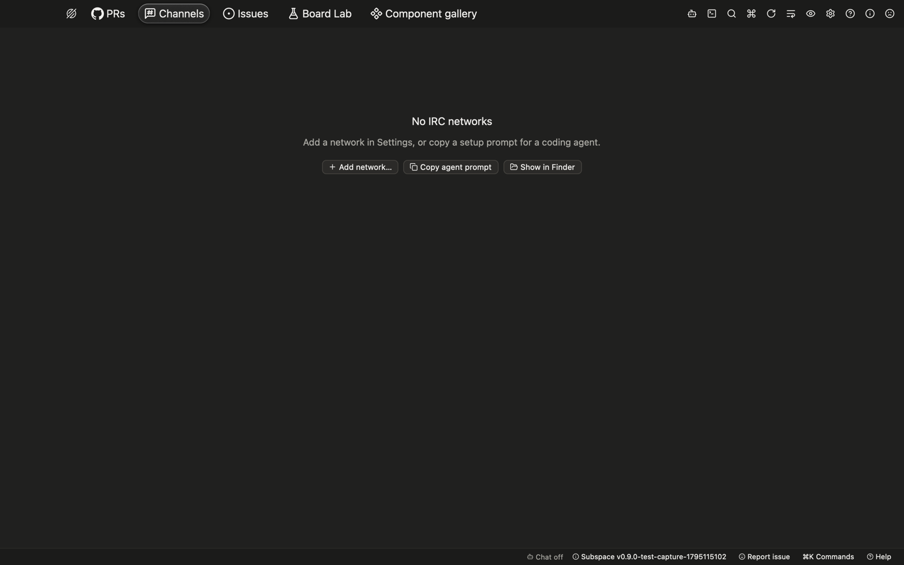
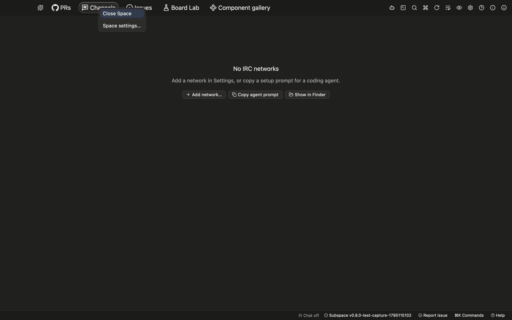
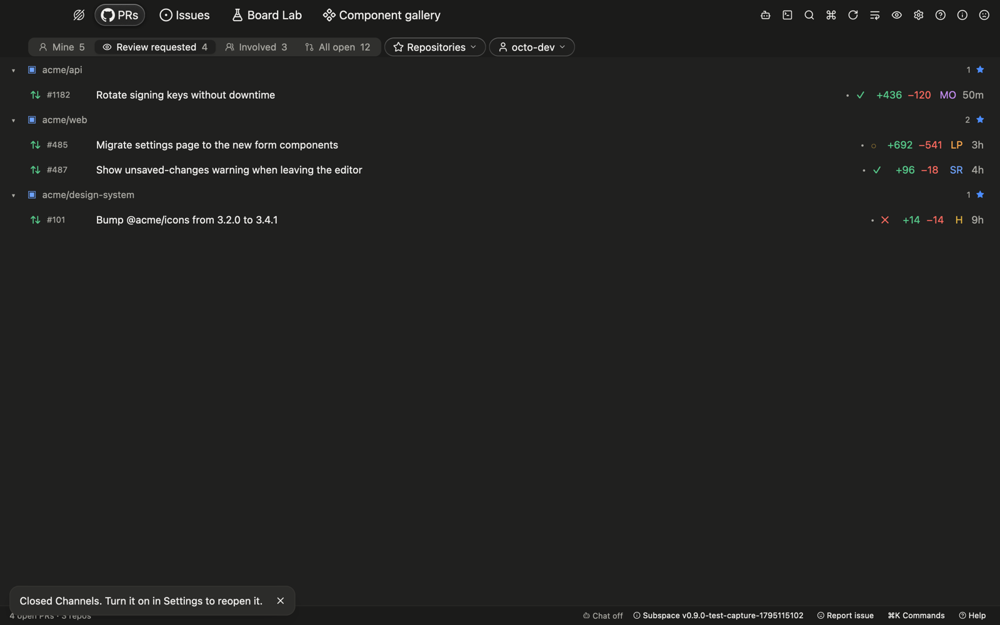
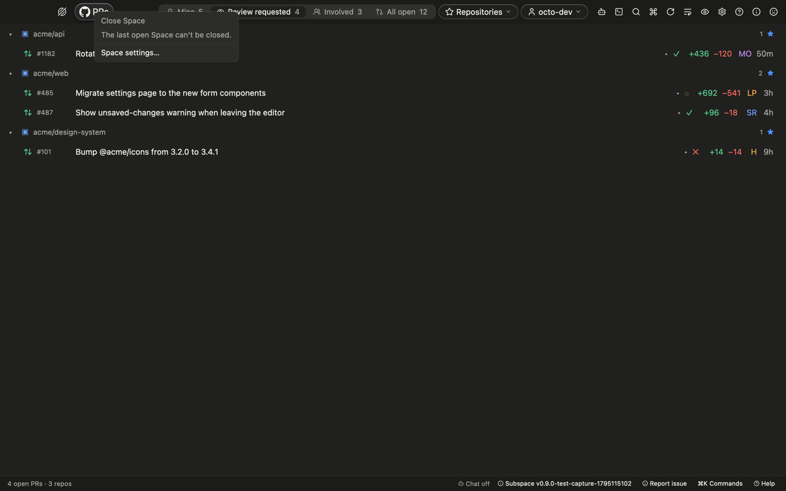

# Delivery: close a Space from its tab

See the [spec](spec.md) and [tasks](tasks.md).

## Screenshots

Captured with `make capture` from the branch's capture build: isolated
`HOME`, fixture data, Cupertino Dark (theme unset), Channels current.

Before: the switcher with Channels current. The tabs look as they did before
this change; the menu is the only new surface.

Right-clicking the Channels tab opens its menu, with the pointer on
**Close Space**.

After **Close Space**: the Channels tab is gone, PRs (the tab before it) is
current, and the notice says where to reopen the Space.

The last open Space (PRs, with every other Space off in the fixture config):
**Close Space** is disabled and the menu says why.

## Tests

In the Framework's shell (`host/app`):

- `app::space_menu_tests::closing_a_background_space_removes_its_tab_and_keeps_the_current_one`:
  right-click Beta, choose **Close Space**; the tab goes, Alpha stays current,
  the running config and `config.json` turn Beta off, and the notice names
  where to reopen it.
- `app::space_menu_tests::closing_the_current_space_moves_to_the_previous_tab_and_focuses_it`:
  closing the current Gamma makes Beta current and focused and stores it as
  the active Space; closing the current first tab hands over to the next.
- `app::space_menu_tests::the_last_space_cannot_be_closed`: with one Space
  left, the menu shows the reason, choosing the disabled item and calling
  `close_space` directly change neither the tabs nor the config file.
- `app::space_menu_tests::closing_from_the_tab_saves_what_the_settings_switch_saves`:
  for a default-on and a default-off Space, the `boards` value in
  `config.json` and the running config after **Close Space** equal those
  after the Settings switch and **Save**; Settings reopens the Space.
- `app::space_menu_tests::space_settings_opens_that_spaces_page`: **Space
  settings…** opens Settings at Beta's page without switching Spaces.
- `app::space_menu::tests`: the neighbour rule and the notice text.
- `subspace_core::settings::tests::board_choices_save_alone_and_match_a_full_save`:
  `save_board_choices` writes only `boards`, as a full Save writes it, and
  removes the key when no choice is left.

The existing `app::configured::hot_tests` (Settings applies board choices
without a restart) still pass with Save's apply step moved into
`settings::board_choice`.

## Checks

- `make check` in `subspace-framework` and `subspace-desktop`.
- `mise run quality` in both projects; `rustqual . --findings` shows no
  findings in the changed files.

## Not done

- Opening the menu from the keyboard: GPUI Kit 0.9.1's `ContextMenu` has no
  keyboard trigger. The Settings switch remains the keyboard path.
