# Delivery: a complete component gallery and clear component rules

## Result

- **Rules**: one canonical, ordered rule set in
  [UI component catalogue › Rules](../../ui-components.md#rules); AGENTS.md
  (Components), the pull request checklists and the board checklist link it.
- **Coverage**: 176 cards in 16 sections (56 before).
  - Subspace components: 77 cards (53 before, including 5 one-offs), with messaging,
    navigation and chrome, form helpers, `anchored::Anchor`, row menus, the
    repository picker and `list::render`. Every catalogue entry has a card or
    a recorded reason (24 entries without a card: non-visual modules, host
    crates represented by shell cards, and the live log).
  - Shell surfaces: 15 cards, 10 with an **Open** action.
  - GPUI Kit: 84 cards (37 basic, 13 form, 17 layout, 17 advanced) covering
    every public gpui-component 0.9.1 module except four infrastructure
    modules; **39 of 84** are used by Subspace outside the gallery.
- **Navigation**: sidebar by library and section, name filter, `/` search,
  **Hide unused** toggle, copy-name buttons.

## Checks

| Gate | Result |
| --- | --- |
| `make check` | Passed: architecture, board guides, docs index, format, cargo-shear, clippy `-D warnings`, 3,537 tests, script fixtures |
| `make interfaces` | Passed |
| `mise run quality` | Passed: score 100.0%, no findings above the baseline |
| `rustqual . --findings` | 86 findings before and after, identical lists (no new findings) |

New tests (gallery crate, part of `make check`):

- `tests::catalogue::*`: dashboard modules catalogued; catalogue entries
  have cards or reasons; names table equals the cards; every gpui-component
  module has a card; table readers on fixtures.
- `kit_usage::*`: used marks equal the source scan; use-tree expansion;
  module, glob and alias matching; comments and inline tests ignored.
- `browse::tests::*`: hide-unused removes exactly the unused GPUI Kit cards;
  the filter needs every word; matches are capped; unknown sections fall back.
- `tests::*`: every section renders each card headlessly; clicking a copy
  button puts the exact name on the clipboard (a shared and a GPUI Kit
  name); hiding removes the unused cards from each GPUI Kit section; the
  toolbar toggle and status; `/` search finds every card and reveals a hidden
  one; the filter shows matches from every section; preferred treatments and
  shell links point at real cards.
- Builder tests for every section call each sample builder and check each
  state has a caption; the GPUI Kit checkbox sample changes its value on click.

## Notes

- GPUI Kit components whose native popup hosts Subspace forbids outside
  `anchored` (Popover, DropdownButton's menu, context and dropdown menus,
  Select) and `Switch` are shown through `anchored` and `toggle::switch`;
  their cards say so. DropdownButton shows without its menu.
- `TitleBar` is covered so dragging the sample cannot move the window;
  Speech shows as unsupported (no `speech` feature).
- The shell cannot be drawn by a board, so shell cards link to their
  components and open the real surface.
- Building the "before" binary reused the shared `target` directory; no extra
  worktree or target directory remains.

## Screenshots

Captured from the capture build (`--features subspace-shell/capture`) in the
background with an isolated `HOME`, fixture data and the default Cupertino
Dark theme, scaled to 1600 px. Before is `43bee85`.

### Before

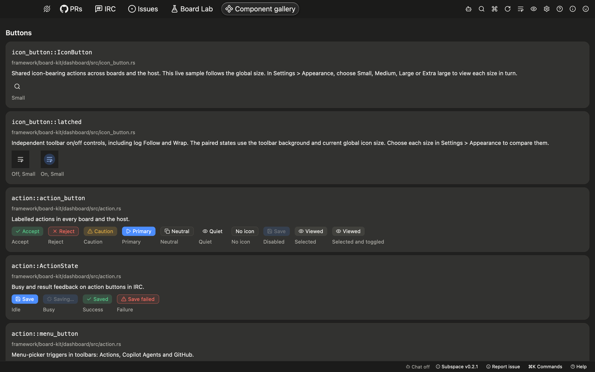
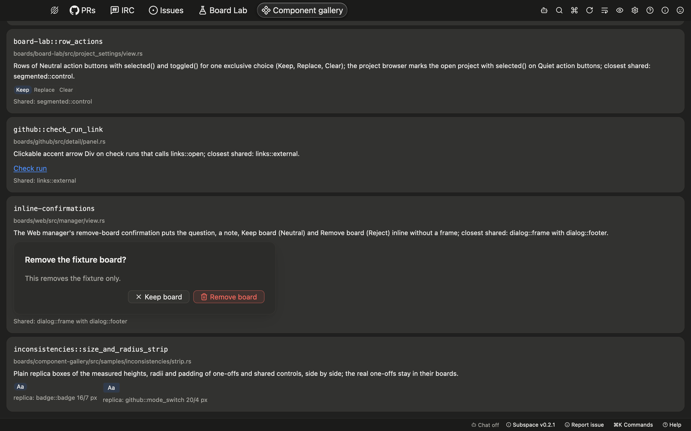

### After

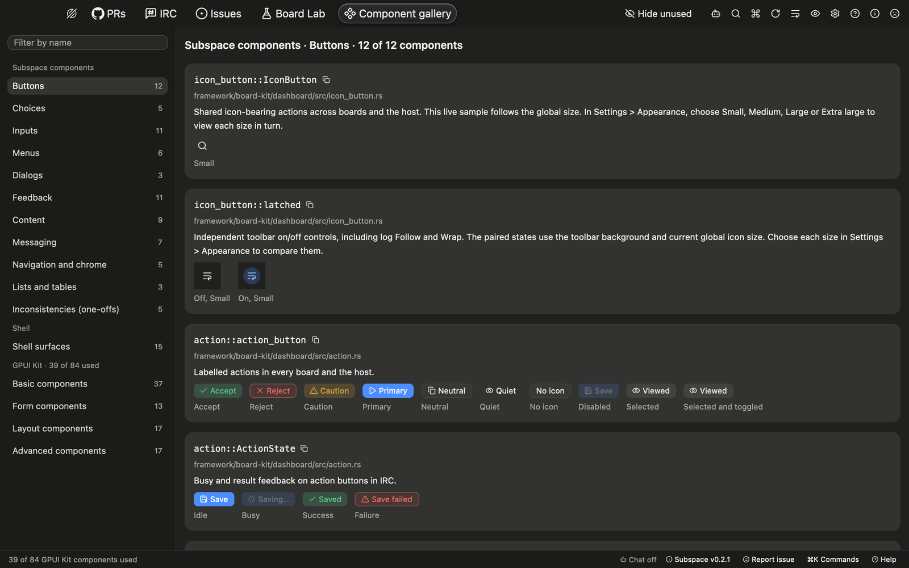
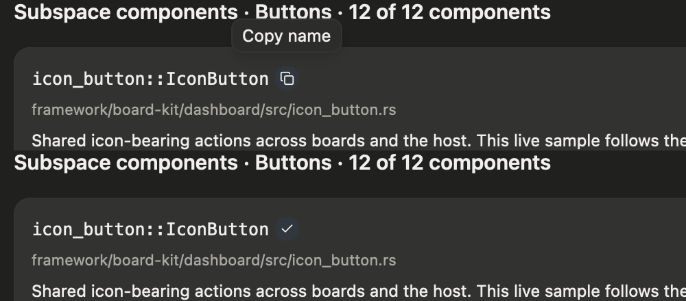
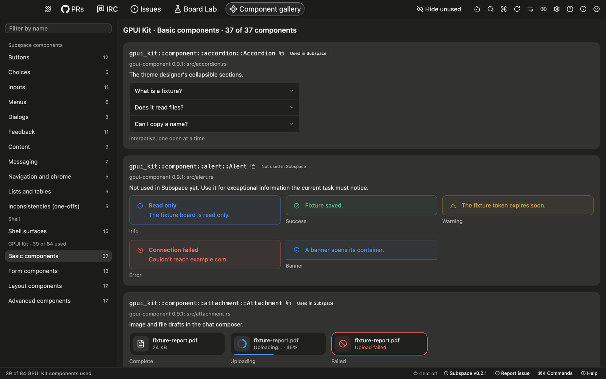
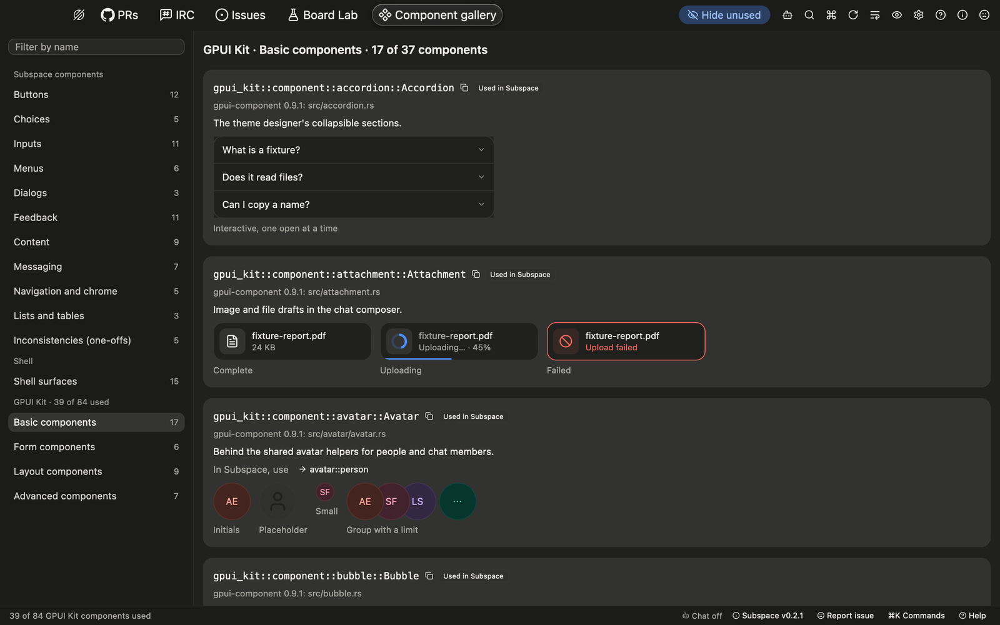
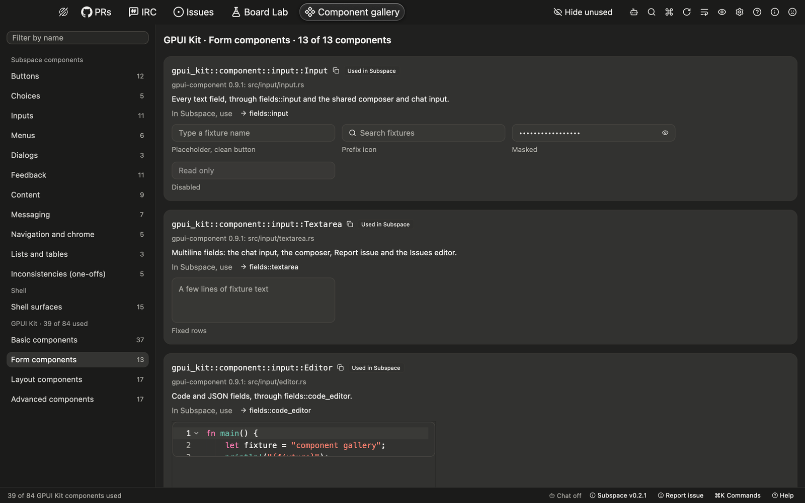
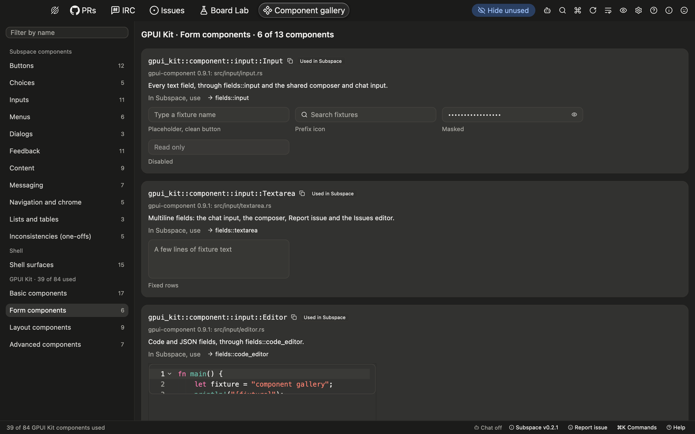
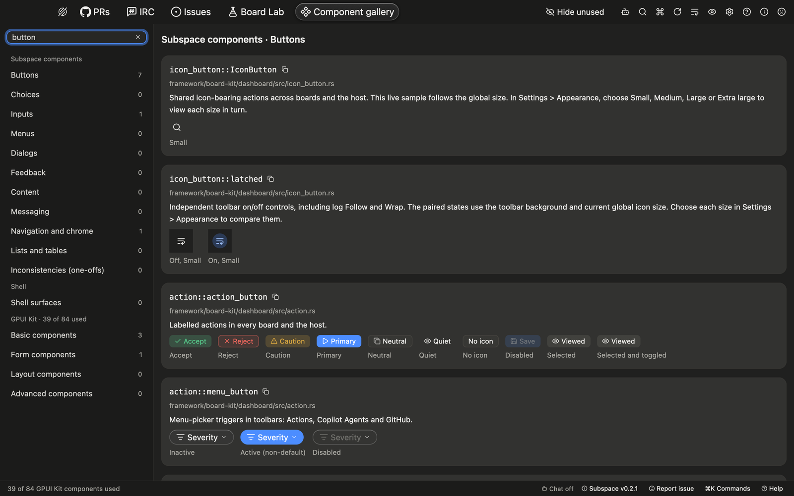
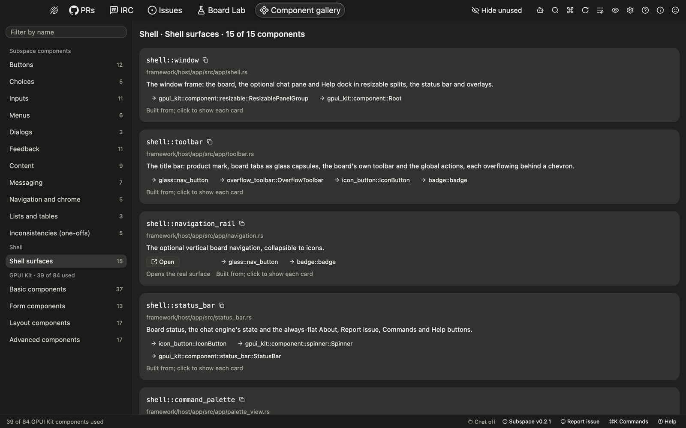
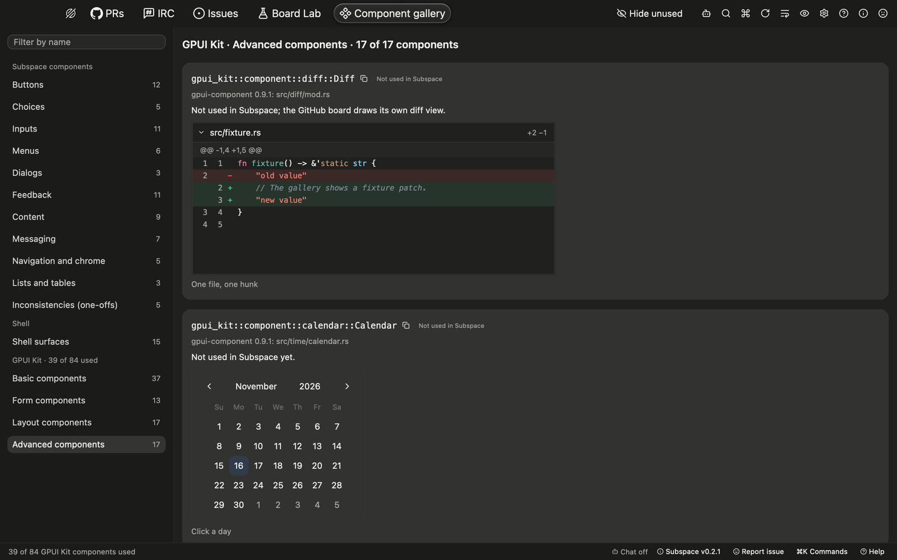
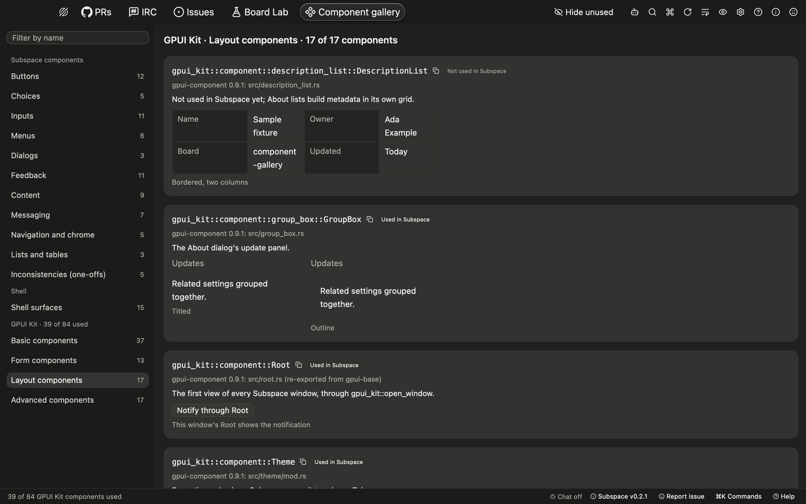
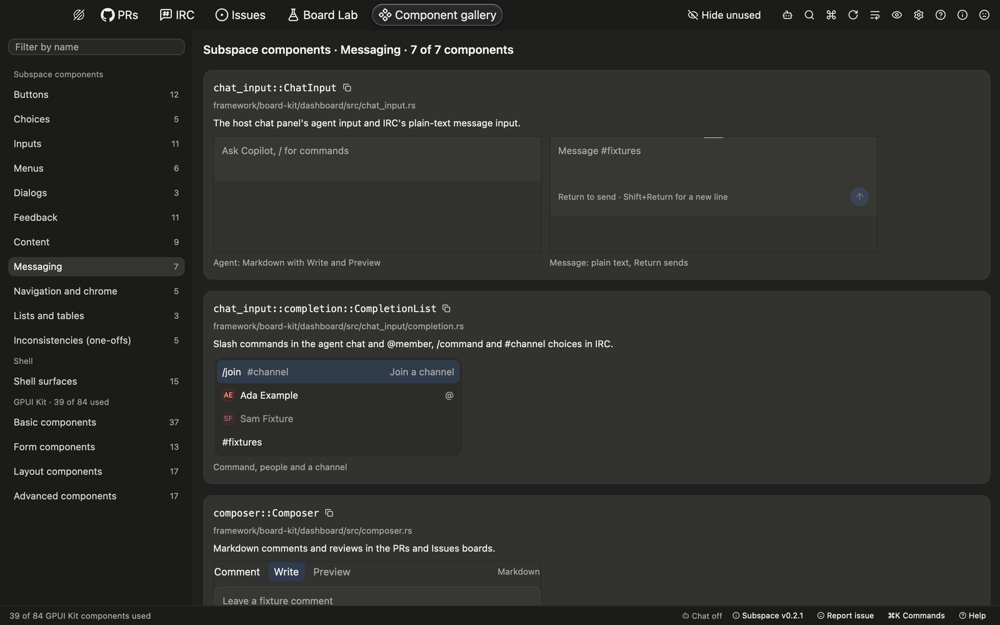
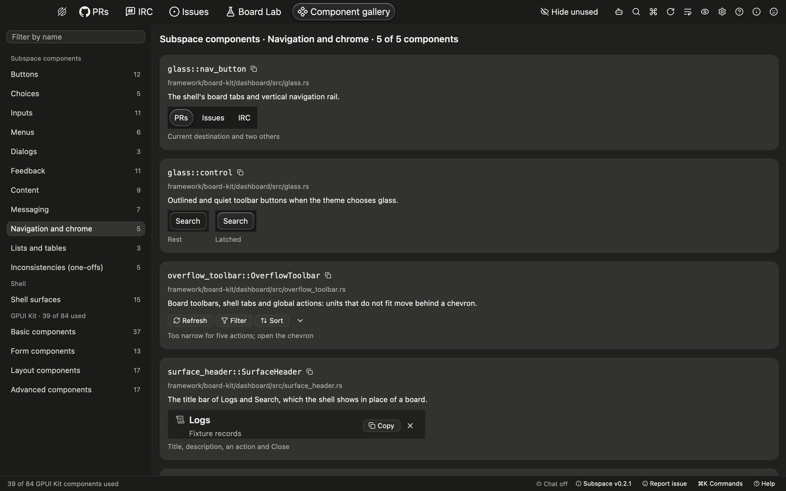

Each image was checked: fixture names only (Ada Example, Sam Fixture,
example.com), no hostnames, tokens or account data.
