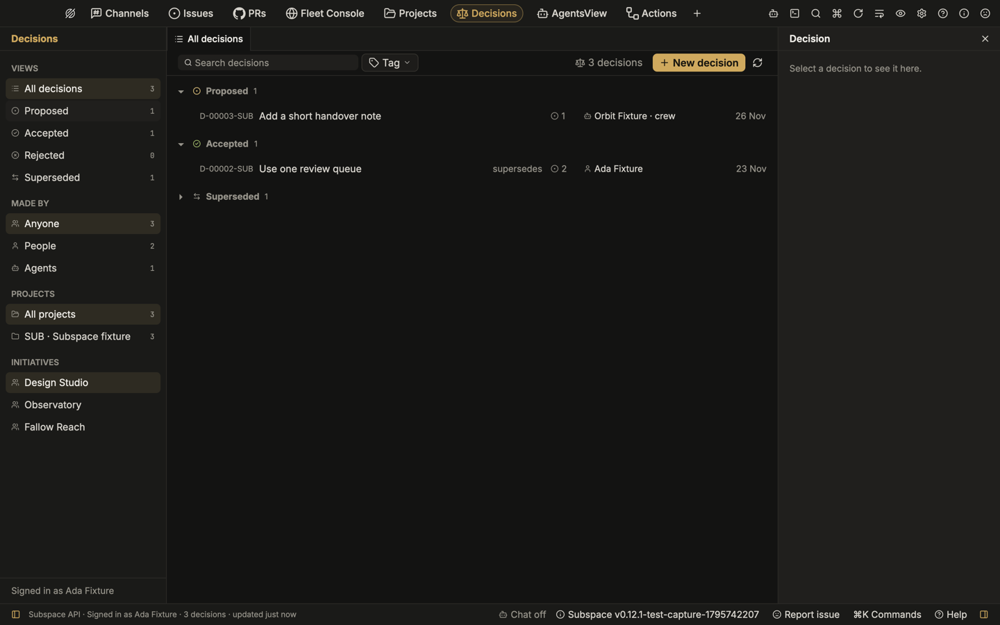
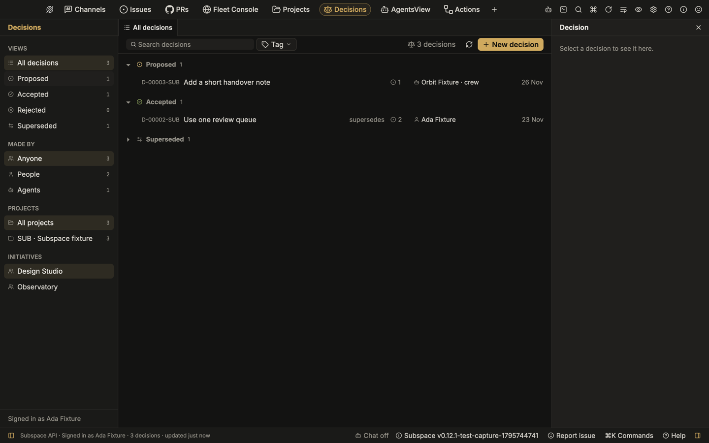
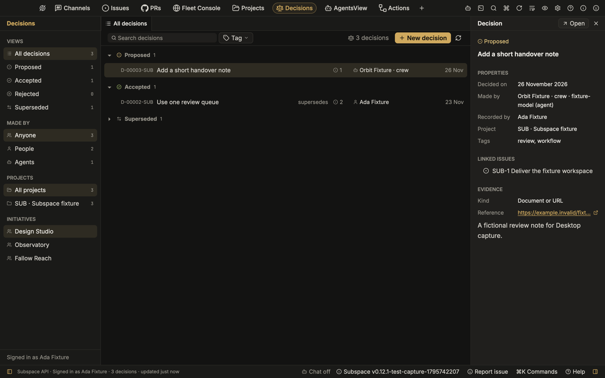
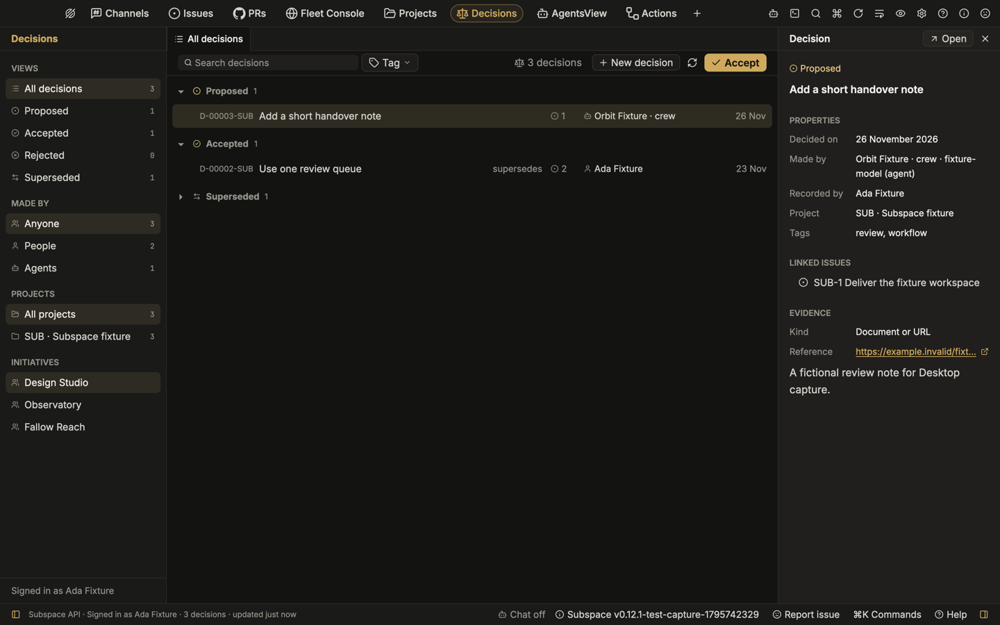
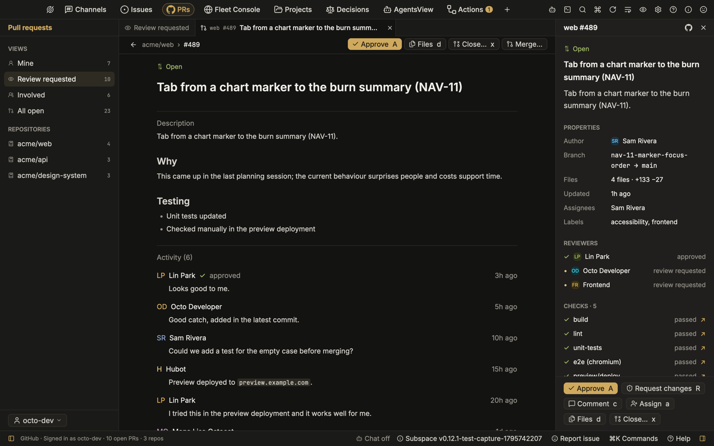
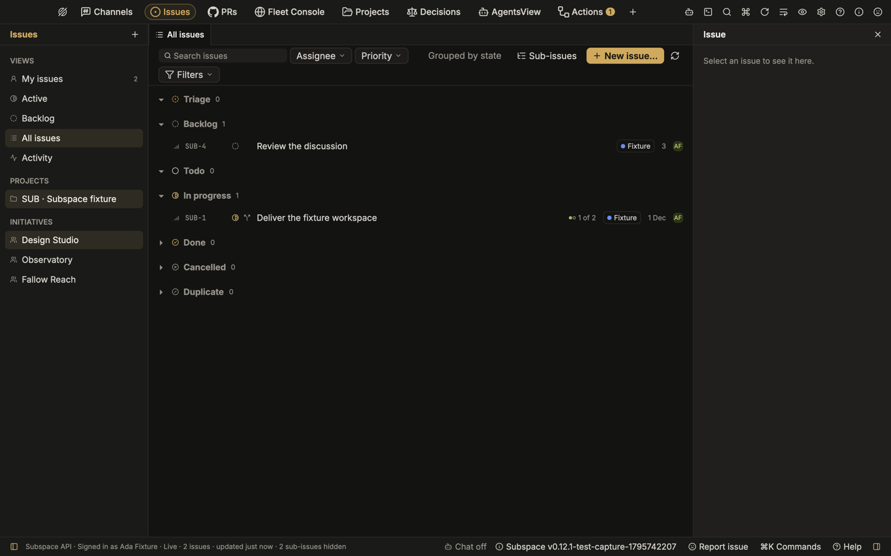
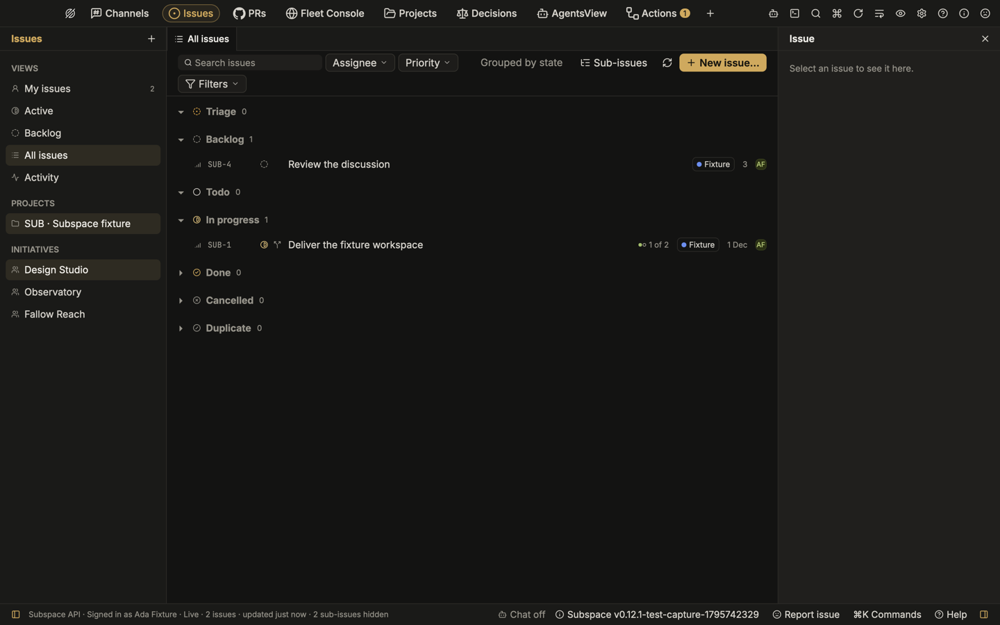
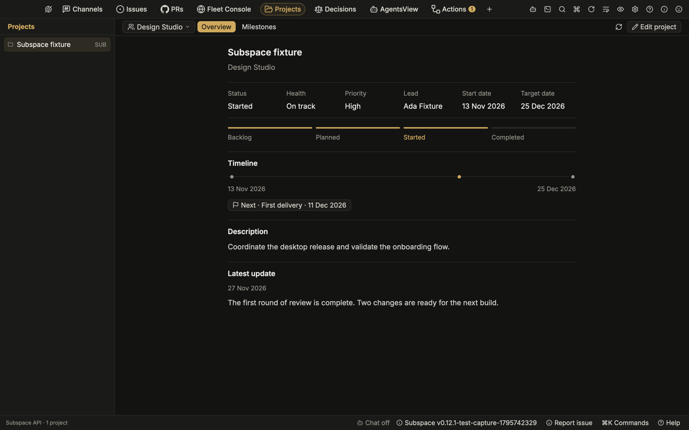
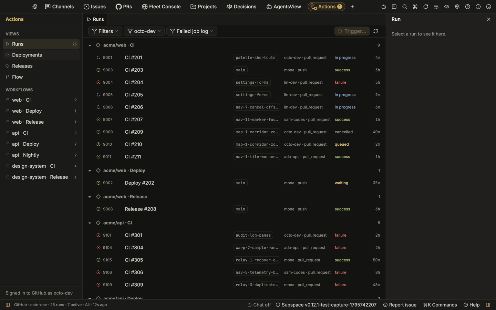

# Contextual Decisions actions and refresh placement

Select a proposed decision that your account can review. **Accept** becomes
the primary toolbar action and opens the existing confirmation dialog for
the selected version. **New decision** remains available and becomes the
primary action again when the selection has no available review. Confirming
**Accept** from the list opens the accepted decision. An open decision
continues to use its own review controls.

Refresh sits immediately before the rightmost action in the Decisions,
Issues, Projects and Actions toolbars. The PR detail toolbar uses the same
placement and refreshes the open pull request in place, even if it has merged.
An older read for another pull request does not delay Refresh. A read error is
shown alongside any cached details.

The Decisions tests check the selection, the review confirmation and the
return to the normal toolbar after a version conflict. The GitHub test checks
that Refresh keeps a recently merged pull request open. The captures use the Twilight Two theme and
the fixture workspace.

## Decisions with no selection

## Decisions while a proposal is selected

## Pull request detail

## Issues

## Projects

## Actions

