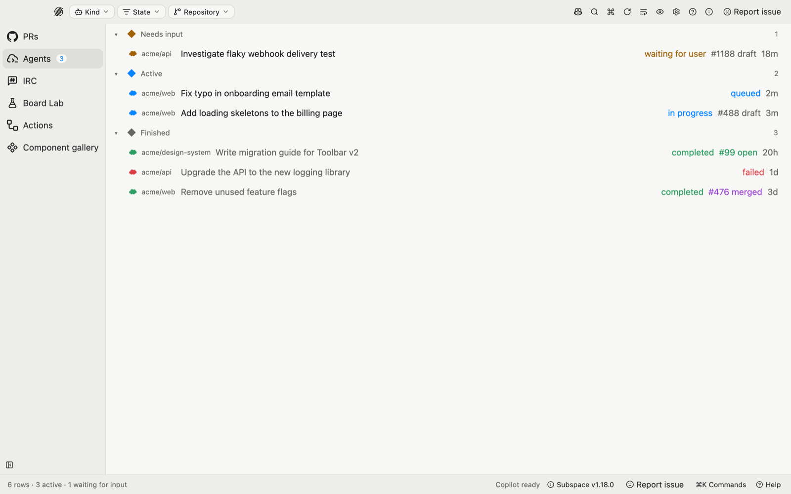
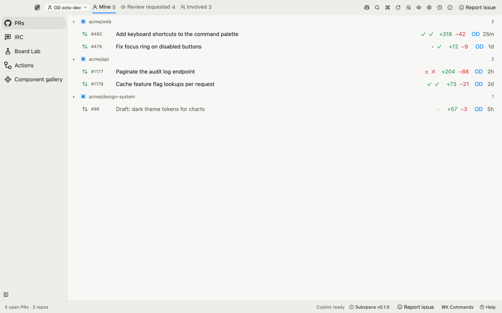

# Change: Copilot Agents rename, default-off, version reset

## Intent

The board that lists GitHub Copilot cloud agent tasks was called **Agents**,
with the ID `agents`. A future agents feature is expected to have nothing to do
with GitHub, so the generic name is freed now: the board, its crate and the
GitHub client code it uses say **GitHub Copilot** explicitly. The board is also
disabled by default. Subspace versioning restarts at 0.1.0.

## Spec

- The board is **Copilot Agents**: ID `github-copilot-agents`, directory
  `spaces/github-copilot-agents`, package `subspace-github-copilot-agents-board`,
  view `CopilotAgents`, artwork key `logos/copilot-agents.svg`, GPUI action
  namespace `github_copilot_agents`.
- The product descriptor declares it default-off in every build. GitHub stays
  default-on; Actions stays default-off. An explicit `boards` entry in
  `config.json`, or **Settings > Boards > Copilot Agents**, enables it.
- Names derived from the board ID follow it, with no aliases for the old ID:
  - agent and MCP tools `github_copilot_agents_read` and
    `github_copilot_agents_write`;
  - CLI commands `subspace github-copilot-agents scope|tasks|task|refresh|github-agent-task`;
  - preferences `github-copilot-agents.kind`, `.state`, `.repo` and `.logs`;
  - the session-log cache `github-copilot-agents-session-log.json`;
  - search scope and reference identities `github-copilot-agents:<task>`
    (`ReferenceIdentity::github_copilot_agents`).
- The command tree assigns a tool to the board with the longest matching ID
  prefix, so `github_copilot_agents_*` tools belong to `github-copilot-agents`,
  not `github`.
- GitHub client modules: `subspace_client_github::copilot_agents` (task list,
  detail, start; `COPILOT_AGENTS_HOME_URL`) and
  `subspace_client_github::copilot_agent_sessions` (session document and log;
  `CopilotAgentSession`). Client methods are `start_copilot_agent_task`,
  `list_my_copilot_agent_tasks`, `get_copilot_agent_task_detail`,
  `copilot_agent_session` and `copilot_agent_session_log`.
- The saved task references move to `subspace_core::copilot_agent_tasks` and
  `copilot-agent-tasks.json`. Existing `agent-tasks.json`, `agents.*`
  preferences and `agents-session-log.json` are not migrated.
- Labels that name GitHub's own page (`github.com/copilot/agents`) say
  **GitHub Agents**, so they cannot be mistaken for the board.
- The generic chat agent (`subspace-agent`, `agent-tools`, `agent-model`, ACP and
  Pi agents) is unchanged.
- `[workspace.package] version` is `0.1.0`; `subspace --version` reports
  `Subspace v0.1.0`. Generic version examples in tests and docs are unchanged.

## Delivery

## Tasks

- [x] Rename the board directory, package, view, ID, title, artwork and action
      namespace.
- [x] Disable the board by default and update the default tests.
- [x] Rename the derived tool, command, preference, cache, search and identity
      names.
- [x] Rename the GitHub client and core modules for Copilot agent tasks and
      sessions.
- [x] Update docs, the board guide, README, AGENTS.md, scripts and fixtures.
- [x] Reset the workspace version to 0.1.0.
