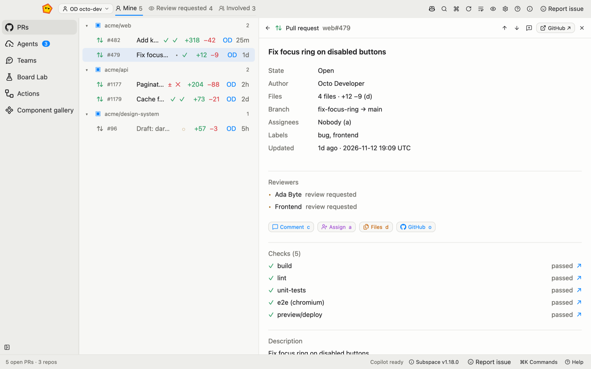
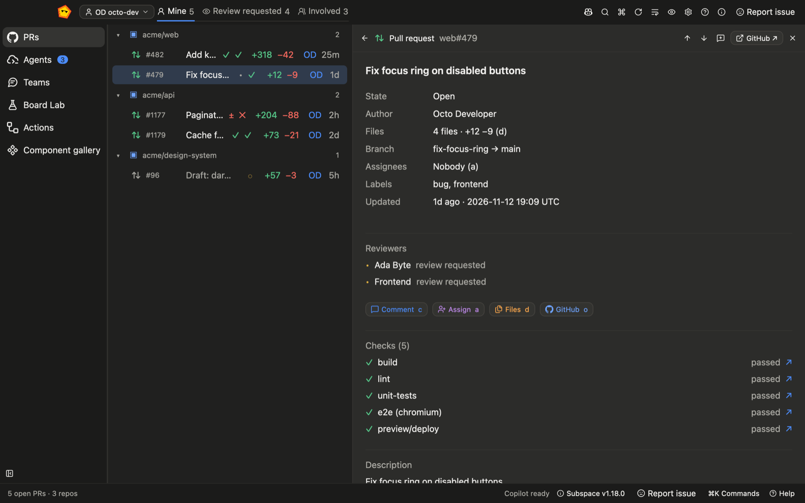
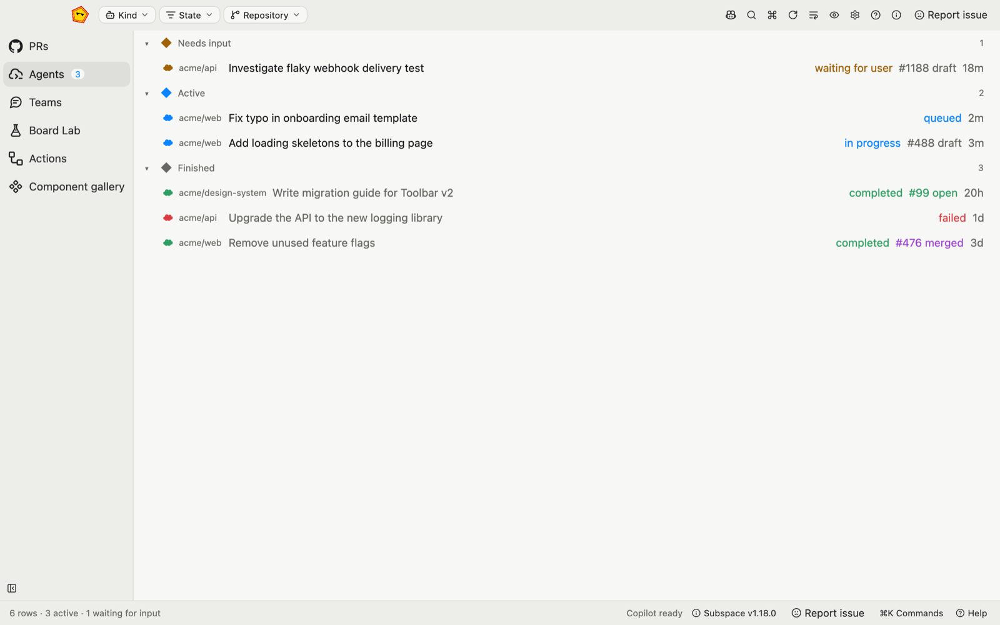
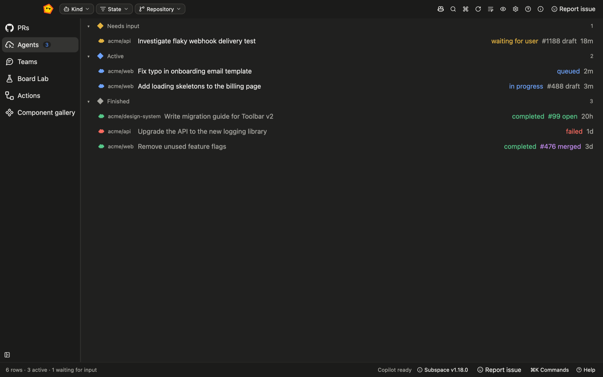
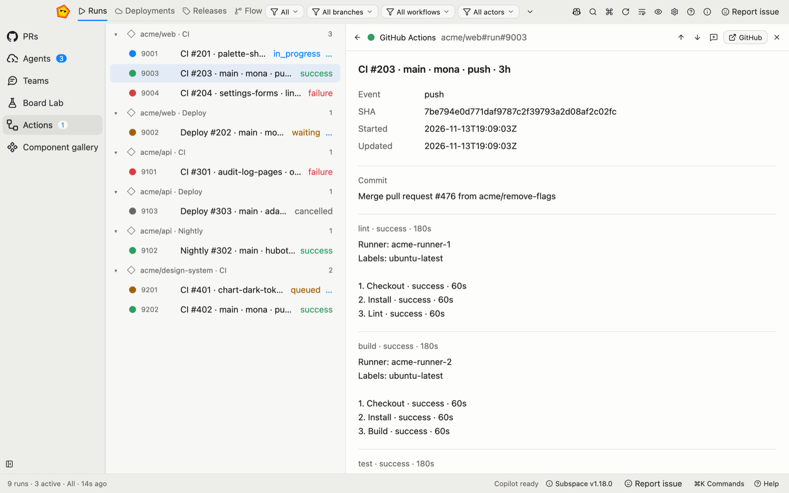
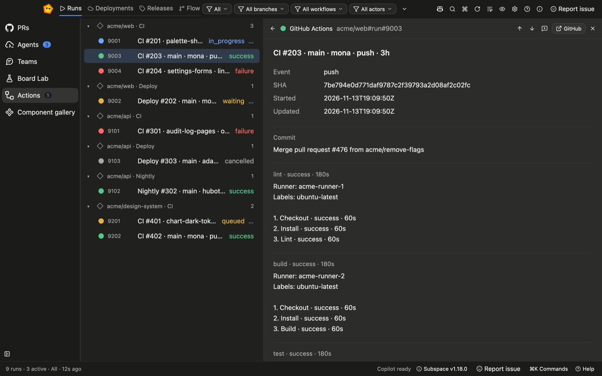
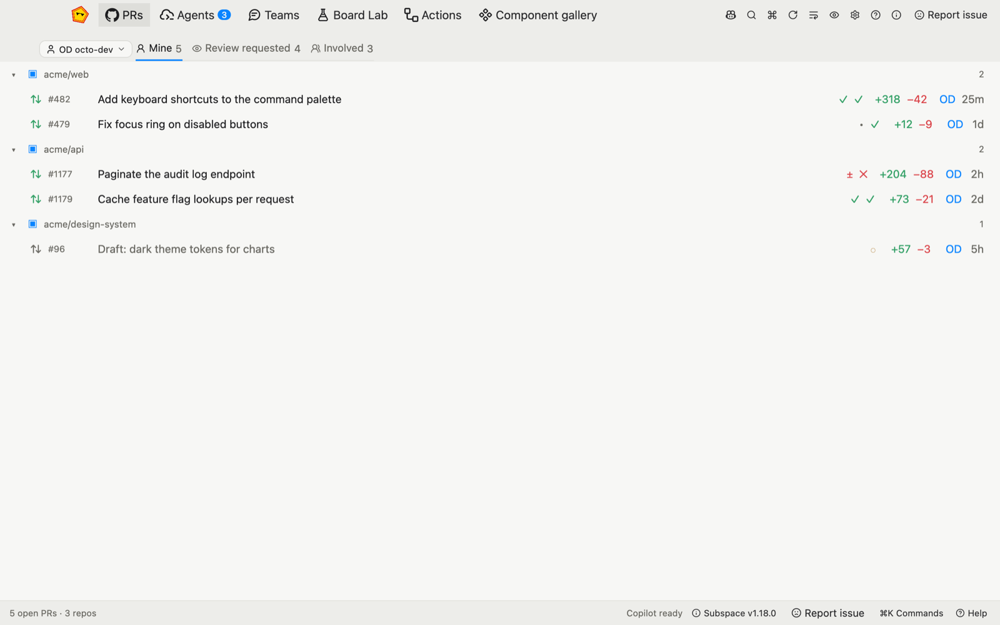
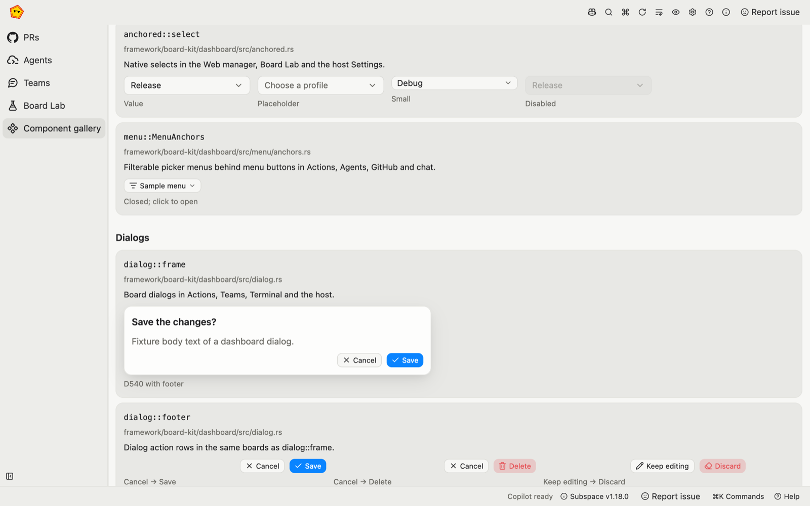
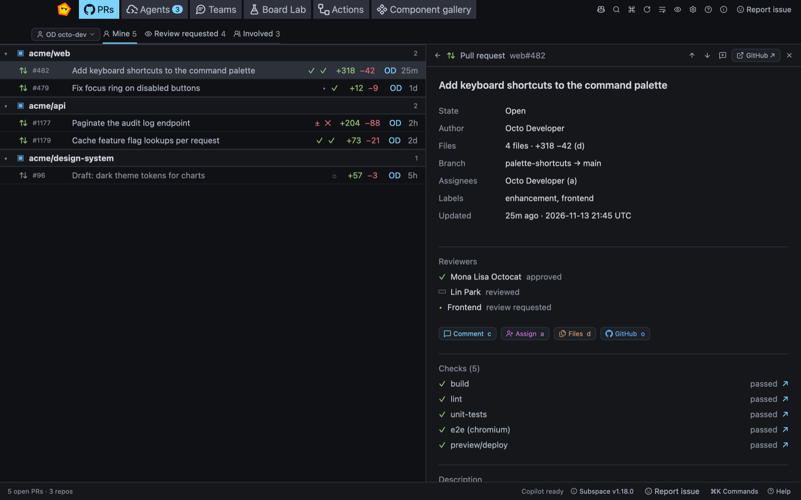

# Delivery: Cupertino theme

Captured from isolated debug builds with fixture data (fictional `acme`
repositories served by a local fixture GitHub API) and a temporary `HOME`.

Offscreen captures do not include the macOS traffic lights; the empty space at
the toolbar's leading edge is where they sit.
