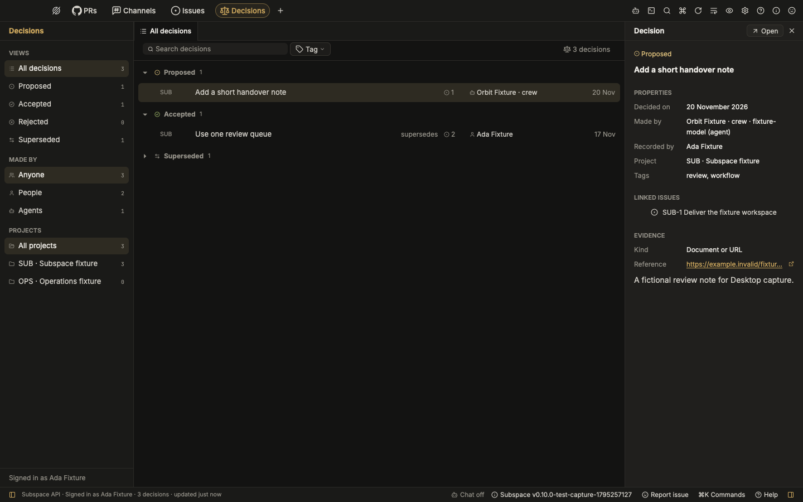

# Decisions Space verification

Back to the [change record](intent.md).

## Status

Built on the same branch as the
[workspace shell](../workspace-shell/delivery.md), and its tests pass. The
main session ran plain `cargo test --workspace --locked --no-fail-fast` in
both projects on the branch's working tree on 21 November 2026; both exited
0. On the final working tree, on 21 November 2026, `make check` passed in the
Framework and in the desktop, `mise run quality` passed in both and
`make interfaces` passed in the desktop. `mise run audit` fails on advisories
that `main` also has, and is not caused by this change. The model reviews
have not run, and only one capture has been taken, so the change is not ready
for review.

## Checks

Passed, in that run:

- The crate's tests (`subspace-decisions-board`, 55 passed):
  - pure: the query each choice and search builds, stored choices, grouping
    and order, first folds, counts, which navigator row is selected, the
    maker and date wording, the peek's and the page's facts, the sections
    left out, the menu options and picks, paging and repeated cursors, and the
    linked-issue address;
  - headless (`src/tests/`): the first read's groups and folds, the status
    line, one click selecting and peeking, a supersession row selecting and
    unfolding, navigator views, makers and projects reading and being stored,
    the committed search, hiding the docks, a failed first read with Retry,
    Enter and a double click opening the page, Escape closing it, the
    banners, a missing decision, and a linked issue opening through a
    stand-in `current-scope` responder or showing a notice without one.
- The product tests (`products/subspace`, 48 passed, 1 ignored), which
  compare the registrations with `docs/spaces-audit.md` and pin the artwork
  listing and the board order.

Passed on the final working tree, on 21 November 2026:

- `make check` in `subspace-desktop` (exit 0), including the board-guide
  check (`spaces/decisions/help.md` follows the template), the documentation
  index, the architecture check and clippy, and `make check` in the
  Framework (exit 0).
- `mise run quality` in both projects.
- `make interfaces` (exit 0): `scripts/test-product-interfaces.sh` lists the
  product's boards and expects `"decisions"` after `"issues"` in both lists.

Not passing, and not caused by this change: `mise run audit` in the desktop
fails on nine advisories published against `heapless` 0.9.3
(RUSTSEC-2026-0574 to RUSTSEC-2026-0582, all "unsound"). `main` depends on
the same version, and this change adds no third-party crate, so `main` fails
the audit too.

Not run:

- Both model reviews, Claude Opus 5.5 and GPT-6.2 Sol at high effort.

## Capture

One capture, taken with `make capture` from the final build of this branch
and retaken on 21 November 2026 to replace the earlier one, with the fixture API's three fictional decisions, in Twilight Two at
1440 x 900. It is kept with the workspace shell's evidence:

A long evidence link that overflowed the inspector is fixed: it now shortens
to an ellipsis and keeps its glyph, as this capture shows.

Still to capture: the navigator hidden, and a decision page with its
superseded banner.
