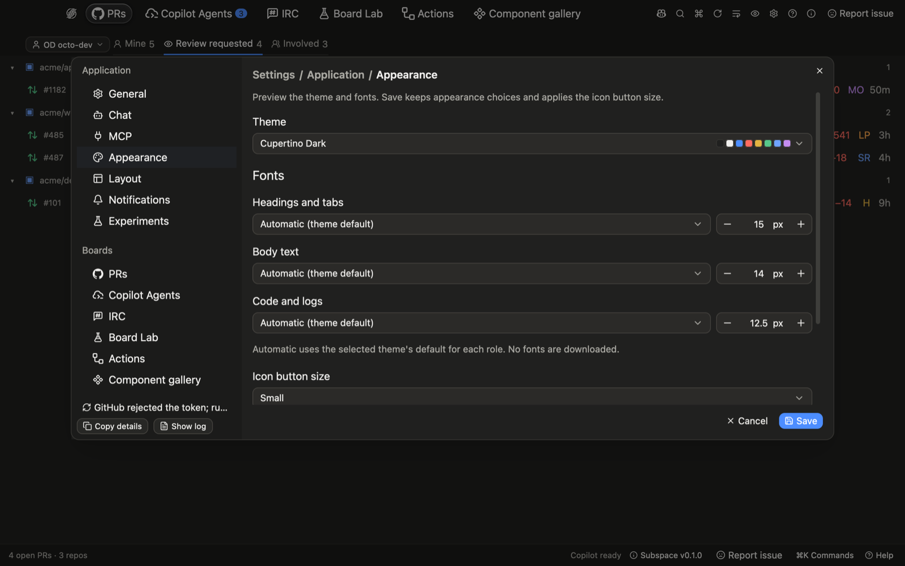

# Delivery: Cupertino Dark as the default theme

The image comes from an isolated debug capture build of this change. It uses
a temporary `HOME` whose `state.json` has no `appearance.theme`, the fictional
`acme` GitHub fixture server, and the default boards. The capture opens
**Settings > Application > Appearance** after launch.

## Results

- `theme::preview_tests::defaults::startup_applies_the_product_default_but_keeps_explicit_user_choices`
  checks that a fresh start selects Cupertino Dark without writing a
  preference, and that a saved Solarized Light choice still wins.
- `theme::loader` tests check that the known product defaults to Cupertino
  Dark from its embedded documents, and that a default outside the declared
  documents fails validation.
- `subspace-product` tests cover the variant-name default, the framework
  fallback that adds the `cupertino` document, and the build override.
