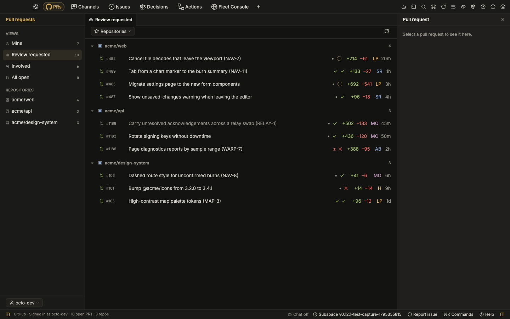

# Delivery: Twilight Two for new installs

The image comes from an isolated debug capture build of this change, started
with `CAPTURE_FIRST_RUN=1`: a temporary `HOME` with neither `state.json` nor
`config.json`, so no theme is chosen and the app treats the start as a new
install. It uses the fictional `octo-dev` account and `acme` GitHub fixture
server and the default Spaces. The window has no saved bounds, so the
capture resizes it to 1440 × 900 before the shot:

```sh
CAPTURE_FIRST_RUN=1 make capture OUT=<dir> \
  STEPS='wait:6000;resize:1440,900;wait:3000;shot:first-run'
```



## Results

- `theme::preview_tests::new_install` in the Framework's `subspace-shell`
  checks that a start with neither file records the theme in a new state
  file and does nothing on the next start; that a state file with or without
  a saved theme, a malformed or blank state file, a config file alone,
  malformed or not, and both files leave everything as it was; that an
  unreadable state file or a dangling link counts as an existing install;
  that an unreadable folder records nothing and says why; that a theme
  outside the catalogue is refused; that a new install on a light-mode
  system opens in Twilight Two, dark; and that an existing install without a
  saved theme still shows Cupertino Dark and gains no saved theme.
- `new_install` tests in the `subspace` product check that a new Subspace
  install records Twilight Two, that an existing one without a saved theme
  records nothing, and that a build with its own default theme records none.
- The descriptor test
  `new_installs_open_in_twilight_two_and_unsaved_installs_keep_cupertino_dark`
  states the rule: Twilight Two for new installs, Cupertino Dark as the
  default, both documents in the catalogue.
- `scripts/test-capture.sh` checks that `CAPTURE_FIRST_RUN=1` writes neither
  fixture file and refuses `CAPTURE_THEME`; the capture step parser test
  covers `resize:`.
