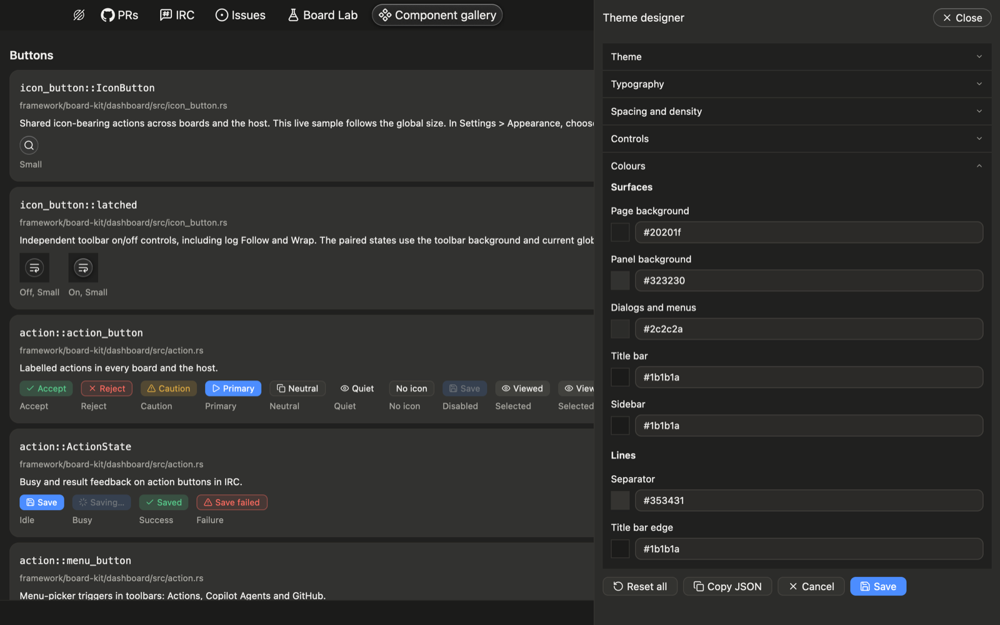
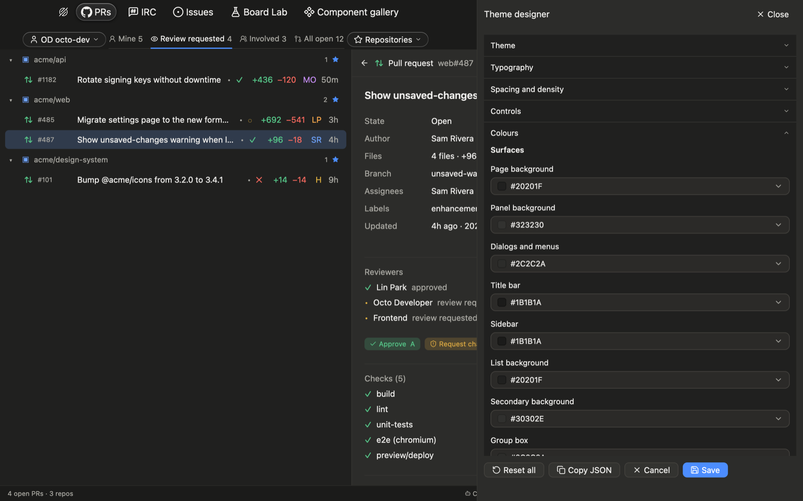
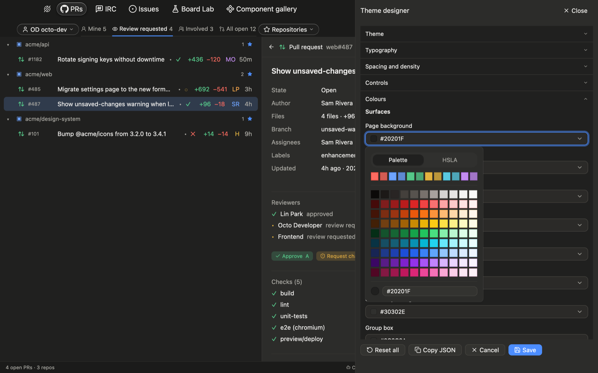
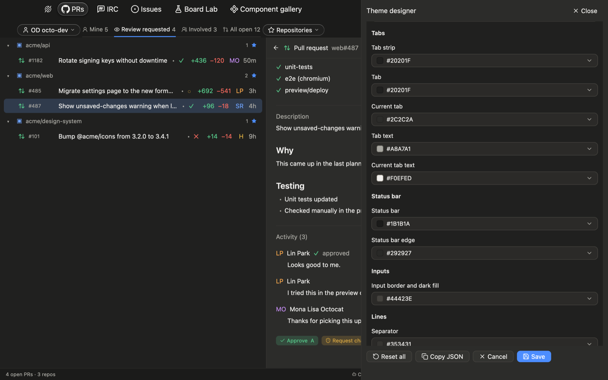

# Theme designer: colour picker and every themed surface

Back to the [change records](../README.md).

## Intent

The owner found surfaces that seemed not to follow the theme: the IRC dock's
tab strip, the status bar and the chat composer. They follow the theme
already: `tab_bar.background` and the `tab.*` colours, `status_bar.background`
and `status_bar.border`, and, in dark themes, `input.border`, which GPUI Kit
uses at 30% opacity to fill inputs. The theme designer offered none of these
keys, so there was no way to see or change them. The owner also asked for a
colour picker in the designer.

## Spec

- New colour fields in the designer:
  - **Surfaces:** list, secondary and group-box backgrounds.
  - **Tabs:** tab strip, tab, current tab, tab text and current tab text.
  - **Status bar:** status bar and status bar edge.
  - **Inputs:** "Input border and dark fill".
- Each colour is GPUI Kit's `ColorSelect`, its form control as it ships: a
  field with a swatch and the hex value that opens the picker (palette, HSLA
  sliders with alpha, and a hex field). It replaces the hand-drawn swatch and
  plain text input. Each field has its own `ColorPickerState`. Like the native
  Select, it hosts a popover, so it goes through the shared popup boundary as
  `anchored::color_select`.
- A picked colour previews in every window at once and is saved as hex.
  Channels are rounded, because GPUI Kit's `to_hex` truncates and turned
  `#123456` into `#113456`.
- Colours the base theme derives stay derived until changed, as before.
- The Component gallery has an `anchored::color_select` card, and the GPUI
  Kit colour picker card is marked used and points to it.
- [Appearance](../../appearance.md) and the
  [component catalogue](../../ui-components.md) describe it.

## Delivery

- Tests:
  - every new key reads and writes;
  - hex round-trips, including alpha;
  - picking or typing a colour previews it and saves the same hex;
  - a cleared colour still fails Save with the field's name.

  All 496 `subspace-shell` tests and the gallery's usage check pass.
- The designer and the GPUI Kit Form gallery page open with accessibility
  active and no duplicate-ID panic.

Before, the Colours section (Cupertino Dark):

After:

## Tasks

- [x] Expose the tab, status bar, input, list, secondary and group-box colours.
- [x] Use GPUI Kit's `ColorSelect` for every colour.
- [x] Round hex output; test the round trip.
- [x] Update the gallery card, docs and evidence.
