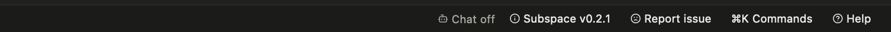
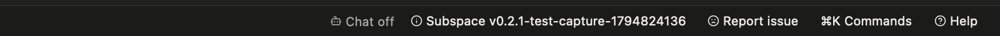

# Dev and test build versions

Back to the [change records](../README.md).

## Intent

The owner asked that local builds from `make run` show a version that makes
clear they are dev builds, such as `0.2.1-dev-<host>-<unixtime>`, and that
test builds show `0.2.1-test-<host>-<unixtime>`. Test builds are the capture
builds and the test binaries. The owner chose the hyphenated pre-release form
over semver build metadata (`+dev…`).

## Spec

- The shell's build script records the build kind (`release` for the release
  profile, `test` with the `capture` feature, otherwise `dev`), the short host
  name as a semver identifier, and the build time in unix seconds. Capture
  builds use the host `capture`, so screenshots never show a real host name.
- `build_metadata` shows `<version>-<kind>-<host>-<unix time>` for dev and
  test builds and the bare version for release builds, in the status bar,
  About, `--version` and `--about`. The shell's unit tests (`cfg(test)`) are
  test builds.
- Only display text changes. Update checks, `__product_metadata`, MCP, ACP and
  IRC keep the real version, so semver ordering of the marker (a pre-release
  ranks below its release) never affects updates.
- [Developer tools](../../developer-tools.md#build-version) documents it.

## Delivery

- Unit tests: the marker for each kind, and a test build's version text with
  a valid host and time.
- `make interfaces` checks that the debug binary's `--version` is
  `Subspace v<version>-dev-<host>-<unix time>`, and a local build printed
  that form with the machine's short host name.
- `make capture` shows `Subspace v0.2.1-test-capture-<unix time>`.

Before, a capture build's status bar (Cupertino Dark, fixture data):

After:

## Tasks

- [x] Record the kind, host and time at build time.
- [x] Mark the shown version; keep the real version everywhere else.
- [x] Update the interface check and document it.
