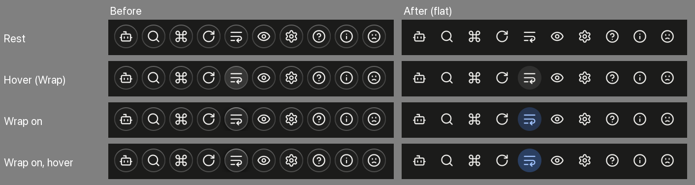
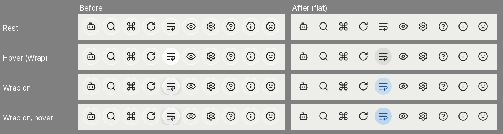
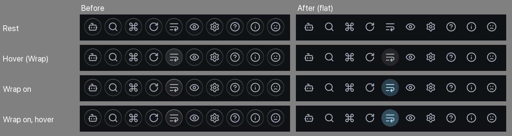
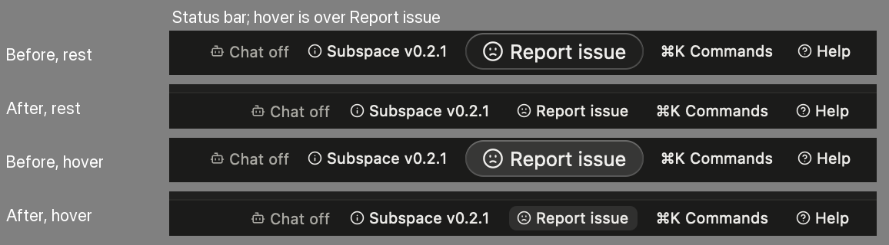
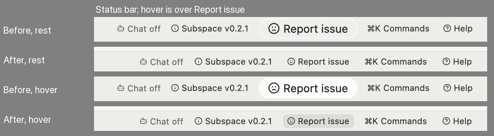
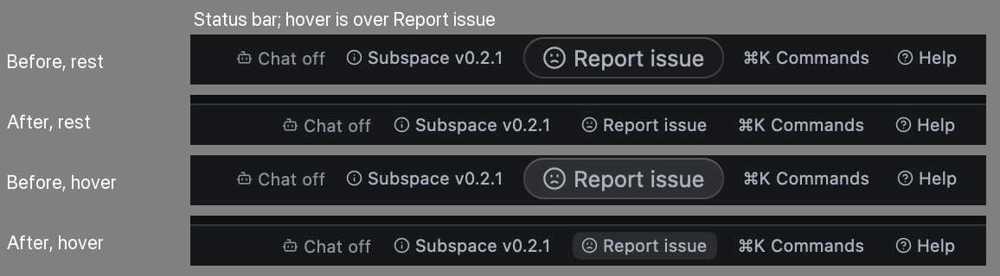
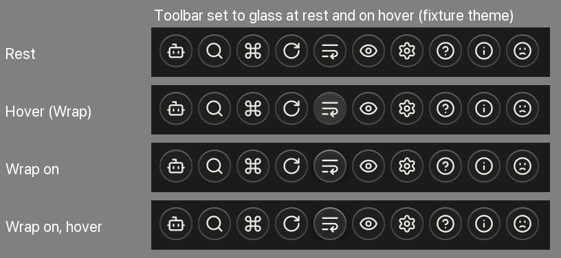
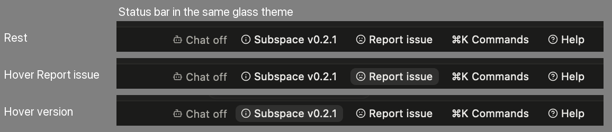
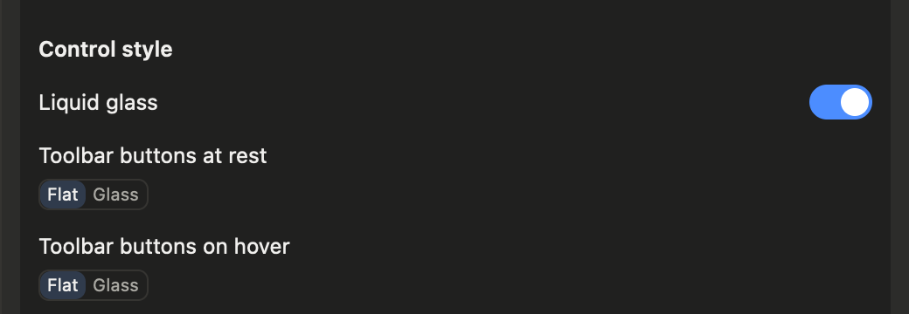

# Delivery: flat controls

## Checks

- `make check` and `mise run quality` (no new findings).
- Dashboard tests:
  - `density::tests::choice_tokens_store_their_value_names`: `flat` and
    `glass` are stored by name and held as 0 and 1; `1` and `outline` are
    rejected.
  - `icon_button::tests::surface`: every theme starts flat, including the
    Liquid glass themes; a theme opts into glass for rest and hover
    separately. Quiet glyph Toolbar buttons follow the look; `.flat()`
    buttons ignore it in every role; outlined toolbar buttons keep resting
    glass only with Liquid glass. For each look, `paint` gives the rest,
    hover, pressed and latched states: flat rests with no fill or edge,
    hover is `button-hover`, pressed is stronger, and latched has the
    `button-on` fill (stronger than hover, deeper under the pointer) and an
    accent-tinted glyph; the glass looks keep the capsule, the glass hover
    and the lit glass.
  - `icon_button::tests::latched` still checks the pressed state for both
    values, keyboard activation and disabled or loading rejection, now under
    the flat treatment.
- Host tests:
  - `status_bar::tests::every_status_command_is_flat_whatever_the_toolbar_look`:
    in a theme with Liquid glass and glass at rest and on hover, all four
    status commands are `Quiet(ToolbarLook::FLAT)`, with no glass, rim or
    edge at rest, hover, pressed or latched.
  - `report_issue::report_entries_follow_their_bars`: the status bar's
    Report issue matches the version's height and line at every icon size;
    the toolbar entry still grows with the size.
  - `jig::tests::designer`: the designer's segmented choices set glass at
    rest and on hover, and a Button hover colour, live without Save; Save
    writes `"--toolbar-button-rest": "glass"`,
    `"--toolbar-button-hover": "glass"` and the tone to the theme file; Reset
    returns to flat.
  - `theme::tests::every_subspace_theme_keeps_flat_button_glyphs_legible_on_their_fills`:
    at least 4.5:1 for the strong text on the hover and pressed fills, and
    for the latched glyph on its fills, on the title bar and page of
    Cupertino Light, Cupertino Dark and Subspace One Dark. An accent glyph
    alone failed this in both Cupertino themes (2.3:1 in Light), so the
    latched glyph is the accent mixed halfway with the strong text colour,
    on an accent-tinted fill.

## Screenshots

Captured from the capture build in the background with an isolated `HOME`
and no credentials. Before is `82950d4`; after is this change. The pointer
is moved over Wrap, then Wrap is clicked on and hovered again.

### Toolbar

### Status bar

Report issue was a toolbar-size button on a glass capsule; it is now a
compact flat command like the version beside it. Under the pointer, every
command shows the same faint fill.

### A theme that chooses glass

A fixture theme, Cupertino Dark with `"--toolbar-button-rest": "glass"` and
`"--toolbar-button-hover": "glass"`, shows the earlier glass toolbar. Its
status bar stays flat at rest and under the pointer, on Report issue and on
the version.

### Theme designer

## Notes

- Glass toolbar buttons now lose their hairline edge under the pointer: the
  flat and glass finishes share one GPUI Kit custom variant whose hover edge
  is transparent. The inset rim and the glass fill remain.
- Board tabs and the navigation rail are unchanged: they were already bare
  at rest, with a glass hover and the current tab lit.
- Menu pickers (outlined toolbar buttons, such as Repositories) keep their
  resting glass capsule with Liquid glass: their outline is their prominence,
  not a quiet button's rest. A theme cannot make them flat.
- Labelled quiet toolbar buttons with a glyph, such as Report issue with its
  label shown, follow the same look as icon-only ones, so one toolbar row
  never mixes flat and glass.
- Each segment in the designer's choices is named Flat or Glass; the group's
  visible label names the token, but the segmented control does not expose a
  group name to assistive technology.
