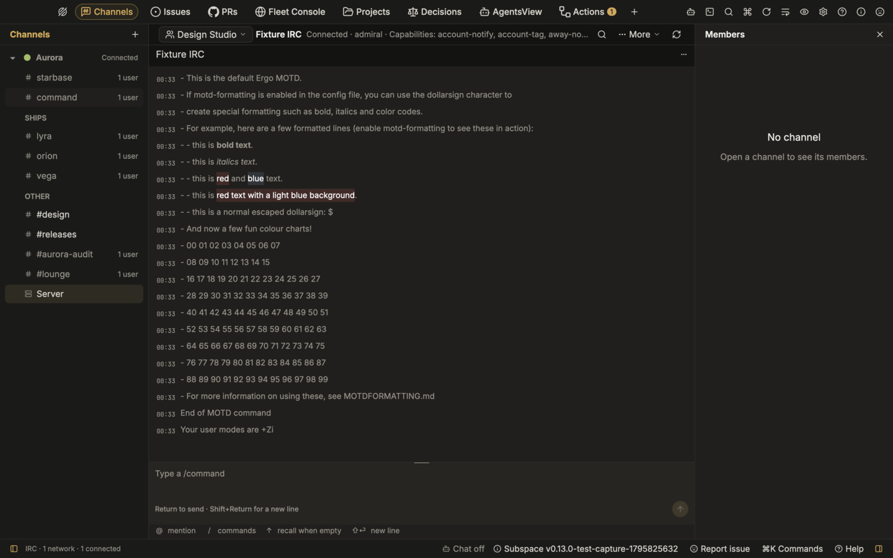
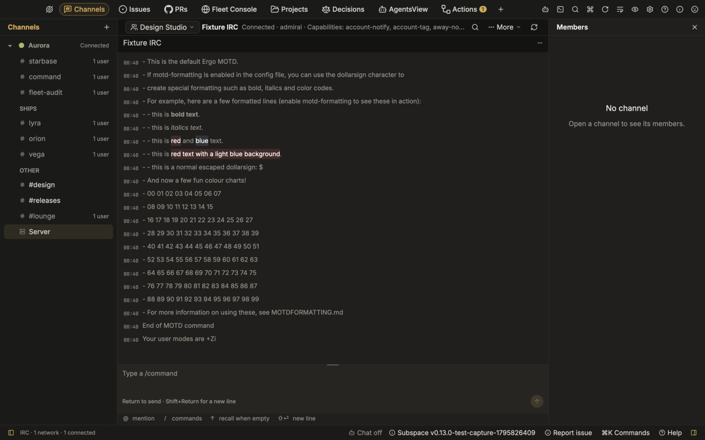

# Fleet Audit in Channels

## Intent

Give Fleet Audit a predictable place in the Channels navigator, beside
Starbase and Fleet Command.

## Behaviour

A network associated with a fleet in the Subspace API recognises the
installer's `#<slug>-audit` channel. It labels the row **# fleet-audit** and
sorts it immediately after Fleet Command and before the ships. The row uses
the existing channel controls and buffer identity. Private channel access
and membership come from IRC.

## Checks

- The navigator test covers the label, order and fleet placement.
- The gateway renders the audit as a DM mirror. Installer tests cover the
  defaults, opt-out and a conflicting ship name.
- The Ergo smoke test admits seeded password and certificate accounts and
  refuses another account. It repeats the check after recreating the server.

The change reuses the Channels navigator rows, connections and commands.

## Evidence

The two 1440 × 900 Twilight Two captures use the same local Ergo and
Subspace API fixtures. The navigator uses the same rows, controls and text
edge on both builds.

