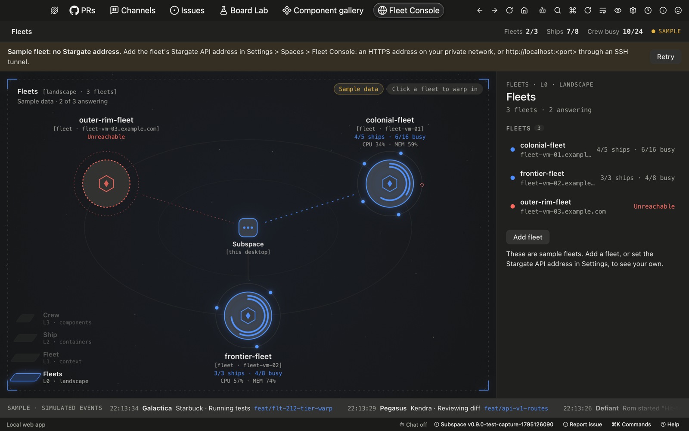
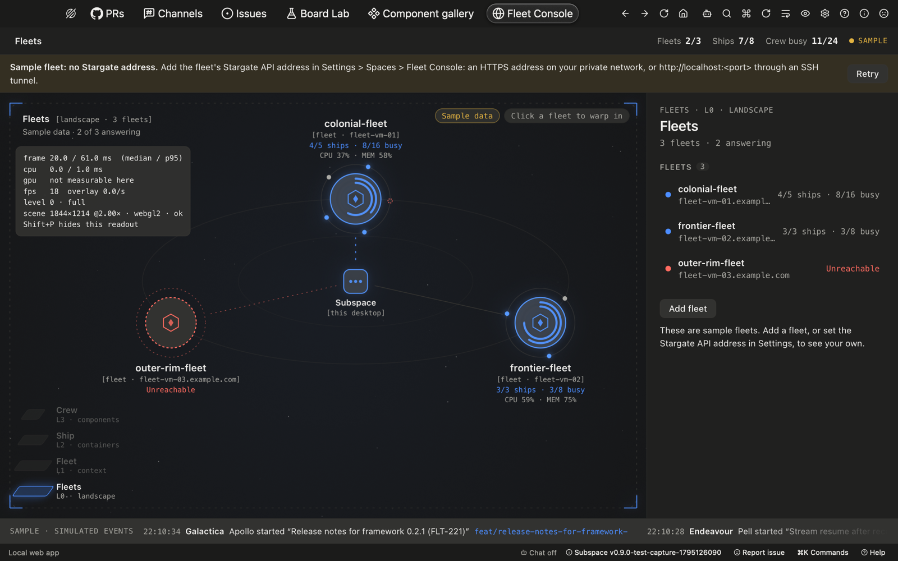
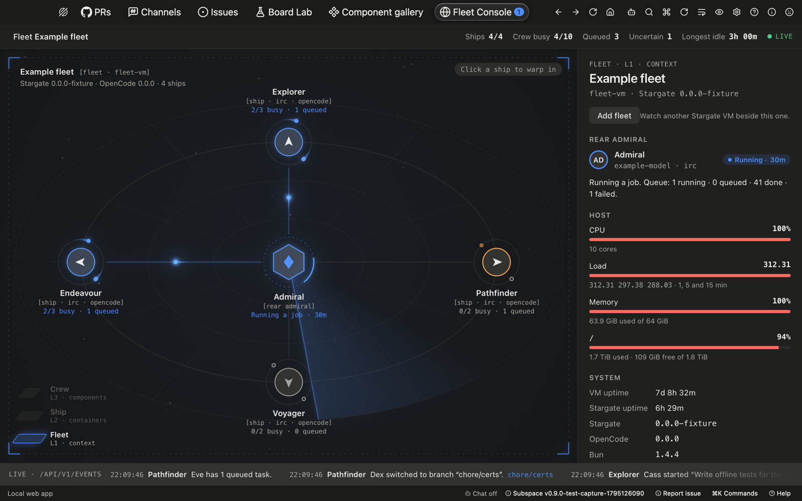
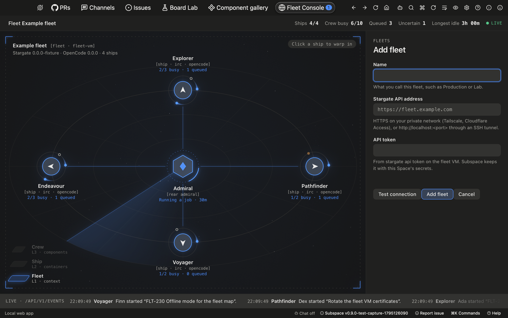
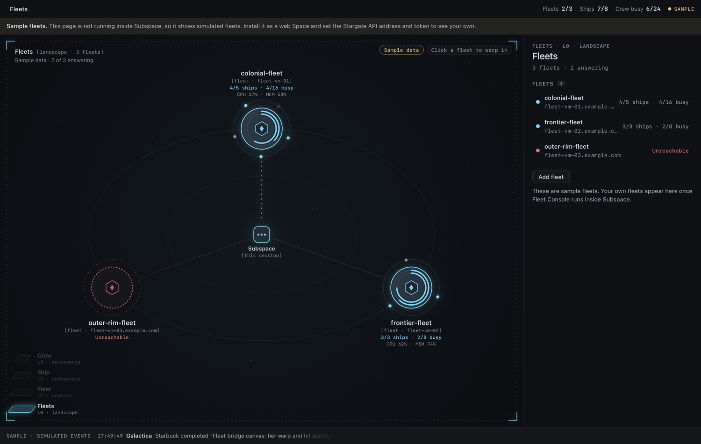
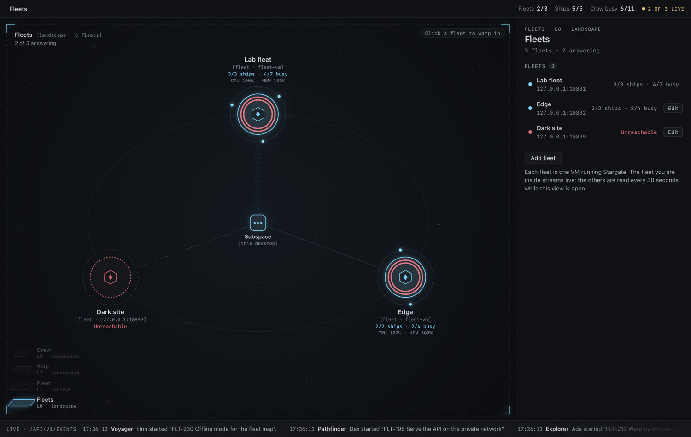
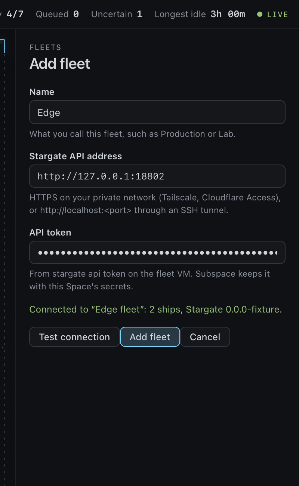
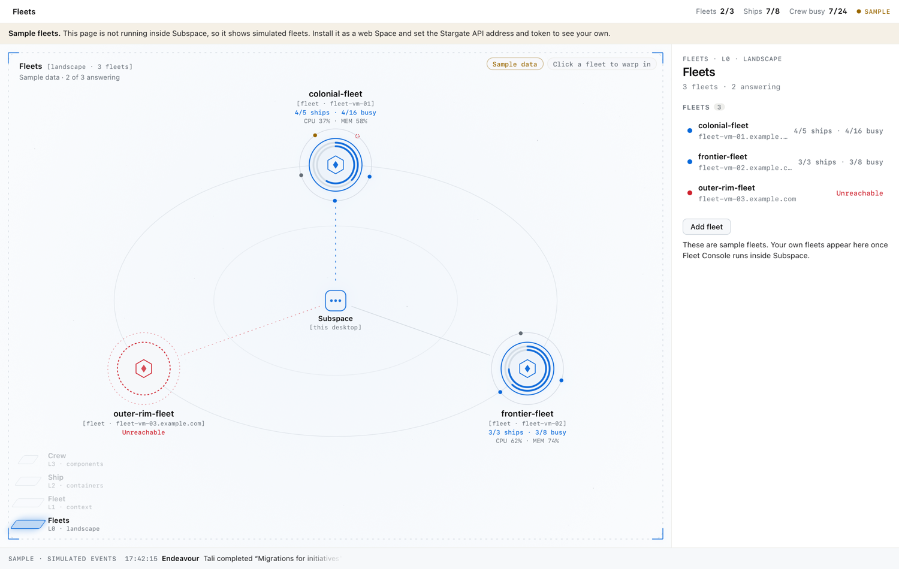
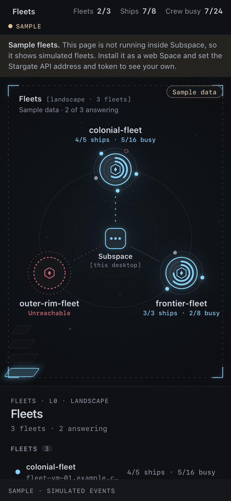

# Fleet Console: multiple fleets

## Intent

A fleet is one VM running Stargate. People have several, each with its own
Stargate address and token. The owner asked for Fleet Console to show them
all: the Settings fleet stays the first one, more can be added in the page,
a Fleets tier above the fleet tier shows them together, and the source of
fleets has a clear seam for the Subspace API, which will later assign a
fleet to each initiative.

## Spec

- **Sources.** `src/fleet-sources.js` merges the Settings fleet
  (`endpoint`, `token`), the fleets added in the page and, later, the
  Subspace API's fleets into one ordered list, one entry per address, and
  decides live or sample mode. Live needs at least one fleet with an address
  and a token.
- **The page's fleets.** `src/fleet-store.js` keeps id, name and address in
  localStorage under `fleet-console.fleets` with a version number; storage
  that throws, corrupt data and a newer version's data are handled (a newer
  version's list is never overwritten). Tokens are kept by Subspace through
  `subspace.secrets.set("fleet_<id>", value)` and read back with
  `secrets.get()`; `null` deletes one. Without `secrets.set` or the secrets
  permission, **Add fleet** explains why.
- **Add, edit, remove.** The inspector's form takes a name, a Stargate API
  address (HTTPS, or loopback HTTP through an SSH tunnel) and a token in a
  password field. **Test connection** reads `GET /api/v1/fleet` and reports
  success or the reason (401, 403, 404, unreachable, timeout). Editing keeps
  the saved token unless a new one is pasted, and never shows it. **Remove**
  asks first and deletes the entry and its token. The Settings fleet points
  to Settings › Spaces › Fleet Console. With one fleet, **Add fleet** sits
  under the fleet's heading.
- **Fleets tier (L0, landscape).** Shown with two or more fleets: this
  Subspace at the hub and each fleet around it with its name, state, ships
  online, crew busy, small CPU and memory arcs, and its ships in orbit. A
  link says how the fleet is reached (a live stream, a periodic read, or not
  at all). Unavailable or signed-out fleets are drawn in red with dashed
  outlines, as unavailable ships are. Labels keep clear of the tier stack,
  the frame-time readout when it shows, the frame title and this Subspace's
  label: on a small stage the arrangement turns, flattens, lifts or moves
  right, or the fleets are drawn smaller, least change first. Warping into a
  fleet uses the same gate transition. The breadcrumb reads `Fleets › fleet
  › ship › crew`, the tier stack gains L0, Escape pulls out through it, and
  focus returns to the row you came from.
- **Connections.** `src/fleet-manager.js` keeps one reducer state and one
  connection state per fleet. The fleet you are inside streams
  `GET /api/v1/events` as before. The others are read once on load and
  every 30 seconds while the Fleets tier is open, never overlapping, and a
  failed read waits for the next interval. Each fleet shows live,
  reconnecting, signed out, forbidden or unreachable, and its panel says
  what to do.
- **Sample mode** shows three sample fleets: two simulated and one that
  never answers.
- **Everything else stays.** The quality governor, `?perf=1`, themes,
  reduced motion, keyboard access and issue tiles are unchanged. The
  frame-time readout can now also be shown from inside Subspace, with the
  **Frame-time readout** setting or Shift+P on the map (see
  [fleet-console-perf](../fleet-console-perf/README.md)). The badge
  counts across fleets (uncertain crew where ship detail is known,
  unavailable ships, fleets that cannot be read); chat context and
  notifications name the fleet when there is more than one.

## Delivery

- 153 offline tests pass, 26 of them for fleets: the store's failure modes
  and versioning, the Settings fleet's reasons, the source merge, address
  validation, poll timing and per-fleet connection states, switching the
  streamed fleet, updating sources, the landscape layout (labels clear of the
  tier stack at Subspace's default size) and scene, navigation and the
  breadcrumb through L0, the panels and chat context. Four more cover the
  frame-time readout: the setting, Shift+P, the manifest and the map's
  keyboard focus.
- `make package-web-space SPACE=web-spaces/fleet-console` passes.
- WebKit (Playwright) at device scale 2 in sample mode: the Fleets tier,
  warping into a fleet, a ship and a crew member and back out with Escape,
  light theme, phone width, reduced motion, `?perf=1`, and keyboard focus
  returning to the fleet row.
- WebKit against two fixture Fleet API servers (Stargate's own server code
  with a fictional fleet each) and a stand-in bridge with `secrets.set`:
  adding a fleet with a wrong token (401 reported) and then the right one,
  refusing a plain-HTTP address, adding an unreachable third fleet, warping
  into the second fleet (it streams; chat context names it), renaming,
  removing (the secret is deleted), and the list surviving a reload.
- In the app, with the capture harness (debug capture build, isolated
  home): one fixture fleet live with **Add fleet** under its heading, the
  **Add fleet** form, warping into a live ship, and the three sample fleets
  on the Fleets tier at the default window size, with the frame-time readout
  turned on by its setting. The harness's typing reaches the app, not the
  page, so the form could not be filled in the app; adding a second live
  fleet is covered in WebKit above.
- Not explained: in two in-app sample-mode runs with no clicks scripted,
  the page was found inside a fleet (once a ship and crew member) a few
  seconds after start. Every navigation path in the page starts from a
  click, a key or the data losing the selected node, and the harness sends
  nothing without a step; WebKit with a stand-in bridge stayed on the Fleets
  tier, and three later in-app runs stayed on it too. Real pointer input
  reaching the capture window is the likeliest cause, but it was not
  confirmed.

## Tasks

- [x] Fleet sources and their merge, with a seam for the Subspace API
- [x] Versioned local fleet list; tokens through `secrets.set`
- [x] Add, edit, remove and test connection in the inspector
- [x] Per-fleet connections: stream for the active fleet, 30-second reads for the rest on the Fleets tier
- [x] Fleets tier (L0), warp, breadcrumb, tier stack, keyboard and focus
- [x] Sample fleets
- [x] Badge, context and notifications across fleets
- [x] Tests, README, package check
- [x] Fleets tier labels clear of the tier stack at Subspace's default size
- [x] Frame-time readout from inside Subspace (setting and Shift+P)
- [ ] Fleets from the Subspace API once it is merged
