# Fleet Console web Space

## Intent

The owner approved an interactive mock-up of a **Fleet Console**: a
first-party web Space that visualises one Stargate fleet (a VM with a rear
admiral, captains as ships and their crew) and drills in tier by tier, like
C4 levels, and asked for the real thing, looking at least as good as the
mock-up. It reads Stargate's new read-only Fleet API v1 over a private
network, follows Subspace's themes, and uses the web Space bridge additions
for the theme, the token, issue tiles, the badge, chat context and
notifications.

## Spec

- New package [`web-spaces/fleet-console/`](../../../web-spaces/fleet-console/README.md):
  plain HTML, CSS and JavaScript modules, no dependencies or build step.
- **Rendering.** Hand-written WebGL2: instanced signed-distance shapes for
  nodes, rings, arcs, dials and the radar sweep; instanced line segments with
  dashes for links and orbits; instanced particles for stars, warp streaks
  and dispatch/report packets; the gate ring and its nine chevrons as a
  shader; and a bloom pass (emissive target, downsample, separable blur at two
  scales, composite). Dark themes screen the light in; light themes tint
  toward it. Labels are on a Canvas 2D overlay with the same camera transform.
  Without WebGL2, or after a lost context, a Canvas 2D renderer draws the same
  frame. Frames are drawn only while something moves, at most about 30 a
  second for ambient motion, and never while the page is hidden.
- **Tiers and warp.** Fleet (rear admiral, ships with orbiting crew, peer
  captains) → ship (captain, crew dials, branch pills, issue badges) → crew
  (24-hour outcome ring, a card per project, subagents). Clicking warps
  through the node with an exponential zoom, star streaks, the gate ring and
  lock-on brackets; Escape, the breadcrumb and the tier stack pull back out
  through each tier. Reduced motion (the system setting or the **Motion**
  setting) gives a 260 ms crossfade and no orbits, sweep or blinking.
- **Data.** A Fleet API v1 client with a bearer token; `GET /api/v1/events`
  read as a streamed fetch body by an SSE parser; reconnects with equal-jitter
  backoff, `Last-Event-ID` resume and a 45-second heartbeat watchdog; detail
  reads on drill-in; a reducer for `fleet`, `ship`, `host`, `activity` and
  `heartbeat`; payload shape checks. Connection state (live, reconnecting,
  signed out, forbidden, unreachable) shows in the toolbar and a banner with
  what to do.
- **Settings and permissions.** `endpoint` (url), `token` (secret), `motion`
  (Full or Reduced); permissions `settings`, `secrets`, `issues`, `badge`,
  `context`, `notifications`. Without the bridge, an address, a reachable
  address under the CSP, or the settings and secrets permissions, it runs a
  labelled sample fleet through the same reducer.
- **Inspector.** Fleet: rear admiral, CPU, load, memory and disks, VM and
  Stargate uptime, Stargate, OpenCode and Bun versions, feature flags marked
  where they differ from Stargate's default, ships, issues in flight, idle
  watch. Ship: captain, queue, crew, ship features, issues. Crew: task, phase,
  progress, observed or not checked, issue tiles, git, pull request,
  projects, queue, subagents, recent outcomes.
- **Issues.** Identifiers from task text, branch names (any case) and Linear
  links for the board's workspace, resolved in debounced batches of at most
  50, refreshed on `subspace:issues-changed` and every minute while visible;
  IRC-style tiles that open the issue; quiet when the permission or a board is
  missing.
- **Bridge.** Every new method is feature-detected. Crew selection shares
  context (no address or token); the badge counts uncertain crew plus
  unavailable ships; notifications for newly uncertain tasks and newly
  unavailable ships respect the five-second limit and never fire for the
  first snapshot.
- **Tests and checks.** 104 offline Node tests (`mise run
  fleet-console-space-test`, added to `make check`); `make package-web-space
  SPACE=web-spaces/fleet-console` validates it.

## Delivery

Checked in sample mode, served from the folder, in an isolated headless
Chromium (WebGL2 through SwiftShader, Canvas 2D with `?renderer=2d`) and the
desktop app's built-in browser (WebGL2, keyboard and focus flow, no console
errors). Warp frames were captured with `?slowmo=40`. The in-app run against
a live Fleet API follows.

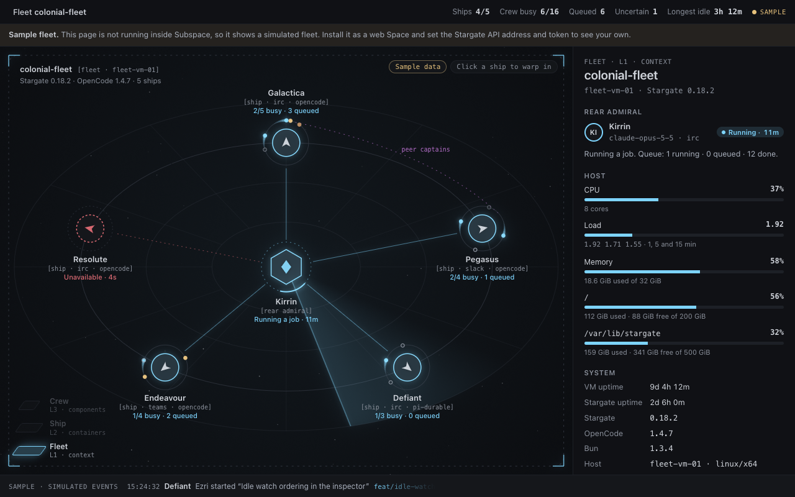

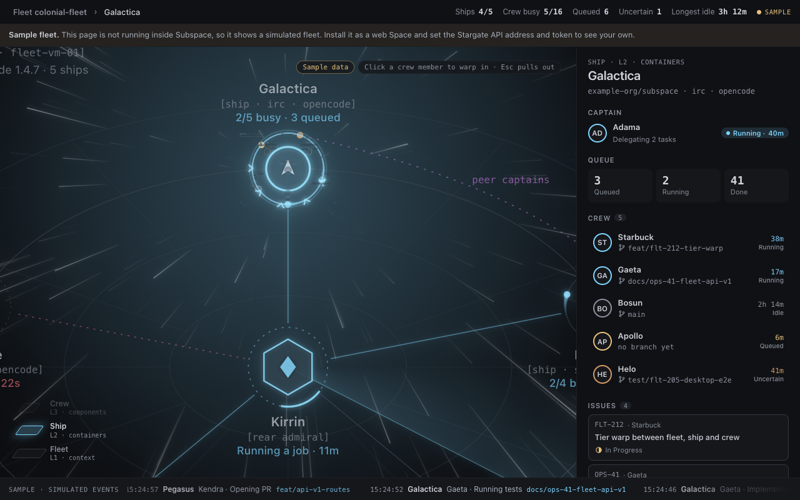

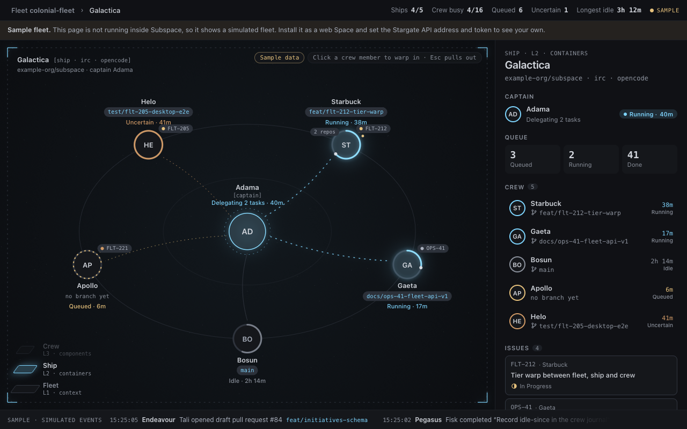

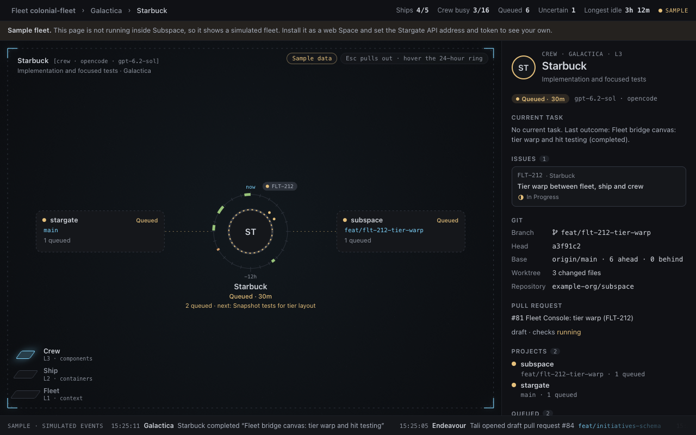

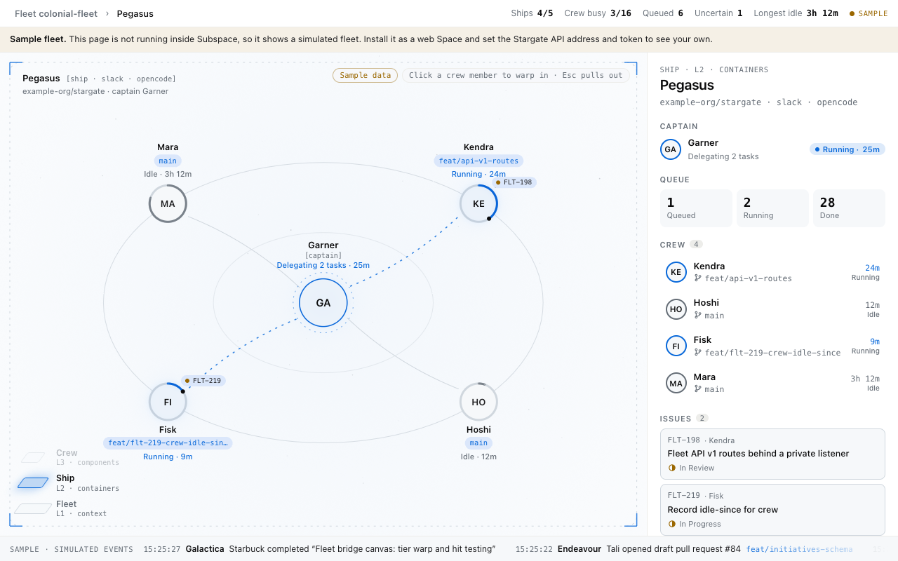

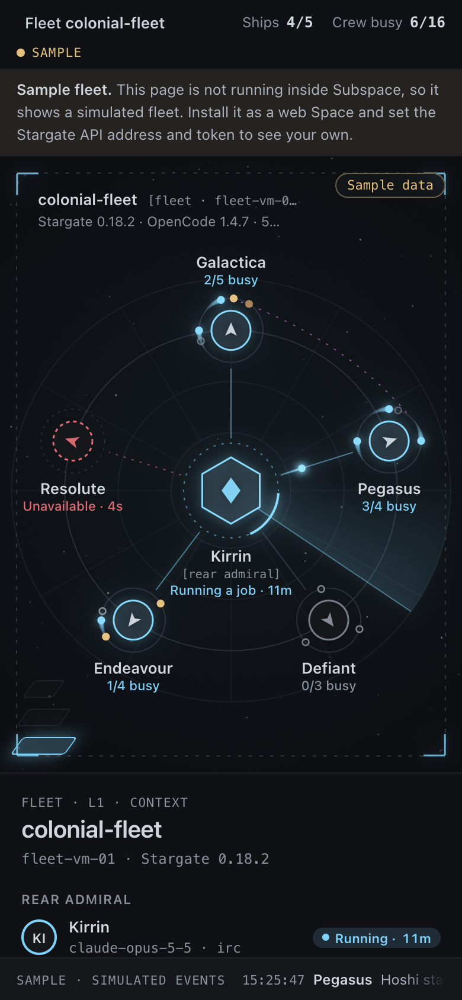

### In Subspace against a live Fleet API

Run end to end in the isolated capture build (`make capture` through
`scripts/capture.sh`), installed as a local-folder web Space with its
permissions granted, `endpoint` set to `http://localhost:<port>` and the token
saved as its secret. The API was Stargate's real Fleet API v1 server and
event diff, fed a fictional fleet that changes every few seconds. The Issues
Space was signed in to the fictional Subspace API fixture with
`CAPTURE_FLEET=1`, whose neutral `FLT` project the crew's tasks and branches
reference. The screenshots below were retaken on the public repository's
base.

- **CORS from the web view.** WKWebView sends `Origin: subspace://fleet-console`
  on the preflight and on every request. Stargate's default `corsOrigins`
  (`subspace://*`) answers the preflight with 204 and each `GET` with
  `Access-Control-Allow-Origin: subspace://fleet-console`. No change needed.
- **Streamed events.** Each page load opened one authorised
  `GET /api/v1/events` and held it for the life of the page (the longest:
  629 s, with 210 `fleet`, 630 `ship`, 523 `activity`, 62 `host` and 41
  `heartbeat` events). In one run, with the machine's load average above
  250, a second stream opened mid-session; the likely cause, a timed-out
  permission refresh dropping the page to sample data and back, is fixed.
- **Theme.** The page follows `theme()`: Cupertino Dark and Cupertino Light
  below.
- **Secrets.** Every request carried the bearer token from `secrets.get()`;
  none was refused.
- **Issues.** `issues.resolve` turned `FLT-212` and `FLT-207` into tiles with
  title, assignee and state, and the dials show their badges.
- **Badge and context.** One uncertain crew member puts `1` on the tab, and
  **Add to chat** attaches the crew tier's context.

Bugs found this way are fixed: a short tier left empty space under the
ticker (a hidden banner shifted the grid rows), the chat label repeated the
Space title, and a failed permission refresh dropped the live connection.

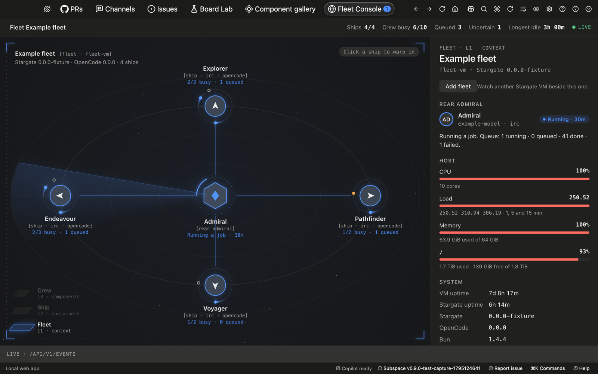

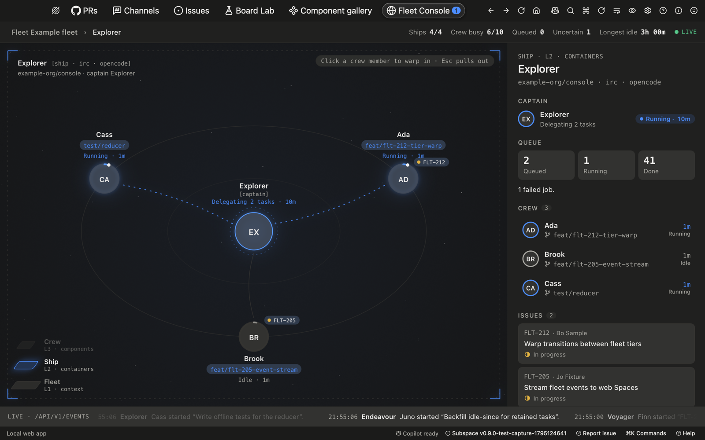

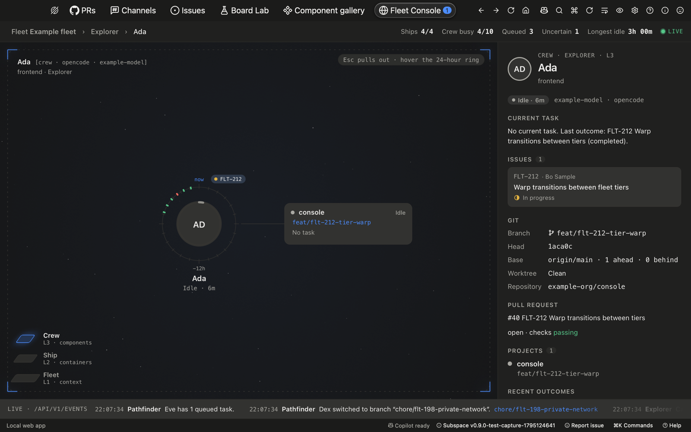

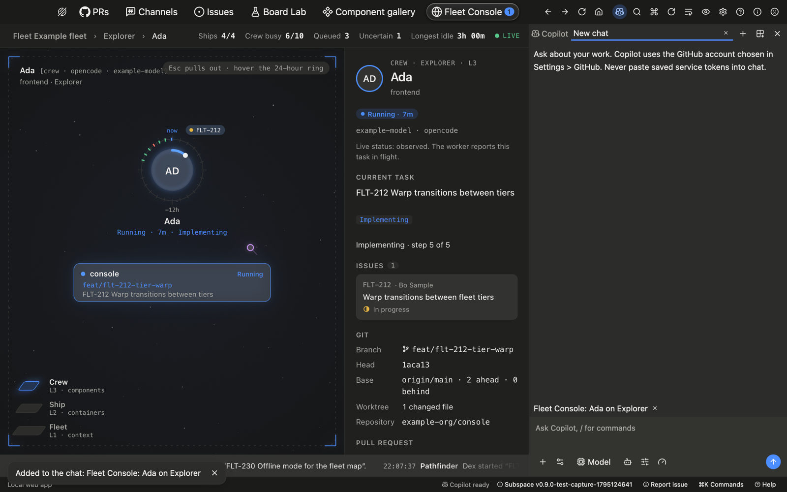

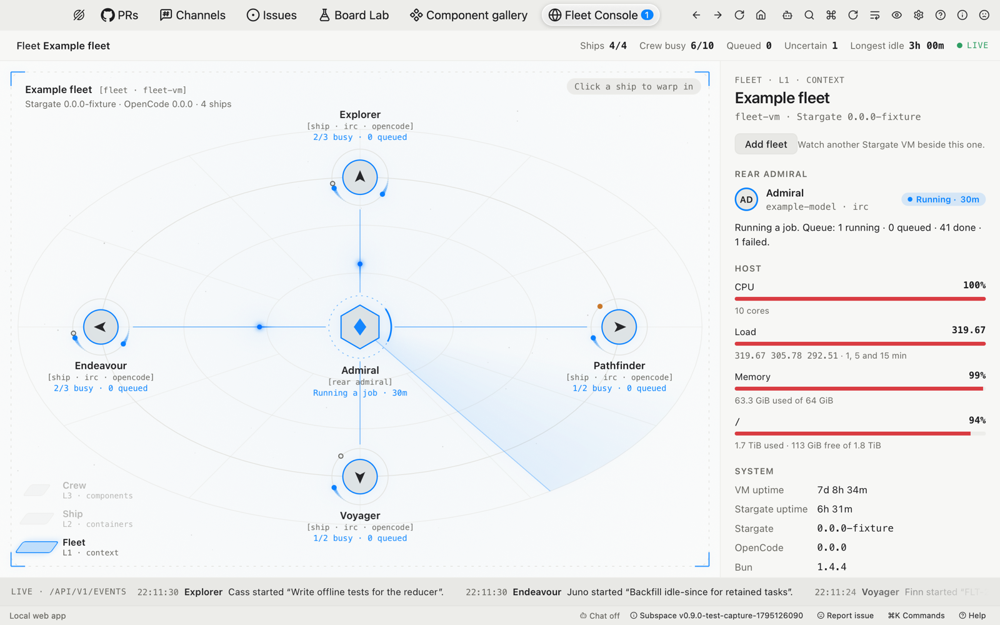

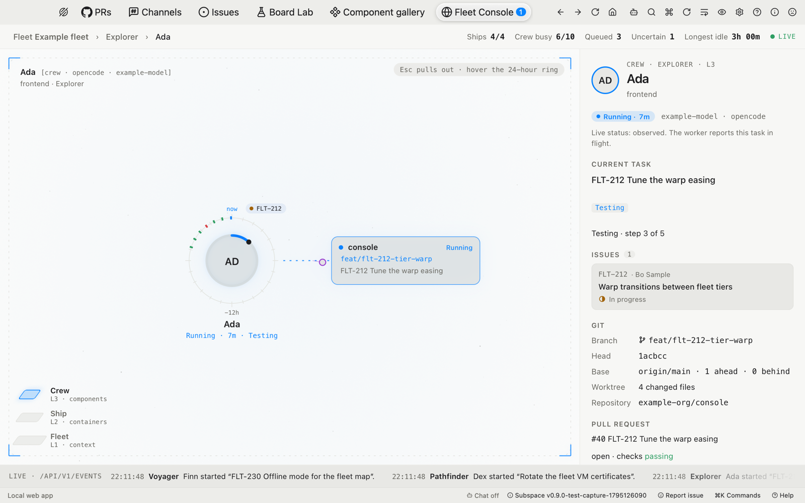

## Tasks

- [x] Data layer: contract checks, SSE parser, connection states, reducer, client, live source
- [x] Sample fleet and simulation in the contract's shapes
- [x] WebGL2 renderer with bloom, gate shader and instanced particles; Canvas 2D fallback; text overlay
- [x] Tier layouts, warp camera, navigation, reduced motion
- [x] Inspector, issue tiles, connection banner, ticker, tooltips
- [x] Bridge: theme, secrets, issues, badge, context, notifications, all feature-detected
- [x] Offline tests, mise task in `make check`, package validation
- [x] README and the web Spaces table
- [x] Check against a live Stargate and in Subspace's web view
- [ ] A live theme switch (`subspace:theme`) checked in the app; covered by the bridge's tests
