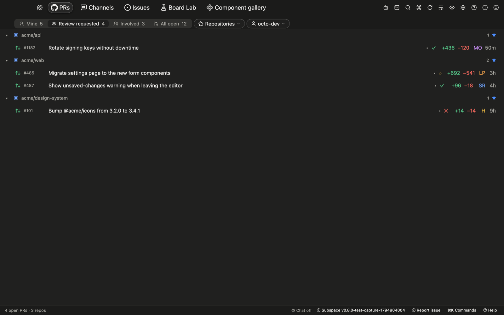
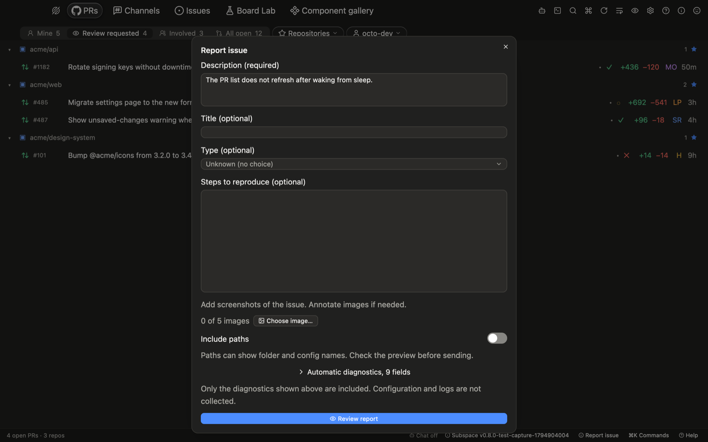
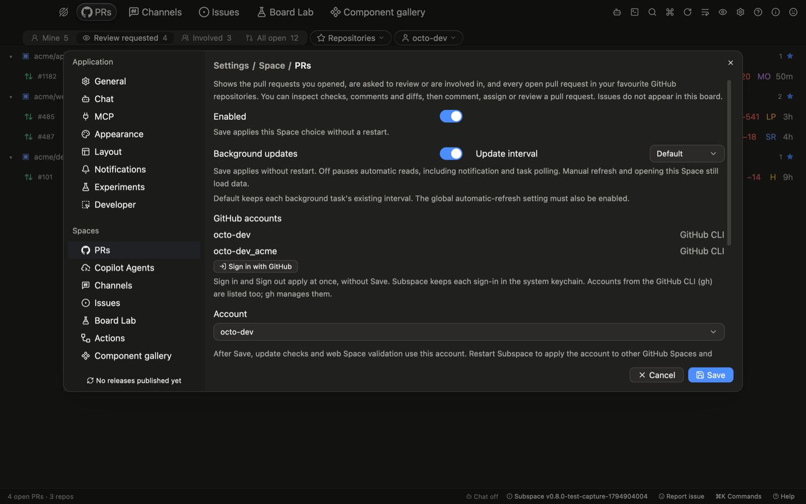
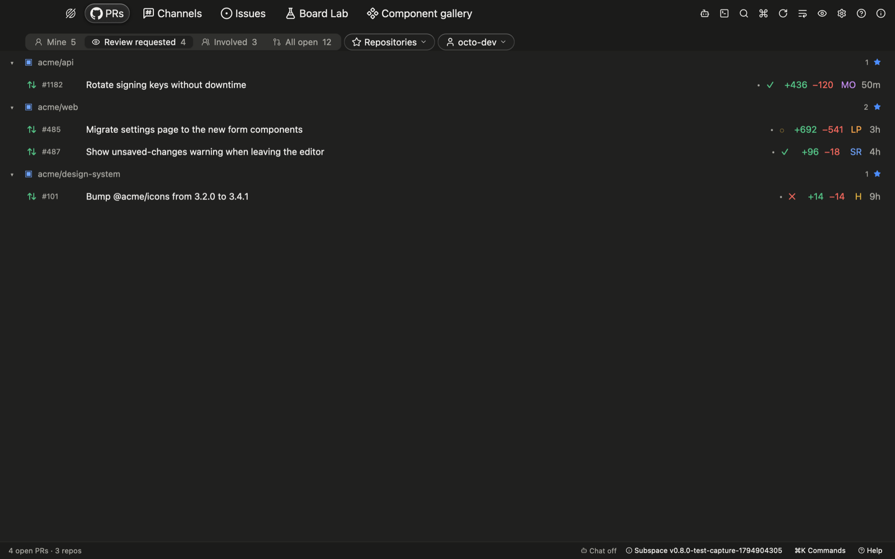

# Report issue and GitHub sign-in as build configuration

Back to the [change records](../README.md). Follows
[The Framework as its own crate](../framework-crate/spec.md) and the
Framework's publishing audit.

## Intent

Before the Framework is published, the owner decided, from the publishing
audit:

- **Report issue** is behind a build feature flag, and the repository it
  files into is a build configuration value, not a constant in the
  Framework.
- The **Sign in with GitHub** OAuth App details are build configuration
  that an app can override, not constants in the Framework.
- The example user in comments and tests is Zack; the Linear workspace in
  the Framework's tests is fictional (`subspace-networks`) and the real one
  is supplied by the app; notes that code was "ported" from the owner's
  earlier application go, because it is the owner's original, unpublished
  work. (Done in `c36138b`, `ce89fb2`, `8ae45bb`, `51a1b47`.)
- The licence is Apache-2.0, confirmed by the owner on 17 November 2026.

## Spec

### Report issue

- A Cargo feature, `report-issue`, on the facade (`subspace-framework`) and
  on the shell. `host` no longer includes it. With the feature off, none of
  Report issue is compiled: the `subspace-report-issue` crate, the action,
  the toolbar control and its label setting, the status bar item, the menu
  item, the palette command and the help text.
- The repository is product data supplied at build time. The Framework has
  no default: `subspace-client-github`'s issue report takes its target
  (`owner/name`) from the caller, and the dialog shows that name. The app
  passes it through `ProductBuild`; an empty or missing value hides Report
  issue at run time even with the feature on.
- Subspace Desktop: the product has a `report-issue` feature, on by
  default, and its build configuration names `aiconsultancy/subspace`.
  `SUBSPACE_REPORT_ISSUE_REPOSITORY` overrides it at build time (empty turns
  it off).

### Sign in with GitHub

- The Framework holds no OAuth App identity: no client id constant and no
  `option_env!` for the secret. The app passes its OAuth App (client id,
  optional secret) through `ProductBuild`. Without one, Sign in with GitHub
  is not offered; tokens from the environment, the config file and the `gh`
  CLI work as before. Scopes and endpoints stay with the Framework.
- Subspace Desktop: the product's build configuration holds Subspace's
  client id. `SUBSPACE_GITHUB_OAUTH_CLIENT_ID` overrides it at build time,
  and `SUBSPACE_GITHUB_OAUTH_CLIENT_SECRET` supplies the secret as today
  (never in the repository; the release scripts read it from the login
  keychain and still check it is in the binary).
- The product's `build.rs` reads these variables, declares
  `cargo:rerun-if-env-changed` for each, and compiles the values in. A
  published Framework crate is not rebuilt when an app's environment
  changes, so the Framework must not read them. As built, the client id and
  the repository pass through `cargo:rustc-env`; the secret does not: the
  product reads it with `option_env!`, so it never enters the build
  script's output, which Cargo keeps in the target folder and prints when a
  build script fails. `build.rs` still declares `rerun-if-env-changed` for
  it.

### Licence

The licence is confirmed Apache-2.0; no licence switch command or publish
guard was built.

### Docs

The publishing audit and guide, both READMEs, both AGENTS.md files, the
settings, report-issue and installation pages say what is now build
configuration and how to set it.

## Delivery

### As built

- **Report issue.** Facade feature `report-issue` (implies `host`; `host`
  no longer pulls `subspace-report-issue`) and shell feature
  `report-issue`. Off, the shell compiles no `OpenReportIssue`, no
  `ToolbarControl::ReportIssue` (so no label setting or toolbar menu row),
  no status bar command and no form. `ProductBuild::report_issue_repository:
  Option<&'static str>` exists only with the feature; the shell parses it as
  an `IssueRepository` (`owner/name`) and installs it as the report target;
  missing or blank hides Report issue at run time, malformed hides it with a
  startup notice. `ToolbarControl::offered` is the one rule the toolbar,
  its menu and Settings > Layout use. `subspace-client-github`'s
  `issue_report::prepare` takes the repository; API paths, the browser
  editor URL and the created-issue check use it; the review step says
  "Destination: owner/name". The Framework names no repository.
- **Sign in with GitHub.** `CLIENT_ID`, `client_secret()` and both
  `from_build()`s are gone; `OAuthClient::new(id, secret)` trims and treats
  a blank id as no OAuth App. `ProductBuild::github_oauth:
  Option<OAuthClient>`; `github_sign_in::init` installs the shared sign-in
  only with one. `Credentials::with_sign_in_offered` tells credential
  guidance, the chat runtime's identity errors and the session-log message
  whether to name Sign in with GitHub; without it chat offers no in-app
  sign-in and Settings shows neither Sign in nor Sign out (the `gh` accounts
  are still listed). The credential order is unchanged.
- **Subspace Desktop.** `products/subspace/build/config.rs` holds the
  defaults (`Ov23lihtCHEoDujzEB6y`, `aiconsultancy/subspace`) and the
  directives, tested by the product's tests. `build.rs` prints them after
  the fallible Windows resource step. The product's `report-issue` feature
  is on by default. The release scripts are unchanged: they still pass
  `SUBSPACE_GITHUB_OAUTH_CLIENT_SECRET` to Cargo and check the built binary
  contains it, which holds because `main.rs` compiles it in with
  `option_env!`.
- **Licence.** Apache-2.0, confirmed; no switch command was built.
- **Also changed.** Framework tests and fixtures use `com.example.*` and
  `example-org/example-app` instead of the organisation's bundle ids and
  repository. Packaging now runs through `scripts/package-workspace.sh`,
  which verifies in `target/package-build` and first clears the Framework's
  own crates from it and from Cargo's extracted sources: with every crate at
  0.1.0, Cargo reused stale registry copies and verification failed on a
  new cross-crate API. The shell's offline test fixture is
  `offline_shell_fixture` (it is not specific to Report issue).

### Audit greps

Over the 1,183 packaged files: no `aiconsultancy`, `thoughtsun`, `Ov23li`,
the private tracker workspace or operator's handle. `work app` matches only "Framework apps"
(`subspace-update`); `ported from` only the credited `gpui-lucide` port in
`subspace-lucide`.

### Evidence

Captured with `make capture` in Cupertino Dark with fixture data; Subspace's
own UI is unchanged, so there is no before/after pair.

The review step, which names the repository, could not be captured: the
capture script's clicks did not reach the dialog's **Review report**
button. The destination line is covered by the report-issue crate's tests.

### Gates

All on 2026-11-17, from the working tree:

- Framework `make check`: exit 0 (`Package check passed for 24 crates:
  metadata, LICENSE, third-party notices, file list and sizes.`; the shell's
  tests with `--features report-issue` and the README doctests with
  `report-issue` included).
- Framework `mise run quality`: `Findings: 0 → 0 (+0)`, `Quality: 100.0% →
  100.0%`.
- Framework `make publish-dry-run`: `Dry run passed; nothing was uploaded.`
  A real run would refuse only for uncommitted changes, an unpushed HEAD,
  `make check` and `make publish-check` not recorded for HEAD, and no
  `CARGO_REGISTRY_TOKEN`; nothing about the licence.
- Desktop `make check`: exit 0 (script fixtures, including the packaging
  and release script tests, passed). `mise run quality`: `Findings: 0 → 0
  (+0)`. `MISE_ENV=terminal make check-terminal`: exit 0. `make
  interfaces`: `real product headless interface checks passed`.
- Root `make check`: exit 0. `prek run --all-files` and `prek run --stage
  pre-push --all-files`: every hook Passed.

## Tasks

- [x] Report issue behind `report-issue`; repository from `ProductBuild`.
- [x] OAuth App from `ProductBuild`; no Sign in with GitHub without one.
- [x] Subspace's build configuration and overrides in `build/config.rs`.
- [x] Shell tests and clippy with and without the feature in `make check`.
- [x] Docs: publishing audit and guide, READMEs, AGENTS.md files,
  report-issue, settings and installation pages.
- [x] Evidence screenshots.
- [ ] Capture the review step once the capture script can click inside a
  dialog.
