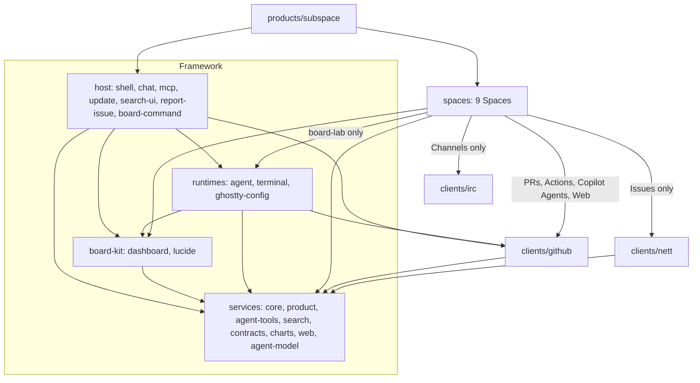

# Framework split: research and proof of concept

A research spike on separating the Subspace Framework from the Spaces, so the
Framework can be published as crates that anyone can use to build their own
Spaces and their own branded app. Written 16 November 2026 against
`feat/subspace-desktop` at `fb4ce19`, on the branch `spike/framework-split`.

Paths are relative to `subspace-desktop/`. "Space" and "board" mean the same
thing; the code still says board.

**Status.** The first step is merged: the Spaces live in `spaces/`, apart
from `framework/`, and the architecture check locks the layout in (see
AGENTS.md › Structure). The Harbor white-label proof of concept,
described below as `examples/white-label/`, is archived at
[`.agent/spikes/framework-split-harbor/`](../../../.agent/spikes/framework-split-harbor/README.md),
outside `make check` and unmaintained; white-labelling is deferred.

**Decided.** The published Framework crate is named `subspace-framework`
(free on crates.io on 16 November 2026; `subspace` is taken). The working
names `subspace-sdk` and `subspace-app` below are superseded; whether Space
authors get a second, Space-only crate beside it is settled in phase 3.

## Summary

**What the proof of concept did**

- Moved the Spaces from `boards/` to `spaces/`, beside `framework/`. The app
  builds and all 3,564 workspace tests pass.
- Added `examples/white-label/`: a second app, **Harbor**, in its own Cargo
  workspace with its own lockfile. It uses five Framework crates through
  their public API, registers its own 66-line Space and Subspace's Component
  gallery, and compiled without any change to the Framework. `make check`
  now builds, lints, tests and runs it.
- Packaged and verified all 22 Framework crates with `cargo package` after
  two manifest edits (not committed), to measure what blocks publishing.

**What it showed**

- The composition already works. The product descriptor is data, a Space
  needs four trait items, and Spaces never depend on the host.
- White-labelling does not work yet. Run without a window, Harbor's version
  text, commands, MCP server and data folder carry its own name, and the
  source shows that its window title and menus would too. But its chat
  sessions, caches and Keychain entry would land in Subspace's folders, its
  About text names Subspace's repository, and **Report issue** files into
  `aiconsultancy/subspace`. [White-labelling](#3-white-labelling) lists about
  100 such places.
- Nothing structural blocks publishing the Framework, apart from the
  Terminal runtime's git dependency. The blockers are `publish = false`,
  missing versions on internal dependencies, a vendored `markdown` patch that
  consumers do not inherit, and the unsettled public API.

**Recommendation**

1. Keep one repository and one workspace for now, with the layout this spike
   leaves. Do the cleanup there, where a change to the Framework and its
   Spaces is still one commit.
2. Next, move Subspace's own data out of the Framework and fix the
   white-label leaks, with Harbor as the test.
3. Then define the public API as two crates, one for Space authors and one
   for app builders, and rename the public types to Space before anything is
   published.
4. Split the Framework into its own public repository only after that, and
   have Subspace consume it by git tag first and crates.io second.

The [migration plan](#migration-plan) has the phases, and
[Open questions](#risks-and-open-questions-for-the-owner) lists what the owner
needs to decide. The licence question and the crate names come first.

## Proof of concept

### What moved

`boards/` is now `spaces/`, in the same workspace.

- **Name**: the owner's term is Space, and the folder was the largest
  remaining use of the old word.
- **Location**: `subspace-desktop/spaces/`, beside `framework/`. The
  repository root holds only `subspace-desktop/` and its forwarding
  `Makefile`; the Cargo workspace, `mise.toml`, the scripts and the docs all
  live in `subspace-desktop/`, so that is the top level for this app.
- **Same workspace, deliberately**: see [Repository layout](#7-repository-layout-options).

Crate names (`subspace-<id>-board`), type names (`Dashboard`,
`BoardRegistration`), the `"boards"` config key and Board Lab's data folder
(`…/subspace/boards/board-lab/`) are unchanged. `web-boards/` holds
installable web packages, not crates, and stays.

### What broke and how it was fixed

Nothing broke in Rust beyond paths. Each item below was found by a failing
check or by search.

| What | Fix |
| --- | --- |
| Workspace `members` and `exclude`, and the product's nine path dependencies | Paths in `Cargo.toml` and `products/subspace/Cargo.toml` |
| Architecture check keyed on the folder name | Layer renamed to `spaces` in `scripts/check-architecture.py`, `architecture_source.py` and their fixtures |
| Board-guide and documentation-index checks | `scripts/check-board-docs.py`, `check-docs-index.py` |
| Formatting script and mise tasks naming `boards/terminal`, `boards/web`, `boards/board-lab` | `scripts/format-workspace.py`, `mise.toml` |
| The host's build script watches `framework boards clients products` | `framework/host/app/build.rs` |
| A board-kit test walks `boards/` to check every Space's source | `framework/board-kit/dashboard/tests/anchored_boundary.rs` |
| The Component gallery's test walks the repository by folder name | `spaces/component-gallery/src/kit_usage.rs` |
| 87 files with `boards/<id>` paths in docs, guides and change records | Rewritten, except the removed `boards/teams` and the run-time data path |

The last three rows are findings as well as fixes: a Framework build script
and a Framework test know the repository layout and read Space source. They
keep working in one repository and break in two.

### The white-label app

`examples/white-label/` stands in for a separate repository.

| Part | Size | What it is |
| --- | --- | --- |
| `app/src/main.rs` | 61 lines before its tests | Harbor's descriptor (name, bundle id, themes, Spaces), two `BoardRegistration`s, one logo and the call to `subspace_shell::launch` |
| `spaces/hello/src/lib.rs` | 66 lines | Harbor's own Space |
| `spaces/hello/src/tools.rs` | 43 lines before its test | One agent read tool |
| `Cargo.toml` | 60 lines | Five Framework crates and one Subspace Space, by path |

It compiled on the first build. Run without a window from an empty
environment, it reports:

```text
$ harbor --version
Harbor v0.1.0-dev-<host>-<time>
$ harbor __product_metadata
{"id":"harbor","binary_name":"harbor","display_name":"Harbor","bundle_id":"com.example.harbor",…,"boards":["hello","component-gallery"]}
$ harbor hello greet --name Ada --json
{"greeting":"Hello, Ada."}
$ harbor upgrade --help
unexpected word: upgrade
```

Its MCP server answers as `{"name": "harbor", "title": "Harbor"}` and lists
`hello_read`, and its log and path cache are written under
`~/Library/Application Support/harbor/`.

Gates: `mise run white-label` (`scripts/test-white-label.sh`) runs clippy with
warnings denied, the tests and these headless checks, and `make check`
includes it. It shares the main `target/` folder, so it rebuilt about 100
crates the first time, not the whole dependency tree. The architecture check
treats `examples/<name>/app` as a product and `examples/<name>/spaces/<id>` as
a Space, so Harbor's Space may not depend on the host or on another Space.

### What an outside app has to repeat

Cargo applies these only from the workspace being built, so Harbor copies
them from Subspace's `Cargo.toml`:

- `[patch.crates-io] markdown = { path = "vendor/markdown" }`. Without it the
  Framework builds against the unpatched parser, which can panic
  (`vendor/markdown/PATCHED.md`).
- `panic = "unwind"` in both profiles, which that patch needs, and the
  optimisation overrides that make GPUI usable in a debug build.
- `gpui-kit = "0.9.1"`, the version the Framework uses, because its types are
  in the Space interface.

### What Harbor exposed and this spike did not fix

Found by running Harbor, and confirmed in source:

1. `harbor about` prints `Repository: https://github.com/aiconsultancy/subspace`
   (`framework/host/app/src/build_metadata.rs:5`).
2. Its git commit and branch are the Framework checkout's, because the
   Framework's build script reads git three folders above its own manifest
   (`framework/host/app/build.rs:5-7`).
3. Its MCP server reports version `0.5.0`, the Framework's, not Harbor's
   `0.1.0` (`framework/host/mcp/src/lib.rs:132`), and tells agents that
   "Subspace may run them without asking" (`framework/host/mcp/src/instructions.rs:11`).
4. Harbor has to list each Space twice, in the descriptor and as a
   registration. A registration missing from the descriptor is dropped
   without a message (`framework/host/app/src/registry.rs:155-165`).
5. Harbor must pass `subspace_product::SUBSPACE_VERSION` back to the
   Framework that defines it.
6. Harbor can choose among the Framework's bundled themes but cannot add its
   own (`framework/host/app/src/theme/loader.rs:20-27`).
7. In the window, which the gate does not open, chat and caches use
   Subspace's folders, and an app that includes the Issues Space shares
   Subspace's Keychain entry. See [White-labelling](#3-white-labelling).

### Gate results

| Gate | Result |
| --- | --- |
| `cargo test --workspace --locked` after the move | Passed: 3,564 tests, 8 ignored |
| `mise run architecture` | Passed: 38 packages, including both Terminal workspaces and Harbor |
| `mise run white-label` | Passed |
| `make check` | Passed: architecture, board guides, documentation index, format, cargo-shear, clippy, 3,568 tests with Harbor's, the white-label task, script fixtures and both Node suites |
| `make interfaces` | Passed |
| `mise run quality` | Passed: score unchanged at 100%, no findings in the new code |
| `make check-terminal` | Passed: format, clippy and tests for both excluded Terminal crates from their new paths, and the product built with the `terminal` feature |

## Findings

### 1. Inventory

34 packages in the workspace, plus two excluded Terminal packages that need
Zig. Lines are Rust source, tests included. Dependencies are internal, normal
edges from `cargo metadata --no-deps`; the `subspace-` prefix is dropped.

| Folder | Package | Layer | Lines | Depends on |
| --- | --- | --- | ---: | --- |
| `framework/services/agent-model` | `subspace-agent-model` | services | 51 | – |
| `framework/services/agent-tools` | `subspace-agent-tools` | services | 3,366 | core, search, web |
| `framework/services/charts` | `subspace-charts` | services | 1,247 | – |
| `framework/services/contracts` | `subspace-contracts` | services | 1,135 | – |
| `framework/services/core` | `subspace-core` | services | 15,163 | product |
| `framework/services/product` | `subspace-product` | services | 2,097 | – |
| `framework/services/search` | `subspace-search` | services | 4,187 | – |
| `framework/services/search-onnx` | `subspace-search-onnx` | services | 779 | search |
| `framework/services/web` | `subspace-web` | services | 689 | – |
| `framework/board-kit/dashboard` | `subspace-dashboard` | board-kit | 29,750 | agent-model, agent-tools, charts, contracts, core, lucide, product, search |
| `framework/board-kit/lucide` | `subspace-lucide` | board-kit | 140 | – |
| `framework/runtimes/agent` | `subspace-agent` | runtimes | 19,934 | agent-model, agent-tools, charts, client-github, core |
| `framework/runtimes/ghostty-config` | `subspace-ghostty-config` | runtimes | 2,007 | – |
| `framework/runtimes/terminal` (excluded) | `subspace-terminal` | runtimes | 14,304 | dashboard, ghostty-config |
| `clients/github` | `subspace-client-github` | clients | 11,052 | core |
| `clients/irc` | `subspace-client-irc` | clients | 8,796 | – |
| `clients/nett` | `subspace-nett-client` | clients | 21,759 | contracts, core |
| `clients/test-support` | `subspace-client-test-support` | clients | 159 | – |
| `framework/host/app` | `subspace-shell` | host | 42,159 | agent-tools, chat, client-github, contracts, core, dashboard, lucide, mcp, product, report-issue, search, search-ui, update |
| `framework/host/board-command` | `subspace-board-command` | host | 1,275 | agent-tools, mcp, product |
| `framework/host/chat` | `subspace-chat` | host | 12,394 | agent, charts, core, dashboard, lucide |
| `framework/host/mcp` | `subspace-mcp` | host | 3,869 | agent-tools, core, product, search |
| `framework/host/report-issue` | `subspace-report-issue` | host | 4,356 | client-github, dashboard, lucide |
| `framework/host/search-ui` | `subspace-search-ui` | host | 1,625 | dashboard, lucide, search |
| `framework/host/update` | `subspace-update` | host | 3,492 | core, product |
| `spaces/actions` | `subspace-actions-board` | spaces | 4,422 | client-github, core, dashboard, lucide |
| `spaces/board-lab` | `subspace-board-lab-board` | spaces | 21,651 | agent, agent-tools, charts, core, dashboard, mxc-worker |
| `spaces/board-lab/crates/mxc-worker` | `subspace-mxc-worker` | spaces | 1,841 | – |
| `spaces/component-gallery` | `subspace-component-gallery-board` | spaces | 10,924 | charts, core, dashboard, lucide |
| `spaces/github` | `subspace-github-board` | spaces | 10,904 | agent-tools, client-github, core, dashboard |
| `spaces/github-copilot-agents` | `subspace-github-copilot-agents-board` | spaces | 5,497 | agent-tools, client-github, core, dashboard, lucide |
| `spaces/irc` | `subspace-irc-board` | spaces | 22,920 | agent-tools, client-irc, contracts, core, dashboard, lucide |
| `spaces/issues` | `subspace-issues-board` | spaces | 21,424 | contracts, core, dashboard, lucide, nett-client |
| `spaces/terminal` (excluded) | `subspace-terminal-board` | spaces | 977 | dashboard, ghostty-config, lucide, terminal |
| `spaces/web` | `subspace-web-board` | spaces | 6,664 | client-github, core, dashboard, lucide |
| `products/subspace` | `subspace` | products | 369 | every Space, shell, board-command, search-onnx, product, core, lucide |



**Which Framework crates Spaces use**

| Crate | Spaces that depend on it |
| --- | --- |
| `subspace-dashboard` | All nine |
| `subspace-core` | All except Terminal |
| `subspace-lucide` | Actions, Component gallery, Copilot Agents, Channels, Issues, Terminal, Web |
| `subspace-agent-tools` | Board Lab, PRs, Copilot Agents, Channels |
| `subspace-contracts` | Channels, Issues |
| `subspace-charts` | Board Lab, Component gallery |
| `subspace-agent` | Board Lab, for one function (`canvas::prepare`) |
| `subspace-terminal`, `subspace-ghostty-config` | Terminal |

No Space depends on a host crate, on `subspace-product` or on another Space.
The architecture check enforces all three.

**Which clients are shared**

| Client | Spaces | Framework crates |
| --- | --- | --- |
| `clients/github` | PRs, Actions, Copilot Agents, Web | `host/app` (repository search in Settings, issue report), `host/report-issue` (the whole report model), `runtimes/agent` (`credential_login`, `validate_task_id`) |
| `clients/irc` | Channels only | None |
| `clients/nett` | Issues only | None |
| `clients/test-support` | PRs and Issues, in tests | `host/report-issue` and `clients/nett`, in tests |

So the owner's guess is right: the GitHub client is the one client that
several Spaces share, and the Framework uses it too. The other two belong to
one Space each.

**What Spaces reach into that is not a deliberate Space API**

- **Space domain code inside `subspace-core`**:
  `copilot_agent_tasks` and most of `task_state` (Copilot Agents),
  `config::web_boards` and `SettingsFile::update_web_board` (Web),
  `Config::terminal` (Terminal).
- **The whole product configuration**: `Services` and `ToolEnvironment` hand
  every Space the complete `Config` and the GitHub credentials. Spaces read
  `config.repos` directly (`spaces/actions/src/dashboard.rs:86`,
  `spaces/github/src/agent_tools.rs:72`).
- **Hard-coded state paths**: `subspace_core::state::sibling` and `path`
  (`spaces/github/src/store.rs:15`, `spaces/board-lab/src/lib.rs:199`), which
  ignore the product's own folder.
- **One shared stored choice**: the `github.activeAccount` key is read or
  written by four Spaces, the host and the agent runtime
  (`framework/services/core/src/credentials.rs:54`).
- **Product glue for the Web Space**: the product passes
  `subspace_shell::reload_configured_boards` into the Space, reads
  `config.web_boards` itself and adds a Settings page for it
  (`products/subspace/src/main.rs:7-20, 83-100`).
- **A runtime crate**: Board Lab depends on the whole agent runtime, with the
  Copilot SDK, to validate a chart canvas.

### 2. The boundary

**What a Space uses today**

| Area | API | State |
| --- | --- | --- |
| The Space itself | `subspace_dashboard::{Dashboard, ListDashboard, DashboardEvent, Toast, Modal, KeyHelp, BoardArtwork}` | Sound. `Dashboard` has 46 items, 4 required; `ListDashboard` has 29, 3 required |
| Registration | `subspace_shell::BoardRegistration::{new, configured, description}` | Works, but lives in the host and exposes three field types that cannot be named outside it |
| Tokens and components | `tokens`, `typography`, and about 35 widget modules (`action`, `panel`, `list`, `menu`, `feedback`, `rich`, `composer`, `chat_input`, `toggle`, `icon_button`, `chart`, …) | Sound; documented in `docs/ui-components.md` and shown in the Component gallery |
| Settings | `settings::{BoardSettings, SettingsEditor, FeatureSpec}`, `Services::board_config_file` | Sound for a Space's own settings. `ConnectionField` is a closed enum with only GitHub values |
| Stored choices and caches | `prefs::{get, set, read_cache, write_cache}` | Sound API; caches go to a hard-coded folder |
| Agent tools | `subspace_agent_tools::{ReadService, ReadTool, WriteService, WriteTool, ToolSpec, schema}` | Sound |
| Contracts and broker | `subspace_contracts::{Contract, Event, Request}`, `subspace_dashboard::contracts::{publish, subscribe, request, respond, Declaration}` | Sound and open: the broker is generic over the traits, so a contract can be defined in any crate |
| Search | `SEARCHABLE`, `full_text` (the whole `subspace-search` crate), `search_adapter`, `prefetch`, `retained` | Works. Cross-Space references are closed: `ReferenceIdentity` accepts five fixed kinds (`framework/services/search/src/api.rs:215-221`) |
| Notifications | `notifications::{request, Notice}` | Sound |
| Help | `HELP_MARKDOWN`, `HELP_IMAGES` | Sound |
| Logging | `subspace_core::log::Logger` | Sound |
| Tests | `subspace_dashboard::test_support`, `subspace_agent_tools::test_support` | Thin: no fixture for `Services`, so Spaces build it by hand |

**What is public but should not be**

`subspace-dashboard` has 55 public modules. Because the host is a separate
crate, everything the host needs from board-kit is `pub` and so is visible to
every Space:

- Installers and globals the host sets: `contracts::install`,
  `prefs::{init, init_file, save}`, `notifications::{Sink, install_defaults}`,
  `chat_sessions::publish`, `copy_details::CopyDiagnostics`,
  `icon_button::initialize`, `Services` as a constructible struct.
- Shell-only UI: `density`, `log_view`, `glass`, `surface_header`, `contrast`,
  `help::prepare_markdown`.
- `DashboardHandle`, apart from `from_entity`, which the Web Space needs.
- Service-specific helpers: `repositories` (GitHub favourites), `alerts`
  (agent-task sounds), `ChatRequest::OpenCloudSession`.

No Space uses the first three groups outside tests. A Space author should
never have to see them.

**Where products compose Spaces today**

- `products/subspace/src/main.rs`: `ProductBuild`, the registrations, the
  product logo, the Web Space glue. This is the right place and the right
  shape.
- `framework/services/product/src/known.rs`: Subspace's own descriptor,
  inside a Framework crate. It names Subspace's eight Spaces, 24 themes,
  bundle id and release repository.

**What must become data or registration**

| Today | Why it blocks | Becomes |
| --- | --- | --- |
| `known.rs` holds Subspace's descriptor | A Framework crate lists one app's Spaces | Moves to `products/subspace`. The Framework keeps the types and the default theme name |
| `ProductContext.known` and `known_products()` | Built at every start; nothing in production reads it | Removed |
| `subspace-product`'s `terminal` feature | Exists only to add a Space to `known.rs` | Removed with it |
| `subspace-product-metadata` helper binary, used by the packaging scripts | Knows only the listed products | The scripts ask the built binary's `__product_metadata`, which already exists |
| Descriptor `boards` beside the registrations | Two lists that must agree; a mismatch is silent | One list: each registration carries its default and aliases |
| Bundled themes chosen by id | An app cannot ship its own theme | The product passes theme documents, as it passes artwork |
| `ConnectionField`, `SettingsExtension::with_github_credentials` | Closed to GitHub | Stay for GitHub ([question 5](#5-shared-space-dependencies)); a third-party Space uses its own `settings_editor`, as Channels and Issues do |
| `ReferenceIdentity` kinds | A new Space cannot join `related_items` | Any kind a Space declares |
| The About repository, the issue-report target | Hard-coded to `aiconsultancy/subspace` | Optional descriptor fields; no value hides the feature |
| `framework/host/app/src/capture/issues.rs` | A stand-in for one Space inside the host | A capture hook the product supplies |

### 3. White-labelling

What the product descriptor already controls, as Harbor confirms: the window
title, the menu bar name, the About title, version text, notification titles,
the bundle id, the config, state, log, search and MCP-token folders (all from
`binary_name` and the release channel), the MCP server name, the CLI name,
the update source, and the product logo.

What is still Subspace's, most serious first:

| # | Item | Where | Effect in another app |
| --- | --- | --- | --- |
| 1 | State folder name `subspace` | `subspace_core::state::directory_name` (`framework/services/core/src/state.rs:29-35`) and its 14 callers | Chat sessions and tabs, the Copilot config, the agent-task store, every `prefs` cache, the Ghostty layer and the PRs cache are read from and written to Subspace's folders. Chat reads the GitHub account from Subspace's state file, not the app's |
| 2 | Keychain service `subspace.api-refresh` | `clients/nett/src/session.rs:70-76` | The app shares Subspace's NETT sign-in |
| 3 | Issue reports go to `aiconsultancy/subspace` | `clients/github/src/issue_report.rs:17-19`, `framework/host/report-issue/src/{view,submission}.rs` | **Report issue** is always shown and files into Subspace's repository with the user's GitHub account |
| 4 | Agents are told they are Subspace | `framework/runtimes/agent/assets/subspace.agent.md`, `acp/context.rs:9-12`, `acp/protocol.rs:103`, `acp/mcp.rs:12`, `framework/host/mcp/src/instructions.rs:11`, `framework/services/charts/src/guide.md` | The default agent's name and prompt, the ACP client name, the MCP rules and the chart guide all say Subspace |
| 5 | About 50 interface strings | `framework/host/app/src/settings/copy.rs:22-27`, `framework/host/chat/src/agent_chat/{engine,sign_in,tabbing}.rs`, about 35 in `framework/runtimes/agent/src/runtime/**` | "Restart Subspace to apply…" and similar. The agent runtime, `subspace-core` and the clients receive no product name at all |
| 6 | Packaging and installer scripts | `scripts/product.sh:28-31`, `install-release.sh`, `release-macos.sh`, `package-macos-ci.sh` | They build only `subspace`; the signing identity, Key Vault and repository are fixed |
| 7 | Updater limits | `framework/host/update/src/{github,token,archive}.rs` | GitHub only; a token is required even for a public repository; fixed asset names and channel set |
| 8 | Themes | `framework/host/app/themes/*.json`, `theme/document/metadata.rs:14` | No product themes; bundled variants are named "Subspace One Dark" and "Subspace Channel"; the file format's metadata key is `subspace` |
| 9 | `SUBSPACE_*` environment variables | `SUBSPACE_MCP_TOKEN`, `SUBSPACE_LOG`, `SUBSPACE_RELEASE_CHANNEL` (compile time) and others | Shown in CLI help and agent prompts under Subspace's name |
| 10 | Protocol and file-format names | `subspace-search://`, `subspace://help`, `subspace-help-image:`, `open_in_subspace` | Visible to agents and in help Markdown |
| 11 | Smaller leaks | About's repository URL; MCP version; GitHub `User-Agent: subspace`; IRC `Subspace IRC` version reply and `Subspace closed` quit message; the build script's git lookup | As listed under [What Harbor exposed](#what-harbor-exposed-and-this-spike-did-not-fix) |

Internal names (`SubspaceApp`, action namespaces such as `subspace_app`, key
contexts, thread names, crate names) are not visible to users and need no
change for white-labelling.

**How a white-label app should supply these**

| Mechanism | For | Model |
| --- | --- | --- |
| The product descriptor, a plain Rust value built in `main.rs` | Identity, bundle id, update source, and new optional fields: homepage, issue tracker, release channel | Tauri's `productName` and `identifier` in `tauri.conf.json` [T1]. A struct literal needs no config file or macro |
| Builder calls taking embedded bytes | Logo (today), themes, the default agent prompt | Today's `assets()` slice; Tauri's `generate_context!` embeds the same kinds of asset [T2] |
| The product's name passed down at start | Every interface string, the state folder, the Keychain service, user agents | One `ProductContext`, which the shell already has, reaching `subspace-core`, the agent runtime and the clients |
| A small build-script crate for the app's `build.rs` | Git commit and branch, Windows resources, icons | `tauri-build` [T2]. Replaces `framework/host/app/build.rs` and `products/build.rs` |
| Neutral names in the Framework | URI schemes, environment variables, the theme metadata key | Decide once: either keep `subspace` as the Framework's name, as Tauri apps keep `TAURI_*`, or derive from the binary name. See [open questions](#risks-and-open-questions-for-the-owner) |

Item 1 is the one that corrupts data, so it comes first in the plan: the
shell should give `subspace-core` the product's state folder once at start,
and `state::directory_name` should go.

### 4. Publishability

**Measured**

- `cargo publish --dry-run -p subspace-core` fails at once:
  "`package.publish` must be set to `true`" (`Cargo.toml:26`).
- `cargo package -p subspace-core` fails: "all dependencies must have a
  version requirement specified when packaging. dependency `subspace-product`
  does not specify a version". The 22 `[workspace.dependencies]` entries are
  `{ path = "…" }` only.
- At least nine crates with no internal dependencies package today.
  `subspace-agent-model`, `subspace-contracts` and
  `subspace-client-test-support` also pass verification, which builds the
  packaged copy.
- With two edits, `publish = true` and `version = "0.5.0"` beside each
  internal `path`, **all 22 Framework crates package**. The edits were not
  committed.
- Packaging **with verification** then passed for all 22: Cargo built each
  crate from its packaged copy against the other packaged copies, in 5 min
  31 s. That build compiled `markdown v1.0.0` from crates.io, not the
  vendored copy, which shows directly that the patch does not travel.
- Sizes are far below the 10 MB limit [C2]: the largest is `subspace-shell`
  at 1.9 MiB (416 KiB compressed); all 22 total under 2 MiB compressed.

**Blockers, by kind**

| Check | Finding | Blocks crates.io? |
| --- | --- | --- |
| `publish = false` | Workspace-wide | Yes; one line |
| Path dependencies | All internal dependencies lack a `version` | Yes; mechanical. Every release must then bump them together |
| Git dependencies | One: `libghostty-vt`, pinned to a git revision in `framework/runtimes/terminal/Cargo.toml`, because the crates.io release needs Zig 0.15.2 | Yes, for `subspace-terminal` and the Terminal Space only |
| Crates not on crates.io | None. All of the roughly 1,100 registry packages in `Cargo.lock` come from crates.io, including `gpui-kit` 0.9.1, `gpui-pre` 0.3.12, `gpui-webview`, `lb-wry`, `github-copilot-sdk`, `mxc-sdk` and `fastembed` | No |
| `[patch.crates-io]` | `markdown` 1.0.0 replaced by `vendor/markdown`, in all three workspace manifests | Not mechanically, but a published Framework cannot carry it: Cargo honours a patch only from the workspace being built [C1]. Every consumer must copy it, or lose the fix |
| `include_str!` and `include_bytes!` outside the crate | Framework: one, in a test (`framework/host/app/src/theme.rs:678` reads a board-kit example theme). Spaces: nine, all in tests and examples (`spaces/issues` reads `clients/nett` fixtures; the gallery reads `docs/ui-components.md`). Product: two docs pages in tests | No. Packaging verifies the library, not its tests. They break tests once crates live apart |
| Build scripts that read the repository | `framework/host/app/build.rs` runs git in `../../..` and watches the workspace folders. From a registry copy it finds no repository and stamps `unknown`; from a path or git dependency it stamps the Framework's commit | No, but wrong for every consumer |
| Other build scripts | `subspace-lucide` reads GPUI Kit's icon folder through `links` metadata, which works for a published crate. `github-copilot-sdk` and `fastembed` can download at build time (`COPILOT_SKIP_CLI_DOWNLOAD`, `scripts/prepare-onnx-runtime.sh`) | No; consumers inherit the behaviour |
| Feature flags | `subspace-product/terminal` only adds a Space to `known.rs`; `capture` and `test-support` are fine | No |
| Excluded Zig workspaces | `framework/runtimes/terminal`, `spaces/terminal` | They stay out of the first published set |
| Licences | Every manifest says `Apache-2.0`. There is no `LICENSE` file in the repository or in any crate. Third-party notices exist for Flint, mermaid-rs and Ghostty under `licenses/`, outside the crates that embed them | Metadata passes; the files should ship in each crate |
| `clients/irc` | Adapted from Halloy, which is `GPL-3.0-or-later` [L1]. An adaptation cannot be relabelled Apache-2.0 [L2] | Yes for that crate. It is used only by the Channels Space, so it does not have to be a Framework crate. See [open questions](#risks-and-open-questions-for-the-owner) |
| Package metadata | No `repository`, `readme`, `rust-version`, `keywords` in any manifest | Warnings only |
| Names | `subspace` is taken on crates.io (an unrelated crate, last updated 2020). Every `subspace-*` name checked is free | The facade cannot be called `subspace` |

**Publish to crates.io, or consume another way**

| Route | What it needs | When |
| --- | --- | --- |
| Path dependency in one repository | Nothing | Now. This is Harbor |
| Git dependency on a tag | A repository the consumer can read. Cargo finds each crate by name in the repository and workspace inheritance works. The consumer copies the `markdown` patch and the profiles | Realistic as soon as the Framework has its own repository |
| Private or alternate registry (Kellnr, Cloudsmith, Shipyard) [C3] | The same manifest work as crates.io, plus a registry to run | Only if the Framework must stay closed. Not the owner's goal |
| crates.io | Everything above, and a public API the owner is willing to keep | Last. A published version can be yanked but never removed or changed |

**Recommendation**: consume by path now and by git tag after the repository
split. Publish to crates.io only when the white-label leaks are fixed and the
API is named, because each published version is permanent.

For `markdown`, in order of preference: get the panic fixed upstream in
markdown-rs and drop the patch; otherwise document the patch as a required
step and put it in the project template. Publishing a renamed fork does not
help, because GPUI Kit calls the `markdown` crate itself.

### 5. Shared Space dependencies

| Piece | Used by | Options | Recommendation |
| --- | --- | --- | --- |
| `clients/github` | Four Spaces and three Framework crates | Stay in the Framework; separate published crate; one copy per Space | **A separate crate in the Framework repository**, published with it as `subspace-github`. The Framework needs it (Copilot sign-in, issue reports, repository search), so it cannot leave, and four copies of an 11,000-line client would drift. Its `issue_report` module takes its target from the product |
| `clients/irc` | Channels only | Framework; Space-owned | **Space-owned**: `spaces/irc/crates/client`. This also takes the GPL-derived code out of anything the Framework publishes |
| `clients/nett` | Issues only | Framework; Space-owned | **Space-owned**: `spaces/issues/crates/nett-client`. It hard-codes NETT hosts and a WorkOS client id |
| `clients/test-support` | Tests of two Spaces, one client, one host crate | Framework dev crate; copy | **Framework**, published as a small test crate. It is 159 lines with no dependencies |
| The `issues` contract (`subspace_contracts::issues`) | Channels, Issues, the NETT client | Framework; a crate between the two Spaces | **Out of the Framework**, into a contracts crate that both Spaces depend on. It describes NETT issues. The Framework keeps the `Contract`, `Event` and `Request` traits. This is also the pattern a third party needs for its own contracts |
| GitHub credentials and repositories (`subspace_core::credentials`, `Config::repos`, `ConnectionField`, `subspace_dashboard::repositories`) | Four Spaces, Settings, chat | Keep GitHub as a built-in Framework service; build a neutral credential API | **Keep it built in for now.** Chat with Copilot needs the GitHub account whatever Spaces an app has. A third-party Space with another service is not blocked: Channels and Issues already keep their own settings file, editor and credentials without Framework changes. Build a neutral API only when a second shared service appears |
| `subspace_core::{copilot_agent_tasks, task_state}` | Copilot Agents, `clients/github` | Framework; Space-owned | **Space-owned**, except `PollBackoff`, which is generic and stays in `subspace-core` |
| `subspace_core::config::web_boards` and its settings writer | Web Space, the product | Framework; Space-owned | **Space-owned**, read from the Space's own config file like any other Space |
| Chart canvas validation (`subspace_agent::canvas::prepare`) | Board Lab, chat | Runtime; services | **`subspace-charts`**, so a Space does not need the agent runtime and the Copilot SDK |
| Icons, charts, tokens, components | Everything | – | Framework, as now |

The owner's expectation holds: logging, the HTTP transport, ACP and the chat
engines, search, MCP, updates and settings stay in the Framework. What moves
out is what only one Space uses.

### 6. The Space author's experience

**A Space today**

`Dashboard` requires `ID`, `TITLE`, `new` and `reload`, plus GPUI's `Render`,
`Focusable` and `EventEmitter<DashboardEvent>` on the same type. Harbor's
Hello Space is the whole of it:

```rust
pub struct Hello {
    focus: FocusHandle,
}

impl EventEmitter<DashboardEvent> for Hello {}

impl Focusable for Hello {
    fn focus_handle(&self, _cx: &App) -> FocusHandle {
        self.focus.clone()
    }
}

impl Render for Hello {
    fn render(&mut self, _window: &mut Window, cx: &mut Context<Self>) -> impl IntoElement {
        let tokens = Tokens::current(cx);
        div()
            .key_context(Self::ID)
            .track_focus(&self.focus)
            .size_full()
            .bg(tokens.bg)
            .child(feedback::empty(&tokens, "hello", "Hello from a Space", "…"))
    }
}

impl Dashboard for Hello {
    const ID: &'static str = "hello";
    const TITLE: &'static str = "Hello";

    fn new(_window: &mut Window, cx: &mut Context<Self>) -> Self {
        Self { focus: cx.focus_handle() }
    }

    fn keys(&self) -> &'static [KeyHelp] {
        &[]
    }

    fn reload(&mut self, _window: &mut Window, _cx: &mut Context<Self>) {}
}
```

About 50 lines with imports, and two dependencies (`subspace-dashboard`,
`gpui-kit`). Harbor's file is 66 lines with its comments and the hook for its
tool; the tool itself adds 43 lines and three dependencies. For
comparison, the real Spaces implement 16 to 32 of the 46 items, in 78 to 306
lines of `impl Dashboard`.

This is already a good interface. Its faults are small and specific:

- `keys` defaults to the list keys, so a Space that is not a list shows wrong
  key help unless it overrides it. The default belongs in `ListDashboard`.
- `reload` is required although a Space with no data has nothing to reload.
- The types say board and dashboard; the product says Space.
- A Space author imports from two to five crates and must know which.
- The app lists every Space twice.

**The proposed API**

Two crates, because there are two kinds of author:

| Crate (working name) | For | Contains |
| --- | --- | --- |
| `subspace-sdk` | Space authors | `Space`, `ListSpace`, `SpaceEvent`; tokens and components; settings; stored choices; agent tools; contracts and the broker; search adapters; notifications; logging; test support; a re-export of `gpui_kit`; a `prelude` |
| `subspace-app` | App builders | The app builder, the product descriptor, the headless commands; re-exports `subspace-sdk` |

A Space crate depends on `subspace-sdk` only, so it cannot reach the shell:
Cargo enforces the layer rule that the architecture check enforces today.
A single crate with an `app` feature would not, because features are unified
across the build. egui and eframe are split the same way: `egui` for code
that draws, `eframe` for the app that hosts it [E1].

Both are thin facades over the existing crates, as `bevy` is over its
`bevy_*` crates [B1] and `gpui-kit` is over GPUI [K1]. Only the two facades
carry a stability promise. The crates behind them are published because
Cargo requires it, pinned to exact versions, and documented as internal. That
answers "public only because the host is another crate": the facade does not
re-export the installers, and no Framework code has to move.

A Space with the proposed API:

```rust
use subspace_sdk::prelude::*;

pub struct Hello {
    focus: FocusHandle,
}

impl Space for Hello {
    const ID: &'static str = "hello";
    const TITLE: &'static str = "Hello";

    fn new(_window: &mut Window, cx: &mut Context<Self>) -> Self {
        Self { focus: cx.focus_handle() }
    }
}

// Render, Focusable and EventEmitter<SpaceEvent> as today: they are GPUI's
// own idiom, and hiding them behind a macro would hide GPUI from its users.
```

An app:

```rust
use subspace_app::{App, Identity};

fn main() -> std::process::ExitCode {
    App::new(Identity {
        id: "harbor",
        name: "Harbor",
        bundle_id: "com.example.harbor",
        version: env!("CARGO_PKG_VERSION"),
    })
    .logo(include_bytes!("../assets/harbor.svg"))
    .space::<harbor_hello::Hello>()
    .space::<subspace_component_gallery::ComponentGallery>()
    .run()
}
```

This is Bevy's `App::new().add_plugins(…).run()` [B2] and Tauri's
`Builder::default().plugin(…).run(…)` [T3], with the product identity as
plain data. Options a Space needs at registration (off by default, command
aliases, a description override) hang on the registration, so the separate
`boards` list in the descriptor goes.

**What a Space author writes, must know and must never touch**

| Writes | Must know | Must never need |
| --- | --- | --- |
| One type implementing `Space` and GPUI's `Render` | GPUI Kit's elements and the Design Guides | Any host crate |
| Optional: tools, settings, a help guide, contracts, search documents | The component catalogue and tokens | `Services` construction, `prefs::init`, `contracts::install` |
| A `help.md` | The Space checklist (`docs/board-checklist.md`) | The product descriptor, theme files, other Spaces' crates |
| Tests with the SDK's fixtures | That client calls block and belong on the background executor | `subspace-core`'s config internals |

**Stability and versions**

- **One version for every Framework crate**, released together, as egui does
  [E2]. Internal crates pin each other exactly.
- **While below 1.0, a minor release may break**, with a migration guide, as
  Bevy does about every three months [B3]. A promise of more would be false:
  GPUI Kit's types are in every signature, and Kit itself is below 1.0 and
  pins its GPUI snapshot exactly [K2].
- **A compatibility table** of Framework version against GPUI Kit version, as
  Bevy asks of its plugin authors [B4]. A Space and its app must use the
  Kit version the Framework re-exports; using the re-export makes that
  automatic.
- **An `unstable` feature** for API that is offered but not yet promised, the
  compile-time form of VS Code's proposed API [V1].
- **Checked, not remembered**: `cargo public-api` snapshots of the two
  facades in `make check`, so a change to the public surface shows in review,
  and `cargo-semver-checks` before a release [R1].
- `#[non_exhaustive]` on the event and settings types, which
  `BoardRegistration` and `MessageKey` already have [R2].

**Documentation**

| Piece | Source | Model |
| --- | --- | --- |
| rustdoc on the two facades, with `missing_docs` denied | The trait docs are already good | docs.rs |
| A guide: your first Space, then one page per capability | `docs/board-integration.md` is this guide already, 880 lines of it; it needs the Subspace-specific audit and gaps split off | The Bevy and Tauri books |
| Examples in the Framework repository, built by its checks | Harbor and its Hello Space | Bevy's `examples/` |
| A project template: an app, one Space, the `markdown` patch and the profiles | Harbor | `cargo generate` [G1]; `eframe_template` [E3]; `create-tauri-app` [T4] |
| The Component gallery, published as a Space any app can include | `spaces/component-gallery` | Harbor already includes it |
| The Space checklist | `docs/board-checklist.md` | Bevy's plugin guidelines [B4] |

**How other frameworks do it**

| Project | Extension unit | Registration | Crates | Stability |
| --- | --- | --- | --- | --- |
| Bevy | A type implementing `Plugin` | `app.add_plugins(…)` in `main` [B2] | One facade over many `bevy_*` crates; a prelude [B1] | Breaking releases about quarterly, with migration guides [B3] |
| Tauri | A plugin crate, `tauri-plugin-<name>` | `builder.plugin(…)` [T3] | `tauri`, `tauri-build`; official plugins in a second repository [T5] | Semver from 1.0; app identity in config, not code [T1] |
| egui and eframe | A type implementing `eframe::App` | `eframe::run_native` [E1] | `egui` for widgets, `eframe` for the app; lockstep versions [E2] | Breaking minor releases |
| Zed | Built-in features are crates with an `init(cx)`; third-party extensions are WebAssembly | `init` calls in `crates/zed`; `extension.toml` for extensions [Z1] | About 250 crates in one workspace; `gpui` and `zed_extension_api` published, the rest not [Z2] | The extension API has its own version, apart from Zed's [Z3] |
| VS Code | An extension with a manifest | Static `contributes`, then `activate(context)` [V2] | One API package | Stable API kept compatible; proposed API opt-in [V1] |

Subspace's Spaces are compile-time Rust, so Bevy, Tauri and eframe are the
models, not Zed's or VS Code's sandboxed extensions. From those two the
transferable idea is the one Subspace already has: a Space declares what it
offers as static facts (`ID`, `settings()`, `contracts()`, `agent_tools`),
read without creating a view.

### 7. Repository layout options

| | (a) One repository, one workspace, separate folders | (a2) One repository, two workspaces | (b) Framework repository and app repository | (c) As (b), plus a third repository of shared Spaces |
| --- | --- | --- | --- | --- |
| Example | Bevy, egui, Zed | Uncommon | What a third party has by definition | Tauri and its plugins workspace [T5] |
| A change across the boundary | One commit | One commit | Two pull requests and a version bump | Up to three |
| Tests and `make check` | One `cargo test --workspace`, as now | Two runs, two lockfiles, two `target` trees | Each repository has its own | Each its own |
| Architecture check | One script, as now | One script over two manifests | Framework: its layer rules. App: Spaces may use the SDK, their own crates and shared clients | The same, three times |
| Proof the Framework stands alone | Harbor, in `make check`, and packaging verification | The Framework workspace builds alone | Structural | Structural |
| Component gallery | A Space beside the others | In the Framework workspace | In the Framework repository: its tests read the Framework's source and its catalogue, and `make check` requires a card for every component | The same |
| Docs | One tree | One tree | Framework: the Space author's guide and API docs. App: the product guide and Space guides | Split three ways |
| Releases | One version, as now | Two versions in one repository | Framework: crate releases. App: `make release-macos`, as now, on its own version | Three cadences |
| Open-sourcing the Framework | The whole repository becomes public, including the NETT client and the Halloy-derived code | The same | Only the Framework repository | Framework and shared Spaces |

**Recommendation**: (a) now, (b) as the end state.

- (a) is what this spike leaves. The cleanup in phases 1 to 3 touches the
  Framework and every Space together, and that is cheap only while they
  share a commit. Bevy, egui and Zed all publish from one repository.
- (b) is forced by the goal. An open-source Framework needs a public
  repository, and `aiconsultancy/subspace` also holds the NETT client, the
  Halloy-derived IRC code and Subspace's own Spaces. A third party's app is
  option (b) from its first day, so Subspace's own app should live the same
  way and find the problems first.
- (a2) adds a second lockfile and build tree without adding proof that
  Harbor and packaging verification do not already give. Use it for a week
  as the rehearsal before the split, not as a place to stay.
- (c) solves a problem Subspace does not have yet. Shared clients stay in
  the Framework repository ([question 5](#5-shared-space-dependencies)).

## Recommended target architecture

```text
subspace-framework (public repository, Apache-2.0)
  crates/
    subspace-sdk          facade for Space authors
    subspace-app          facade for app builders
    subspace-build        helper for an app's build.rs
    subspace-github       the shared GitHub client
    subspace-test-support offline HTTP fixtures
    …                     today's services, board-kit, runtimes and host crates, internal
  spaces/component-gallery  the catalogue Space, published
  examples/harbor           a white-label app and its Hello Space, built by the checks
  template/                 the cargo-generate project template
  docs/                     the Space author's guide

subspace (the app repository)
  spaces/      PRs, Copilot Agents, Actions, Channels, Issues, Web, Board Lab, Terminal
               each with its own crates/: the IRC client, the NETT client
  contracts/   the issues contract, shared by Channels and Issues
  products/subspace   the descriptor, themes, icons and main.rs
  scripts/, docs/     packaging, releases and the product guide
```

Terminal stays an optional crate outside the published set until
`libghostty-vt` has a crates.io release that supports Zig 0.16.

## Migration plan

Each phase leaves Subspace shippable and `make check` green. Phases 1 to 3
change no behaviour that a Subspace user sees, apart from data moves that
phase 1 must migrate.

| Phase | What | Done when |
| --- | --- | --- |
| **0. Folders and a second app** (this spike) | `boards/` to `spaces/`; Harbor in `make check` | Done |
| **1. The Framework knows no product** | Move `known.rs` to `products/subspace`. Remove `ProductContext.known`, the `terminal` feature and the metadata helper binary. Give `subspace-core` the product's state folder at start and remove `state::directory_name`. Pass the product name to the agent runtime and clients. Add optional descriptor fields for homepage and issue tracker. Product-supplied themes. Fix the MCP version and rules. Parameterise `scripts/product.sh` | Harbor's gate opens its window in a capture build and asserts that no file, Keychain entry or visible string says Subspace |
| **2. The Framework knows no Space** | Move `clients/irc` and `clients/nett` under their Spaces. Move the `issues` contract out. Move the Copilot task store and web-board config to their Spaces. Replace the host's Issues stand-in with a product hook. Open `ReferenceIdentity`. Make the path-reading tests local (`anchored_boundary.rs`, the Issues fixtures) | A search of `framework/` for a Space id finds only GitHub, which stays by decision |
| **3. A public API** | Add `subspace-sdk` and `subspace-app`. Rename `Dashboard` to `Space` and its relatives. Add the app builder and drop the descriptor's Space list. Move `keys`' default; default `reload`. Port every Space and Harbor to the facades. Add the `cargo public-api` snapshot and the architecture rule that Spaces depend on the SDK only | Harbor and all Spaces import only the two facades |
| **4. Packageable** | `version` on internal dependencies, a release step that bumps them, `LICENSE` and notices in each crate, package metadata. `subspace-build` replaces the host build script. Resolve or document the `markdown` patch. Run `cargo package` with verification in `make check` | `cargo publish --dry-run --workspace` passes for the Framework set |
| **5. Two repositories** | Rehearse as two workspaces. Split with history. Subspace depends on the Framework by git tag. Write the guide and the template from Harbor | Subspace releases from its own repository against a tagged Framework |
| **6. crates.io** | Publish, when the owner is content to keep the API | The template builds from crates.io alone |

Phase 1 is the smallest step with value on its own: it fixes real defects
(an app's data in another app's folders) and is testable today with Harbor.
Phases 1 and 2 can be several small pull requests each.

## Risks and open questions for the owner

**Decisions needed**

1. **Licence of the IRC client.** `clients/irc` is adapted from Halloy, which
   is `GPL-3.0-or-later` [L1]. Moving it under the Channels Space keeps the
   Framework Apache-2.0. It does not settle Subspace itself: an app that
   links GPL code is distributed under the GPL as a whole [L3]. The choices
   are to license the Subspace app under the GPL, rewrite the adapted files,
   or obtain permission from Halloy's authors. This is licensing analysis,
   not legal advice.
2. **Names.** `subspace` is taken on crates.io. Decided: the Framework
   crate is `subspace-framework`; the name of a second, Space-only facade,
   if phase 3 keeps one, is open. Should the public types be
   renamed to `Space` before publishing? This report recommends yes: it is
   free now and a breaking change later.
3. **The Framework's own name in visible places.** Keep `SUBSPACE_*`
   variables, `subspace://` URIs and the `subspace` theme key as the
   Framework's name, as Tauri does, or derive them from each app? Keeping
   them is simpler and this report leans that way, apart from
   `SUBSPACE_RELEASE_CHANNEL`, which should become descriptor data.
4. **GitHub as a built-in service.** Accept that every app built on the
   Framework carries GitHub sign-in and repository settings, or make them
   optional? This report recommends accepting it until a second shared
   service exists.
5. **Which Spaces are open.** Is the NETT client publishable? Which of
   Subspace's Spaces, if any, should be published for other apps to reuse,
   beyond the Component gallery?
6. **Packaging for other apps.** Should a white-label app get the macOS
   bundling, signing and update tooling, or only the crates? The scripts are
   Subspace-only today.
7. **Versions.** One workspace version covers the Framework and the app
   today, and `subspace_version` assumes they are equal
   (`scripts/product.sh:53`, which requires the two to match). After the split the app has its own version
   and the Framework's shows in diagnostics as the Framework version.

**Risks**

- **GPUI Kit moves fast.** The workspace is on 0.9.1; crates.io already has
  0.10.0 [K2]. Every Kit upgrade is a breaking Framework
  release for every Space author. The compatibility table and the re-export
  contain this; they do not remove it.
- **The `markdown` patch.** Until upstream fixes the panic, every consumer
  must copy a `[patch]` section, and one who forgets gets a parser that can
  panic. The template carries it, and the Framework could check at start that
  the patched behaviour is present.
- **Publishing is permanent.** A leak found after publishing costs a
  breaking release. That is why crates.io is the last phase.
- **Cross-repository friction.** After the split, a Framework change that a
  Space needs takes two pull requests. Doing phases 1 to 3 first removes most
  of the reasons for such changes.
- **Build-time downloads.** The Copilot SDK and the ONNX runtime can fetch
  files while building. Consumers inherit that; the guide must say so.
- **Not verified in this spike.** Harbor's window was not opened, so the
  white-label findings for the window come from source, not from
  observation. Windows and Linux were not built. `mise run audit` was not
  run: it needs the network, and no dependency version changed.

## Sources

Checked on 16 November 2026. Registry versions are as observed that day.

- [B1] Bevy facade and prelude: <https://github.com/bevyengine/bevy/blob/main/src/lib.rs>, <https://github.com/bevyengine/bevy/blob/main/crates/bevy_internal/src/prelude.rs>
- [B2] Bevy plugins: <https://bevy.org/learn/quick-start/getting-started/plugins/>, <https://github.com/bevyengine/bevy/blob/main/crates/bevy_app/src/plugin.rs>
- [B3] Bevy's stability warning and migration guides: <https://github.com/bevyengine/bevy#warning>, <https://bevy.org/learn/migration-guides/introduction/>
- [B4] Bevy plugin guidelines: <https://bevy.org/learn/quick-start/plugin-development/>
- [T1] Tauri configuration: <https://v2.tauri.app/reference/config/#productname>, <https://v2.tauri.app/reference/config/#identifier>
- [T2] `tauri::generate_context!`: <https://docs.rs/tauri/latest/tauri/macro.generate_context.html>
- [T3] Tauri plugin development: <https://v2.tauri.app/develop/plugins/>
- [T4] `create-tauri-app`: <https://v2.tauri.app/start/create-project/>
- [T5] Tauri plugins workspace: <https://github.com/tauri-apps/plugins-workspace/tree/v2>
- [E1] eframe: <https://github.com/emilk/egui/blob/master/crates/eframe/src/lib.rs>
- [E2] egui workspace versions: <https://github.com/emilk/egui/blob/master/Cargo.toml>
- [E3] `eframe_template`: <https://github.com/emilk/eframe_template>
- [Z1] Zed extensions: <https://zed.dev/docs/extensions/developing-extensions>
- [Z2] Zed workspace and the `gpui` crate: <https://github.com/zed-industries/zed/blob/main/Cargo.toml>, <https://crates.io/crates/gpui>
- [Z3] `zed_extension_api`: <https://crates.io/crates/zed_extension_api>, <https://github.com/zed-industries/zed/tree/main/crates/extension_api#compatible-zed-versions>
- [V1] VS Code proposed API: <https://code.visualstudio.com/api/advanced-topics/using-proposed-api>
- [V2] VS Code extension anatomy: <https://code.visualstudio.com/api/get-started/extension-anatomy>
- [K1] GPUI Kit's facade: <https://github.com/longbridge/gpui-kit/blob/main/crates/kit/src/lib.rs>
- [K2] `gpui-kit` on crates.io and its dependencies: <https://crates.io/crates/gpui-kit>, <https://crates.io/api/v1/crates/gpui-kit/0.10.0/dependencies>
- [C1] Cargo's `[patch]` section: <https://doc.rust-lang.org/cargo/reference/overriding-dependencies.html#the-patch-section>
- [C2] Publishing on crates.io: <https://doc.rust-lang.org/cargo/reference/publishing.html>, <https://doc.rust-lang.org/cargo/reference/specifying-dependencies.html#multiple-locations>
- [C3] Alternate registries: <https://doc.rust-lang.org/cargo/reference/registries.html>, <https://github.com/kellnr/kellnr>
- [L1] Halloy's licence: <https://github.com/squidowl/halloy/blob/main/Cargo.toml>, <https://github.com/squidowl/halloy/blob/main/LICENSE>
- [L2] Apache and GPL compatibility: <https://www.apache.org/licenses/GPL-compatibility.html>
- [L3] GNU licence FAQ: <https://www.gnu.org/licenses/gpl-faq.html#IfLibraryIsGPL>
- [G1] `cargo-generate`: <https://github.com/cargo-generate/cargo-generate>
- [R1] API checks: <https://github.com/obi1kenobi/cargo-semver-checks>, <https://github.com/cargo-public-api/cargo-public-api>
- [R2] Rust API Guidelines, future proofing: <https://rust-lang.github.io/api-guidelines/future-proofing.html>

Name availability on crates.io was checked through its API
(`https://crates.io/api/v1/crates/<name>`): `subspace` exists (0.1.0, 2020);
`subspace-framework`, `subspace-sdk`, `subspace-app`, `subspace-kit`,
`subspace-core`, `subspace-dashboard`, `subspace-shell`, `subspace-github`
and 13 other `subspace-*` names returned 404.
