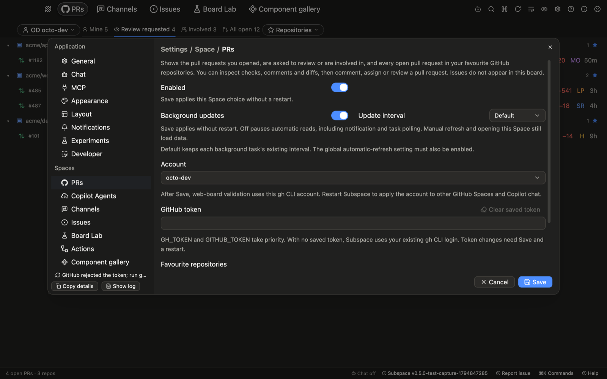
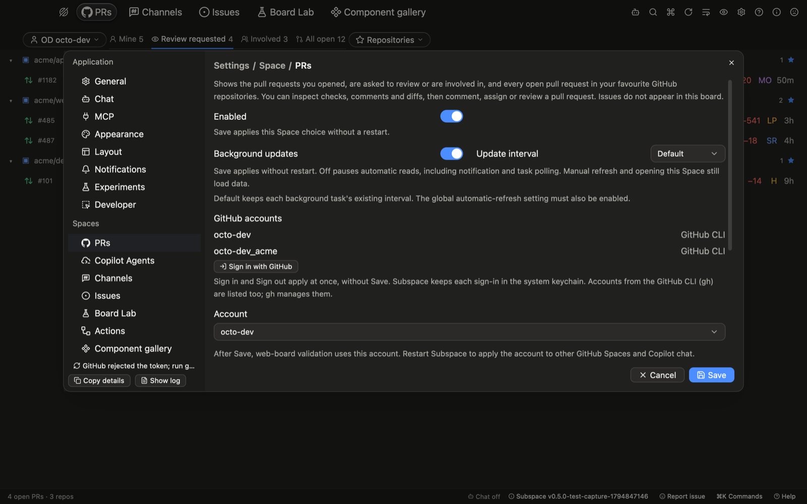
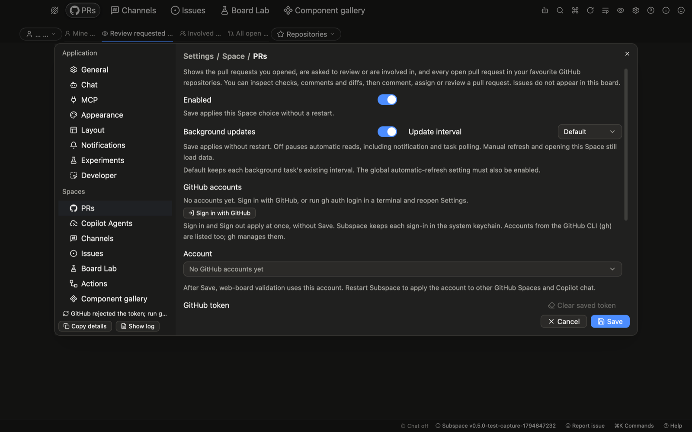
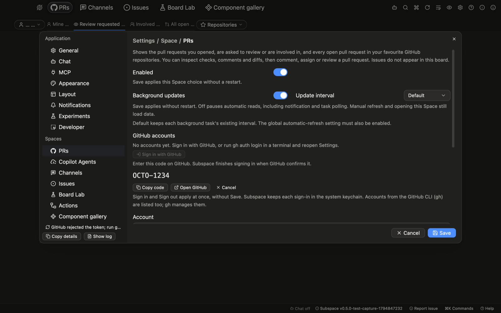
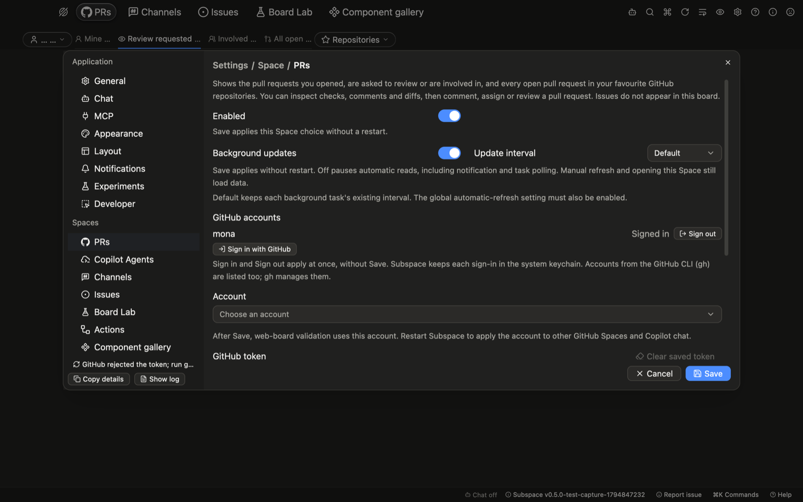
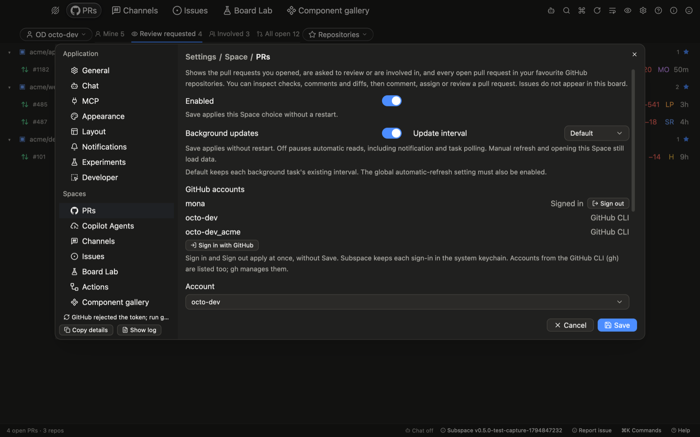
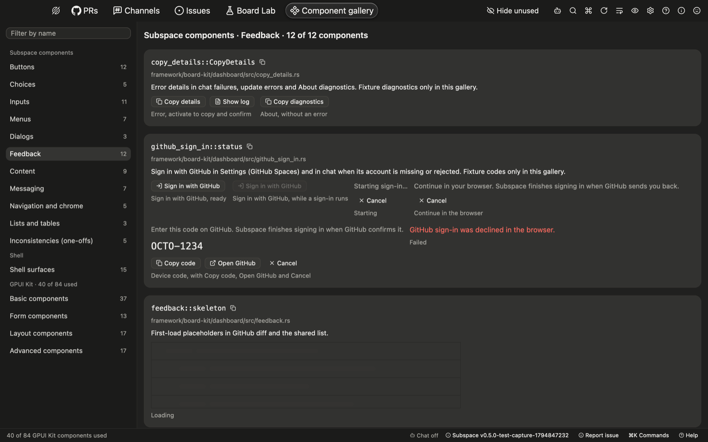

# Sign in with GitHub: delivery

## Checks

- Unit tests: PKCE (RFC 7636 example), `state` and callback parsing, the
  authorize URL, token answers and scopes, device polling decisions
  (`interval`, `slow_down`, expiry, denial, `device_flow_disabled`),
  loopback-only fixture overrides, the signed-in store (case, replacement,
  expiry only for the rejected token, removal, owner-only files), account
  merging and sources, precedence (environment, config, signed in, gh), a 401
  on a signed-in token, the updater's order, and chat's sign-in offers.
- Integration (`framework/services/github-auth/tests/flow.rs`, a fake GitHub
  on loopback): the browser flow end to end with PKCE checked at the token
  endpoint, a forged `state` refused before any exchange, the time limit,
  Cancel, missing scopes, and the device flow with pending polls and with
  device sign-in disabled.
- Headless UI: the shared model (sign-in, refused start, cancel, sign-out with
  revocation, status per phase); Settings' GitHub accounts (signing in lists
  the account without Save, each state's controls and Cancel, Sign out); chat
  offering the in-app sign-in and reconnecting after it; the gallery card.
- Scripts: `scripts/test-github-test-server.py` (the fixture's authorize,
  token, device and revoke endpoints), `test-capture.sh`
  (`SUBSPACE_GITHUB_OAUTH_URL`, `CAPTURE_NO_GH`), `test-release-macos.sh` and
  `test-package-products.sh` with a stubbed `security` (keychain read, the
  variable winning, a stable release refused without the secret, the secret
  reaching only the build and never printed, a build without it refused).

## Evidence

Captured with `make capture` (Cupertino Dark, fixture GitHub and gh accounts
`octo-dev`, `octo-dev_acme`; the fixture signs in as `mona`). Capture builds
have no client secret, so they use the device flow against the fixture.

The browser state is shown through the gallery: a capture must not open the
real browser.

## Not verified against real GitHub

- The browser flow with the real client secret, and that GitHub accepts a
  `redirect_uri` port other than the registered 31415 for this app.
- That the granted `scope` comes back as `repo,read:org`.
- Whether Copilot (the SDK's `with_github_token`) and the Copilot agent
  session API accept a third-party OAuth App token. If not, chat and session
  logs still need gh's token for that account.
- Device flow is disabled on the app today; GitHub answers
  `device_flow_disabled`, which the UI explains.
- Revocation (`DELETE /applications/{client_id}/grant`).
