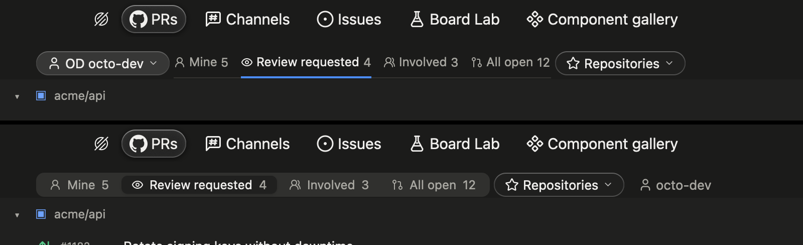
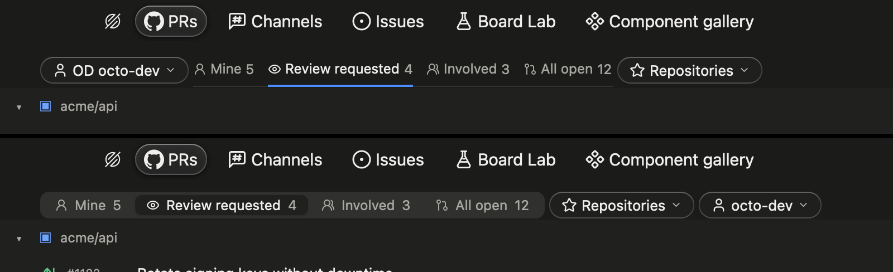
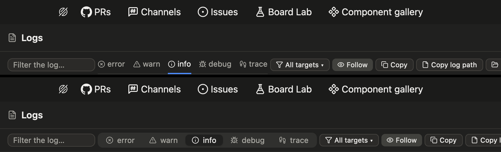
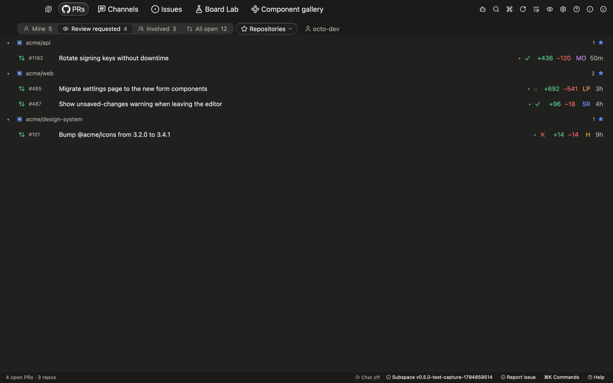

# GitHub toolbar: segmented sections and a quieter account

Back to the [change records](../README.md).

## Intent

The owner asked for three changes to the PRs Space toolbar:

- The account picker showed a person glyph, a letter avatar ("W") and the
  login, which says the same thing three times.
- With only one account signed in there is nothing to choose, so it should
  not be a drop-down.
- The section tabs (Mine, Review requested, Involved, All open) should use
  GPUI Kit's segmented `TabBar` style instead of the underline, and the
  account should come last: the segmented control, then Repositories, then
  the account.

## Spec

- The shared `tabs::tab_bar` treatment is GPUI Kit's `small` segmented
  `TabBar` at its natural width. A segmented tab paints its selected fill
  behind its children only, so `tabs::tab` puts the glyph, title and count
  in one child instead of a prefix and suffix. Every user of the shared
  treatment follows: the GitHub sections, the log view's levels and the
  Issues timeline, which already used segmented directly and now uses the
  shared helper.
- The account is the toolbar's last unit, after the section tabs and
  Repositories, so it is also the first to move into overflow.
- One account: the new shared `toolbar_label::label`, the User glyph and the
  short login in muted text at the toolbar button's height and text size,
  with no hover, focus or caret. Its accessible name is "Signed in to GitHub
  as <login>". In overflow it is a native menu label with the same text.
- More than one account: the existing `menu_button` picker, now with the
  User glyph and the short login only, without the initials.
- `toolbar_label::label` has a Component gallery card and catalogue entries
  in [UI components](../../ui-components.md). The PRs Space guide describes
  both account states and the new order.

## Delivery

Tests: the GitHub Space's runtime tests check that one account is a label
after the tabs and Repositories, that two accounts are a picker after
Repositories, and that the overflow entry for the account (now the last)
still opens the account menu. Dashboard, gallery, Issues and GitHub tests
pass, and `mise run quality` shows no new findings.

Screenshots from `make capture` with fixture data, Cupertino Dark, before
(top) and after (bottom):

## Tasks

- [x] Shared tabs: segmented, with glyph, title and count inside the segment.
- [x] `toolbar_label::label`, gallery card and catalogue.
- [x] GitHub: account last; label for one account, picker without initials
  for more.
- [x] Tests, guide and captures.
