# GPUI Kit 0.11 and GPUI Fast

Back to [change records](../README.md).

## Intent

nsh, which TSX Spaces embeds, draws with GPUI Fast and needs GPUI Kit's
`gpui-fast` backend. The owner asked to move the whole app to GPUI Fast
rather than only an experimental build, if the work was modest. nsh 0.6
and later need GPUI Fast 0.1.16 or later, which GPUI Kit 0.9.1 cannot use,
so the app moves to GPUI Kit 0.11.0, the pairing nsh tests, with
`gpui-fast` on in every build.

## What changed

- GPUI Kit 0.9.1 to 0.11.0 with `gpui-fast` in the Framework, the app, both
  terminal crates and the web view. Imports stay `gpui_kit::*`.
- `gpui-base` re-vendored at 0.11.0. The release ships four of the five
  patched changes; the patch keeps auxiliary link clicks with an active
  selection ([patch notes](../../../../subspace-framework/vendor/gpui-base/SUBSPACE-PATCH.md)).
- Code: GPUI Fast's blanket `IntoElement` impl replaces 9 of Subspace's
  manual impls; `WindowBounds::centered` takes a display.
- Both GPUI stacks still compile: GPUI Kit 0.11 keeps `gpui-pre` and
  `gpui-pre-platform` as dependencies while it exposes GPUI Fast's types.
  No `gpui-pre` code is linked (no `gpui_pre` symbol in the release
  binary), so the cost is build time only: in a clean release build of the
  app (2 min 4 s on one Apple Silicon Mac, 1,333 s of compiler time across
  all units), the `gpui-pre` crates took 63 s of compiler time, 52 s of it
  in `gpui-pre`, `gpui-pre-macos`, `gpui-pre-apple` and
  `gpui-pre-platform`, which GPUI Fast does not use. The release binary is
  168.0 MB unstripped, against 167.7 MB for the same build on `gpui-pre`
  measured earlier.
- Behaviour, deliberate:
  - GPUI Kit's tab lists own each tab's focus handle, make the selected tab
    the list's one Tab stop and move focus with the arrow keys. The Issues
    Activity tabs drop their own handles and arrow handling, and focus the
    selected tab two drawn frames later, once the window's Tab order has it,
    so a palette command that switches tab focuses the new one. In a strip of closable tabs, the
    selected tab is a Tab stop before the first close button.
  - GPUI Kit now wraps the dock's trailing drop target in a box that does
    not grow, so the target takes the tab height and the strip's free width
    after the last tab itself, measured in the previous frame and drawn
    again, from a next-frame request, when a layout such as a resize moves
    the end of the tabs.
  - A loading icon button is disabled, so pointers, keys and assistive
    technology find it unavailable, and drawn faded in its resting colours
    rather than marked loading: GPUI Kit 0.11 draws its own spinner beside
    the button's in a loading button. A quiet button keeps its glyph
    colour, fill and edge; a native variant takes GPUI Kit's disabled fill.
- Tests read borders that GPUI Fast paints as strips of the border colour.
- `subspace-charts` builds on `quickjs-jit`, nsh's QuickJS fork, so an app
  that also embeds nsh links one QuickJS: two copies resolve to one set of
  C symbols without a link error.

## Verification

- Framework and desktop `make check`, `mise run quality` in both, and
  `MISE_ENV=terminal make check-terminal` pass.
- `mise run audit` reports the same advisories on this branch as on
  `main` (new `heapless`, `url` and `cookie` advisories that `main` also
  has); none is new with this change. Reasons in `deny.toml` name the new
  versions.
- The release licence notices pin GPUI Kit 0.11.0's Apache notice (the same
  text as 0.9.1's), checked in the generated third-party licences, and the
  licence check fails on a notice that names a crate no lockfile has.

### Visual pass

Every Space was captured with `make capture` in Twilight Two from `main`
(`gpui-pre`) and this branch (GPUI Fast), with the Fleet fixtures and Space
Lab and the Component gallery turned on. ImageMagick (`compare -fuzz 2%`)
finds differences only in the status bar: the build version, and the
Issues and Actions sync times. Fleet Console's animated canvas differs by
0.46 % of pixels. An opened Issues view, Tab focus there and Settings
compare the same way.

| Space | `gpui-pre` (main) | GPUI Fast |
| --- | --- | --- |
| Channels | 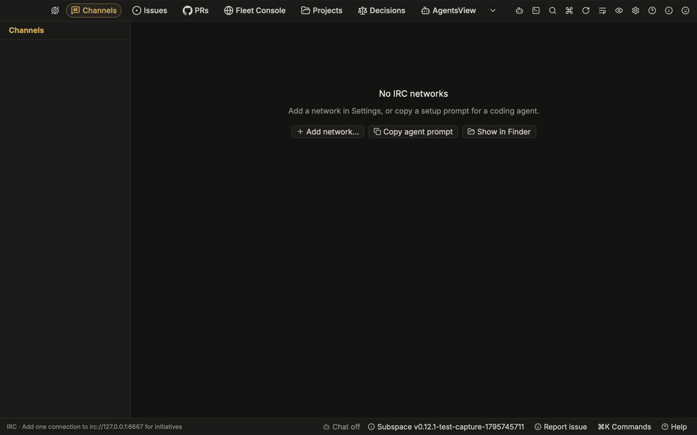 | 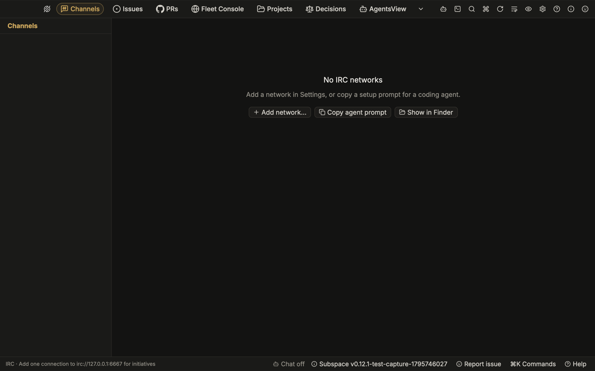 |
| Issues | 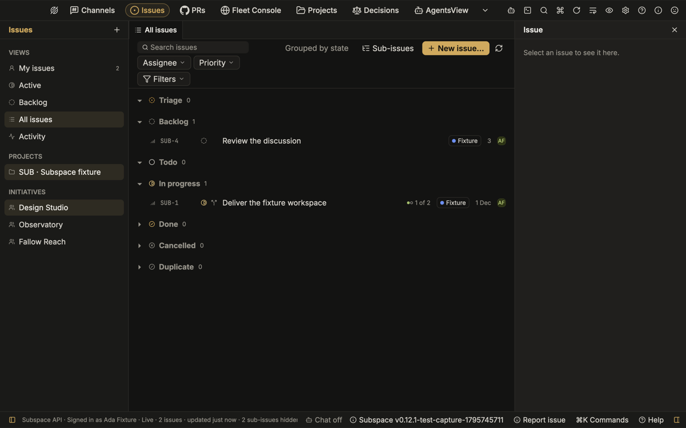 |  |
| PRs | 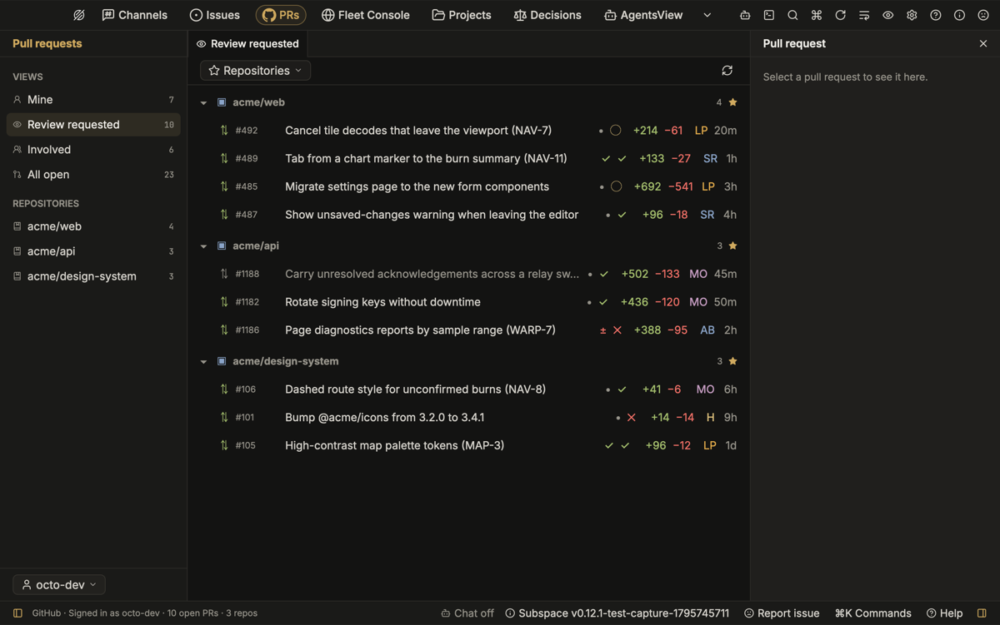 | 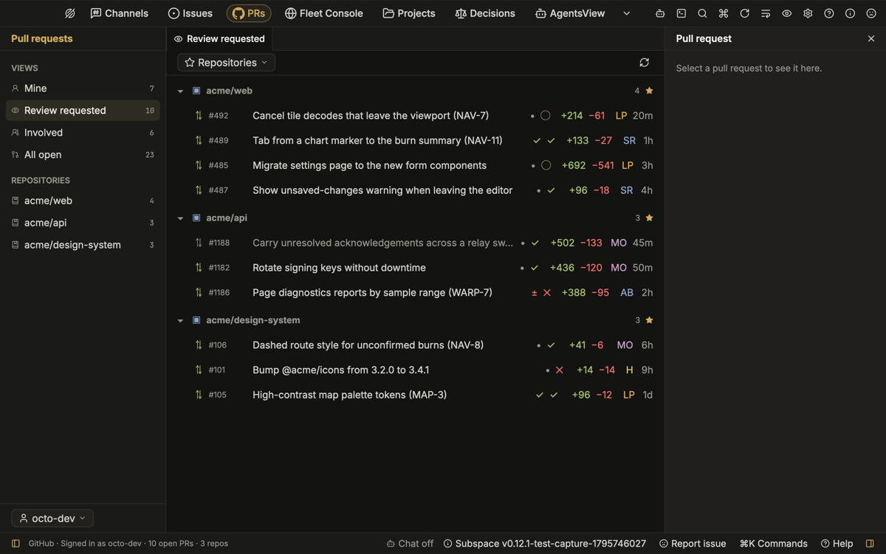 |
| Projects | 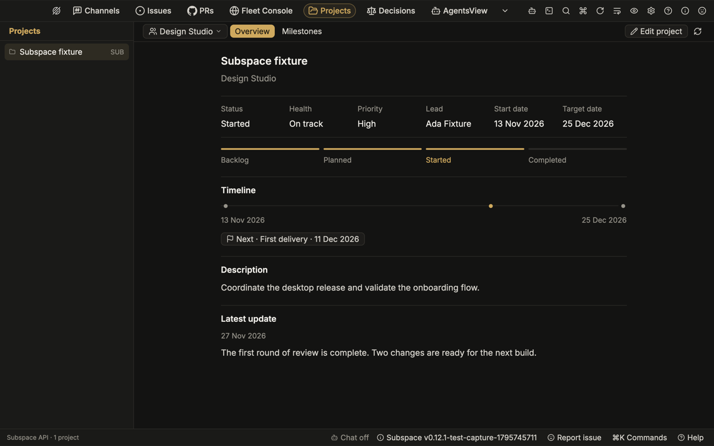 |  |
| Decisions | 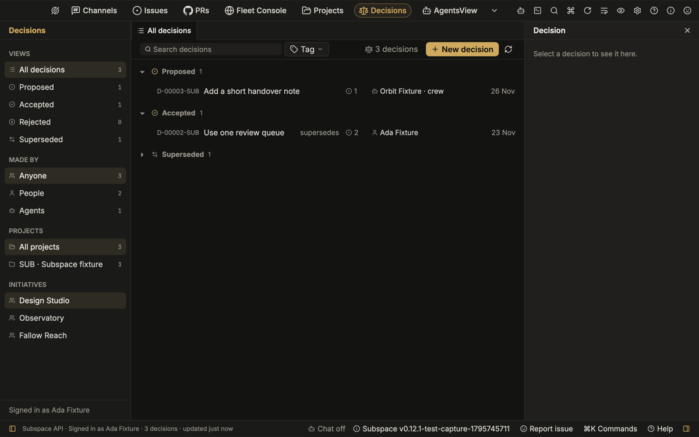 |  |
| Actions |  | 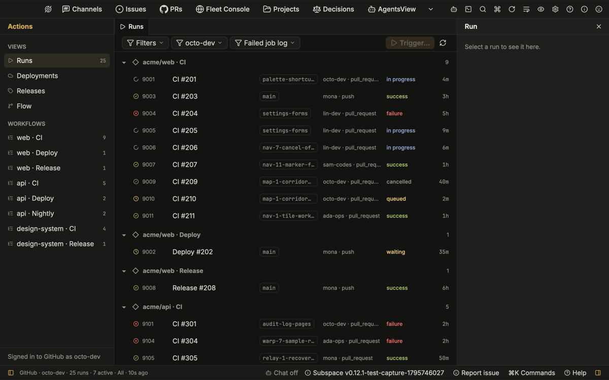 |
| AgentsView | 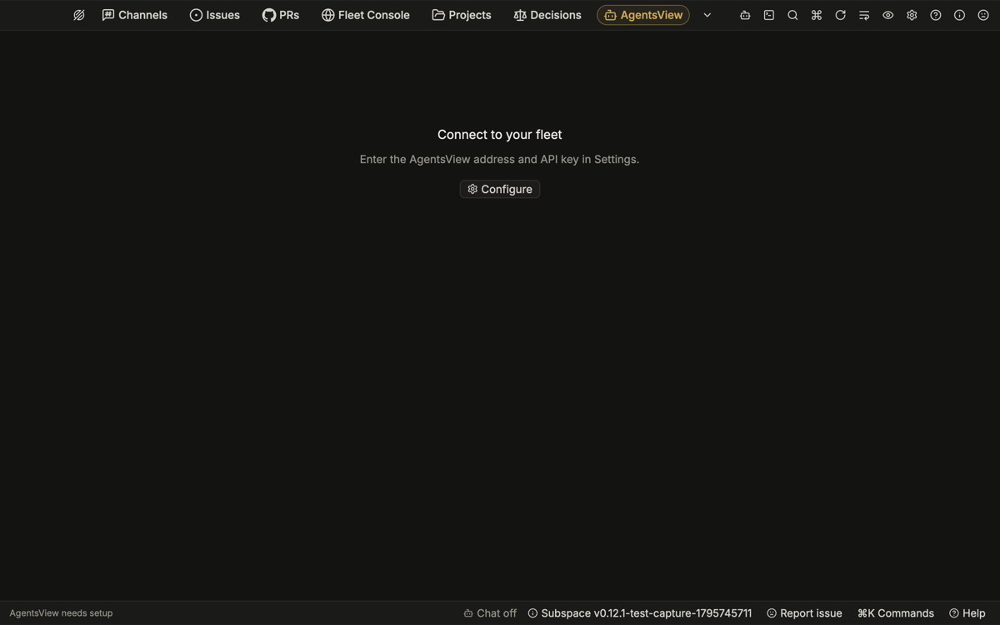 |  |
| Fleet Console | 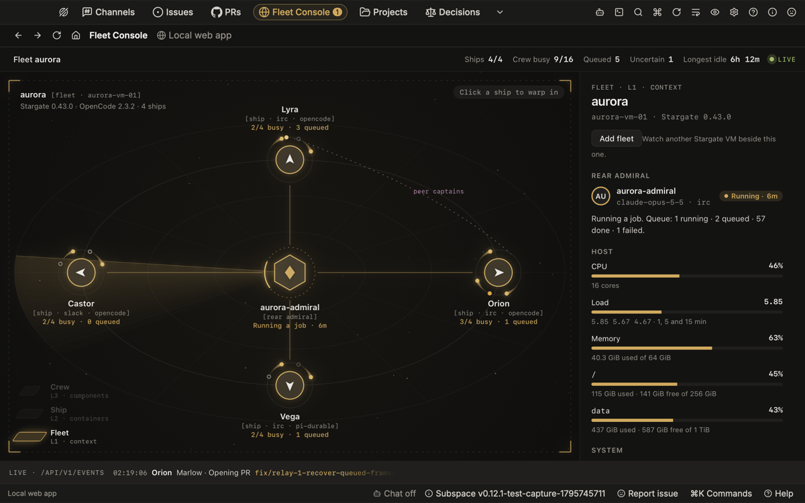 | 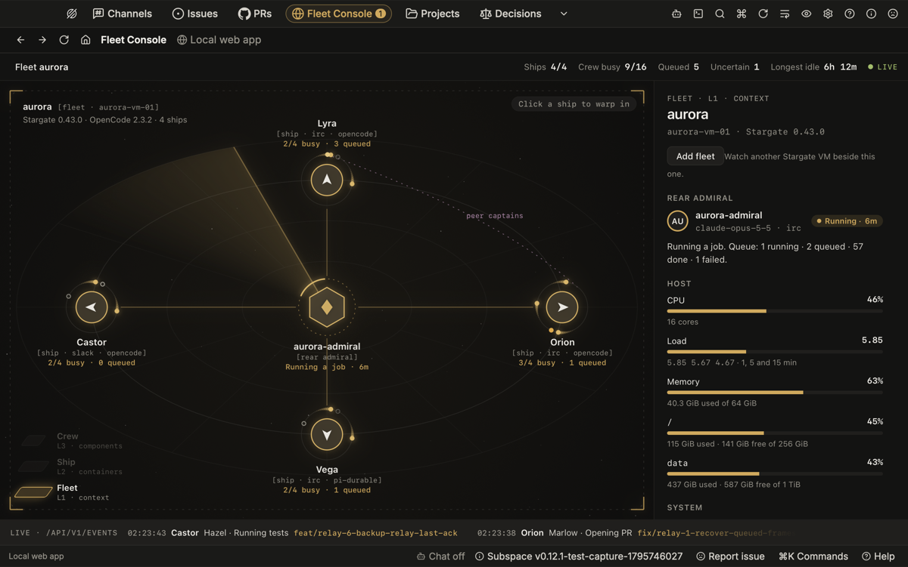 |
| Space Lab |  | 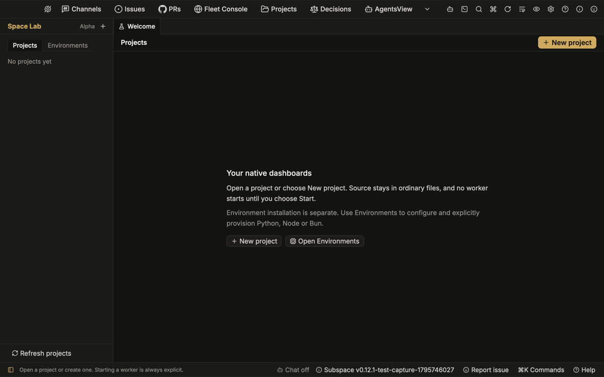 |
| Component gallery | 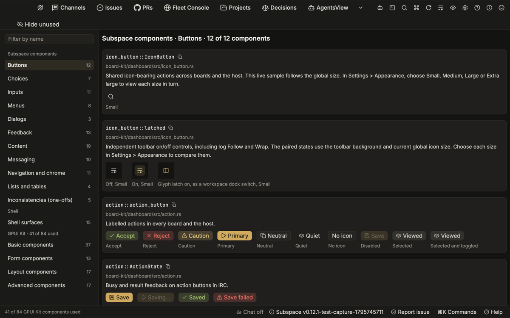 |  |
| Settings |  | 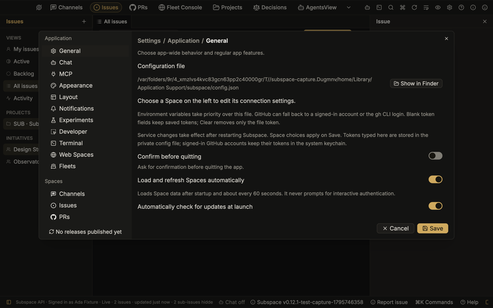 |

### Idle and Space-switch CPU

Method: the debug capture build (`make capture`, Issues Space, Twilight Two,
window in the background) from `main` with the `sleep` capture step and
from this branch, the app's CPU time read with `ps` between two points.
Idle: 25 s to 55 s after start during a `sleep:50000` step. Switching: 30
`NextDashboard` actions 300 ms apart with `sleep` between them, CPU from
17 s to 26 s. Three runs each on one Apple Silicon Mac.

| Measure | `gpui-pre` (main) | GPUI Fast |
| --- | --- | --- |
| Idle, % of one core | 1.30–1.47 | 1.40 |
| While switching Spaces, % of one core | 22.8–23.9 | 17.8–20.3 |

Idle is the same, and switching costs less on GPUI Fast.

An earlier measurement with `wait` steps showed idle CPU doubling
(13.9–14.2 % to 29.6–29.7 %). A `sample` of that run put the work in the
capture harness: a `wait` draws every window each 100 ms with
`Window::draw`, a forced full redraw at 10 fps. In a debug build a forced
full redraw costs about twice as much on GPUI Fast, which keeps more
retained state per element; the app's own frames are not forced, so the
`sleep` step was added to measure them. A second embedding measured
0.7–0.8 % idle before and 1.2–1.3 % after, also in a debug build; that may
include the same kind of forced or full redraws. Release builds were not
measured, as the capture build is debug only.
