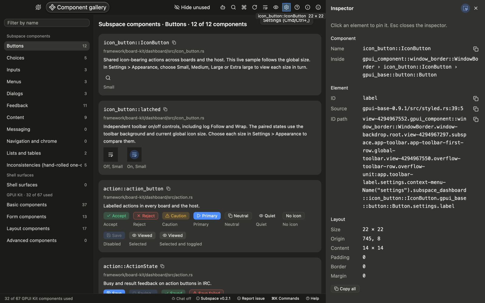
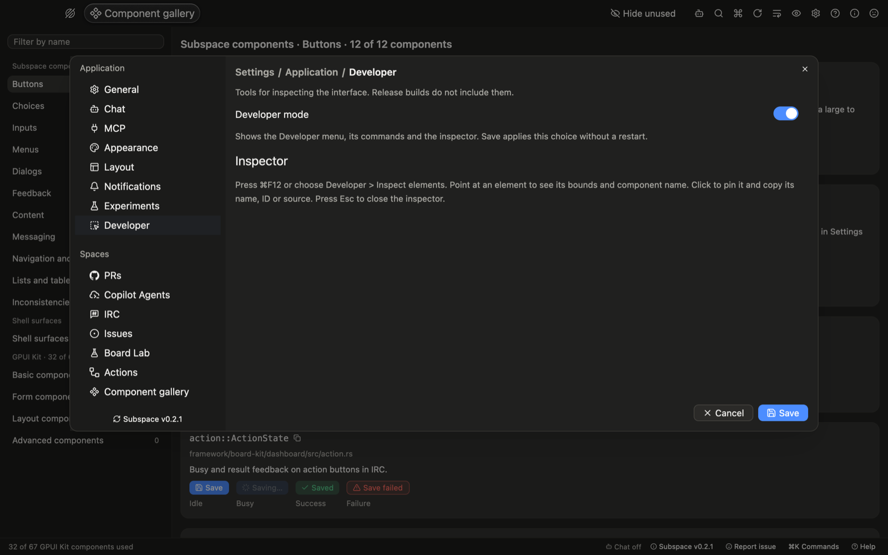

# Delivery: inspector mode

## Screenshots

Captured from the debug capture build (`cargo build -p subspace --features
subspace-shell/capture`), launched in the background with `open -g` from an
ad hoc bundle, an isolated `HOME` and fixture configuration: only the
Component gallery Space is on, chat is off and update checks are off. Cupertino
Dark is the default theme. Steps: `key:cmd-f12`, `move:745,8` (the edge of the
toolbar's Settings button), `click:745,8`, `move:300,400`, and
`action:subspace_app::OpenDeveloperSettings`. Images are scaled to 1600 px.

There is no before image: release and plain debug builds had no visible
inspector, and the Developer page is new.

## Checks

- Host tests (`cargo test -p subspace-shell`, 492 tests) pass, including:
  - `inspector::tests::model`: type-name scopes become components; the
    innermost shared component is named and its parts (`icon_button::content::Glyph`)
    are not; board then Kit fallbacks; generic arguments and ordinary IDs;
    registry and shared sources; helper modules; size and edge labels; rem
    and pixel box model.
  - `inspector::overlay::tests`: tag placement above, below and clamped; the
    padding and margin bands.
  - `inspector::tests`: hovering picks `inner`, then the nested `leaf`, then
    `outer`, with the bounds `window.find` reports and the inner padding; a
    shared button reports `icon_button::IconButton` in name, tag and chain; a
    click pins it, a later hover leaves it selected, and the panel's Copy
    writes `icon_button::IconButton` to the clipboard; Escape and the toggle
    close; ⌘F12 opens; F12 still belongs to the twelfth Space; Developer mode
    off keeps the inspector closed and the palette empty; the Developer menu
    and the palette's **Inspect elements** / **Close inspector** wording.
  - `app::toolbar::tests::inspector`: in the production shell, ⌘F12 opens the
    inspector and hovering the status bar's Help reports
    `icon_button::IconButton` (through the Kit's window layers);
    **Developer settings** opens Settings at the Developer page.
  - `settings::organization_tests::developer`: Developer mode starts on, the
    switch is a draft until Save, and Save writes `app.developer-mode = "0"`;
    `select_developer_page` selects the page.
  - Settings navigation and breadcrumb tests include Developer as the last
    Application page in debug builds.
- Release gating: `cargo check -p subspace --config
  'profile.dev.debug-assertions=false'` builds the whole product without the
  inspector, the Developer page, menu or commands.
- `cargo clippy -p subspace-shell --all-targets [--features capture] -- -D
  warnings`, `cargo shear`, and workspace clippy and tests excluding the
  Component gallery board pass.
- `make interfaces` passes.
- `rustqual . --findings` reports no findings in `framework/host`, `scripts`
  or `products`.
- `make check` and `mise run quality` currently fail only on the Component
  gallery board's uncommitted work in progress from a concurrent change
  (`spaces/component-gallery`: format, a compile break in `state::Retained`
  while it was being edited, hand-rolled icon controls, the anchored-menu
  boundary test and two IOSP violations). The docs-index, board-docs, script,
  web-bridge and weather-board tasks pass.
