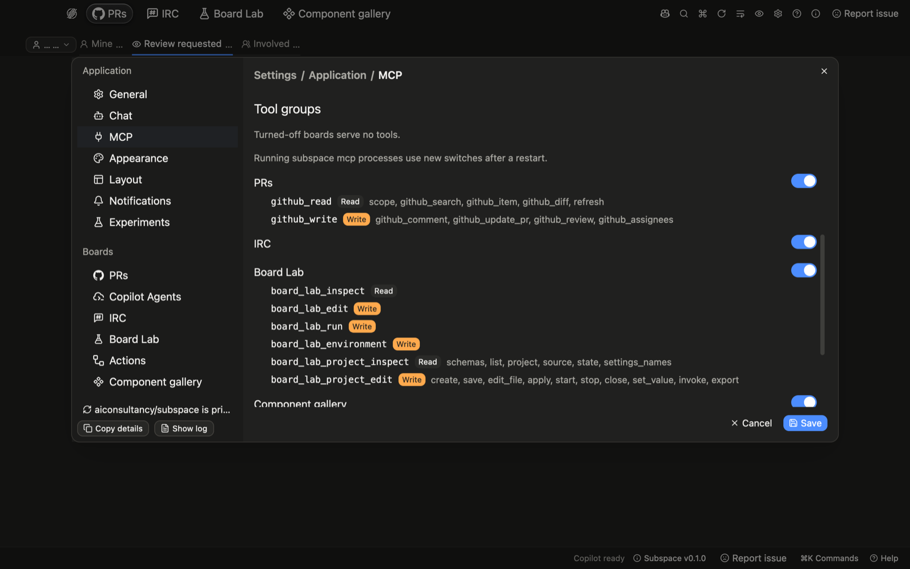
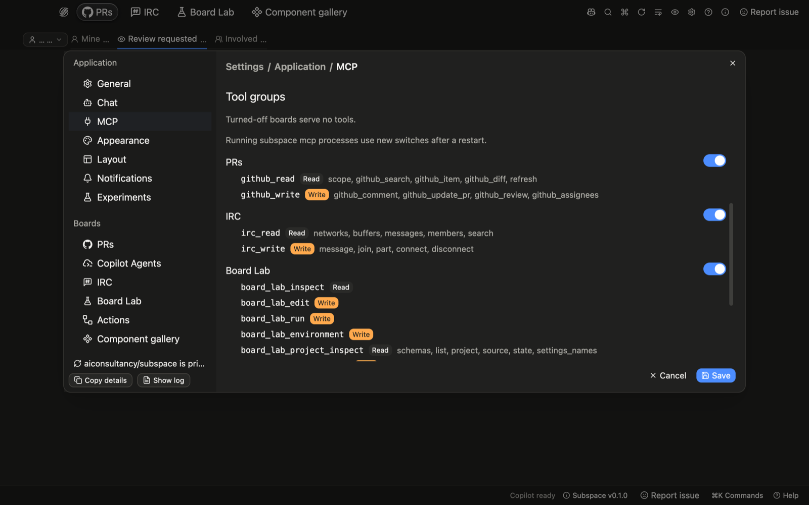

# Delivery: IRC agent tools

## What shipped

- `irc_read` and `irc_write` in `spaces/irc/src/agent_tools/`:
  - `bridge.rs` connects the tools to the hub.
  - `lookup.rs` resolves names.
  - `read.rs` with `read/{messages,search,spec}.rs` implements the read tool.
  - `write.rs` with `write/{validate,spec}.rs` implements the write tool.
  - `Irc::agent_tools` registers both tools.
- The hub (`hub.rs`) opens the tool queue at start, closes it at stop and
  answers queued calls at the start of each drain (`Hub::serve_tools`).
- `IrcState::older_history` contains the history-page request that
  `transcript::load_older` used to build itself. The tool's `messages` read
  also uses it.
- `subspace-client-irc`: `Command::Say { buffer, text, action }` sends literal
  text or a `/me` action and is never parsed as a command. The runtime routes
  it, and a disconnected network answers with **Not connected**.
- `subspace-agent-tools`: `ToolEnvironment::host` holds a `ToolHost` value
  (`App` or `Headless`). `test_support::app_environment` builds an app
  environment, and `check_documented_catalog` checks the catalog that the
  running app builds.
- Host: the desktop app and its configured-board reload build `ToolHost::App`.
  The headless route (`mcp` and generated commands) builds
  `ToolHost::Headless`.
- Docs: `docs/irc.md#agent-tools`, the guide (`spaces/irc/help.md`),
  `docs/mcp.md` (the tool table and the app-only note), `docs/cli.md` and
  `docs/agent-chat.md` (what chat can write, registered tools and the ACP gap).
- `scripts/test-product-interfaces.sh` checks that `subspace irc networks` is
  refused as an unknown command and that `board_help` returns the IRC guide
  with its tool section.

## Evidence

The visible change is the **IRC** group on **Settings › MCP**. It now lists
both tools with their actions. Before the change, the group had no tools. Both
captures use the capture build with fixture data, in Cupertino Dark.

The approval card is unchanged and shows the text from the tool's `describe`.
Tests cover that text (`the_preview_names_who_sends_and_every_line`). No
screenshot shows an IRC approval card: capturing one needs a signed-in chat
engine, which the capture build does not have.

## Tests

- Client: `say_sends_literal_text_and_actions_but_never_commands` and
  `a_message_while_offline_is_reported_in_its_buffer`.
- Board (`agent_tools/tests*`):
  - Only `ToolHost::App` builds the tools.
  - The tool schemas are checked.
  - Read output is checked against fixture state: networks, buffers, paging
    and the history request, members, search, and refusal of unknown actions.
  - Validation is checked.
  - Live checks and the operation-to-command mapping are checked.
  - The preview is checked.
  - Whole calls are checked through a stand-in hub thread: one approval,
    ordered commands, denial, preflight refusal with no approval request, and
    a stopped board.
  - The real hub answers calls on its drain (`tests/hub.rs`).
- Ergo (`tests/ergo.rs`, gated by `IRC_TEST_SERVER`): the drain loop runs on
  a real runtime. An `irc_write` message arrives in a channel under the
  tool's nick, and the echo appears as `own` in `irc_read`. The test passed
  against `scripts/irc-test-server.sh`, which was stopped afterwards.
- `products/subspace`: the documented tool inventory matches the app catalog,
  including the IRC tools.

## Divergence from the request

- The request asked for one `README.md` in the change folder. This record
  follows the four-file layout that the other change records use.
- Setting away was left out. The client has no typed away command, and the
  composer sends away as a raw line. The tools send no raw lines.
- The tools refuse messages to nicks that end in `serv`, such as NickServ and
  ChanServ. Those services change accounts and channels, which the request
  excludes.
- ACP chat sessions get board tools from a separate `subspace mcp` process,
  so they have no IRC tools. Copilot and Pi chat use the app's catalog and
  have them.
