# Delivery: IRC board

## What shipped

- `spaces/irc` (`subspace-irc-board`): hub, reducer, list, transcript, member
  column, composer, Join dialog, toolbar, notifications and empty state. See
  [IRC](../../irc.md) and the [guide](../../../spaces/irc/help.md).
- Shared `ChatInput` options, documented in the
  [component catalogue](../../ui-components.md#gpui-kit-messaging-reuse):
  `set_plain_text` (no Write/Preview or Markdown hint) and
  `set_recall_keys` (Up, Down and Tab emit `Previous`, `Next` and `Complete`
  in the new `SubspaceChatRecall` key context).

## Divergence from the spec

- Older history loads from an explicit **Load older messages** row at the top
  of the transcript instead of on scrolling to the top: Kit's
  `MessageScrollerState` has no top-of-list signal, and loading from a row
  renderer would be a render side effect.
- `background_updates` is off for this board: connections are persistent, so
  there is no polling interval to configure.
- Highlight words also go to the runtime through each network's
  `highlights`; the board still matches them so lines replayed from history
  highlight too. Only messages, actions and notices highlight.

## Evidence

Captured from the isolated capture build (empty `HOME`) against the local Ergo
test server on `127.0.0.1:16667`, with fictional users `alice`, `bob`,
`carol`, `dave` and `erin` scripted to talk in `#subspace` and send a private
message. A second network points at a closed port to show reconnecting.
The window was in the background, so opened buffers keep their unread counts.

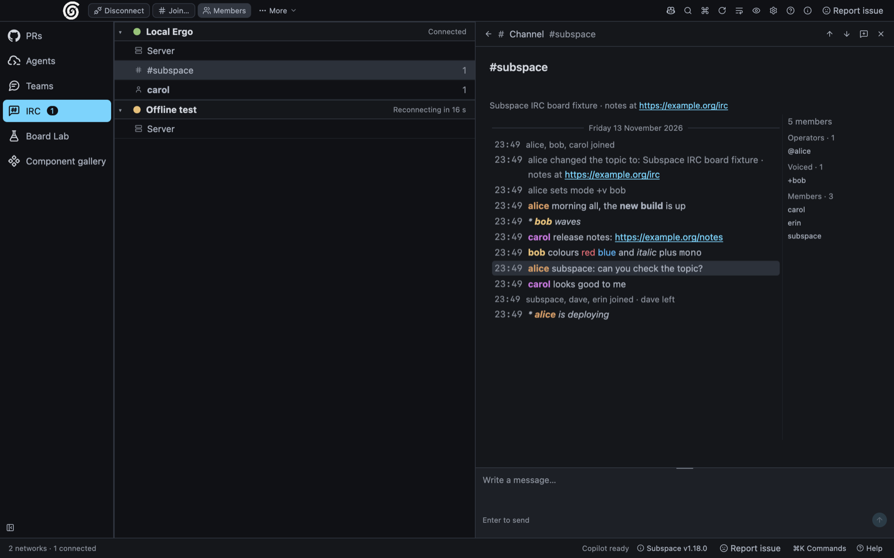
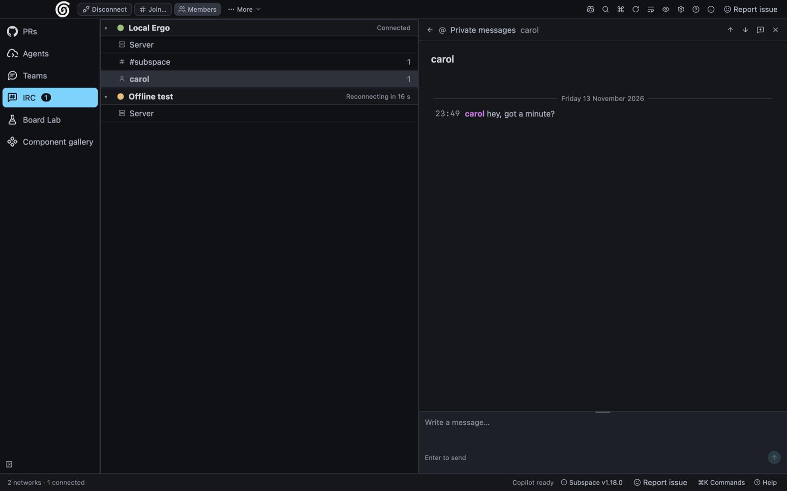
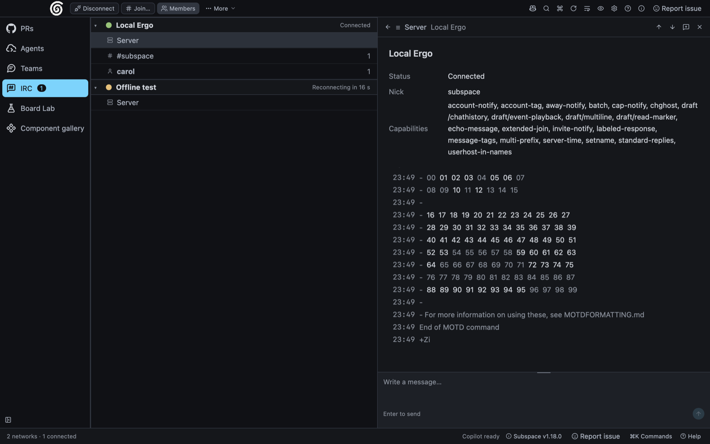
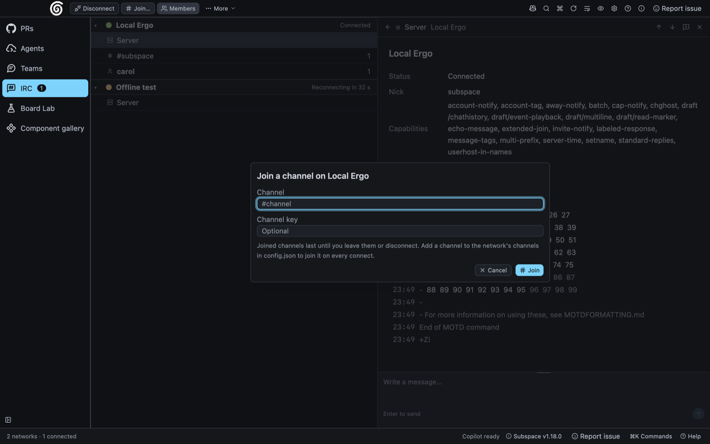
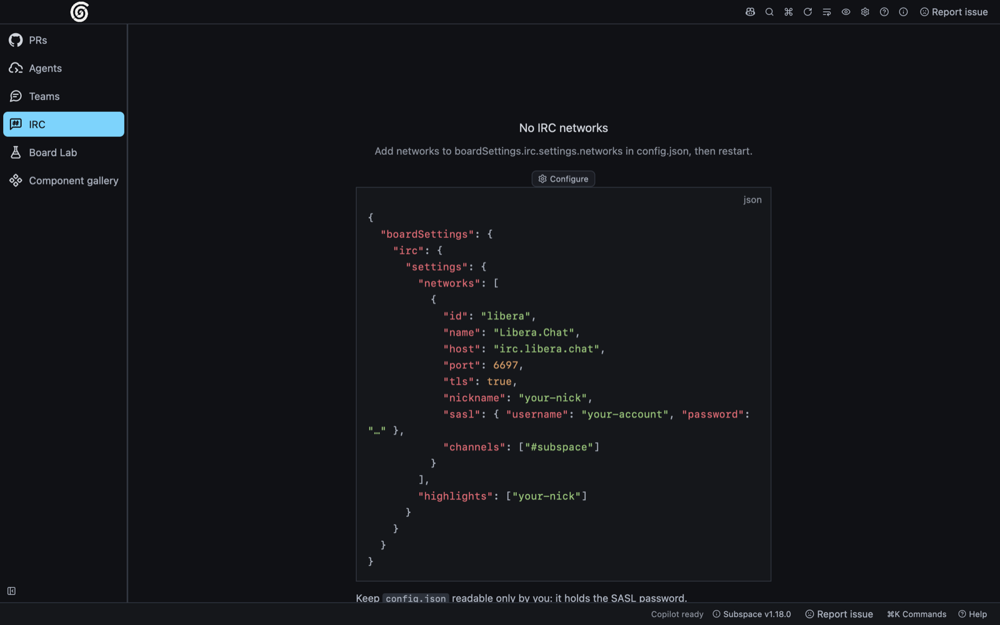
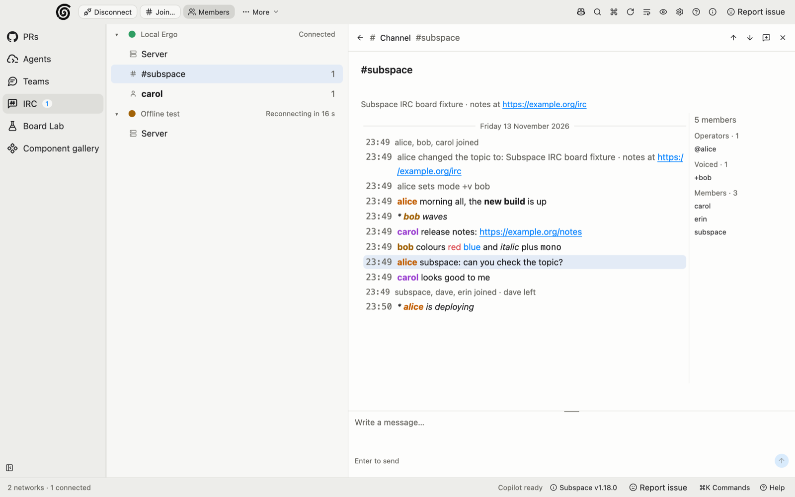
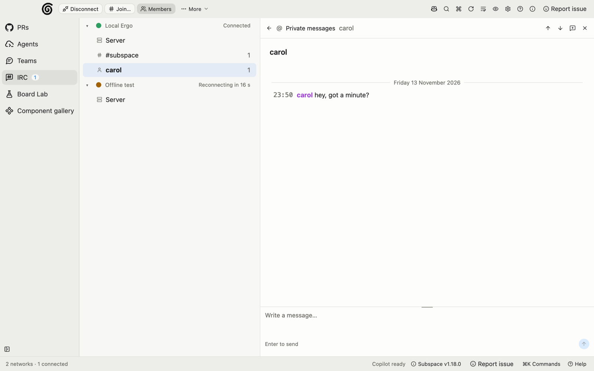
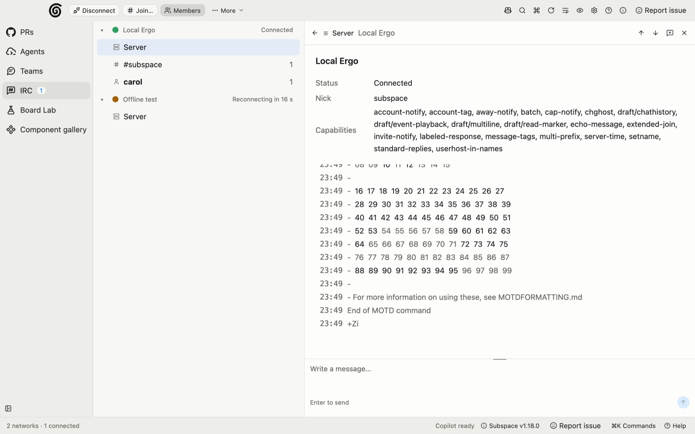
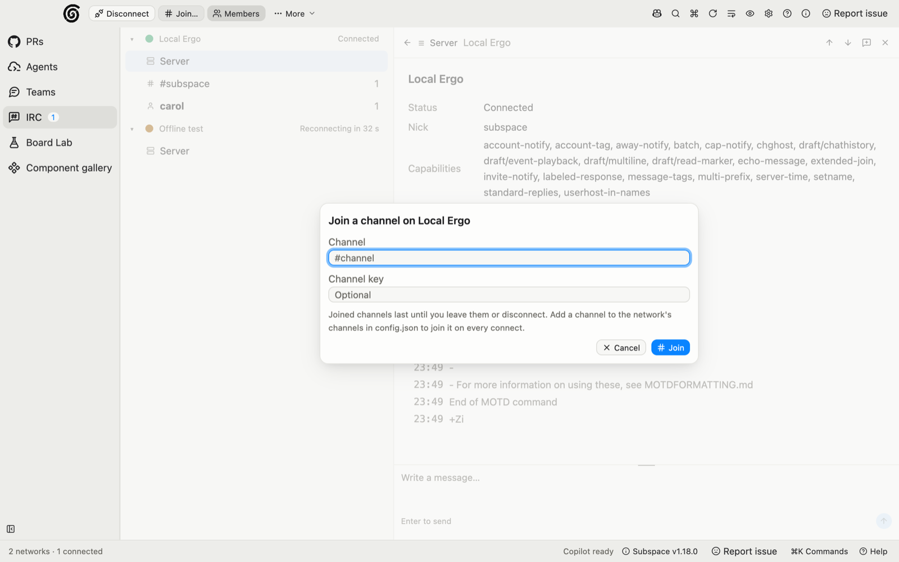
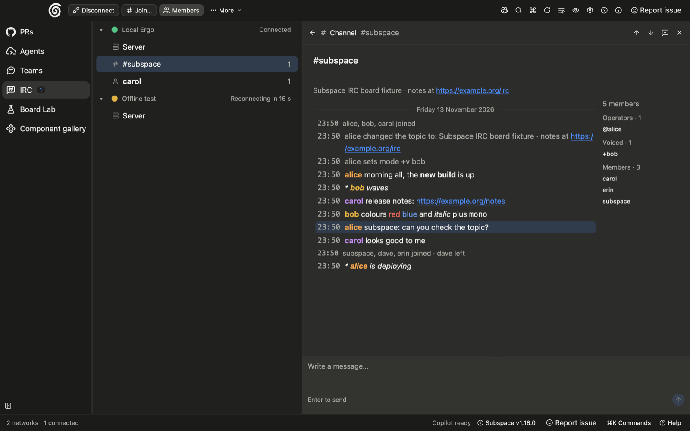
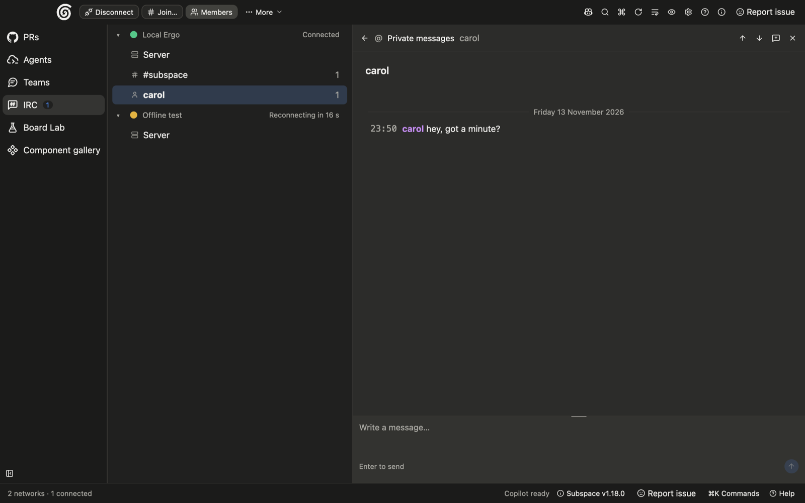
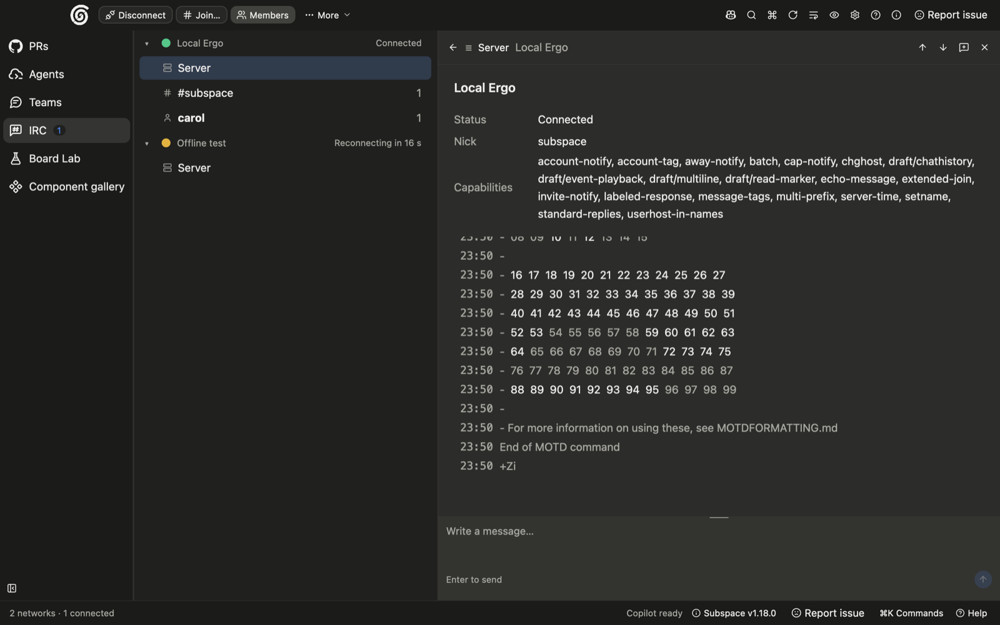
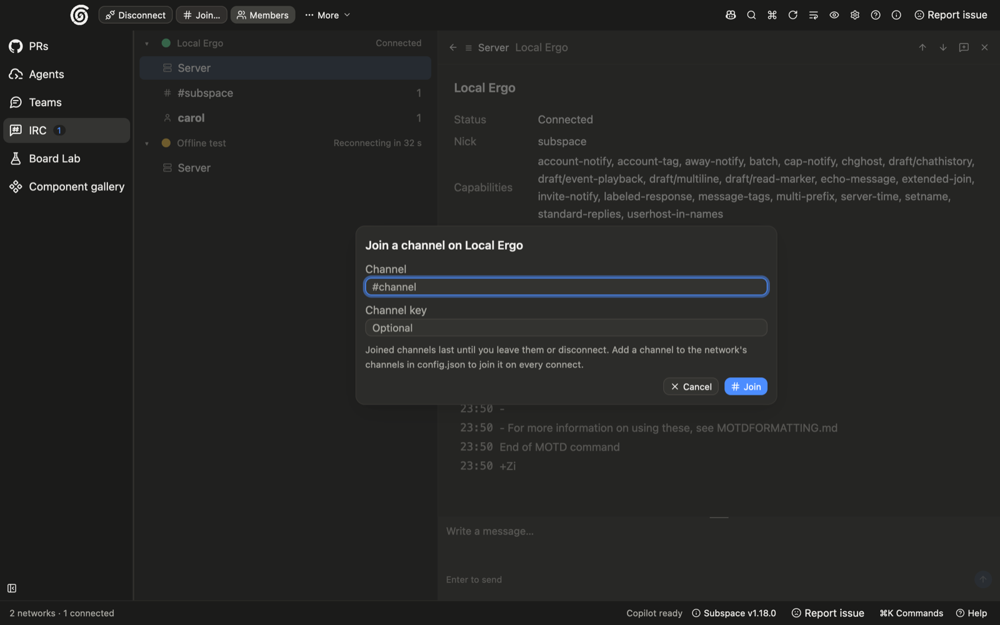

## Checks

- `cargo test -p subspace-irc-board`: reducer, rows, condensing, styling,
  completion, recall, typing throttle, scroller splices and render tests over
  a recording hub.
- `subspace-dashboard` test for the plain-text and recall-key input options.
- Product registration, artwork fingerprint, descriptor order, board docs and
  architecture checks.
