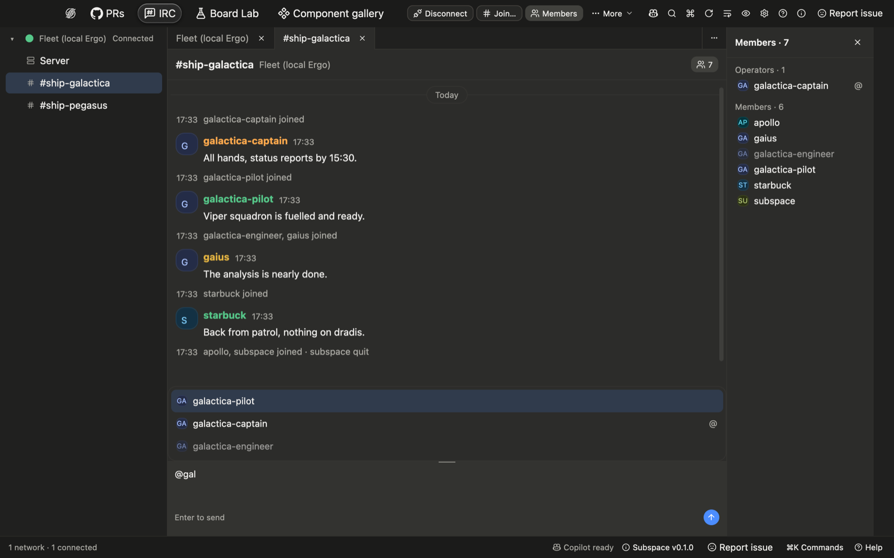
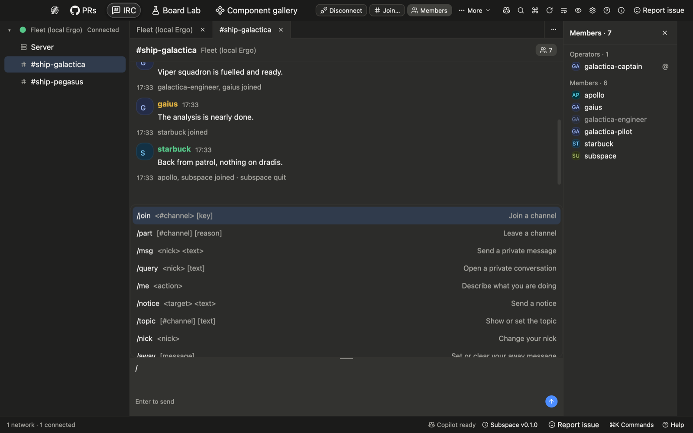
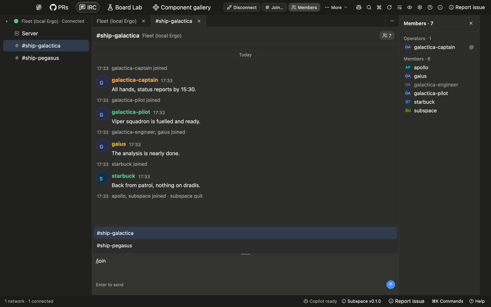

# Delivery: IRC completion

These images come from an isolated debug capture build in Cupertino Dark,
the default theme, with `appearance.theme` unset. Each run used a temporary
`HOME` and a 1280 × 800 window. It connected to a local Ergo server on
`127.0.0.1:16667` with a fictional crew in `#ship-galactica`. The capture
clicked the channel and the composer, then typed with the new debug-only
`type:` and `key:` capture steps. Before this change the composer showed no
list at all, as in the owner's report, so there are no before images.

## Tests

- `subspace-client-irc`:
  `every_listed_command_and_alias_is_parsed_here_not_sent_raw` checks every
  `COMMANDS` entry and alias against the parser. It also checks that an alias
  reports its command's usage.
- `subspace-dashboard` (`chat_input::completion`): the word before the
  cursor (mid-text, empty, a cursor inside a character or past the end),
  wrapping highlight, and plain versus rich rows with their accessible
  names.
- `subspace-chat` (`agent_chat::slash`): the existing filter, alias, catalogue
  and completion tests are unchanged. The wrap test moved to the shared list.
  `the_shared_list_moves_the_highlight_and_completes_that_command` runs the
  agent chat's `SlashList` through the shared list: `/yolo`, then Down, then
  complete, gives `/yolo off ` and runs it.
- `subspace-irc-board`, pure (`compose::suggest`, `compose::complete`):
  - `@gal` offers the galactica members and inserts `@galactica-captain `.
  - A word completes in the middle of a message.
  - Rows carry the mode prefix and speak rank and away state.
  - Matching uses RFC 1459 folding.
  - `/jo`, the `/q` aliases, `//` and a non-leading `/`.
  - First arguments of `/join`, `/part`, `/msg` and `/query`; free text opens
    nothing.
  - `#` in text.
  - Recent speakers first, then by nick, without our own nick, from real hub
    state.
  - A private conversation offers its partner.
  - Classic Tab completion at the start of a line, mid-line and in the middle
    of a draft.
- `subspace-irc-board`, interaction (`tests::completion`, real board and
  keys):
  - Typing `@gal` shows galactica-captain and galactica-pilot, and Enter
    inserts `@galactica-captain `.
  - Down then Tab chooses the next member in the middle of a message.
  - Escape closes the list and keeps the draft.
  - `/jo` shows `/join`, Enter inserts `/join ` and the channel list follows.
  - Tab without a list completes a bare nick to `gaius: `.
- `subspace-shell` (`capture`): the `type:` and `key:` steps parse in order.

## Results

- `make interfaces` passed.
- `make check` stopped at `fmt-check`, on files from other work in progress
  (the IRC dock, GitHub favourites and Settings repositories), not on these
  files.
- Run separately, `architecture` and `board-docs` passed.
- Clippy with `-D warnings` is clean for `subspace-dashboard`,
  `subspace-chat`, `subspace-client-irc`, `subspace-shell` (with `capture`)
  and the `subspace-irc-board` library. Its tests stop on a lint in another
  change's `dock/tests.rs`.
- Tests pass for `subspace-dashboard`, `subspace-chat`,
  `subspace-client-irc` and `subspace-irc-board`. `subspace-shell` fails one
  test, `settings::repository_tests`, which belongs to other work.
- `mise run quality` adds no findings in these files. The three new findings
  against the baseline are in `menu.rs`, `menu/view.rs` and
  `repositories/tests.rs`.
