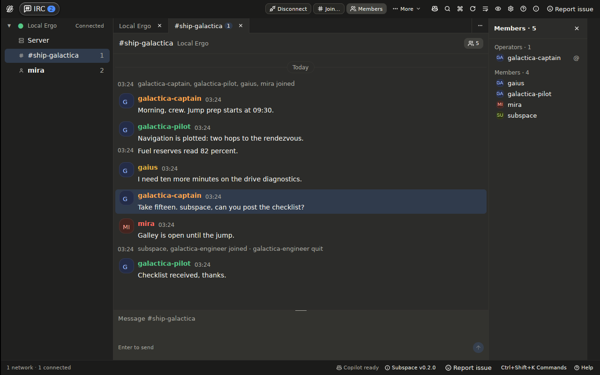
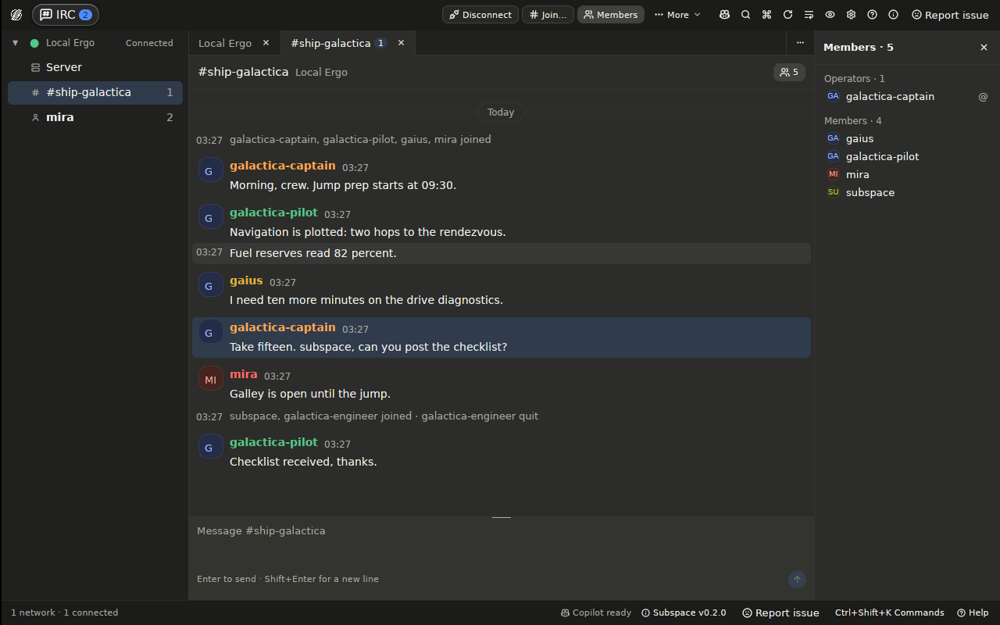
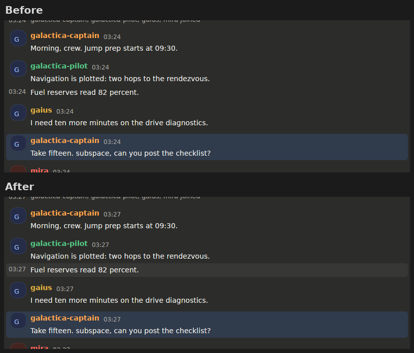
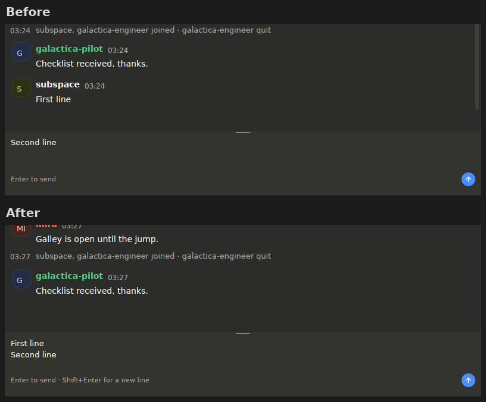
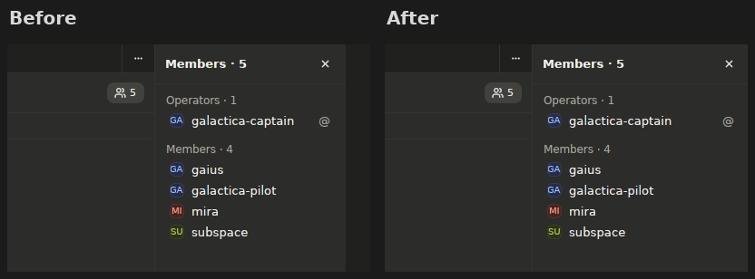
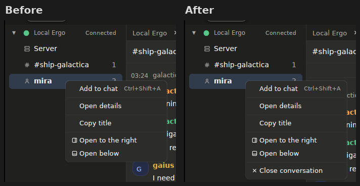
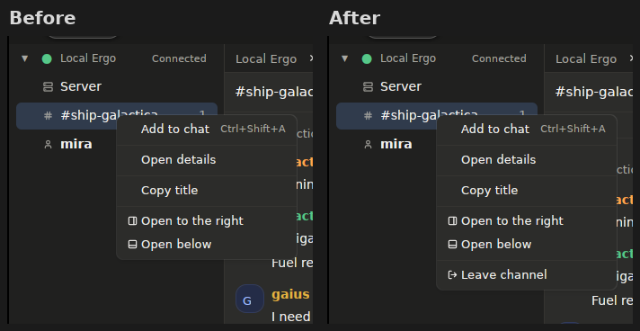
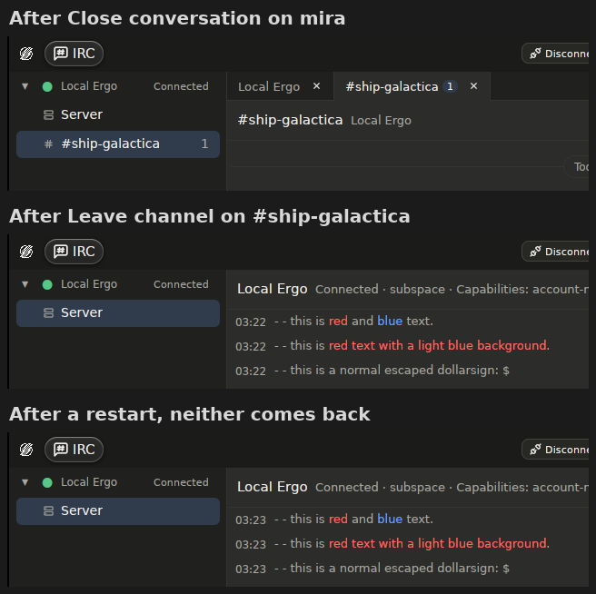

# Delivery: IRC conversation polish

## Evidence

These images come from isolated debug capture builds on Linux, in Cupertino
Dark, the default theme, with `appearance.theme` unset. Each run used a
temporary `HOME` with only the IRC board on, and a 1280 × 800 window under
Xvfb. It connected to a local Ergo server from `scripts/irc-test-server.sh`
on a private port, where a fictional crew talked in `#ship-galactica` and
`mira` sent a private message. The capture build drove the app with its
`click:`, `right-click:`, `move:`, `type:` and `key:` steps. GPUI does not
render a window to an image on Linux, so the frames were grabbed from the
virtual display with `ffmpeg -f x11grab`, without the pointer. The before
build is `e8757cf` with only the debug capture tool from this change, so it
could right-click and move the pointer. The hint reads **Enter** because
these are Linux builds; macOS shows **Return**.

## Tests

- `subspace-dashboard` (`chat_input`):
  - `shift_enter_breaks_the_line_without_sending`: Shift+Enter gives
    `first\nsecond` and sends nothing; Enter then sends both lines.
  - `a_multi_line_draft_keeps_its_arrows_unless_it_was_recalled`: in a
    multi-line draft Up and Down no longer recall and Tab still completes;
    marked as recalled, Up recalls again.
  - `the_hint_names_the_platform_s_send_and_new_line_keys`.
- `subspace-irc-board`, interaction (`tests::keys`, the real board and keys):
  - Shift+Return breaks the line and Return sends both lines as one input.
  - Shift+Return with the completion list open breaks the line and closes
    the list.
  - Return sends after Escape closed the list.
  - Up recalls only from a one-line draft; in a multi-line draft it moves
    the cursor.
  - A recalled multi-line message does not stop the recall: Up goes on to
    older lines and Down comes back to the draft; once edited, the arrows
    move the cursor (`compose::recall` also checks `Recall::showing`).
- `subspace-irc-board`, layout (`dock::tests`):
  `the_member_list_fills_its_dock_to_the_window_edge`, at the default width
  and after restoring a 360 px saved dock. It failed before the fix with the
  list 224 px wide, 16 px short of the window edge.
- `subspace-irc-board`, hover (`transcript::fill`): a plain row is clear at
  rest and tinted under the pointer; a mention keeps its fill.
- `subspace-irc-board`, removal:
  - `state::removed`: ASCII case-insensitive matching without bracket
    folding, the JSON round trip and the server buffer never being removed.
  - `state::tests::removed`: a closed query stays out through replayed
    history, a bouncer's replay, a repeated line, a quit and typing, and
    returns on a newer message with an unread count and a notification. The
    closing time is the newest message received, not our own line or a local
    error. A query closed while empty returns on any message, even one with
    an earlier server time. Opening it brings it back. A left channel stays
    out through its part echo, a late topic, member list and message, and
    returns on a join.
  - `remove`: leaving parts a joined channel; every removal sends `Forget`,
    also after a kick; the label and availability follow the joined and
    connection state; the conversation in front stays in front.
  - `toolbar`: the More menu names and enables the selected row's removal.
  - `hub::running`: left channels are not joined at startup; an unchanged
    network keeps its configuration; channels added in Settings are named.
  - `tests::remove` (the real board): each row menu offers its item and the
    server none; a kicked channel offers **Remove from list**. Close
    conversation removes the row, closes the panel, sends only `Forget`,
    brings the server buffer forward and saves `irc.removed`. A new
    hub that reads the state file, as at a restart, keeps the replayed line
    out and shows the conversation again for a new message. Leave channel
    sends the part, keeps the conversation in front selected, keeps the echo
    out and shows the channel again when joined. A left channel is not
    joined at startup, stays left when Settings drops it, and is joined again
    when Settings adds it. A notification reopens a closed conversation but
    neither shows nor joins a left channel.
  - `dock::layout` and `dock::tests`: restoring a saved layout drops a
    conversation removed since.
- `subspace-client-irc`:
  - `a_removed_channel_is_not_joined_after_a_reconnect_but_a_parted_one_is`:
    a typed `/part` still rejoins a configured channel; `Forget` before the
    PART echo skips it in both the configured and the rejoin lists; joining
    again clears it.
  - `a_channel_removed_while_not_joined_is_skipped_too`: while connected (as
    after a kick) and in the carry, ignoring ASCII case.
  - `removal_matches_ascii_case_but_not_rfc1459_brackets`.
  - `a_channel_forgotten_while_disconnected_is_not_joined_at_connect`: the
    real network task, idle with `autoConnect` off, then connected to a local
    listener; a control run joins the channel.
  - `a_forgotten_query_sends_notices_to_the_server_again`.
- `subspace-shell` (`capture`): the `right-click:` and `move:` steps parse in
  order.

## Reviews

1. **CodeRabbit CLI** (`coderabbit review --agent --committed`): 0 findings
   on all 40 changed files.
2. **Read-only reviewer sub-agent** (Claude): no P0 or P1.
   - P2, fixed: a removed channel we were no longer in, such as after a kick,
     came back on the next reconnect, because nothing reached the runtime.
     Removing a channel now always sends a new runtime command (first
     `StopAutojoin`, renamed `Forget` after the final review), which the
     network task keeps in its `Carry` while connected, connecting or
     disconnected. The variant where the connection drops before the PART
     echo is covered too: the command also filters the rejoin list.
   - P2, fixed: a recalled multi-line message stopped Up and Down. While the
     draft is the unedited recalled line, the arrows keep recalling.
   - P3, fixed: a typed `/part` also skipped autojoin on reconnect but not
     after a restart. Only the removal command skips now, so `/part` behaves
     as before.
   - P3, fixed: a notification for a removed buffer opened an empty panel. It
     reopens a closed conversation and does nothing for a left channel.
   - P3, fixed: a conversation closed while empty recorded the local time, so
     a server clock behind ours could drop a new message. It records no time
     now.
   - P3, fixed: doc wording about `Event::Joined` and RFC 1459 folding.
3. **Codex CLI** (`gpt-6.1-sol`, read-only):
   - P2, fixed: the clock-skew case above.
   - P2, fixed: the kicked-channel case above.
   - P2, fixed: RFC 1459 folding could hide a different name on a network
     with ASCII case mapping. Removals match ignoring case only.
   - P2, declined: our own echoed message, arriving after **Close
     conversation** within the echo's round trip, brings the conversation
     back. Our own message is new activity, like a `/msg` typed in a channel
     or sent from another client, and should reopen it; telling a late echo
     apart would hide a `/msg` just sent. The window is one round trip.
4. **Final Opus review** (Claude Opus, read-only, before the base merge):
   no P0, P1 or P2; seven P3.
   - Fixed: **Close conversation** did not tell the runtime, so a service's
     notices kept reopening a conversation opened with `/query`. The runtime
     command became `Command::Forget`; for a private conversation the
     session forgets the nick and its notices go to the server buffer again.
   - Fixed: the closing time could come from our own or a local error line,
     stamped by our clock. It is now the newest message someone else sent.
   - Fixed: a highlighted server line changed under the pointer; the whole
     compact row keeps the mention fill now.
   - Fixed: names were matched three ways (Unicode case on the board, ASCII
     in the carry, RFC 1459 at `001`). Board and runtime now ignore ASCII
     case only.
   - Fixed: a channel we are no longer in offered **Leave channel**, which
     left nothing; it offers **Remove from list**.
   - Fixed tests: the network task's idle path with a real listener, restore
     with saved removals, and a "Down too" check that could not fail. The
     hover fill itself is visual and shown in the screenshots; its colours
     are unit-tested.
   - Fixed: `IRC_TEST_LISTEN` accepts only `127.0.0.1:<port>`, as the
     script's header promises.
   - Declined: **Close conversation** shares "close" with a tab's ×. The
     brief offered this label, it names the object, and the Help guide says
     the × keeps the row. No undo for **Leave channel**: `/join` recovers it.

After the reviews, `feat/subspace-desktop` was merged in (the mention notification
notifications). A bouncer's replay (`Event::Replayed`) is dropped for a
removed item and never brings it back. The screenshots were taken before
that merge; the mention notification change does not change what they show.

## Results

- `mise exec -- make check` passed on the final head, after the base merge.
  One earlier run failed in `subspace-board-lab-board`
  (`launch_races::source_edit_and_restore_still_rejects_the_pending_launch`,
  "Source edit waited for preparation"), a timing assertion in a crate this
  change does not touch; it passed three times alone and in the next full
  run.
- `mise run quality`: 100.0 %, no new findings against the baseline.
- Clippy with `-D warnings` is clean for every touched crate.
- Tests: `subspace-irc-board` 159, `subspace-client-irc` 92 plus the Ergo
  integration test (skipped without `IRC_TEST_SERVER`), `subspace-dashboard`
  266.

## Not verified on Linux

- The hint's **Return** wording and Shift+Return through the macOS text
  input system. The headless tests use GPUI's key path, which Linux and macOS
  share, but the owner should confirm on macOS that Shift+Return breaks the
  line and Return sends.
- The hover tint's contrast in Cupertino Light, measured from the theme
  values only (about 13 levels darker than the surface).
