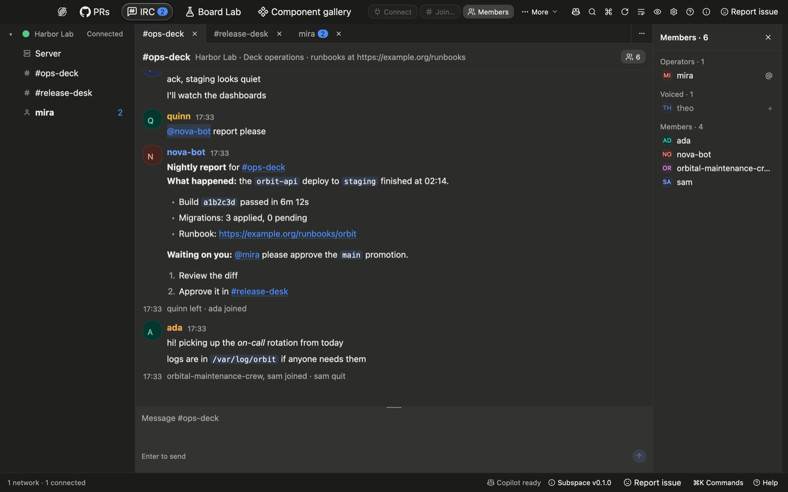
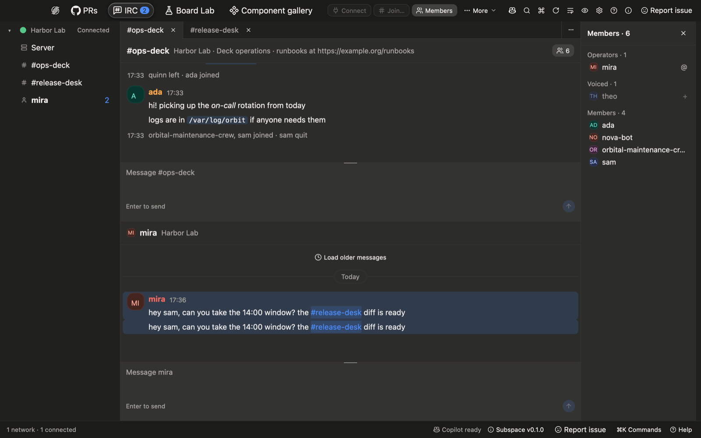
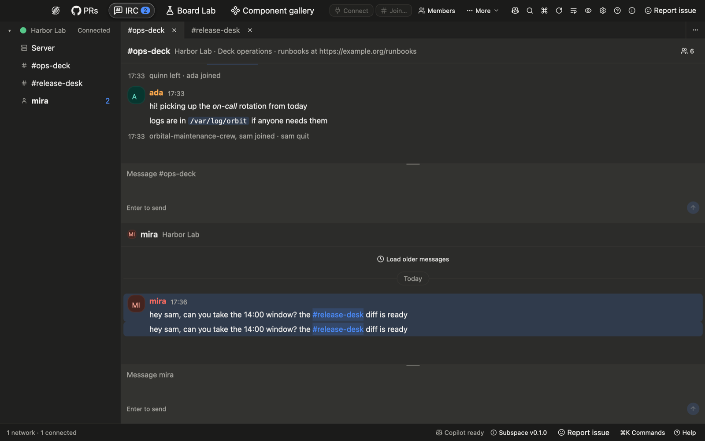

# Delivery: IRC as a dock

## What shipped

- `spaces/irc/src/dock.rs`: `IrcDock` owns the `DockArea`, the side panels,
  the open conversations and member lists, and the focused buffer.
  `with_window` defers dock edits to the board's window, because list and
  conversation events arrive without one.
- `dock/open.rs`: open (tab, right, below), focus, close, member dock
  toggle, placeholder.
- `dock/persist.rs` and `dock/layout.rs`: the layout in buffer terms,
  saved on `DockEvent::LayoutChanged`, pruned and restored.
- `dock/panels.rs`: the buffer list, member list and empty-centre panels.
- `conversation/panel.rs`: `Conversation` as a Kit dock panel, with the
  unread badge on its tab (it redraws its tab group when the count changes).
- `view.rs`: the board renders the dock; rows open panels through
  `ListDashboard::on_activate` and `extend_row_menu`. The server buffer's
  facts moved into its conversation header.
- Shared code: the list and panel hooks added for the previous layout were
  removed; nothing new is shared.

## View boundaries

- `Conversation`: one buffer's header, transcript and composer; Kit `Panel`
  named `irc.conversation`; events `Open(Ref)`, `ToggleMembers`, `Focused`,
  `Closed`.
- `MemberList`: one channel's members; events `OpenQuery`, `Close`.
- `BuffersPanel`, `MembersPanel`, `EmptyPanel`: fixed dock panels.

## Divergence

- A modifier-click to split is not offered: the shared list reports
  activation without the pointer event, so splits come from the row menu.
- No keyboard shortcut closes a conversation; the tab's × closes it.
- Choosing a channel reference that is not in the list joins it; the joined
  channel opens once it appears and is chosen.
- A conversation dragged into a side dock is not stored in the layout.

## Evidence

Cupertino Dark (theme unset), fictional fixture data from the local Ergo
server: `Harbor Lab` with `#ops-deck`, `#release-desk` and a private
conversation with `mira`. Layouts were supplied through `irc.dock-layout`.

## Checks

- `cargo test -p subspace-irc-board`: layout round trip, pruning, first
  active tab, tab names; interaction tests for opening from the list,
  focusing an open buffer, splitting right and below, closing, the member
  dock following focus, saving and restoring, the header divider and the
  member dock toggles.
