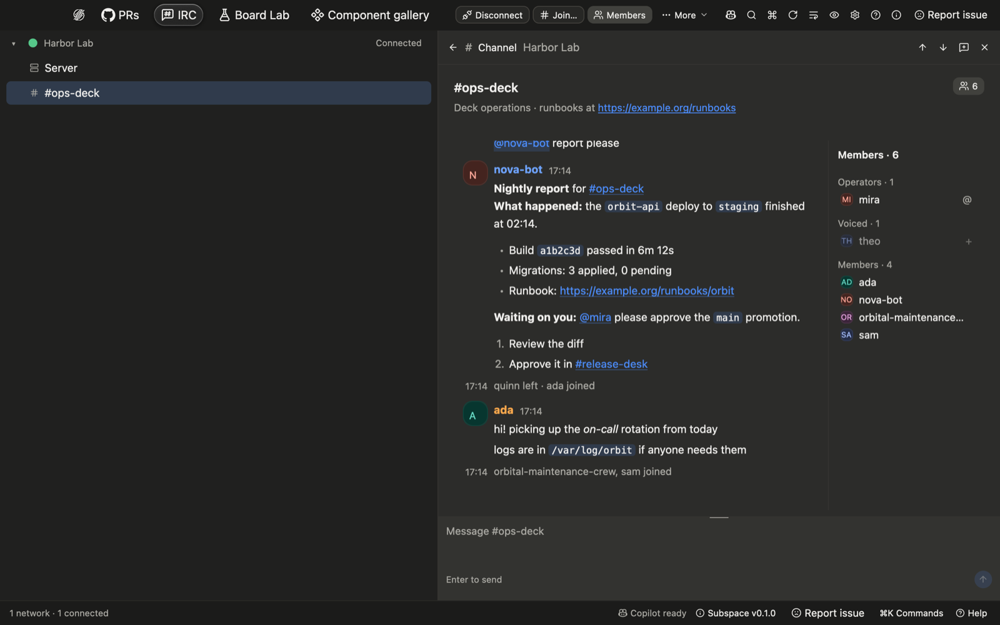
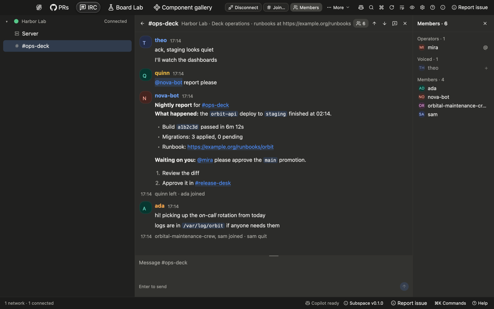
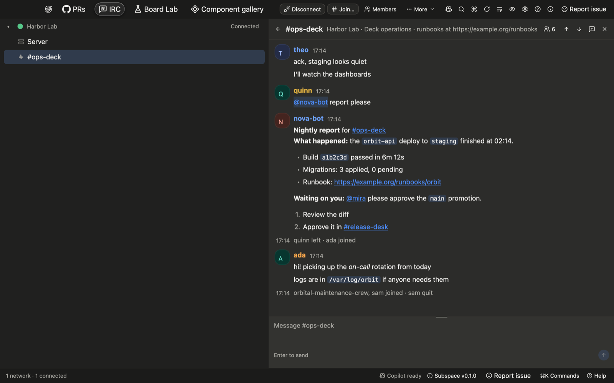

# Delivery: IRC conversation header and member column

Superseded in the same branch by [the IRC dock](../irc-dock/delivery.md):
the header is the conversation's own row with its divider, and the member
list is the right dock. The shared `panel_bar`, `trailing_pane`,
`PanelBar` and `PanelBody::inset` hooks listed below were removed again with
the detail panel host.

## What shipped

- `spaces/irc/src/conversation/header.rs`: one header row (name, muted
  network and topic with a tooltip) and the member count.
- `spaces/irc/src/conversation.rs`: `render_title`, `render_controls`, and
  the standalone view drawing the same row with a divider.
- `spaces/irc/src/members.rs`: full-height column with its own header and
  close button.
- `spaces/irc/src/view.rs`, `view/hosting.rs`, `toolbar.rs`: `panel_bar`,
  `trailing_pane`, the stored `irc.members-shown`.
- Shared: `framework/board-kit/dashboard/src/panel.rs`, `panel/toolbar.rs`,
  `panel/body.rs`, `list.rs`, `list/view.rs`, `list/view/panel_view.rs`.

## Divergence

- The topic in the header is plain text: links in it no longer open from the
  header; the tooltip shows the whole topic.

## Evidence

Cupertino Dark (theme unset), fixture data from the local Ergo server.

## Checks

- `cargo test -p subspace-irc-board`: render tests for the divider and the
  transcript's top edge, the member column's top, one header, and showing
  and hiding the column with its stored choice.
