# Delivery: write Markdown in IRC messages and render it like Slack

## What shipped

- `spaces/irc/src/markup.rs`: `rich(text, members)` decides the
  presentation: `Some(Rendered)` for formatted text without mIRC codes,
  `None` for plain and mIRC text. The old heuristic `is_markdown` and
  `has_emphasis` are gone; detection is the translation's own result.
- `spaces/irc/src/markup/markdown/`:
  - `blocks.rs` sorts lines into paragraphs, list items, quotes, code, fences
    and blanks, with Slack's fences and `>>>`;
  - `spans.rs` reads code spans, safe links and bare URLs as units, and
    writes each link's destination from the URL the link policy approved;
  - `emphasis.rs` pairs Slack's and Markdown's markers at word boundaries;
  - `inline.rs` rewrites a line to safe Markdown and keeps the text as shown;
  - `lines.rs` rewrites each line in its block;
  - `markdown.rs` joins the lines so each keeps its own line and picks a
    fence longer than any backtick run in the code;
  - `parsed.rs` (tests) parses the rewrite with the parser `TextView` uses.
- `spaces/irc/src/transcript/line.rs`: formatted rows use
  `rich::rich_text_prepared`; a row's accessible name is the text as shown.
- Docs: `docs/irc.md` (Formatting messages, design notes), the IRC Help guide
  (Format messages, Transcript, Limits) and `docs/ui-components.md`.

This change no longer touches board-kit: the shared
`rich::rich_text_prepared` it uses came with the issue workspace implementation slice 3a (#7,
`73014cc`), and the branch is rebased onto it.

## Why IRC uses `rich_text_prepared`

`prepare_markdown` reads `<…>` tags anywhere, including inside code spans and
code blocks, and drops a `<script>`, `<style>` or similar element with
everything up to its closing tag, or to the end of the text. In IRC,
`` run `<script>` first `` showed "run `". The board's rewrite already escapes
every `<` outside code and turns `` into text and a link, so its
output has no HTML and no images and does not need that step.
`rich_text_prepared` skips it and keeps the link claim, the link policy and
the data-only image resolver. Like every Markdown path in `rich`, it goes
through slice 3a's `markdown_view` and its parser guard, which shows fenced
or `$$` text the vendored parser rejects as escaped prose. The board's
parser tests require every rewrite to parse, so the guard leaves IRC
messages unchanged.

## Overlap with the issue workspace specification and the issue workspace implementation

This branch first added its own `rich_text_prepared`, matching the issue workspace specification (`docs/changes/nett-issue-workspace/spec.md` §9). The issue workspace implementation slice 3a then
merged the shared version, with `markdown_view`, the parser guard, its
tripwire test and the vendored `markdown` 1.0.0 (`vendor/markdown`, through
`[patch.crates-io]`, so `to_mdast` returns `Err` instead of panicking). On
rebasing, this branch took slice 3a's `rich.rs` whole and dropped its own
copy and its workspace `markdown` entry. The one change to slice 3a's file
is removing its `// qual:api` marker on `rich_text_prepared`. That marker
excused the function as public API with no caller yet; IRC now calls it in
production, so rustqual reported the marker as stale. The IRC board's `markdown`
dev-dependency is slice 3a's and resolves to the vendored copy. Slice 3a's
IRC test, `list_fence_crashes_reproduce_through_the_real_irc_path`, used the
old `is_markdown` and `to_markdown` path through `prepare_markdown`; it is
ported to `markup::rich` as
`list_fence_crashes_do_not_reach_the_parser_through_the_real_irc_path`. The
rewrite writes fences unindented at the left edge, so the parser now accepts
both messages it used to crash on. The board's Markdown is one string
(`Rendered::markdown`), and issue keys such as `TST-1234` pass through the
rewrite unescaped, so a reference plugin that reads text nodes sees them.

## Evidence

Fixture data only: a local Ergo 2.19.1 server on `127.0.0.1:16767` (a
separate port, as another crew's server held `16667`), network `Harbor Lab`,
channel `#ops-deck`, fictional users `mira` (the Subspace user), `theo` and
`nova-bot` (a fixture client posting one message per format, multi-line ones
as one `draft/multiline` batch). Isolated `HOME` and XDG directories, only the
IRC board enabled, Cupertino Dark (theme unset), a 1000 × 720 window.

These were captured on Linux: GPUI's `render_to_image` is not implemented
there, so the debug capture build drove the input (`click:`, `type:`,
`key:`) and `ffmpeg` recorded the Xvfb screen once a second at
`GPUI_X11_SCALE_FACTOR=1.6`, with Ergo started by
`IRC_TEST_LISTEN=127.0.0.1:16767 scripts/irc-test-server.sh`. Fonts are
DejaVu Sans, as the VM has none of GPUI's fallback fonts.

- The four full-window captures and the two composer captures come from
  `feat/subspace-desktop` at `4499261` (the Channels interaction improvements part A, with its composer
  hint and members panel) for before, and from this branch rebased onto it
  (code as at `01999d3`) for after.
- The nine per-format crops show only transcript rows. They come from the
  after build at `07d6312`, before the rebases onto the issue workspace implementation slice 3a and
  the Channels interaction improvements part A. Neither rebase changes how those rows render: slice 3a's
  guard leaves every IRC rewrite unchanged, and the Channels interaction improvements’ hover tint shows
  only under the pointer, which the captures never leave over a row.
- Nothing visible in any capture changed after that:
  - the security-review changes (empty list items, the destination scan
    limit and how destinations are escaped) affect no fixture message's
    text;
  - the later base, `5f40a43`, changes only NETT files.

Before and after, inline formats:

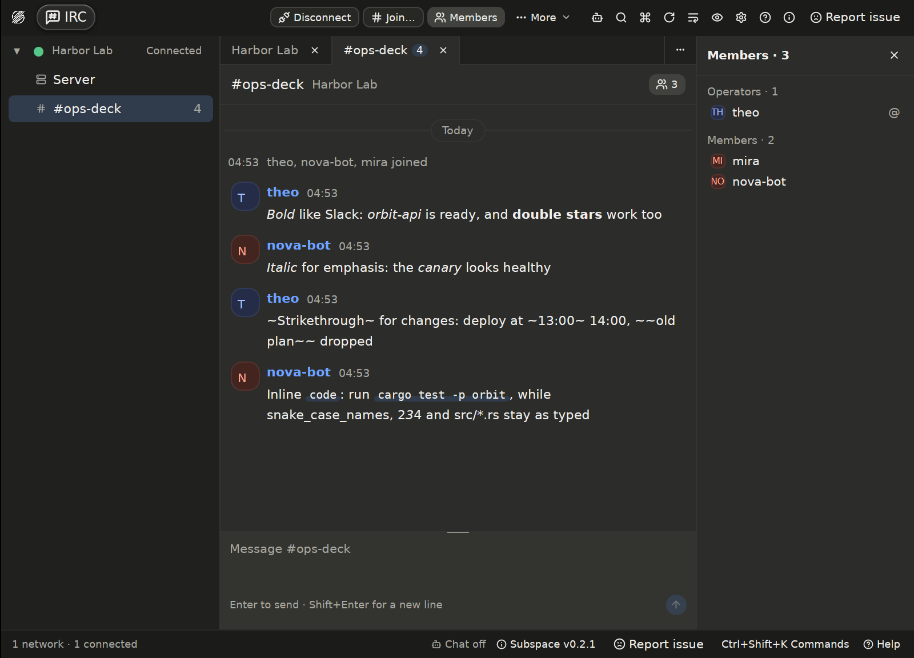

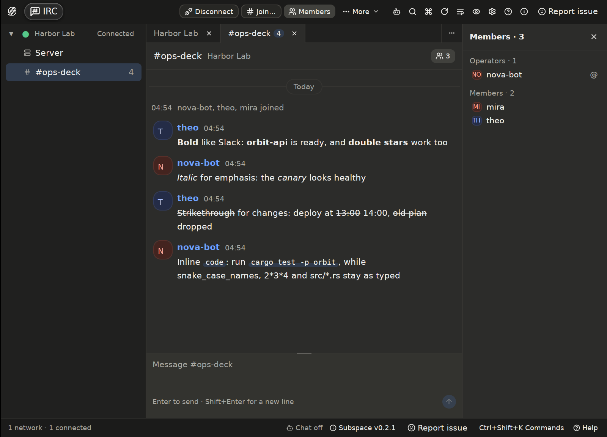

Before and after, block formats:

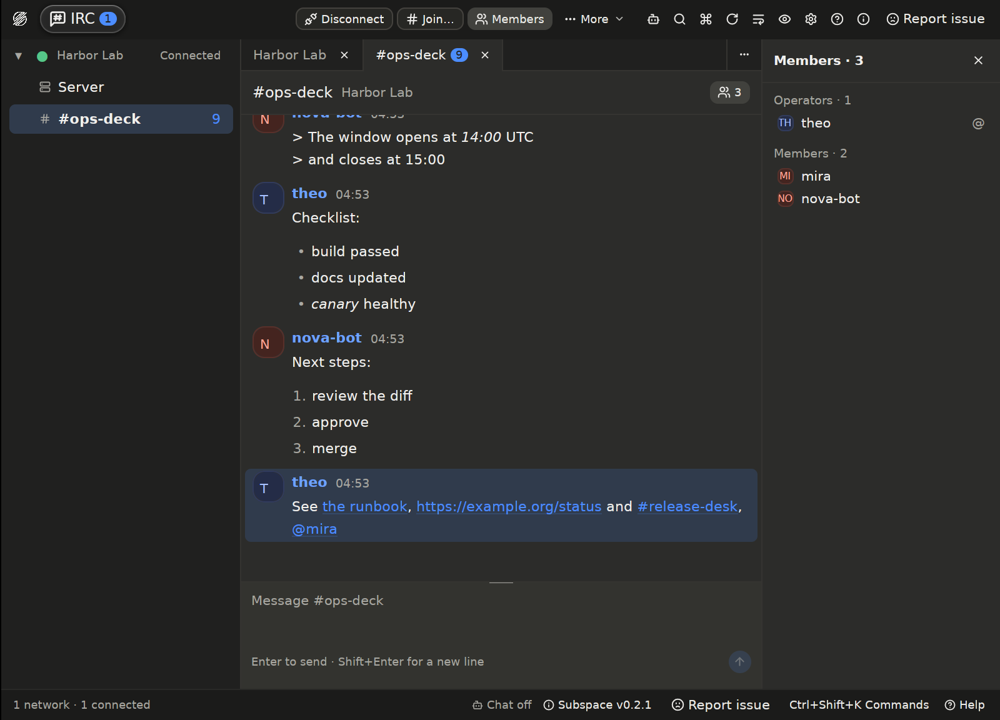

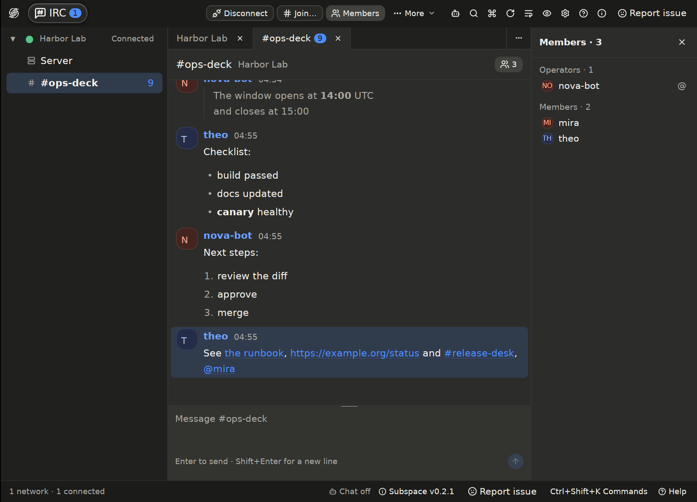

One capture per format (after):

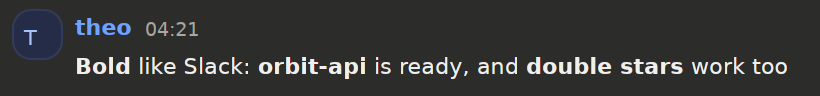

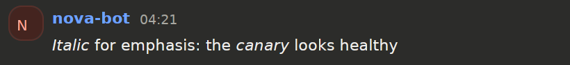

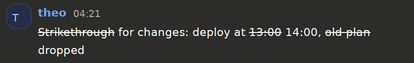

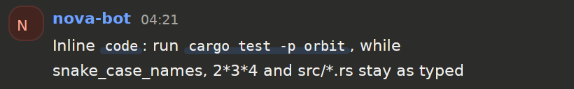

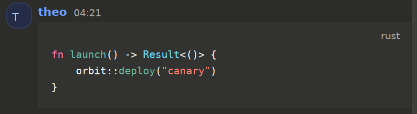

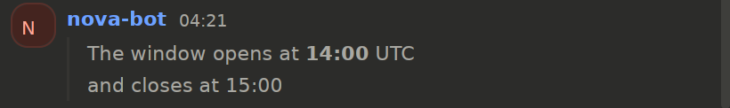

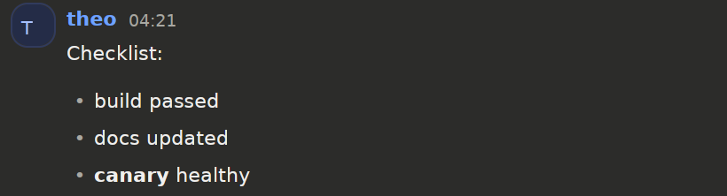

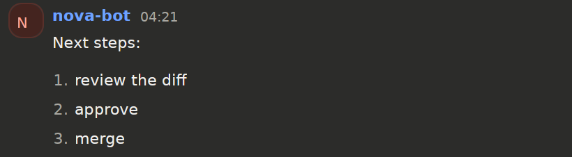

, a bare URL, #release-desk and the @mira mention that highlights the row](evidence/format-links.png)

Writing in the composer and sending:

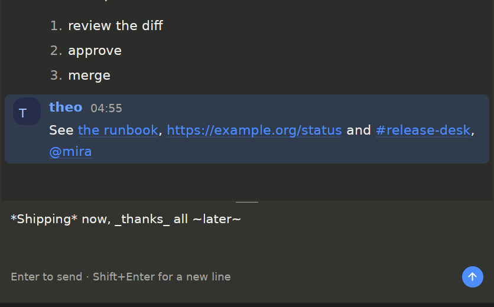

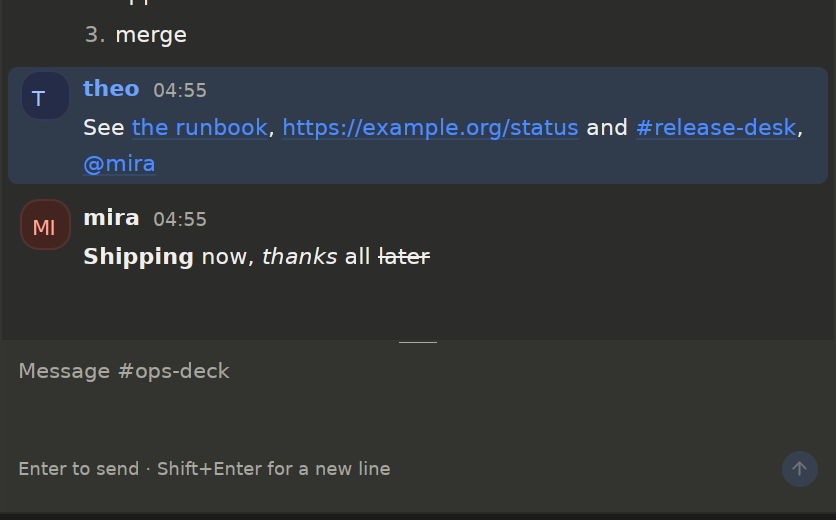

## Checks

- `cargo test -p subspace-irc-board`: 188 passed, on `feat/subspace-desktop`
  at `5f40a43`: this change's translation and markup tests, the parser-tree
  tests in `markup/markdown/parsed.rs`, the ported list-and-fence test and 4
  headless render tests in `tests/formatting.rs`, beside the Channels interaction improvements’ tests.
  `cargo test -p subspace-dashboard` (274 passed) includes slice 3a's
  single-`TextView::markdown(` tripwire.
- `mise exec -- make check`: passed.
- `mise run quality`: passed, 100%, no new findings (`rustqual . --findings`
  lists only the existing chart magic numbers).
- `mise run audit`: advisories ok for all three lockfiles. After the rebase
  this change adds no dependency: `Cargo.toml`, `Cargo.lock` and the IRC
  board's manifest equal slice 3a's.

## Reviews

1. **CodeRabbit CLI** (free allowance; it ran): one minor finding, that
   `` shows as `!` and a link while the Help guide said images
   show as typed. The behaviour is the captain's "images stay links"; the
   Help guide was wrong and now says an image shows as a link.
2. **Read-only reviewer sub-agent** (Sonnet): no P0 or P1. Fixed: a bare URL
   holding `<`/`>` could make HTML (now not a URL, and `<` is `&lt;`);
   `(*.rs) and (*.md)` paired into bold (markers enclosed by punctuation are
   literal); `- ---` became a rule (list text gets the paragraph escapes);
   ```` ```ls ```` hid `ls` (a lone word with no code after it is the code);
   spaces after a list marker and indented lists became code (body trimmed,
   lists dedented); unbalanced parentheses in a destination (the destination
   ends at the balancing `)`). Not changed: a per-row render cache; the
   rewrite is now linear instead (see spec, Known edges).
3. **Codex CLI, `gpt-6.1-sol`**, read-only: fixed its P1, a code line of
   backticks closing the generated fence so a forged reference link rendered
   (fences are now longer than any backtick run in the code); quadratic
   scans of long words; a code span's shown text losing significant spaces.
   Its other findings were the ones above, already fixed. It asked for
   parser-tree coverage, which `parsed.rs` adds.
4. **Final Opus review** (exactly one, last): fixed its P0, a panic when a
   list mixes ASCII and NBSP or U+3000 indentation (indentation is now spaces
   and tabs only); both P1s, link destinations and bare URLs whose escapes,
   nesting or control characters the parser reads differently, which let a
   forged `subspace-irc:` link or HTML through (the board now writes the URL
   `safe_url` approved, percent-encoded, never the typed text); and its P3s:
   a lone `\r`, a quadratic word scan, list numbers over nine digits. It
   asked for a test that parses the output with the real parser, which
   `parsed.rs` now does. That test found one more bypass, GFM autolink
   literals swallowing a code span's backtick, fixed by escaping `:`, `@`
   and the `.` of `www.`. As the gate allows one Opus review, these last
   fixes were not reviewed again; the parser-tree test covers them.
5. **Captain's independent security review** (read-only Opus) of the
   post-review code. It built the translator unedited into a harness with the
   `markdown` crate and `TextView`'s options and ran about 2.5 million
   inputs. It found no P0: no panic, and no HTML, image, definition,
   footnote, table, rule, math or forged reference link. Dispositions:
   - **P1:** an empty nested bullet (`- shout\n  - `, also with a tab,
     three to five spaces, a non-breaking space, `•` or under `1. `) made the
     item above a level-2 heading, through its dash read as a setext
     underline. A list marker with no text after it is now a paragraph line
     shown as typed (`blocks.rs`). Parser-tree tests cover these cases, and
     a generated template covers every short nested body.
   - **P2:** a 64 KiB line of `[a](` took 2.5 s (28 s in a debug test
     build), because each `[` scanned to the end of the line. The
     destination scan now stops at 32 nested parentheses, the parser's own
     limit. It now takes about 0.2 s in a debug build; tests check the limit
     and time the long line.
   - **P2:** `destination()` wrote `(` and `)` as `%28` and `%29`, so a link
     opened `Orbit_%28ship%29`. Brackets, backslashes and `&` are now written
     with a backslash, which the parser decodes, so the link opens exactly the
     approved URL. A parser test compares the opened URL with `safe_url`'s.
   - **P2, not changed:** link text that looks like a channel or another URL
     (`[#ops-deck](https://evil.example)`). The spec allows any link text, and
     the captain is raising it with the Admirals.

## Not checked on Linux

jt checks these from the next macOS build:

- the look on macOS with the system font at 2x;
- `Shift+Return` (the Channels interaction improvements, now merged) for the lines of a code block, quote
  or list in the composer;
- link clicks opening the browser (the policy is unit-tested; the click was
  not exercised in the captures);
- the debug capture build's own `shot:` step, which needs macOS.
