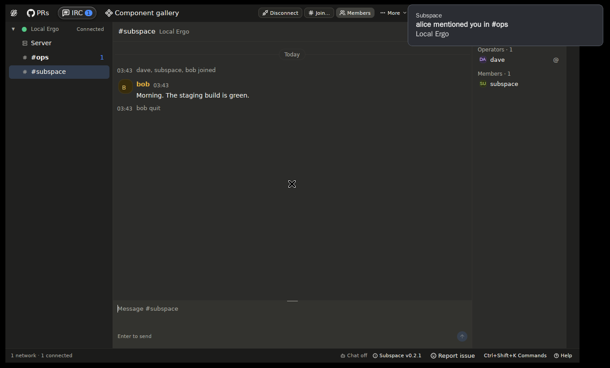
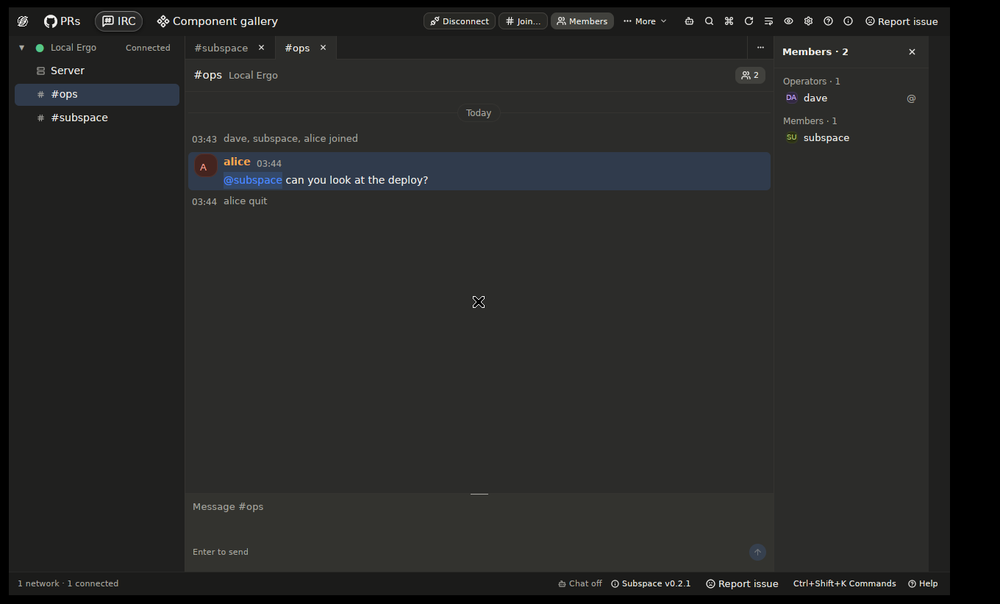
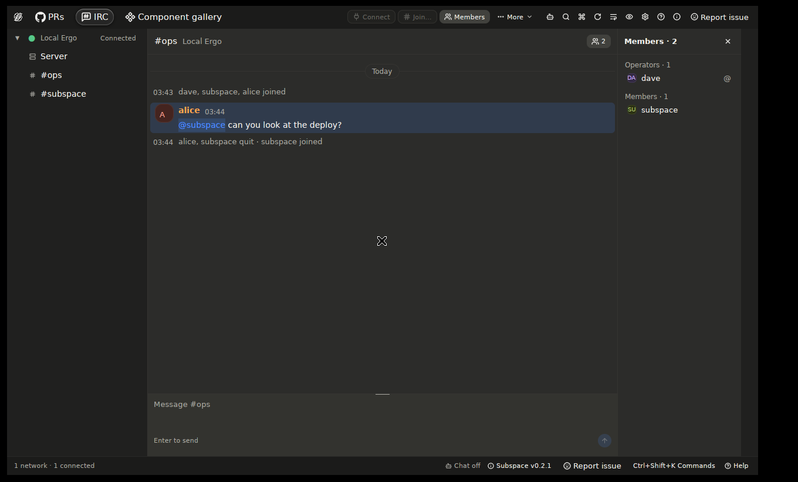
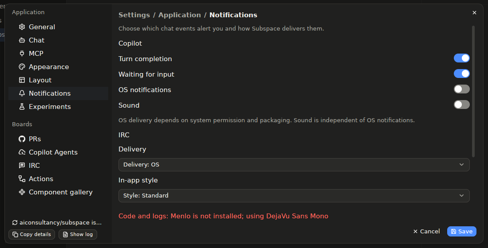

# Delivery: IRC mention notifications

## Linux evidence

These images come from a debug build of this branch on Linux, under Xvfb
with the evilwm window manager and the dunst notification daemon. The run
used an isolated `HOME` and the default Cupertino Dark theme. It connected
to the local Ergo server from `scripts/irc-test-server.sh` on
`127.0.0.1:16667`, with fictional people (alice, bob and dave). dunst draws
the notification; GPUI posts it over the XDG notifications D-Bus interface.
Linux has no sound choices, so it was silent.

dunst counted one notification after the tag, and none shown after the
reconnect, with only the original in its history.

**Settings > Notifications**, before (a build of `feat/subspace-desktop` at
`e8757cf`) and after, with no saved notification choice. The red font
notice comes from the capture machine, which lacks Menlo.

macOS was not run here. jt checks the macOS notification, its sound and the
click from the next build.

## Tests

- `subspace-irc-board`, decision (`state::tests::attention`):
  - A tag notifies with its sender; an untagged line does not.
  - A private message notifies without a tag.
  - Our own lines never notify, even when they name us.
  - History never notifies, including tags, event playback and private
    messages.
  - A bouncer's replayed line counts for the badges but never notifies.
  - A line at or before the read marker does not notify; a newer one does.
  - A line already held (same `msgid`) does not notify again.
  - A **Server** buffer notice that names us does not notify, and the
    badge agrees.
- `subspace-irc-board`, text (`notice::tests`): a mention names the sender,
  the channel and the network; a private message names the other person.
- `subspace-irc-board`, real board and hub (`tests::notifications`), with
  IRC's declared defaults installed as the shell does:
  - A tag in another channel notifies by default with who and where; an
    untagged line does not.
  - The conversation in view with the app in front stays quiet, also for our
    own echo; a private message elsewhere still notifies.
  - A conversation shown beside the focused one in a split stays quiet; a
    tab behind another in its group notifies; once the split is closed,
    without moving focus, it notifies again. Removing the republish on
    dock layout changes makes the last step fail.
  - With the window in the background, the conversation in view notifies.
    Choosing each notification focuses its conversation, and once the window
    is active again the conversation reads.
- `subspace-client-irc`:
  - `an_at_tag_of_our_current_nick_is_a_mention`: `@nick` mentions us, our
    own line does not, and after a nick change only the new nick does.
  - `replayed_tags_and_event_playback_stay_history`: unrequested
    `chathistory` batches with a tag, a `PART` and a private message arrive
    as `Event::History` only.
  - `znc_playback_lines_arrive_marked_as_replayed`: a `znc.in/playback`
    batch's tag arrives as `Event::Replayed`, still a mention, and the next
    live line as `Event::Line`.
- `subspace-irc-board`, layout (`dock::layout::tests`):
  `shown_is_the_displayed_tab_of_every_group`.
- `subspace-dashboard` (`notifications`):
  - A board's declared defaults apply until a choice is saved, and a saved
    Off wins.
  - An unmarked Off, Standard and Silent, as Settings in 0.2.1 and earlier
    stored on any Save, reads as no choice; any other unmarked choice is
    kept.
  - Only `Notice::described` carries text to the OS.
- `subspace-shell`:
  - `app::notification_tests::described_notices_post_who_and_where_and_a_click_opens_the_board`
    checks the declared default, the described OS text, the generic text
    for a plain notice, and that the OS response routes to the board's
    target.
  - `settings::notification_tests::an_unrelated_save_leaves_a_board_on_its_declared_defaults`:
    Settings shows the declared default, a Save that leaves the board alone
    stores no choice for it, and a chosen Off holds.
